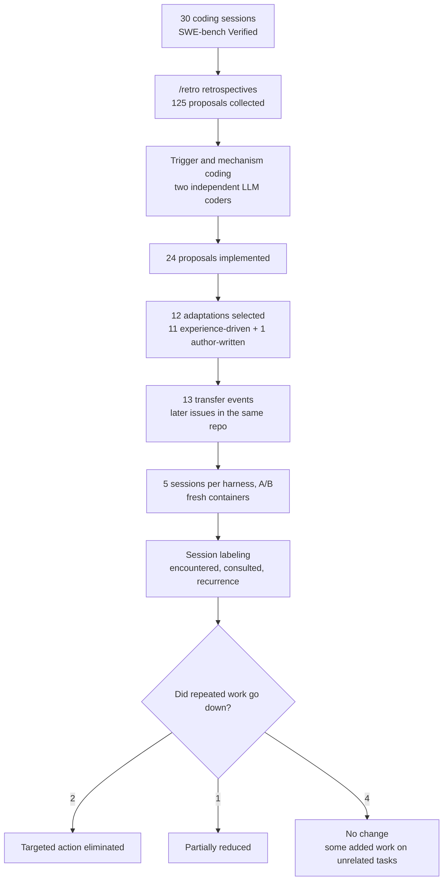

## Why this is worth reading

If you run coding agents in production and have to decide whether to keep or delete the harness changes the agent proposed on its own, this post is for you. The decision is small, but the follow-up cost is large. A note that does not work stays on the wall for months, and the next agent follows it anyway. The paper's core conclusion is one sentence: implementing a proposal is not evidence that it reduced repeated work. Of the seven informative transfer evaluations, only two adaptations eliminated the targeted action completely.

## In plain terms

After a project meeting, someone writes a note and sticks it on the office wall. "From now on, run tests with bin/test." That is close to what the /retro skill does for a coding agent. When a session ends, the agent looks back over where it got stuck and proposes harness changes. Making the note and putting it on the wall, generating the proposal and implementing it, is the easy part.

The paper asks whether the note on the wall actually works for the next shift. The researchers had the next agent do the same kind of work twice. Five sessions without the note, five sessions with it. Then they counted how often each side hit the same snag. The answer, up front: notes that matched the next shift's actual work reduced the snags. Notes that did not match did nothing, and one note made the work longer.

## Overview

Harness self-evolution is one of the hottest topics in agent engineering right now. The idea is that an agent carries what it learned in finished sessions into the harness itself. Context files, hooks, configuration. If the agent improves the more it is used, without retraining the model, the cost of an operator reviewing every session drops sharply.

There was little direct evidence for whether it actually works. Most discussion stops at whether proposals are generated well, or whether files are patched well. Whether a later session's behavior changed is a separate question. The paper by Treude and Baltes is the first empirical study to measure that second part. It is arXiv 2610.34938, submitted on October 26, 2026.

The subject is the /retro skill from Matt Pocock's skills repository. After a session ends, it reviews the session and produces a numbered list of harness-change proposals that require human approval. The study ran it with Claude Code 2.1.295 and Opus 5.5 over 30 SWE-bench Verified issues.

The week after submission, Matt Pocock himself shared the paper with the words "This might be the greatest issue report in history." The post passed 170,000 views. In the agent ecosystem, the self-improving agent is becoming a measurement target, not marketing language.

> 📄 **Full deep review (DOCX)**: [Download the detailed peer review on Google Drive](https://drive.google.com/file/d/1Hkv5hCPpT7DFDkRiiNHnDFIZ_YztQiMg/view).

## The /retro skill

The purpose of /retro is retrospection. After the agent finishes a task, it re-reads the session trace and writes a numbered list of harness-change proposals. The targets are context files such as CLAUDE.md, hooks, and lint or CI configuration. The important design point is that every proposal goes through human approval. The agent only proposes; a person decides whether it gets implemented.

The paper uses the skill source at commit b0618bc. The skill instructions contain one notable rule. A repository with neither a pre-commit hook nor a CI job running checks counts as "a finding." That rule shapes the character of the proposals, and it comes back in the results.

## Study design

The study has two stages. First, collect proposals from 30 sessions. Second, transfer the implemented adaptations to later issues and evaluate them.

The first stage's 30 sessions came from two samples. The exploratory sample of 10 issues, two each from Django, SymPy, Matplotlib, Astropy, and Sphinx, was drawn at random from the benchmark's "15 min to 1 hour" developer-effort category. The second sample of 20 issues from Astropy, pytest, Sphinx, and SymPy was not random. The researchers deliberately picked repositories where earlier sessions had hit environment problems. They wanted pre-existing test failures and missing lint tools to reproduce in practice.

Each issue ran in a fresh Docker container, in a fresh session. The prompt contained only the issue description, with no extra hints. After the session finished, /retro was invoked in the same session, and its output was saved unchanged, whether or not the patch passed the hidden benchmark tests.

That produced 125 proposals, two to six per session. Each proposal was coded independently by two LLM coders using a fixed codebook. One saw the full trace (claude-fable-5-1), the other saw excerpts (gpt-6.1-sol, high reasoning effort). Agreement was κ=0.67 on trigger codes and κ=0.84 on mechanism codes. The first author resolved the 91 disagreements.

A proposal was eligible for implementation and evaluation if it was experience-driven, proposed a persistent harness change in permitted files and settings, was safe to apply, and admitted a written criterion for identifying repeated work in later sessions. Thirty-three proposals qualified, and 24 of them were implemented in the original sessions' containers. Eleven implementations produced adaptations that could be evaluated on another issue. The researchers also added one pre-commit configuration they wrote themselves, after Claude Code's permission system blocked its implementation, for 12 evaluated adaptations in total.

The transfer event is the unit of evaluation. For each adaptation, the team picked another issue from the same repository and first verified, in a fresh container, that its environment reproduced the targeted problem. Then they ran five sessions under the original harness and five under the adapted harness. Three adaptations were also run on unrelated control tasks, to check whether they add work. The 120 session traces were labeled by two LLM labelers and the first author, with recurrence agreement at κ=0.98.

## What the 125 proposals looked like (RQ1)

By mechanism, executable checks were the most common, 38 of 125. Then navigation pointers, 24. Instructions, 21. Information access, 20. Tool or configuration, 12. And ten were no harness change at all (none). The most typical executable check is a pre-commit hook running flake8 on staged files.

By trigger, 101 proposals were experience-driven, based on events actually seen in the session trace. Nineteen were prior-driven, justified without relying on a session event. Five had a weak connection. But 18 of the 19 prior-driven proposals were lint-related. The cause is the skill rule described above. Because a repository without lint automation counts as a finding, the skill recommends lint even when the session never hit a lint problem. Lint-related proposals appeared in 29 of the 30 sessions, 43 in total. Twenty-three were experience-driven, 18 prior-driven, and 2 weak.

So /retro's output is not only a translation of session experience. It also carries the skill's own opinions. Most of the executable checks it produced did not work in the task environment. Only 9 of the 38 could report failure as written. The other 28 needed missing tools, or were commit hooks that could never fire because the task sessions made no commits.

The recurring pattern of environment problems stood out. Failed shell commands, repeated shell commands, or more than one test runner appeared in 5 of the 10 exploratory sessions and 19 of the 20 second-sample sessions. Almost always because of pre-existing test failures from incompatible docutils or Python versions, outdated leap-second data, or missing lint tools. Claude Code proposed known-failures files in 15 of the 30 sessions. A list of tests that already fail, so that later sessions do not have to re-run the baseline comparison every time.

## Did repeated work actually go down (RQ2)

Seven of the 13 transfer events were informative. Informative means at least three of the five original-harness sessions actually encountered the targeted problem. In the other five events, the environment had the problem, but almost no session hit it. In four events, zero original sessions encountered it, and in the fifth, one of five did.

Two adaptations eliminated the targeted action completely. The first is a one-line CLAUDE.md entry in SymPy. pytest was not installed, yet all five original sessions tried it first. In the adapted sessions, zero of five did. The wall note blocked exactly the spot where the next shift's first step got stuck. The second is a known-failures file in Astropy. It lists three failing tests, including the leap-second data problem. All ten sessions encountered at least one of those failures, and the adapted sessions read the file instead of running baseline comparisons. Recurrence dropped from 3 of 5 to 0 of 5.

In four events, recurrence did not decrease. The common cause is that the adaptation did not cover the instances the later sessions actually met. The two Sphinx files each listed two failing tests, and the later sessions hit failures in other tests. The SymPy file covered two packages, but the session tested a different package. The pytest file listed three failures in one test file, but the later sessions met failures in other files. The note was not wrong. The next shift's work was different.

One adaptation partially reduced recurrence. A cache-repair plugin plus a comparison script in Astropy brought recurrence from 5 of 5 down to 2 of 5. But no session encountered the leap-second failure the adaptation targeted, and the sessions hit NumPy failures that were not in the script's stored list, which it treated as new.

The control tasks produced the reverse evidence. One Sphinx known-failures file instructed the agent to treat any failure absent from the list as caused by its own edits. On an unrelated control issue, 4 of the 5 adapted sessions ran baseline comparisons, against 0 of 5 under the original harness. The incomplete list made the next agent verify more, not less. That is what it looks like when following the note adds work.

Time and success did not improve consistently. Task success differed by at most one session between harnesses in every event, with no consistent improvement. The SymPy CLAUDE.md adaptation raised median elapsed time from 88 seconds to 156. On top of the pytest block, it carried a second line telling the agent to run the CI lint checks before finishing, and every adapted session ran them. Even when recurrence drops, a note that adds instructions can make sessions longer.

## Limitations and counterarguments

The authors state their own limitations. First, the transfer issues were selected on purpose to reproduce the targeted problem. So the study measures how often an adaptation works where the problem occurs, not how often it helps on arbitrary later issues. Reading 2 of 7 as a general success rate overestimates it.

Second, the sample is small. Five sessions per harness, seven informative events. The table's counts describe these cases, and do not establish that covering the encountered problem is the sole cause of the differences. The 12 adaptations differ in several properties at once, and were grouped after labeling.

Third, the adaptations were implemented by the same Claude Code sessions, in the same containers, that generated the proposals. The changed files could include information absent from the proposal text. And the labelers could see, in the traces, sessions reading the transferred files, so labeling was not fully blind.

The scope is one agent, one skill version, and environment problems only. Code navigation and coding-convention adaptations were not evaluated, and bundled adaptations were not decomposed component by component.

## Implications for ThakiCloud products

This paper lands squarely on Paxis's self-evolution loop. Paxis is the Agent-Native Cloud that treats Skills, Tools, Policies, and Audit Logs as first-class resources. The structure that reviews completed sessions, proposes skill and harness changes, and feeds approved changes into later sessions has the same shape as /retro. What the paper shows is that the shape works only halfway when you build half of it. Generation and implementation are proven. Verification and retirement are not.

The paper's evaluation recipe translates into three questions. Did the targeted problem actually occur in later sessions. Did the agent consult the change. Did its behavior change. Paxis's skill promotion gate can run an A/B transfer evaluation that answers all three. Run the same kind of tasks in fresh sessions, five or more with the new skill and five without, and promote only if recurrence goes down.

Control tasks cannot be skipped. Some notes added work on unrelated tasks. Measure one or two unrelated issues before promotion, and do not promote if verification time rises.

Feasibility checking at proposal time is another lesson. 29 of the 38 executable checks could never fire because tools were missing or no commits were made. When the skill evolution loop proposes a check, a static step should verify that the check can actually run in the current environment.

The three action items extracted from this paper are recorded in the review ledger (applied=queued) and waiting for human review. Add an A/B transfer evaluation stage to the skill evolution loop's change proposals. Add one or two unrelated-task controls. Add the static feasibility check at proposal time.

The same lesson applies to customer environments on Metis. A known-failures file, or a CLAUDE.md line that assumes a specific environment, is a note that goes stale. The environment changes and the note does not, and the next agent follows the old note. Retained changes need continuous evaluation, not a one-time review.

## Summary

Returning to the wall-note analogy, this is the first study to measure whether the notes an agent writes for itself actually work. The answer is not simple. The two notes that matched the next shift's real work eliminated the targeted action. The four that did not match did nothing. And one added work to an unrelated task. All 125 proposals looked reasonable, and the implementations went smoothly. Behavior changed in only a minority.

If you are building a self-evolving agent, the next step is not generating more proposals. It is building the verification stage. Before leaving a change on the wall, answer three questions. Did the targeted problem occur, did the agent consult the change, and did its behavior change. A note without answers to those three should not go on the wall. And notes already up need periodic re-evaluation, because outdated or incomplete notes can stay ineffective, or add work. Harness self-evolution starts not when the proposals appear, but when that verification loop closes.

## Sources

- [arXiv 2610.34938, How Do Coding-Agent Harnesses Self-Evolve? An Empirical Study of Retrospective Adaptation](https://arxiv.org/abs/2610.34938) (PDF: <https://arxiv.org/pdf/2610.34938>)
- [Study artifact (Zenodo)](https://zenodo.org/records/23653700): prompts, codebook, session traces, labels, and all harness changes
- [/retro skill source (github.com/mattpocock/skills)](https://github.com/mattpocock/skills)
- [Matt Pocock's post](https://x.com/mattpocockuk/status/2117588845864575397): "This might be the greatest issue report in history"

> 📄 **Full deep review (DOCX)**: [Download the detailed peer review on Google Drive](https://drive.google.com/file/d/1Hkv5hCPpT7DFDkRiiNHnDFIZ_YztQiMg/view).
