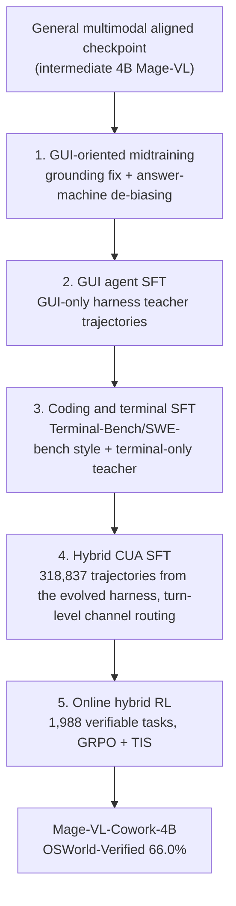
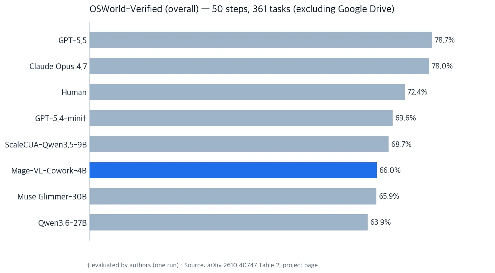

*Abstracting the design where one policy uses both channels: clicking and typing.*

> 📄 **Full deep review (DOCX)**: [Download the detailed peer review on Google Drive](https://drive.google.com/file/d/1d8Y4QKEFHl9DHmWRhub30Wc6ngn5_TVf/view).

## Why This Matters

If you are an agent-platform engineer running multi-agent sandboxes, or an infra planner working on on-prem/sovereign AI, read this paper before you draw the next CUA (computer-use agent) roadmap.

The conclusion up front: Microsoft released the full training recipe for a 4B open-weight model. It routes screen clicks (GUI channel) and terminal typing (code channel) inside a single policy, under Apache-2.0. It scores 66.0% on OSWorld-Verified (50-step budget) - the best in the 4B class - and its demonstration data costs $0.16 per task to generate. The on-device CUA baseline moved, with numbers.

## In Plain Terms

Imagine one worker who uses both hands. Until now, computer agents came as two specialists: one who holds the mouse and watches the screen, and one who writes code and types into a terminal. When a task arrives, a manager (an external orchestrator) decides which specialist handles it.

Mage-VL-Cowork removes that structure. A single worker decides mid-task: "this I click," "this one is faster as code." With the manager calls gone, the model calls and tokens per task go down with them.

Let me use the analogy to the end. The senior (the teacher model) that trains this worker does not fix the teaching material first - it fixes its own work tools. Better tools produce better demonstrations. So the senior improves its screen, its tool buttons, its instructions, and its workbench (the terminal environment), and only then has the worker imitate the demonstrations the senior produced. A small change in the senior's tools makes a large difference in the worker's skill. Everything in this paper - the five-stage curriculum, the evolved teacher harnesses, the 6,915-skill taxonomy - is the recipe that produces this one worker.

## Overview

The Microsoft Mage team published the paper on arXiv on October 29, 2026. The model is released on Hugging Face (microsoft/Mage-VL-Cowork) under Apache-2.0 open weights: 4B parameters, 9.48GB in bf16 (two shards). The code lives in the GitHub microsoft/Mage repository.

The backbone: Mage-VL-Cowork sits on Mage-VL, a codec-native streaming multimodal foundation model. The visual encoder, Mage-ViT, is trained from scratch (16x16 patch grid, spatial_merge_size=2, 3D RoPE), and the language model is Qwen3-4B-Instruct-2507. Training a fresh visual stack at 4B is what separates this from bolting on an existing vision encoder.

A demo shipped with the release. Hugging Face ML engineer Niels Rogge built one. You give it a task: "go to Wikipedia and find out when the Eiffel Tower was completed." The model clicks, types, scrolls, and opens a terminal on a real Linux desktop. Everything runs inside Hugging Face: the model in a Space, the desktop in an HF Sandbox. No VMs to manage, in the tweet's words. A 4B-scale CUA reaching a usable demo the moment it ships is the feel of this release.

## What Is Hybrid Computer Use

A traditional CUA takes a screenshot and outputs click/drag coordinates. In the paper's framing, the screenshot-only GUI channel is "a modeling choice rather than a property of the domain." And an expensive one: a typical screenshot costs thousands of tokens, and a screen-watching agent pays that thousands-of-tokens bill at every step. The terminal channel compresses the same state into a line of output. The payoff of channel routing comes exactly from this token gap. The 25.4% output-token reduction after RL (below) is that design converted into an inference-cost number.

Hybrid computer use means one policy holds both channels: the GUI channel (visual observation plus coordinate control), and the terminal channel. The terminal is a persistent shell environment: the policy runs code, invokes command-line utilities, and calls application libraries directly. The core design decision: channel routing is learned inside the policy, at turn level, with no external orchestrator. The project page's phrasing, verbatim: "One 4B policy that knows when to click-and when to code."

In the training data, GUI tool calls versus terminal tool calls run 68.19% to 31.81%. The policy is trained on data where the channel is allocated per task, not data skewed to one side.

## The Five-Stage Training Recipe

The curriculum has five stages and starts from a general multimodally aligned checkpoint. This is not distilling a frontier model; it is building channel capability stage by stage. Midtraining and SFT run two epochs, packed to 32,768 tokens.

*The five-stage curriculum. One channel at a time, then the single policy that uses both, and final RL polishing with verifiable rewards.*

Stage by stage:

Stage 1, GUI-oriented midtraining, fixes the answer-machine bias: answering the question without acting. It trains on grounding corpora (UGround, UI-E2I-Synth, OS-Atlas, MolmoWeb, JEDI, SeeClick) filtered to 720p to 1080p, with coordinates normalized to [0,999] in `computer_use` click calls.

Stage 2, GUI agent SFT, learns multi-step GUI execution from trajectories of a GUI-only-harness teacher. The logic: to make the worker *choose* between two channels later, it must first be capable in both.

Stage 3, coding and terminal SFT, adds Terminal-Bench-style and SWE-bench-style data plus trajectories from a terminal-only teacher harness run on the same desktop tasks.

Stage 4, hybrid CUA SFT, learns turn-level channel routing from the 318,837 trajectories produced by the evolved hybrid harness.

Stage 5, online hybrid RL, trains on the 1,988 tasks released by ScaleCUA, each paired with a verifiable reward. Frontier sampling, GRPO optimization, asynchronous rollouts, and TIS (truncated importance sampling) to control policy lag (lag capped at 3 updates, TIS weight cap 2.0). Each rollout uses the same 50-step budget as the OSWorld-Verified evaluation.

### The teacher's tools evolve too (evolved harnesses)

The most unusual part of the recipe. The teacher (the demonstration-generating model) does not work in a fixed environment. An authoring agent revises the harness the teacher works with: scaffold (F), tool interfaces (T), prompt (P), and terminal execution environment (E, a Docker sandbox).

The revision criteria are four, judged on a shared dev set: rubric-based task success, per-task token cost, execution feedback, and application-level channel statistics. Per the paper, evolution is as much pruning as growth: it removes xdotool and adds domain libraries like python-pptx. The harness transitions run alpha to beta (add the terminal channel), to gamma (scaffold), to delta (teacher model switch), and to epsilon (prompt refinement). Once selected, the harness stays essentially fixed across subsequent data-generation rounds.

The teacher stack is not prompt-only. Demonstrations come from GPT-5.4 (the official GPT-5.4 OSWorld agent), step-level reasoning annotations from GPT-5.4-mini, and the rubric judge plus the task-generation cost baseline both run on gpt-5.6-terra.

### The data generation engine (Mage-CUA-Forge)

The 293,806 desktop and web tasks are synthesized over a taxonomy of 6,915 atomic skills. The taxonomy is agent-constructed and refined over three rounds using student feedback. Single-app tasks are 61.76%, multi-app 38.24%. After teacher execution, rubric-based LLM judging, and quality filtering, 318,837 trajectories survive.

Cost efficiency is the headline result of the engine. Per-task generation cost drops from $0.91 (1,276K tokens) under an agent-first approach to $0.16 (85K tokens) with Mage-CUA-Forge: 82.6% less (tokens -93.3%). The paper's exact per-task figures are in the table below. Caveat from the paper: one-time workflow authoring and debugging are excluded from the per-task comparison.

| Per-task generation | Cost | Tokens |
|---|---|---|
| agent-first | $0.906 | 1,276K |
| Mage-CUA-Forge | $0.158 | 85K |

## Results

OSWorld-Verified stands at 66.0% (50-step budget): the two-run average (run 1: 65.33%, run 2: 66.75%) over 361 held-out tasks, excluding Google Drive. The comparison rows from Table 2 of the paper:

| Model | OSWorld-Verified (overall) | Note |
|---|---|---|
| GPT-5.5 | 78.7 | frontier API |
| Claude Opus 4.7 | 78.0 | frontier API |
| Human | 72.4 | |
| GPT-5.4-mini (dagger) | 69.6 | authors' own one-run eval |
| ScaleCUA-Qwen3.5-9B | 68.7 | 50 steps |
| **Mage-VL-Cowork-4B** | **66.0** | 50 steps, best 4B class |
| Muse Glimmer-30B | 65.9 | |
| Qwen3.6-27B | 63.9 | |
| Fara1.5-4B | 13.9 | same 4B control |

*Comparison rows from arXiv 2610.40747 Table 2. Mage-VL-Cowork-4B (66.0%) is highlighted. (dagger) marks the authors' own one-run evaluation.*

The stage-by-stage progression is even. GUI SFT 45.56% to hybrid SFT 55.84% (+10.28pp) to RL 66.0% (+10.16pp). SFT building and RL polishing contribute about the same.

The compute split is also reported (Appendix B); per-stage FLOPs are in the table below. The share: midtraining 15.2%, SFT 51.2%, RL 33.6%.

| Stage | FLOP |
|---|---|
| midtraining | 1.182e21 |
| SFT | 3.988e21 |
| RL | 2.618e21 |
| Total | 7.787e21 | Half of the performance comes from SFT, a third from RL.

The stage-1 grounding effect: OSWorld-G 30.6% to 56.9% (against Qwen3.5-4B's 54.5%), ScreenSpot-v2 78.8% to 87.2% (against Qwen3-VL-4B's 85.3%).

RL does not only lift accuracy. Mean model calls go 25.36 (GUI SFT) to 21.57 (hybrid SFT) to 18.77 (RL), and output tokens drop about 25.4% (5,499 per task). The +10.16pp and the efficiency gain arrive in the same stage.

By category: Operating system 87.5%, Office 64.9%, Daily 65.0%, Professional 66.3%, Multi-application workflow 62.7%. Single-app OS tasks are clearly stronger than multi-app workflows.

WebVoyager-Static (a self-built offline replica, 643 tasks) scores 58.6% (377/643), but that is the SFT checkpoint, not the post-RL model.

The harness ablation (Table 5, 672 held-out multi-app tasks) backs the paper's design thesis. Teacher beta-1 (GUI+code) 92.0% versus teacher beta-2 (GUI+code+AX) 89.6%: a 2.4pp gap. But the student distilled from beta-1 scores 37.6%, and the student from beta-2 scores 25.1%: the gap widens to 12.5pp. Differences in the teacher's harness amplify through distillation.

## The SOTA Claim, and Its Scope

The tweet's "new SOTA for on-device computer use" is wider than the paper's "state-of-the-art performance at its parameter size." Precisely: SOTA within the 4B parameter class. It clears the same-size control Fara1.5-4B (13.9%) by a wide margin, and is effectively tied with 30B Muse Glimmer (65.9%). It trails the frontier APIs (GPT-5.5 78.7%, Claude Opus 4.7 78.0%) by 12 to 13 points. Humans (72.4%) are still above it.

For reference, the paper itself evaluates GPT-5.4-mini once on the same 361 tasks: 69.6% (50 steps). The gap to a frontier mini model is 3.6pp, much narrower than the gap to large frontier models (12 to 13pp). Read "on-device SOTA" with both scopes in mind.

## Implications for ThakiCloud

Through the Paxis lens, the numbers this recipe leaves behind are new inputs to the CUA-step economics of multi-agent sandboxes. Turn-level channel routing (removing the external orchestrator) is a pattern directly portable to Paxis's multi-channel tool agents (GUI+API+CLI): it moves the fixed overhead of orchestrator calls inside the policy. Combine $0.16 per generated task with 4B serving (9.48GB bf16), and the cost-quality frontier for CUA steps substitutable by local models instead of frontier API calls is fixed with numbers. The demo Niels Rogge published on HF Space plus HF Sandbox (model and desktop both inside Hugging Face, no VM management) is the on-device-scale version of Paxis's sandboxed execution. Running Mage-VL-Cowork in the Paxis sandbox demo would turn "frontier API versus local 4B" CUA economics into internal data.

Through the ai-platform lens, this gives on-prem/sovereign AI a production-candidate baseline for CUA configuration: 66% OSWorld-Verified, 9.48GB bf16, Apache-2.0. A CUA servable on one 48GB-class GPU is a concrete option for on-prem configurations that reduce dependence on large frontier APIs. The on-device small-CUA trend aligns with the direction of lowering large-GPU dependence.

## Limitations and Counterarguments

First, the numbers come from Microsoft's announcement page and model card. No independent third-party evaluation exists yet. The 66.0% is the authors' two-run average, and OSWorld-Verified here excludes Google Drive tasks.

Second, the RL training set and the evaluation set are not declared disjoint. RL trains on the 1,988 tasks released by ScaleCUA and evaluates on 361 held-out OSWorld-Verified tasks. The paper does not state that the two sets do not overlap. In the CUA benchmark ecosystem, the data-contamination question is standing, and this paper does not answer it.

Third, the judge model plays a double role. The rubric judge and the task-generation cost baseline are both gpt-5.6-terra. There is no judge-bias analysis, and as long as the teacher depends on a frontier API (GPT-5.4), the cost barrier to reproducing the training is higher than serving the model.

Fourth, multi-app workflows are weak: 62.7% versus 87.5% on Operating system. The band where production CUA value actually sits shows a category gap of about 25 points.

Fifth, the paper has no Limitations section. The points above are reviewer inferences, not author-stated limitations - read them with that distinction.

Sixth, the -82.6% cost figure excludes one-time authoring. The per-task comparison of Mage-CUA-Forge counts steady-state generation cost only; authoring and debugging the 6,915 skill workflows is not in the numerator. Small if you reuse the infrastructure, unreported if you reproduce from scratch.

## Bottom Line

Collecting the conclusion stated in the introduction: the on-device CUA baseline moved from the mid-40s to 66.0% (OSWorld-Verified, 50 steps), and the recipe plus the model are out under Apache-2.0.

The paper leaves three things. One: single-policy channel routing - the structure that learns to use two channels inside the policy without an external orchestrator. Two: evolved harnesses - lifting demonstration quality from the teacher's model to the teacher's tooling (the ablation where a 2.4pp teacher gap becomes a 12.5pp student gap is the evidence). Three: the economics of CUA training data, with 6,915 reusable skill workflows bringing per-task cost to $0.16.

One line for teams drawing CUA roadmaps: the denominator of "how far can 4B go" is now 66% / $0.16. When you pick an on-prem CUA candidate, or compute the cost-quality substitution for frontier API calls, use that number as the new baseline.

## Sources

- Xiaoyi Zhang et al., "Mage-VL-Cowork: A Full Training Recipe to Learn Hybrid Computer Use From Evolved Harnesses", arXiv 2610.40747 (2026-10-29): https://arxiv.org/abs/2610.40747
- Microsoft Mage team project page: https://microsoft.github.io/Mage/cowork/
- Hugging Face model card (Apache-2.0, 4B, 9.48GB bf16): https://huggingface.co/microsoft/Mage-VL-Cowork
- GitHub (microsoft/Mage): https://github.com/microsoft/Mage
- Demo tweet (Niels Rogge, 2026-11-04): https://x.com/hjguyhan/status/2118212198912970768 (RT)
- All quoted benchmark figures are based on Tables 2-5 of the arXiv paper and the project page.

> 📄 **Full deep review (DOCX)**: [Download the detailed peer review on Google Drive](https://drive.google.com/file/d/1d8Y4QKEFHl9DHmWRhub30Wc6ngn5_TVf/view).
