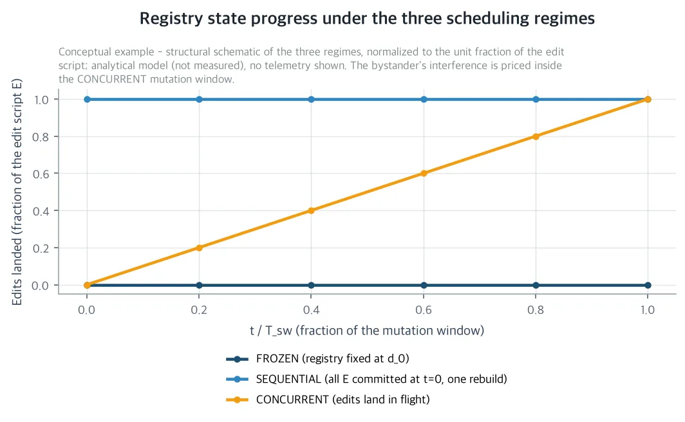
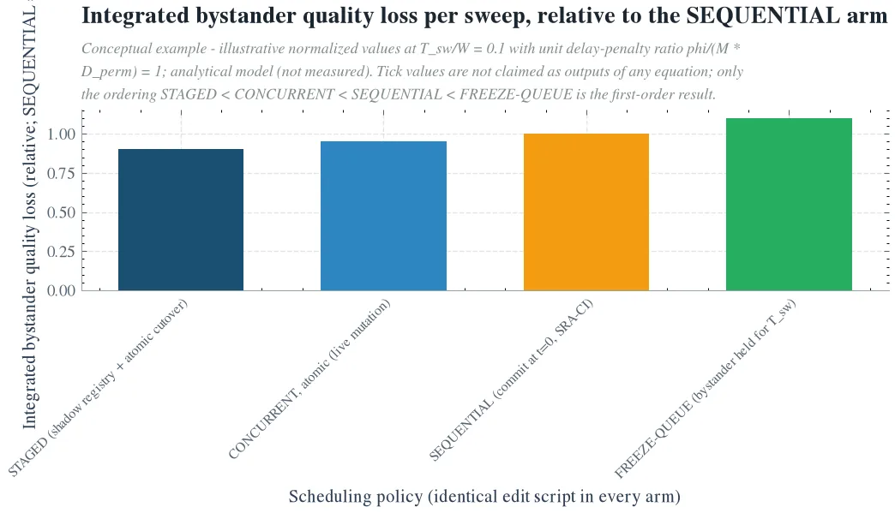

Read this paper if you run an unattended routing loop that keeps serving live tasks on the same registry while a nightly evolution sweep repairs the skill registry. Nightly job scheduling is exactly the subject of this paper. Put more broadly, it is the story of every team that runs several unattended loops on the same H200 cluster, all sharing one piece of mutable state: the skill registry. There is one question. Of the bystander loop's routing accuracy, token cost, and end-to-end task success rate, how much degrades while the mutation is in progress, and how much is permanent drift, measured after it ends? Every churn measurement so far, our router series included, has priced only the after. The during has never been priced. Nightly self-evolution can quietly erode routing quality and inflate the token bill, and post-hoc scores will not catch it. One thing to know up front. This is an analytical paper, and it reports no measurements. The numbers in this post are either symbols, first-order arithmetic on the recorded bystander drift law, or pre-committed protocol parameters, and the two figures are drawings of the analytical model, not measured data. Measurement is the job of the 7-arm protocol the paper pre-registers.

*A visual metaphor for the article's key idea.*

## The problem: every churn measurement is taken only after the repair

Our production harness routes every step of an unattended task to one of roughly 2,200 reusable skills. The hybrid router runs one lexical BM25 lane and one dense lane, and the ranking signal of both lanes is the skill's own description text. The lexical lane is coupled to the corpus. Since the idf of every term is a function of the term frequencies of all skills in the registry, any edit moves the bystander's lexical scores. The dense lane moves the embeddings of the edited skills. The description text is at once the routing signal and the curator's write surface.

The two loops share one mutable artifact. Overnight, the evolution loop, the curator sweep, applies the edit script, a sequence of description rewrites, skill additions, and skill retirements, to the same registry. Edits land in real time from t_1 to t_E, the sweep duration is T_sw, and its rate is ρ_e = E/T_sw. During the same window, live tasks keep arriving at a constant arrival rate λ and are routed against the registry in whatever state it is in at that moment. The loop that writes the registry and the loop that reads it are different, and both run unattended on the same self-hosted H200 cluster.

Our router series has priced that registry one axis at a time so far. Query paraphrase instability, top-1 survival decay with registry size, frozen index freshness, adversarial description injection, and, most recently, benign description edits in Silent Reroute. Silent Reroute established a first-order bystander drift law: how the expected top-1 flip rate of unedited tasks moves as a function of edit semantic distance, edit type, and registry size N. The type ordering put semantic moves first, truncation next, and paraphrasing last, and recall-level drift was about 0.25 times the top-1 drift. But every study in this series measures the final registry state after the edits finish. Post-hoc scores. Deployment does not wait for the edits to finish. The sweep is in progress, and the bystander keeps serving on top of a mutating registry.

This is the cross-loop version of the classic noisy neighbor problem. Two consumers share one resource, one of them repairs it, and the other pays interference that has never been priced. What differs is the kind of shared resource. In the serving literature it is hardware, namely GPU memory or PCIe fabric, tail latency. Here it is state, namely the registry. The interference does not travel along the fabric. It travels along the description text and the search index. The paper prices two questions. One is how much of the bystander's loss is the transient excess paid during the mutation and how much is the permanent drift of the final state. The other is where on the cost-quality frontier a registry mutating live, a frozen registry, and a sequential replay of the same edit each land.

*The three scheduling regimes on the same edit script, in a conceptual drawing that plots the fraction of the script that has landed in the shared registry during the mutation window. FROZEN never evolves. SEQUENTIAL commits the entire script at t=0, the Silent Reroute post-hoc protocol. CONCURRENT keeps the bystander routing while edits land in flight. The interference this paper prices lives in the mutation window of the CONCURRENT arm. A drawing of the analytical model, not measured data.*

## An identity that splits total loss into permanent and transient

Price the same edit script E under three scheduling regimes. FROZEN has no edits, and the registry state d(t) is always d_0. This is an anchor, not a frontier point. SEQUENTIAL commits the entire script at t=0 before the window's routing and rebuilds the index once. This is exactly SRA-CI, the Silent Reroute post-hoc protocol, with quality Q_S and permanent drift Δ_perm = Q_F - Q_S. CONCURRENT keeps the bystander routing while edits land in flight from t_1 to t_E. That is deployment. What differs from arm to arm is only the landing schedule and the locking. The edit script is the same.

The bystander's total quality loss over the window [0, W] is L_tot = ∫_0^W (Q_F - Q_c(t)) dt, where Q_c(t) is the instantaneous quality at time t. The identity this paper establishes is L_tot = W Δ_perm + L_trans, where L_trans = ∫_0^T_sw (Q_S - Q_c(t)) dt. It assumes neither independence nor linearity, and it holds under any edit schedule. L_trans is a signed transient interference. It is the bystander's excess loss (positive) or relief (negative) during the mutation, measured against the final state, not the frozen state. If the schedule were irrelevant to quality, L_trans would be 0.

The interference coefficient is this transient cost normalized by the sequential drift of the same edit. IC_Q = L_trans / (T_sw Δ_perm). The cost-side IC_C divides the transient cost excess by the permanent per-route cost delta ΔC_perm. If the denominator cannot exceed ε, report the absolute excess. There are three reference values. IC_Q = 0 means the schedule is irrelevant to quality. IC_Q > 0 means genuine interference: in-flight states are on average worse than the final state. IC_Q < 0 means transient relief: the harmful edits have not landed yet. Because the denominator is the sequential drift of the same edit script, a single SRA-CI post-hoc measurement calibrates both denominators. One number per night, from which you can read how much the schedule adds to the bystander's cost.

## First-order analysis: quality pays no extra cost, cost is invisible to post-hoc scores

The assumptions add two things to the recorded bystander drift law. The expected bystander effect δ_j of each edit j is negative, the effects of edits are independent, and edits land almost uniformly over [0, T_sw], as a Poisson process at rate ρ_e.

The quality channel result: IC_Q = -1/2. Under atomic commits, where a reader sees only d_{j-1} or d_j and never a mixed state, the results are as follows. E[Q_c(t)] = Q_F - δ̄ ρ_e t, and L_trans = -Δ_perm T_sw / 2, IC_Q = -1/2, L_tot = Δ_perm (W - T_sw/2). Read the sign: during the sweep, the harmful edits have not landed yet, so the bystander is on average better off than under the final state. The SEQUENTIAL arm pays Δ_perm over the entire window W, and the CONCURRENT arm pays only Δ_perm (W - T_sw/2). A policy that accepts or rejects the nightly sweep on the post-hoc SRA-CI score can never underprice the bystander's in-flight quality cost. That is what it means for post-hoc measurement to be a conservative quality proxy. The single-loop churn result of Silent Reroute generalizes to the cross-loop regime for quality, with a schedule correction factor of 1 - T_sw/(2W). The alarm band is IC_Q ≥ 0.

The cost channel does not overlap. Quality is schedule-irrelevant to first order, but cost is not. Every edit must be absorbed into the index structures the bystander sees, namely the BM25 corpus statistics, the embedding index, and the cached routing prompts. While absorption is in progress, per-route spend rises. The pool changes between retrieval and the paid final selection, retries pile up after stale cache misses, and injection length spikes momentarily. γ is the bystander-side churning cost per edit, in tokens. T_mem is the memory window, the time it takes the churning of one edit to decay to 0. Then the bystander cost inflation per sweep of the CONCURRENT arm is ΔC_byst = λ γ T_mem E. It is 0 for the SEQUENTIAL and FROZEN arms. The rebuild is one-time, so the curator pays it and it amortizes out of the bystander's per-route bill. The cost-optimal re-embedding cadence of Staleness Frontier is the steady-state ratio of this T_mem.

Rate-limiting invariance: as long as the sweep is longer than the memory window, T_sw > T_mem, the time-averaged cost depends only on the number of edits E and the memory window T_mem, not on the speed of the sweep. Double the sweep and ρ_e is halved, and the per-route peak excess γ ρ_e T_mem and its SLO risk drop by half, but the time-averaged bill is unchanged. A longer sweep helps only in the overlapping regime T_sw < T_mem. The cost-side conclusion is the mirror of the quality side. Sequential measurement is conservative for quality, but blind for cost. It prices only the per-route delta ΔC_perm of the final state, usually small, and sees none of the schedule-driven churning. The extra bill of the live arm, λ γ T_mem E per sweep, is observable as a line item of the paying loop, because token metering attributes cost per loop.

Mixed states: the only first-order path to IC_Q > 0. Atomic application is a property of the writer, not of the registry. When an edit is applied non-atomically, the bystander reads a mixed state for a visibility window ω around each t_j. The description is rewritten in place, the BM25 statistics update term by term, and the embeddings are re-indexed before the lexical lane catches up. In between, the lexical signature is still the old state and the dense signature is already the new state. A request whose gold skill is adjacent in term space to the edited skill double-misses: it routes correctly under the pre-edit state and under the post-edit state, but not under the mixed state. The bound says the additional time-integrated transient quality loss of mixed states is at most ω E p v. Here p is the probability that a task lands in the pool of a typical edited skill, and v is the per-task quality value at stake in a double-miss. IC_Q ≤ -1/2 + ρ_e ω p v / Δ_perm. In other words, the traffic-exposure weighted mixed window cannot exceed the accumulated bystander drift of a half-sweep. This bound is tight up to a constant in the corners where edits cluster in term space, such as simultaneous rewrites of near-duplicate skills. Those are exactly the places where the independence assumption breaks the most. The IC_Q ≥ 0 alarm is, in effect, aimed at that corner the model cannot see.

## A policy that prices the freeze window: staged commits as default, live as exception

We spend the scheduling levers in task-value currency. Penalty M per misroute, Δ_perm^v = M Δ_perm. The first-order bystander loss per sweep of the four candidate policies: LIVE (atomic concurrent): λ M Δ_perm (W - T_sw/2) + κ λ γ T_mem E. STAGED (shadow registry, atomic cutover, one rebuild): λ M Δ_perm (W - T_sw) + π_fresh λ T_sw. FREEZE-QUEUE (hold the bystander for T_sw): λ M Δ_perm W + φ λ T_sw. SEQUENTIAL (commit at t=0): λ M Δ_perm W. Here κ converts tokens to value at H200 cost, π_fresh is the per-task value of routing to an in-flight addition, and φ is the per-task delay or SLO penalty of queueing.

The break-even results come in three. STAGED dominates SEQUENTIAL, because the bystander cost is the same and the quality is strictly better: Δ_perm^v (W - T_sw) < Δ_perm^v W. STAGED dominates LIVE when M Δ_perm/2 + κ γ ρ_e T_mem ≥ π_fresh, that is, when half of the permanent drift in value units plus the per-task churning exceeds the per-task value of the in-flight edit. LIVE dominates FREEZE-QUEUE when M Δ_perm/2 + φ > κ γ ρ_e T_mem.

π_fresh is the value of additions during the sweep, and the demands of an unattended loop are set by that day's tasks, so it is rare. The second condition holds with room to spare in normal operation. That is why the default nightly policy is STAGED. LIVE is the exception. Operate it only when the sweep is dominated by additions the bystander clearly needs, and only under the R4 alarm.

A four-rule policy. R1 is live registry locking. The sweep applies the entire script to the shadow registry over [0, T_sw], and the live registry stays invariant. The bystander routes against the frozen snapshot for the whole lock. R2 is atomic cutover. At T_sw the shadow state is swapped atomically, and the index rebuild, including the BM25 statistics and the embeddings, happens once, under the lock, outside the bystander's critical path. The bystander churning bill of the sweep becomes 0, and the quality loss becomes Δ_perm^v (W - T_sw), the STAGED loss. R3 is the speed cap for the exception. Edits that must be exposed live are accepted only while the class-specific break-even condition holds, and the rate is capped at ρ_e ≤ (M Δ_perm/2 - π_fresh)/(κ γ T_mem). R4 is the drift alarm. A rolling probe rescores a fixed subset of the SRA bystander suite every Δt during the sweep, pointing the SRA-CI gate back at the live registry. If the probe drift exceeds the pre-committed alarm a_Q = 2 δ̄_law, twice the expected bystander value per edit of the Silent Reroute law, the sweep stops. This is an empirical guard against the two corners the model does not cover: non-atomic mixed states and higher-order edit interactions.

The accounting is observable by construction. Token metering turns the churning bill into a line item per loop, and under R1 and R2 the bystander's is exactly 0, while the curator pays it once at cutover. The quality bill is the STAGED bill, at or below the post-hoc silent-reroute bill.

A conceptual drawing comparing the size of the first-order bystander quality bill per sweep under one and the same edit script. STAGED, the registry-locked regime, is the cheapest. Live atomic mutation gets a credit of a half-sweep window, and FREEZE-QUEUE, which holds the bystander, piles a delay penalty on top of the sequential bill. The knee of the cost-quality frontier is at STAGED. A drawing of the analytical model, not measured data.*

## What this gives to the company, to society, and to science

For the company, it is the first systematization of pricing the interference between two loops that are already running, plus the nightly schedule policy that executes that pricing. The platform already runs, on a self-hosted H200 cluster, a nightly skill-evolution loop and an unattended task-routing loop at the same time, both aimed at a single shared 2,200-skill registry. This paper gives a measurable interference coefficient, a drift-over-time curve, and a freeze-window/registry-lock policy. A cost-quality guardrail that plugs onto the existing curator sweep, sra_bench, and Metis token metering. Nightly evolution can no longer quietly erode routing quality or inflate the token bill. Scheduling becomes a policy with break-even points instead of a guess.

For society, it is a public, reproducible methodology for pricing interference in multi-loop unattended operation that shares one piece of mutable state. As ops agents, evolution agents, and task agents running concurrently becomes the standard, every organization needs a way to catch hidden quality drift and cost leakage early. Large-scale autonomous agent operations become safer and cheaper. A post-hoc churn budget is not a cross-loop budget, and the interference coefficient is the normalizer that tells you whether it was.

For science, it is the first systematization of the cross-loop regime for self-evolving agent harnesses. Existing self-evolving library research, Skill++, SkillForge, SELM, Trackable, evaluates the library in steady state after the evolution steps finish. No study prices a bystander that keeps routing during the steps. Noisy neighbor research in the serving literature priced interference that traveled along resources or failures. This paper prices the third channel: interference that travels along a mutable knowledge state. It also answers whether single-loop churn results generalize to the cross-loop regime. To first order, they split in two. Quality generalizes, and with the schedule correction 1 - T_sw/(2W) the post-hoc bill becomes a conservative proxy. Cost does not generalize. The churning bill λ γ T_mem E exists only in the live regime, is invariant to rate limiting, and single-loop cost measurement underprices cross-loop deployment by exactly that line item.

## Limits: numbers that end in symbols, and corners the model cannot see

First, the analytical scope. This paper establishes the identity and the policy, but IC_Q, IC_C, ΔC_byst, the sign of the break-even, the false alarm rate, and the value of the schedule correction factor are commitments of the protocol, not measurements. Every quantitative claim is first-order arithmetic on recorded drift laws, a labeled model bound, or a pre-committed protocol parameter. The numbers of the cross-loop regime become telemetry when the pre-registered protocol runs.

The protocol is a 7-arm design over the 2,200-skill registry, a self-hosted H200, and per-loop token metering. Design invariant: every evolution arm writes the same edit script, and only the landing schedule and the locking differ. A1 LIVE publishes atomically per edit. A2 FROZEN is the baseline. A3 SEQUENTIAL measures Δ_perm and ΔC_perm of the same script with SRA-CI. A4 FREEZE-QUEUE carries the delay cost φ. A5 STAGED is the bill of the policy itself. A6 RATE-LIMITED stretches the sweep to 2 T_sw and tests schedule invariance: the time-averaged churning should stay put and the peak should halve. A7 PER-EDIT-LOCK removes mixed states by construction with a short global read lock per edit, so that A1 - A7 is the mixed-state term. The probe-based estimator rescores a fixed subset of n_P cases from the SRA bystander suite every Δt. The delta method variance bound is independent of Δt and T_sw, and the design bound for the target relative precision ε gives the size of n_P. The pre-committed acceptance criteria are as follows. LIVE (A1) is allowed as the nightly default mode only if IC_Q ≤ 0 and the churning line item is at or below β_bill. The default β_bill is 5% of the nightly bystander spend. The conditions carry zero R4 alarms, and the criteria are applied at confidence 1-α. Otherwise, STAGED is the default. The A6 invariance and the A7 zero mixed state are falsifiable partial hypotheses, and a violation reopens the independence assumption and the schedule invariance consequence.

Second, additivity. Edits of near-duplicate skills can interact, and two rewrites of competing descriptions can amplify or cancel. The first-order assumption rules that out, and the mixed-state bound does not cover it. The R4 alarm is the designated guard, and if IC_Q > 0 persists in A1 while A7 is 0, that is the signature of interaction. Third, bursty schedules. Real curators are burstier than Poisson. This is conservative for the atomic quality term: the expectation, linear in m(t), does not change, the variance changes, and peak churning rises. Fourth, workload stationarity. The probe design pins the distribution by rescoring the fixed bystander suite. Fifth, registry growth. The bystander drift law stands on the rising segment up to the size peak N* ≈ 3,535. If N grows, Δ_perm and the left-hand side of the break-even grow with it, and the STAGED default gets more comfortable. But the alarm a_Q must be re-derived for each size band. Sixth, the memory window. The schedule invariance consequence holds only while T_sw > T_mem, and the campaign verifies this before scoring A6.

Silent Reroute priced what the evolution loop leaves behind, the permanent bystander drift of the final state. This paper prices what is paid while the neighbor is still moving, and hands the scheduler a break-even. The interference coefficient of the registry is now a quantity that can be measured, that appears as a bill item, and that is an object of governance. The seven arms that pin down its value are pre-registered. The full paper and the 7-arm measurement protocol are available on the Hugging Face paper page. https://huggingface.co/datasets/thaki-AI/daily-paper-2026-11-06-noisy-neighbor-cross-loop-interference
