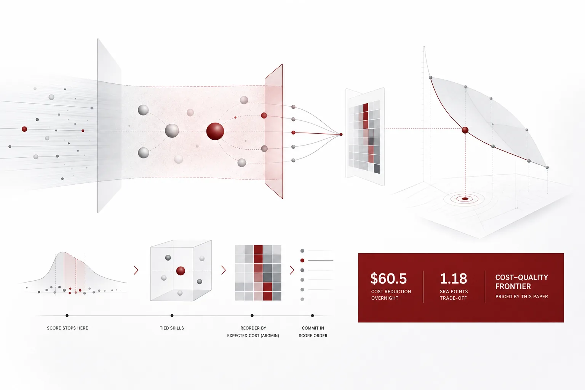
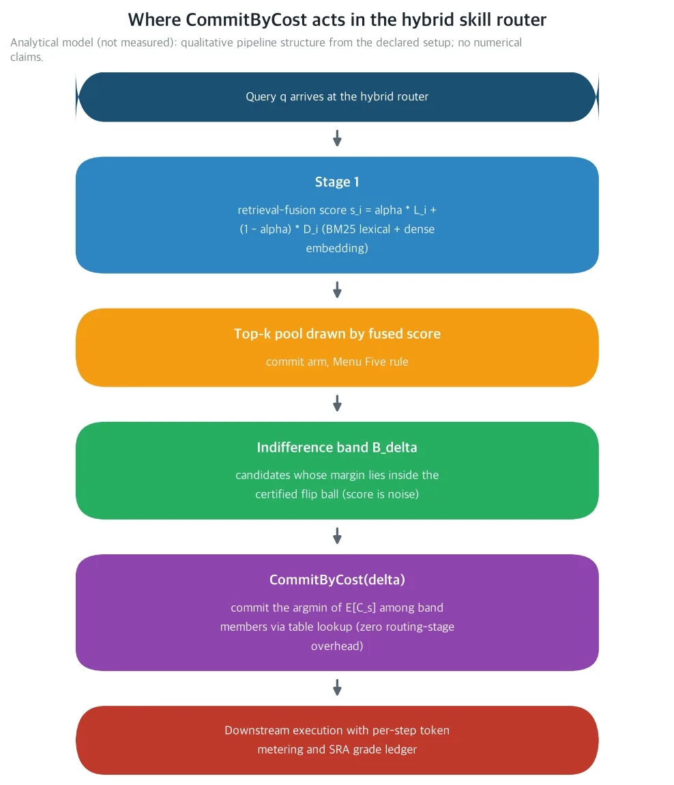
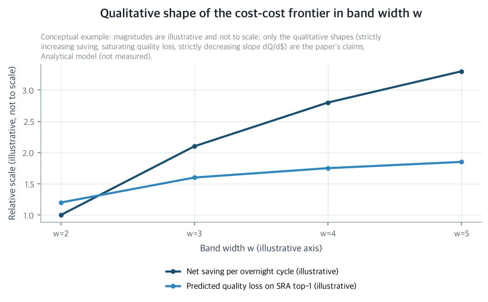

The router's score sometimes cannot tell two skills apart. When that happens, the current rule picks the score-order first, which among tied skills is effectively a coin flip. This paper puts a price on that coin. At the declared rates, one lookup into an already-kept ledger saves 60.5 dollars a night. If you run an unattended agent harness on your own GPU and keep the token ledger of its router yourself, this paper is for you.

The ThakiCloud hybrid skill router has been priced step by step in this series: the retrieval score, the paid rerank call, stage overhead, the inference budget, query truncation, near-duplicate registry mass, paraphrase instability, deadline-aware tier skip, pool width, and the ex-post miss price. One object was left unpriced. The indifference decision: what to commit when the score ties. This paper prices that decision.

One thing up front. This is an analytic paper, and it reports no new measurements. Every number is a closed-form prediction on the declared nominal rate card, or a result attributed to a cited reference. Both figures are plots of the analytic model, not measured data. Measurement is the job of the four-arm protocol the paper preregisters.

*A visual metaphor for the article's key idea.*

## In plain terms

Let us look at the coin more closely. The router picks a skill for every task that arrives overnight. When the retrieval score clearly supports one side, pick that side. But sometimes the score ties. Then no ranking criterion is left behind.

Today's rule still picks the score-order first in that case. Among near ties, the score difference sits inside the instability tax, so the choice is effectively a coin flip. And the two sides of this coin are not worth the same. One side's skill fails early and cheap when it fails. The other side's skill loses more when it fails, and it takes longer to run.

We already know the value of both sides. This harness already meters every step's tokens in its ledger. So there is no need to flip the coin. When the score ties, pick the cheaper side in the ledger. No new inference call, no new infrastructure. One lookup into a value already kept. The rule the paper proposes is called CommitByCost.

In plain terms, a score tie is today a coin flip; CommitByCost says do not flip, take the cheaper side.

## What they did

The router moves in two stages. Stage 1 pulls up a candidate pool with the fused retrieval score, BM25 (lexical) plus dense embedding, s_i = α·L_i + (1−α)·D_i. Stage 2 runs a paid listwise rerank over that pool at 0.08 dollars per root. The rerank stage then chooses commit (the router decides the final candidate) or menu (the pool goes to the agent). This paper prices the commit arm: what the router commits among near-tie candidates.

*A structural diagram of the two-stage hybrid router. The left is the fused lexical plus dense-vector retrieval; the right is the paid rerank at 0.08 dollars per root. The indifference band B_δ is the region where the expected-cost tiebreak reorders near-tie candidates. A diagram of the analytic model's conceptual structure, not a measurement.*

The premise comes from the Fickle Router in the same series. Inside the certified flip ball of radius ρ_eff, the fused score is noise against true skill quality. When the margin between the first and the second falls inside δ, the score cannot tell which is better. But the two candidates have different expected costs. The current top-1 carries a miss multiplier of 1.8, while the cheaper band member carries 1.6. The expensive side also has a longer execution stretch.

The indifference band is simple to define. Write the margin as m(q) = s_top(q) − s_2(q); the band B_δ(q) is the set of candidates within δ of the top-1. Pin δ to ρ_eff, and every flip partner Fickle Router certified for the top-1 lands inside the band. The near-tie incidence p(δ) is declared at 0.30. Three of every ten overnight-routed roots fall into the band. Today those three are committed at random in the name of score order.

The band is a region of priced ignorance. The quality difference between candidates is certified into the instability tax, so cost is the only thing that carries meaning in the decision.

The cost model declares simple values. The per-step skill cost median is 0.10 dollars, with spread σ_c = 0.5. Flips come in three kinds. Six of ten are harmless ties with no grade drop, three are costly re-executions, one is a harmful misroute. Straddle flips, the ones that cross the band boundary, make up one of ten, and their grade drop is larger at 0.38. The straddle values come from the Miss Price accounting in the same series.

*The precise declared values live here: mean E[C] = 0.1133 dollars, class grade drops 0 / 0.05 / 0.30, straddle parameters ρ = 0.6, q_rec = 0.9, q_fail = 0.2.*

Premise A4 assumes the cheapest band member also has the lowest conditional miss multiplier. When the cheap side fails, recovery is cheap as well. So the gain arrives through two independent channels. One is the execution-cost reduction E[C] − E[min_w]. The other is the miss-multiplier reduction m_top − m_c.

CommitByCost(δ) does one thing. It commits the band member with the lowest expected downstream token cost E[C_s], s*(q) = argmin_{s∈B_δ(q)} E[C_s]. C_s is the per-skill step ledger tokens (router, execution, recovery) summed. The harness already meters every step, so the tiebreak is a lookup into an already-kept ledger. The check cost c_check = 0, and there is no new inference call at the routing stage. With w = 1 the rule reduces to today's commit, so where there is no near tie it changes nothing.

The break-even theorem compresses into one closed-form expression. The per-root net gain at band width w is Δ(w) = p(1 − 1/w)·[(1−g)(E[C] − E[min_w]) − g·D(w)], and D(w) is the straddle excess. If Δ(w) is positive, the rule pays out.

The confirmation protocol is preregistered as four arms. A0 is the control, the score-order top-1. A1 is Band Two, and A2 is Band Three. A3 is A1 plus an optional verification LLM call. Each arm logs the swap share, the straddle share, the net savings per swapped root, the SRA top-1 change versus A0, and the standard stage ledger (router/execution/recovery tokens, wall time, deterministic grade).

The falsification criteria F1-F5 are all closed-form predictions.

| Criterion | Statement | Prediction |
|---|---|---|
| F1 | Swap share lands inside 10-20 percent | p(1 − 1/2) = 15 percent |
| F2 | Net savings per swapped root at least 0.0025 dollars | 0.00336 dollars |
| F3 | A1 quality drop (SRA top-1 versus A0) at most B_Q = 1.5 | 1.18 |
| F4 | Straddle share at most 0.20 | declared 0.10 |
| F5 | CommitByCost does not activate where the margin exceeds ρ_eff (guard-band audit) | n/a |

At the declared rates, the whole protocol costs 22.16 dollars, under 25.

*Cost formula: 63 SRA benchmark cases, four arms, 0.08 dollars per rerank call per root, plus 1,000 verification calls at 0.002 dollars on arm A3. Total: 63 × 4 × 0.08 + 1,000 × 0.002 = 22.16 dollars.*

## What came out

At the declared nominal rates, the net gain is positive at every band width from w = 2 to w = 5. The wider the band, the larger the overnight saving. In plain terms, at the declared values there is no band width where the rule loses money.

| Band width w | E[min_w] (dollars/step) | Net savings per night (dollars) | Predicted quality loss dQ (SRA points) | Frontier slope (points/dollar) |
|---|---|---|---|---|
| 2 | 0.0820 | 60.5 | 1.18 | 0.0195 |
| 3 | 0.0701 | 126.0 | 1.57 | 0.0125 |
| 4 | 0.0634 | 170.4 | 1.77 | 0.0104 |
| 5 | 0.0590 | 202.0 | 1.88 | 0.0093 |

Even in the worst single-parameter scenario, g = 0.20, the w = 2 net gain stays at 36.4 dollars a night. No scenario in the sensitivity grid flips the sign.

The per-root net gain is about 4 percent of the 0.08-dollar rerank cost. It is obtained with zero surcharge at the routing stage. The exact per-root value follows from the table: divide the nightly savings by the number of routed roots.

The direction in which this paper upgrades the frontier is the crux. The axis shifts from cost at fixed quality to quality loss per dollar saved, which the paper calls cost-cost. The predicted quality loss dQ(w) is computed from the A3 class drops. The savings are d$(w) = N·Δ(w), where N = 18,000, the steps routed every night.

The frontier slope dQ/d$ decreases strictly with w. As w goes from 2 to 5, the quality price per saved dollar roughly halves. E[min_w] decreases strictly with w by the property of order statistics, and the savings bracket grows with it. The wider the band, the cheaper the quality price of saving a dollar.

*The qualitative shape of the cost-cost frontier the paper predicts. Overnight net dollar savings per cycle increase strictly with band width w, while predicted quality loss in SRA points rises and saturates. Widening w from 2 to 5 brings the slope down from 0.0195 to 0.0093 points per dollar. An illustrative shape from the analytic model, not a measurement.*

The quality budget B_Q pins the band width in closed form. w*(B_Q) is the widest width with dQ(w) ≤ B_Q. At the declared B_Q = 1.5, dQ(2) = 1.18 fits the budget while dQ(3) = 1.57 exceeds it. So the default is w* = 2, Band Two. If B_Q rises to 2.0, w* becomes 5. The band width is not an engineering constant; it is a value the quality budget decides.

Under Band Two, overnight step execution spend drops by 60.5 dollars per cycle. The predicted quality price is 1.18 SRA top-1 points, about 3 percent (2.96 percent) of the declared per-night step budget of 2,040 dollars. In plain terms, the rule trades about three percent of the nightly budget for 1.18 points of predicted quality.

## What to change

For the company, a routing rule that plugs into its 2,200-skill self-evolving registry. No new infrastructure, no retraining. It reuses only the existing per-step skill token ledger, the SRA benchmark (63-case holdout, threshold θ = 0.75), and the registry itself. At declared nominal rates, overnight step execution spend drops by 60.5 dollars per cycle.

For society, the message is the same as the series' but lands one level lower. Every token saved maps directly onto the per-task inference cost of an unattended agent. That cost decides whether full business automation is economically possible for a small team. In the tokenergy result from the same series, tokens are energy too. Savings earned with a single lookup, with quality loss inside the quality budget, go straight into the automation economics of small teams.

For science, three things remain. First, the indifference band B_δ becomes a first-class object of routing. Fickle Router drew the boundary of when a flip can happen; this paper acts inside that ball. Second, ex-ante expected downstream cost becomes a routing signal. Miss Price's miss price formula, (m−1)c_E + (1−ρ)c_def + c_rec, is promoted from an ex-post ledger to a signal that reorders decisions before a root is taken. Third, the frontier is upgraded to cost-cost, with a slope that decreases strictly with band width.

This paper is an explicit one-step upgrade over Menu Width (Menu Five rule, k* = 5) and over Miss Price. Menu Width priced pool width k and the commit-versus-menu split but assumed score-order top-1 commit. Miss Price priced the ex-post miss price.

On the menu arm, where the final choice sits with the agent, CommitByCost becomes the order of the menu. The cheaper skill is offered first. The indifference band is orthogonal to the commit-menu split and composes with the Menu Five rule (k* = 5). Inside a pool of five, the band reorders only the near-tie subset. The pool width governs how many candidates the agent sees.

## What not to trust

First, every number is a closed-form prediction on the explicit premises A1-A7 and the declared nominal rate card. The sign of Δ(w) is robust across the whole sensitivity grid, but a future harness run could shift the net gain by tens of percent. The grid's worst scenarios: g = 0.20 at 36.4 dollars, σ_c = 0.30 at 22.5 dollars, m_c = 2.0 at 51.6 dollars. All positive, but the range is not narrow.

Second, premise A2, score-blindness. If cost inside the band correlates with the retrieval score, the arbitrage shrinks. F5's guard-band audit and the protocol's stage ledger accounting are the channels that confirm it. The sign guarantee does not extend by itself to a world with score-cost correlation.

Third, drift of the values. The 2,200-skill registry is self-evolving and changes every night. The per-skill cost table is not static and needs a sliding-window refresh. Staleness enters the model as an extra term in σ_c. The sign guarantee does not extend to the c_def = c_E tie either. Both are the job of a harness run.

The paper's position is clear. It does not assert the decision. It specifies the intervention and the accounting that can be confirmed or falsified. Four arms, five falsification criteria, 22.16 dollars of cost. Every stage of this router series has been priced this way. The indifference decision is the next measurement target.

---

The paper and its companion materials are available here: [The Indifference Band](https://huggingface.co/datasets/thaki-AI/daily-paper-2026-11-07-expected-cost-indifference-router)

*Every number in this post is either a closed-form prediction under the explicit premises (A1-A7) and the declared nominal rate card, or a result attributed to cited references. This post reports no routing measurements. Both figures are plots of the analytic model, not measured data. The body rounds for readability; the precise values are in the tables and captions.*
