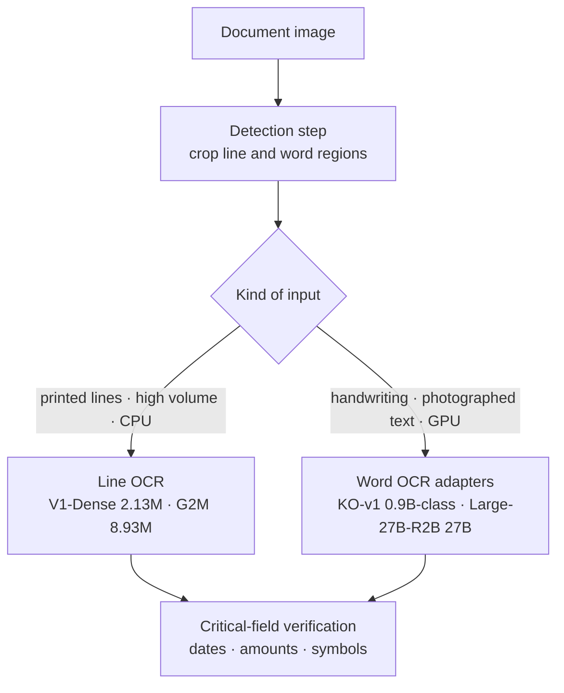
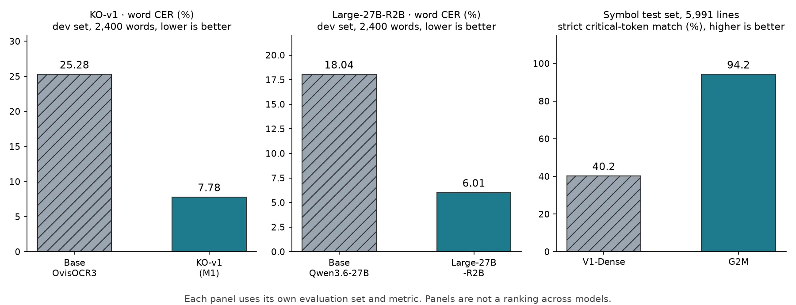

ThakiCloud has released four Korean text recognition models whose sizes differ by more than 10,000 times. The two small models read one text line on CPU, and the two large models read one Korean word image on GPU. The four were built to solve different problems, and their evaluation sets and metrics differ too, so their numbers cannot be lined up and ranked.

## In plain terms

Think of a parcel sorting center. Boxes with a cleanly printed barcode go past a conveyor scanner that handles dozens per second. Boxes with a hand-written address, or a label smeared by rain, go to an experienced clerk. Asking whether the scanner or the clerk is better makes no sense, because they handle different boxes.

ThakiOCR's small models are closer to the scanner, and its large models closer to the experienced clerk.

## Why four models of different sizes

Enterprise document processing carries two kinds of demand at once.

The first is volume and environment. The same form's line images may need to be read hundreds of thousands of times a day, often on on-premises servers or field devices without a GPU. That calls for a small line OCR that reads one line in a few milliseconds on CPU. ThakiOCR-KOEN-V1-Dense (2.13M parameters) and ThakiOCR-KOEN-G2M-Preview (8.93M parameters) fill that role.

The second is hard input. Handwriting, signboard text photographed outdoors, and uncommon Hangul syllables are hard for a small CTC model. For such words it works better to take a vision-language model already trained on large amounts of image and text and adapt it to Korean word OCR. ThakiOCR-KO-v1 (a LoRA for a 0.9B-class base model) and ThakiOCR-Large-27B-R2B (a LoRA for a 27B base model) fill that role.



None of the four models finds text positions on a page. A detection step must come first, and after it a decision on which model gets the input. That routing is covered separately in the [Metis tiered document inference post](/tech-blog/en/llmops/thakiocr-metis-tiered-document-inference/). Size, links, and licenses for each model are collected on the [ThakiOCR model hub](/tech-blog/en/ocr/).

## What each model learned

### V1-Dense: synthetic data alone does not teach spacing

V1-Dense was trained from scratch only on synthetic OCR data that NVIDIA published under CC BY 4.0. It taught us two things.

One is that in Korean OCR the vocabulary sets the model size. It can output 14,152 characters, so about 1.83M of its 2.13M parameters sit in the final output layer, and the part that actually reads the image is about 0.3M.

The other is the limit of synthetic data. On 38% of real Korean word crops it inserted spaces between syllables that were not there, because spacing in the synthetic lines differed from scanned documents. Full results are in the [ThakiOCR A release post](/tech-blog/en/research/thakiocr-a-small-korean-english-line-ocr/).

### G2M: an average error rate hides symbol errors

G2M scaled the same architecture family to 8.93M parameters. It was trained again from scratch, this time with real public-document images and self-generated symbol lines added. Even if every won sign or circled number in a line is wrong, they make up so little of the line that CER barely moves. So we first fixed a separate metric for whether symbols survive.

On the same symbol test set (5,991 self-generated synthetic lines), critical-token strict exact match was 40.2% for V1-Dense and 94.2% for G2M. These two numbers come from the same set and the same metric, so they can be compared.

The remaining failures are just as clear. It got a date wrong when a space followed the year, and it swapped the near-identical `₩` (U+20A9) and `￦` (U+FFE6) in 427 lines. It failed the date criterion out of five pre-set pass criteria (preregistered gates), so the verdict is A1_GEN2_NO_GO. The details are in the [G2M release post](/tech-blog/en/research/thakiocr-g2m-numbers-and-symbols/).

A2 was retrained on the same architecture as G2M with financial-document data added, and its weights are not public. We evaluated it separately on forms not seen in training. The results are in the [A2 evaluation post](/tech-blog/en/research/thakiocr-a2-independent-eval-43751-lines/) and the [Maxis training post](/tech-blog/en/research/thakiocr-maxis-same-size-fewer-errors/).

### KO-v1: the better word reader can break the document

KO-v1 trained Korean word OCR by adding a LoRA to the document OCR model ATH-MaaS/OvisOCR3. We trained two arms on the same data.

- M1: LoRA on the language decoder only, with the vision side frozen.
- M2: LoRA on the decoder and the vision tower, with the vision-language connector also trained.

M2 was the better word reader. Development-set CER was 7.78% for M1 and 5.98% for M2, and the 95% confidence interval of the difference excluded zero. But on 50 synthetic table pages kept sealed until results were in, M2's exact table-structure match was 0.80, a drop from the base model's 0.98 beyond the 0.04 tolerance. Under the selection rule fixed in advance, we released M1, which kept the table structure.

The lesson of this model is that adapting the vision side too reads words better but can break document-structure abilities the base model already had. Training is covered in the [KO-v1 release post](/tech-blog/en/research/thakiocr-ko-v1-ovisocr3-korean-finetune/).

### Large-27B-R2B: the big gain came from adaptation itself

Large-27B-R2B attached a LoRA to 496 decoder linear layers of Qwen/Qwen3.6-27B. On the same development set, CER fell from 18.04% (base model) to 6.01%, and no source got worse.

Most of the gain came from fine-tuning itself. On handwriting dataset 91 the base model often inserted characters that were not there (18.6% insertion rate), and fine-tuning removed that. In contrast, sampling rare characters more often (R2-B) added only 0.41pp over uniform sampling (R2-A), and with the confidence interval's upper bound close to zero it is statistically borderline.

A separate inference-only study gave the R2-A adapter the whole line containing a word instead of the word alone. On a subset of dataset 605 pages, word CER fell by 2.35pp. That result is not a property of the R2-B adapter; it is evidence for choosing the next research direction. Details are in the [Large-27B-R2B release post](/tech-blog/en/research/thakiocr-large-27b-r2b-qwen-korean-ocr/).

## How the measurement contracts differ

The evaluation sets and metrics in the table below differ, so it is not a ranking between models. It shows the conditions under which each model's headline number was measured.

| Model | Input | Evaluation set | Independence | Headline metric |
|---|---|---|---|---|
| V1-Dense | line | 5,000 word crops from part of AI-Hub 71299 validation data | development set, not an independent test | CER 37.14% |
| G2M | line | 70 lines from one volume of AI-Hub 71299 Training held out of training | opened once after training, same dataset family | CER 0.89% |
| KO-v1 | word | 600 per source from Validation of datasets 605, 91, 105, 2,400 total | same source, not an independent test | CER 25.28% → 7.78% |
| Large-27B-R2B | word | 600 per source from Validation of datasets 605, 91, 105, 2,400 total | same source, not an independent test | CER 18.04% → 6.01% |

Three things are worth keeping in mind when reading this table.

First, the input unit differs. Line CER and word CER share a name but measure different jobs. A line contains spaces and a word does not.

Second, the size and independence of the evaluation sets differ. G2M's real-document set has only 70 lines, so a single error moves the number a lot. The development sets of KO-v1 and Large-27B-R2B come from the same sources as the training data. They say nothing about new handwriting styles or new document types.

Third, the development sets of the two large models are built in a similar way. We have not verified that their evaluation images, preprocessing, decoding, and ground-truth handling are the same. So we do not say "the 0.9B-class model is on par with 27B." The only comparable number for each model is its change from its own base model on the same set.


*Each panel has its own evaluation set and metric. Do not read the three panels side by side as a model ranking.*

Speed and memory were also measured under different conditions, so the table below is not a ranking either.

| Model | Conditions | Latency (median) | Memory |
|---|---|---|---|
| V1-Dense | data-center server CPU, 4 threads, one line | 5.61ms | not on card |
| G2M | CPU, one line | 13.3ms | not on card |
| KO-v1 | one B200, one word | 0.210s | peak 7.02GiB |
| Large-27B-R2B | the same single GPU (bf16), one word | about 0.46s | about 53GB |

## Real error types and limits

Grouped by type, the errors of the four models look like this.

- **Space insertion**: V1-Dense inserts spaces between syllables on 38% of real Korean word crops. Ignoring spaces brings CER on the same set from 37.14% down to 17.81%.
- **Spaces inside dates**: G2M dropped the space in dates that have a space after the year. On internal real-document development sets, date-token exact match was between 45% and 69%.
- **Look-alike symbols**: on the symbol test set G2M swapped the two won signs in 427 lines (301 lines read `￦` as `₩`, 126 lines read `₩` as `￦`).
- **Broken document structure**: KO-v1's M2 arm read words better, but on 10 of 50 tables it got cell text right and table structure wrong. The released M1 is the arm chosen to avoid that.
- **Inserting characters that are not there**: Large-27B-R2B's base model inserted extra characters on handwriting, and that error disappeared after fine-tuning.

There are shared limits too. All four are research releases, and run-to-run variation was not measured over multiple seeds. None of them should read critical fields in financial, legal, or identity documents without human review.

## How to choose

Choose with three questions, not by a numeric ranking.

1. **Is the input a line or a word?** If the detector crops lines, V1-Dense or G2M; if it crops words, KO-v1 or Large-27B-R2B.
2. **Can you use a GPU?** Without a GPU, only the two line OCR models are candidates. With about 7GiB on one GPU you can run KO-v1, and with 53GB or more, Large-27B-R2B as well.
3. **Which characters must not be wrong?** For won signs, circled numbers, and masked digits, G2M was trained for exactly that skill. For handwriting or photographed text, the word OCR adapters were trained on that data. Either way, keep a separate verification step for dates and amounts.

How to design that verification step is covered in the [Paxis verification workflow post](/tech-blog/en/agentops/thakiocr-paxis-verify-before-commit/).

## Download and run

The small line OCR models run with the single `inference.py` in the repository. The code below is exactly as on the V1-Dense card.

```bash
pip install torch numpy pillow safetensors
python inference.py line.png              # one or more line images
python inference.py --demo                # renders an English line and reads it back
```

```python
from inference import ThakiOCR
ocr = ThakiOCR(".", device="cpu")
print(ocr.recognize(["line1.png", "line2.png"]))
```

KO-v1 and Large-27B-R2B are adapters, so the base model must be loaded at the revision pinned on the card. Both cards ship a run example of the same form.

```bash
pip install torch "transformers>=5.0" "peft>=0.21" pillow
python inference_example.py --image word.png            # prints the transcription
python inference_example.py --image word.png --report   # JSON: text + load checks
```

Follow the card's Usage table for prompt, image size, and decoding settings. Nothing else was evaluated.

## On-premises and platform use

All four models can be downloaded and run inside a private network. ThakiCloud builds a platform for training models (Maxis), serving them (Metis), and connecting them to business work (Paxis) in environments the customer controls. We are researching a setup that puts the small line OCR on a CPU endpoint and the word OCR adapters on a GPU endpoint. Document classification sits in front, and critical-field verification behind.

If you want to evaluate on your own documents or are considering the platform, contact [ThakiCloud](https://thakicloud.com).

## Related posts

- [ThakiOCR model hub](/tech-blog/en/ocr/)
- [ThakiOCR A: our own 2.13M-parameter Korean-English OCR](/tech-blog/en/research/thakiocr-a-small-korean-english-line-ocr/)
- [ThakiOCR G2M: our second public model, built to read numbers and symbols more accurately](/tech-blog/en/research/thakiocr-g2m-numbers-and-symbols/)
- [ThakiOCR A2: what an independent 43,751-line evaluation confirmed](/tech-blog/en/research/thakiocr-a2-independent-eval-43751-lines/)
- [ThakiOCR-KO-v1 release post](/tech-blog/en/research/thakiocr-ko-v1-ovisocr3-korean-finetune/)
- [ThakiOCR-Large-27B-R2B release post](/tech-blog/en/research/thakiocr-large-27b-r2b-qwen-korean-ocr/)
- [Tiered document inference with ThakiOCR and Metis](/tech-blog/en/llmops/thakiocr-metis-tiered-document-inference/)

## References

- Models: [ThakiOCR-KOEN-V1-Dense](https://huggingface.co/ThakiCloud/ThakiOCR-KOEN-V1-Dense), [ThakiOCR-KOEN-G2M-Preview](https://huggingface.co/ThakiCloud/ThakiOCR-KOEN-G2M-Preview), [ThakiOCR-KO-v1](https://huggingface.co/ThakiCloud/ThakiOCR-KO-v1), [ThakiOCR-Large-27B-R2B](https://huggingface.co/ThakiCloud/ThakiOCR-Large-27B-R2B)
- Data sources: NVIDIA OCR-Synthetic-Multilingual-v1 (CC BY 4.0); AI-Hub's OCR 데이터(공공) (71299), 대용량 손글씨 OCR 데이터 (605), 다양한 형태의 한글 문자 이미지 인식 데이터 (91), and 야외 실제 촬영 한글 이미지 데이터 (105). AI-Hub data and anything derived from it are not redistributed.
- All four models are research releases; product release decisions are separate. We make no claim of state-of-the-art performance.
