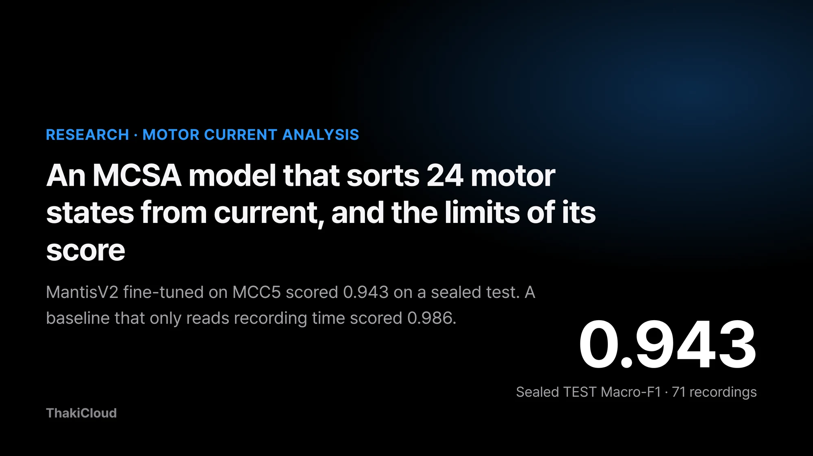
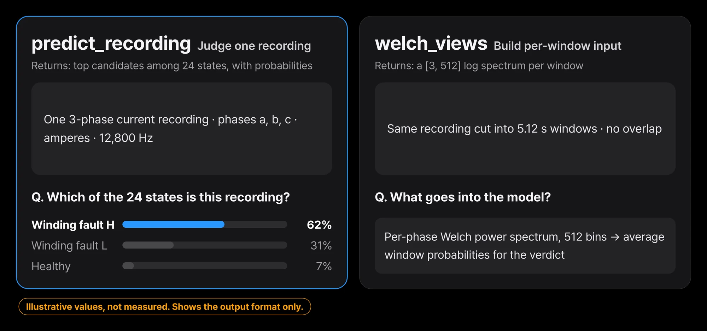
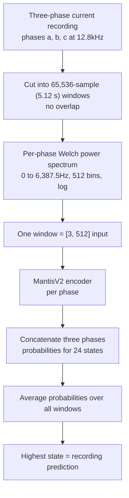
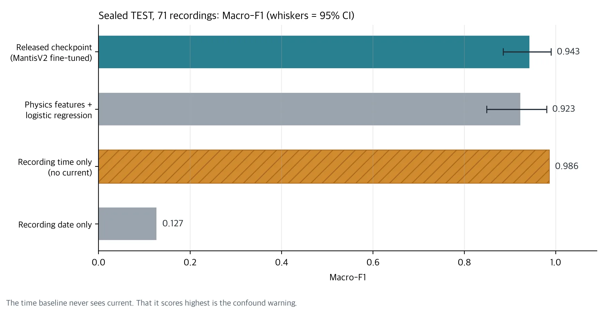
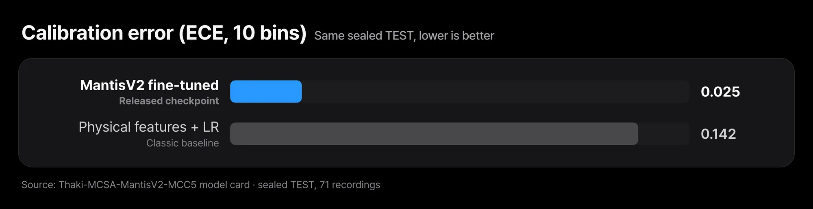
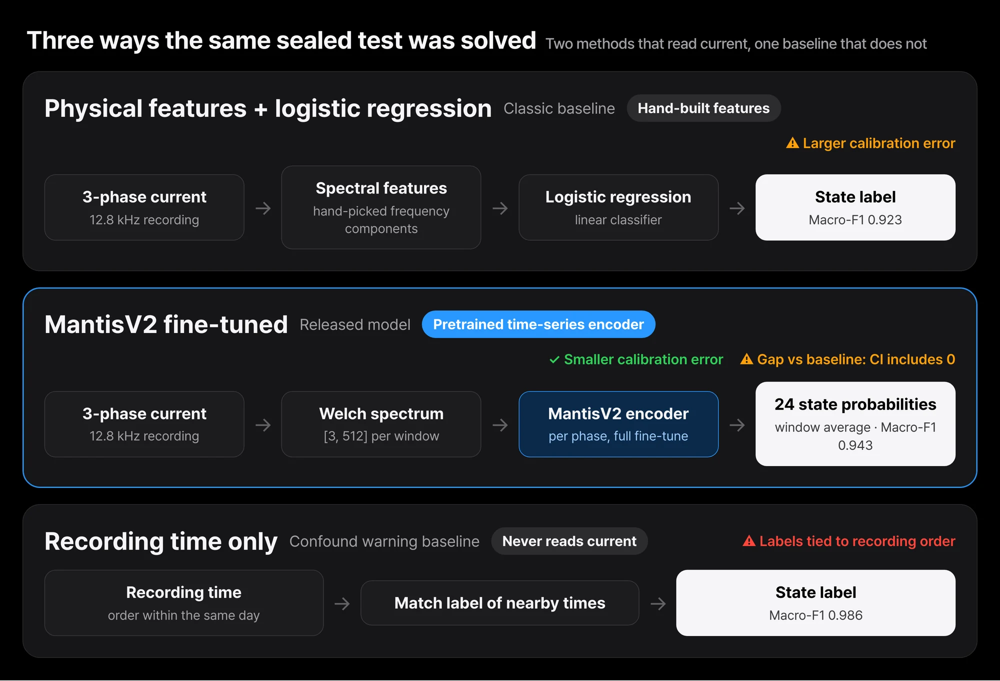

*The released checkpoint's sealed-test score. A baseline that only uses recording time scored 0.986.*

Maintenance teams who want to catch a failing factory motor early usually start by asking whether to bolt on more vibration sensors. Yet most equipment already measures the current flowing into the motor. If current waveforms alone could tell a damaged winding from a worn bearing or a bent shaft, diagnosis could begin without any new sensor.

So we built and released a research model that classifies a motor's fault state from its three-phase current alone. Scored once on recordings never used in training, it did well. On the same test, though, a baseline that never looks at current and only uses the recording time did even better.

This post shows what the model takes in and what it returns, and explains why its score should not be taken at face value. The model is called Thaki-MCSA-MantisV2-MCC5. We fine-tuned the pretrained time-series model MantisV2 on the MCC5 motor current data, and it distinguishes 24 states.

## Plain terms

Picture a student taking a test in the same classroom with the same teacher. The score is high, but if every test sheet came in a different pen color, you cannot tell whether the student solved the problems or memorized the pen colors. In MCC5, the recording time played the role of the pen color. Whether this model can solve the problems in a different classroom, that is, on a different physical motor, has not been tested.

## The current sensor is already on the equipment

Depending on fault state and operating conditions, a motor's current can change in magnitude, frequency content, and the relationship between phases. MCSA (Motor Current Signature Analysis) looks for clues of a state change in these electrical signals. Current sensors are often already installed on equipment, so it is worth checking how much diagnostic information existing measurements can give.

A change in current does not mean a fault, though. Load, rotating speed, supply voltage, and the measuring equipment also change the signal. A fault classifier first needs data structured so that these factors can be separated from faults.


*Feed one recording and you get a state label plus the top three candidates. The probabilities shown are format examples, not measurements.*

## The recording is cut into windows and turned into spectra

The data is MCC5-THU. The recordings come from a single 2.2kW three-phase induction motor test rig and cover 24 states: 1 normal and 23 single or compound faults. The original is published on Mendeley Data under CC BY 4.0.

The model input is not the raw waveform. Current recorded at 12.8kHz is cut into non-overlapping windows of 65,536 samples (5.12 seconds). For each window and each phase we compute a Welch power spectrum. A power spectrum is a chart of which frequencies are mixed into a signal, and how strongly.

We take the log of 512 bins over 0 to 6,387.5Hz, giving a [3, 512] input. The MantisV2 encoder processes each phase, the three outputs are concatenated, and the model computes probabilities for the 24 states. A recording's prediction is the state with the highest mean probability across its windows.



During development we ran leave-one-condition-out cross-validation (LOCO), holding out each of the 9 operating conditions in turn. At this stage we compared a physics-feature classifier, frozen pretrained MantisV2 representations, and full MantisV2 fine-tuning. The released checkpoint is a single model retrained on all 208 development recordings.

## 67 of 71 recordings in the sealed test were right

A sealed test is one set aside before training and opened only once. Ours holds 71 recordings from 3 operating conditions that were never used in training.

| Evaluation | Macro-F1 | What it means |
|---|---|---|
| MantisV2 fine-tuned, 9-fold LOCO cross-validation | 0.945 (worst fold 0.884) | Average of models retrained per fold. Not the score of the released file |
| Released checkpoint, 71 sealed TEST recordings | 0.943, 95% CI [0.885, 0.990] | Sealed before training and opened once |
| Physics features + logistic regression, same TEST | 0.923, 95% CI [0.849, 0.980] | Conventional baseline |
| Recording time only, same TEST | 0.986 | Confound-warning baseline that never sees current |
| Recording date only, same TEST | 0.127 | Date alone gets almost nothing right |



*Only the four results from the same sealed TEST are plotted. LOCO 0.945 is a different evaluation and is left out.*

For 20 of the 24 states, precision and recall were both 1.00. Of the 4 errors, 3 swapped winding fault severity H and L. The remaining 1 called an outer-race bearing fault a bent shaft. Winding H has F1 0.40 and winding L 0.57.

These numbers come from a small sample. Each state has only 3 TEST recordings, and voltage unbalance L has 2. A single error moves that state's recall by 0.33.

The score was slightly higher than the physics-feature logistic regression, but the confidence interval of the difference includes 0. It falls short of the pre-registered superiority rule (at least +5pp with a CI lower bound above 0), so we do not claim that MantisV2 beats hand-built spectral features on this rig.


*Macro-F1 was 0.020 higher than logistic regression, with a 95% confidence interval of [−0.051, +0.094]. Expected calibration error (ECE, 10 bins) was 0.025, lower than the logistic regression's 0.142.*

Expected calibration error (ECE) measures whether answers the model calls near-certain are in fact right that often. The smaller it is, the more you can trust the model's probabilities as they are. On this point MantisV2 was clearly better. That advantage, too, was observed only on the same test rig.

## A baseline that never reads current scored higher

In MCC5, state labels and recording times are tightly coupled. 21 of the 24 labels were recorded on essentially a single day. Recordings of the same label are clustered in time, so knowing the recording time is almost enough to guess the label. A baseline using only the date, by contrast, gets almost nothing right. The problem is not the date itself but the order of recordings within a day.


*The recording-time baseline at 0.986 beat the released checkpoint at 0.943. Using only the date drops to 0.127. In this data, labels are tied to the order of recordings within a day.*

MantisV2 never received the recording time as input. Still, differences in rig state or measurement environment that changed with recording time may have left traces in the current. With this data alone, we cannot rule out that the model learned those differences instead of the faults.

Measuring normal and faulty states alternately on the same day under the same conditions, and reproducing the same fault on different physical motors, would have made a stronger test. This data could not prove that kind of field generalization.

## Weights and code are open so it can be reproduced

This release is a Research Preview, not a finished product ready for the field. The goal is to make it reproducible how we applied a pretrained time-series model to motor current, how we compared it with conventional physics features, and which data confounds can shake an evaluation.

The weights and code are released under Apache-2.0. The base model paris-noah/MantisV2 is also Apache-2.0. The model repository does not redistribute the original MCC5 data, so please get the data from the original provider.

The model card example looks like this. The input is three-phase a, b, c current in amperes, and the sampling rate must be exactly 12,800Hz. Resampling was not validated, so the loader rejects other rates.

```python
import numpy as np
from thaki_mcsa import load_model, welch_views, predict_recording

net, labels, meta = load_model("mantisv2_mcc5_full_welch.pt", device="cpu")  # verifies sha256 before loading
current = np.load("current.npy")                 # [3, n_samples], amperes, fs = 12,800 Hz
out = predict_recording(net, labels, welch_views(current, fs=12800))
print(out["label"], out["top3"], out["n_windows"])
```

Installation and command-line usage are on the [Hugging Face model card](https://huggingface.co/ThakiCloud/Thaki-MCSA-MantisV2-MCC5). For reference, one 90-second recording took about 1 second on a general x86 server CPU. We did not measure on edge devices.

## Five checks before it goes near real equipment

Before applying this to field equipment, at minimum check the following.

| Check | This MCC5 experiment |
|---|---|
| Does the same fault repeat across different physical motors? | ⚠️ Only one test rig |
| Were normal and faulty states measured under comparable load, speed, and voltage? | ⚠️ Labels are tied to recording time |
| Do equipment IDs, sensor codes, or collection times stand in for the true label? | ⚠️ The recording-time baseline scored higher |
| Did the same waveform or session end up in both training and evaluation? | ✅ Split and sealed by operating condition |
| Were false alarms and missed faults measured on equipment never used in development? | ⚠️ Not measured yet |

Scaling the model up does not solve these items. They have to be solved in data and evaluation design.

## In Paxis, it sits in front of the maintenance work

Even when the model flags an anomaly, that alone should not stop equipment or trigger maintenance automatically. One option is to serve a validated model through an inference operations layer such as Metis, and use Paxis to set up reviewer checks, work handoff, and approval steps.

This is a reference design. It does not mean this MCSA model was integrated with Paxis and validated in the field. The structure that ties sensor verdicts to maintenance work under the same principles is covered in [Reading Equipment Health from Sensors, and Letting Paxis Open the Maintenance Work](/tech-blog/en/research/thaki-equipmenthealth-sensor-paxis-maintenance/).

## Closing

This model achieved a high classification score on MCC5. The same evaluation also showed that a recording-time baseline scores higher and that its gap over the physics-feature baseline is not certain. What motor fault diagnosis AI needs is not one high score but evidence that it separates fault signals on equipment it has never seen.

A first experiment you can run today is simple. Before running this model on your own current recordings, build a baseline that guesses the label from recording time or equipment number alone. If that baseline scores high, the model's score is likely inflated for the same reason.

If you want to assess whether AI can work on your own equipment's current or sensor data, [contact ThakiCloud](/contact?interest=industrial-ai&origin=mcsa). We start by reviewing equipment types, sensor setup, and measurement conditions with you.



---

*Model: [ThakiCloud/Thaki-MCSA-MantisV2-MCC5](https://huggingface.co/ThakiCloud/Thaki-MCSA-MantisV2-MCC5) (Apache-2.0, research preview). Base model: [paris-noah/MantisV2](https://huggingface.co/paris-noah/MantisV2) (Apache-2.0). Data source: MCC5-THU, Mendeley Data, CC BY 4.0. The Metis and Paxis connection in this post is a reference design, not a measured result of an integrated product.*
