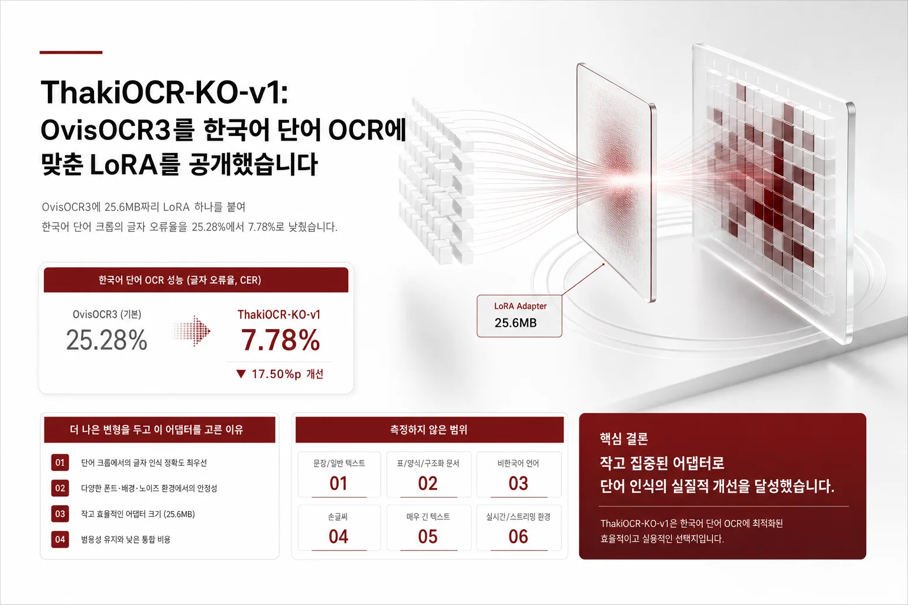
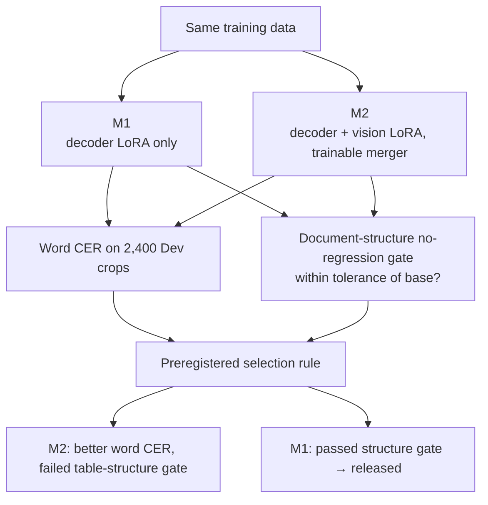
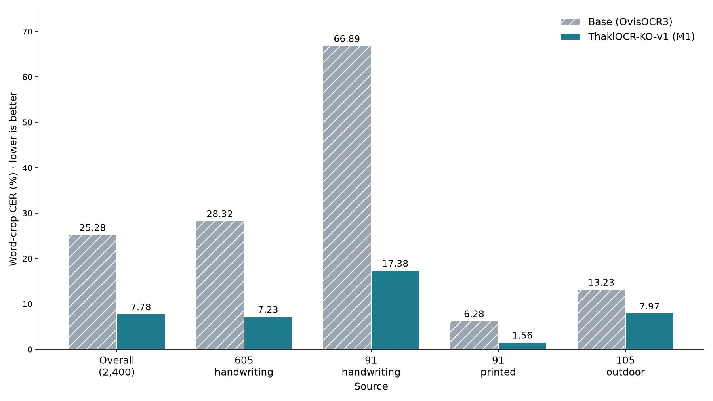
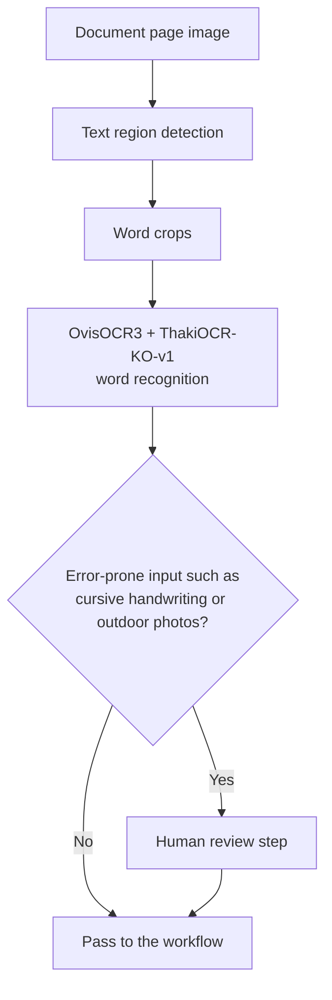

We trained a LoRA adapter for Korean word recognition on top of the open OCR model OvisOCR3 and released it as [ThakiCloud/ThakiOCR-KO-v1](https://huggingface.co/ThakiCloud/ThakiOCR-KO-v1). On 2,400 word crops from our internal development set, the character error rate (CER) went from 25.28% for the base model to 7.78%, a 69.2% relative reduction. The adapter is 25.6 MB and licensed under Apache-2.0.

This is a research release, not a product launch. The model reads an image of one cropped word. We have not verified how well it reads a full document page, so treat it as one step in a pipeline that handles handwritten forms or photographed signs. The base model stays as it is and you download one small extra file on top, so it is easy to add to an existing setup.


*A visual metaphor for the article's key idea.*

## In plain terms

OvisOCR3 is like an experienced clerk who reads printed documents well. It was weak on Korean handwriting, especially cursive writing whose shapes differ from person to person. We gave this clerk a short, focused practice session with a stack of Korean word cards. The method does not change the clerk's whole memory; it only adds one notebook (the LoRA).

After practice, the clerk read word cards much better. We also checked separately that the clerk had not forgotten how to read tables, which it already did well. Another practice method read words even better but failed the table-reading test, so we left it out of this release.

## What problem it solves

Korean document pipelines usually find text regions on a page and then crop and recognize them. If the step that reads a cropped word image is weak, the result is wrong no matter how good the detector is. In Korean settings with varied inputs, such as handwritten application forms, signs photographed outdoors, and printed forms, errors from this step pile up.

OvisOCR3 is an open OCR model that can read document structure. Measured under the same conditions, its CER on Korean word crops was 25.28%, and on one handwriting subset it rose to 66.89%. Our goal was to fix only this weakness without harming the document-structure ability the base model already had.

## Model, data and training

### Model

- Base: [ATH-MaaS/OvisOCR3](https://huggingface.co/ATH-MaaS/OvisOCR3), revision `4833d5d2afa6e769ee933f024504d67ace80a24c`. The base repo's `main` has moved since, so pin this revision.
- Size: the bf16 checkpoint with the adapter merged is 1,706,030,528 bytes, which works out to roughly 0.85B parameters. The model card calls it "0.9B-class".
- Adapter: LoRA r=16, alpha=32, dropout 0.05, attached only to `q/k/v/o/gate/up/down_proj` of the language model. That is 96 modules and 6,389,760 trainable parameters. The vision tower and the vision-language merger were frozen.

### Data

The training data comes from three AI-Hub datasets.

- AI 허브(AI-Hub) · 대용량 손글씨 OCR 데이터 (605), large-scale handwriting OCR data
- AI 허브(AI-Hub) · 다양한 형태의 한글 문자 이미지 인식 데이터 (91), Korean character images in various forms, handwritten and printed subsets
- AI 허브(AI-Hub) · 야외 실제 촬영 한글 이미지 데이터 (105), Korean text photographed outdoors

The data was used only for internal training and evaluation by the approved applicant. The originals and anything derived from them (crops, label files, subsets, samples) are not in the public repository, and this post does not include them either. To use the data, apply for it yourself on AI-Hub.

The printed subset of dataset 91 was rendered with third-party fonts. We checked the font-license field of every label used for training. There were 10 fonts, 7 under the SIL Open Font License and 3 free fonts published by local governments, and we found no prohibition. The public repository contains no font files and no rendered images.

### Training

We trained two arms on the same data.

- **M1 (the released adapter)**: LoRA on the decoder only.
- **M2**: LoRA on both the decoder and the vision tower, plus a trainable merger.

M1 trained for 4.74 GPU-hours on one B200 GPU, with peak training memory of 3.88 GiB. Early stopping used an internal validation split carved from the training data (patience 4; full settings are on the model card). Training stopped at step 5,500, and the released adapter is the best checkpoint at step 5,250. The development set (Dev) was never used to pick a checkpoint.

Which arm to release was decided by a selection rule registered before we saw the results.



## Performance: same-condition comparison with the base model

**Evaluation set**: 2,400 word crops from our internal development set (Dev), 600 per source (605, 91 handwriting, 91 printed, 105), drawn from the official validation splits of the three training datasets. The ground truth totals 7,389 characters, and the 91 handwriting subset has 15 writers. Because it comes from the same sources as the training data, it is not an independent test set.

**Metric**: in this post, Word CER means character error rate (CER) measured on word crops. It is not word error rate (WER). We apply NFC normalization and strip leading and trailing whitespace from prediction and ground truth, then divide the character edit distance by the number of ground-truth characters. "Pooled" divides the sum of edit distances over all 2,400 crops by the total number of ground-truth characters. Lower is better.

**Baseline**: OvisOCR3 without the adapter (same revision), run on the same 2,400 crops with the same prompt, the same image size and the same greedy decoding. The base predictions measured in the M1 training run and in the M2 training run were identical on all 2,400 crops.

| Source | Base (OvisOCR3) | **M1 (released adapter)** | M2 (not released) |
|---|---|---|---|
| Pooled (2,400 crops) | 25.28% | **7.78%** | 5.98% |
| 605 handwriting (600 crops) | 28.32% | **7.23%** | 5.53% |
| 91 handwriting (600 crops, 15 writers) | 66.89% | **17.38%** | 12.19% |
| 91 printed (600 crops) | 6.28% | **1.56%** | 1.66% |
| 105 outdoor photos (600 crops) | 13.23% | **7.97%** | 6.47% |

- Paired over the same items, M1 minus base is −17.50 pp pooled (95% CI −20.32 to −15.12). All four sources improve with confidence intervals that exclude zero.
- The unweighted mean of the per-source CERs is 8.53% for M1.
- By character class, M1 CER is 9.11% for Hangul, 0.85% for digits, 5.04% for Latin letters and 4.14% for punctuation. The base model scored 18.87%, 3.75%, 22.30% and 18.42%. Latin covers only 42 crops (139 characters), so that number is noisy.


*Per-source word-crop CER measured with the same prompt, image size and greedy decoding. Lower is better.*

### Did document structure get worse?

Fine-tuning on word crops can break the table reading or reading order the base model already handled. So we checked, on pages rather than word crops, only that the model did not get worse than the base (no regression). The evaluation sets are 200 sealed synthetic pages (including 50 table pages), set aside and never used for training or tuning, and an 849-item Korean document test suite. Tolerances were fixed before we saw the results. The numbers come from a bf16 merged copy of the adapter served under the same interface as the base model.

| Check | Tolerance | Base | **M1** | M2 |
|---|---|---|---|---|
| Exact table-structure match (50 sealed table pages) | −0.04 | 0.98 | **1.00** | 0.80 ✗ |
| Table TEDS (sealed) | −0.02 | 0.999 | **0.992** | 0.992 |
| Reading-order Kendall τ (sealed) | −0.01 | 0.998 | **0.997** | 0.995 |
| Reading-order coverage (sealed) | −0.01 | 0.998 | **0.997** | 0.996 |
| Korean document test suite (849 items), table pass rate | −0.02 | 51.9% | **56.2%** | 55.6% |
| Korean document test suite (849 items), overall pass rate | −0.02 | 58.0% | **60.2%** | 59.5% |

M2 read words more accurately. M2 minus M1 is −1.80 pp pooled (95% CI −2.43 to −1.14), and on 91 handwriting it is −5.19 pp with a writer-clustered bootstrap over 15 writers (95% CI −7.49 to −3.20). But its exact table-structure match fell to 0.80, more than the 0.04 tolerance below the base model's 0.98. Under the preregistered rule we chose M1. The M2 checkpoint is kept as a separate research model and is not in this repository.

M1's 1.00 is a result on 50 synthetic pages. It does not mean table structure is always correct on real documents.

## Remaining errors and limits

### Where it still fails

- **Cursive handwriting is the hardest.** 91 handwriting dropped from 66.89% to 17.38%, but it is still more than twice as high as any other source. That is not yet good enough to use without human review.
- **Most errors are Hangul syllables.** Hangul makes up most of the ground-truth characters, and M1's Hangul CER of 9.11% is more than ten times its digit CER (0.85%). Most of the remaining errors come from Hangul syllables.
- **Outdoor photos improved the least.** Source 105 went from 13.23% to 7.97%, the smallest relative improvement of any source.
- **Headers and footers stay as weak as in the base model.** On the header/footer items of the Korean document test suite, the pass rate is 5.4% for the base and 6.3% for M1, both low. This adapter did not target that area.

### What we did not measure or claim

- **Full-page OCR**: we did not evaluate reading full real documents as a target task. The model assumes a crop that contains one word.
- **Out-of-distribution generalization**: Dev comes from the same three datasets as the training data. New writers, new fonts, new document types and new capture conditions were not tested. For 91 printed, the same fonts appear in train and Dev.
- **Comparison with larger models**: we do not claim this adapter matches larger OCR models.
- **Other inference settings**: prompts, image sizes and sampling other than the fixed settings below were not evaluated.
- **Cost**: on one B200 GPU at batch size 1, median latency was 0.210 s, p95 0.360 s, and peak memory 7.02 GiB. The base model alone took 0.186 s, 0.310 s and 4.95 GiB. The adapter makes inference a little slower and uses more memory.

## What we checked before release

- Just before release, we re-ran the release adapter on the 2,400 Dev crops. All 2,400 predictions matched the strings saved during training, and the pooled CER was the same 7.78%.
- After switching the repository to public, we downloaded the 6 files without logging in and confirmed that every sha256 matched the pre-release manifest.
- In the same anonymous environment, we downloaded the base model, the adapter and `inference_example.py`, and confirmed that one synthetic image was read correctly. 96 modules had the LoRA attached and 0 on the vision side. This was a loading check, not a performance measurement.

## Download and inference

Use the fixed settings from the model card exactly.

| Setting | Value |
|---|---|
| Base model | `ATH-MaaS/OvisOCR3` revision `4833d5d2afa6e769ee933f024504d67ace80a24c` |
| Prompt | `prompts/plain_ocr.txt` from the base repo at that revision |
| Chat template | `apply_chat_template(..., add_generation_prompt=True, enable_thinking=False)`; image first, then the prompt |
| Image size | `min_pixels = 448*448`, `max_pixels = 2880*2880` |
| Decoding | greedy (`do_sample=False`), `max_new_tokens=64` |
| Weights | base in fp32, generation under bf16 autocast |
| Input | one RGB crop containing one word |

The reference script in the repository runs as is.

```bash
pip install "transformers>=5.0" "peft>=0.21" torch pillow huggingface_hub
python inference_example.py --image word.png
python inference_example.py --image word.png --report   # JSON with load checks
```

The minimal code from the model card is below.

```python
import torch, transformers
from huggingface_hub import hf_hub_download
from peft import PeftModel
from PIL import Image

BASE, REV = "ATH-MaaS/OvisOCR3", "4833d5d2afa6e769ee933f024504d67ace80a24c"
processor = transformers.AutoProcessor.from_pretrained(BASE, revision=REV)
model = transformers.AutoModelForImageTextToText.from_pretrained(BASE, revision=REV, dtype=torch.float32).to("cuda")
model = PeftModel.from_pretrained(model, "ThakiCloud/ThakiOCR-KO-v1").eval()

prompt_text = open(hf_hub_download(BASE, "prompts/plain_ocr.txt", revision=REV), encoding="utf-8").read()
msgs = [{"role": "user", "content": [{"type": "image"}, {"type": "text", "text": prompt_text}]}]
prompt = processor.tokenizer.apply_chat_template(msgs, tokenize=False, add_generation_prompt=True, enable_thinking=False)
inputs = processor(text=[prompt], images=[Image.open("word.png").convert("RGB")], return_tensors="pt",
                   images_kwargs={"min_pixels": 448 * 448, "max_pixels": 2880 * 2880}).to("cuda")
with torch.no_grad(), torch.autocast("cuda", dtype=torch.bfloat16):
    out = model.generate(**inputs, max_new_tokens=64, do_sample=False)
print(processor.tokenizer.decode(out[0, inputs["input_ids"].shape[1]:], skip_special_tokens=True).strip())
```

The public files are `adapter_model.safetensors` (25.6 MB), `adapter_config.json`, `inference_example.py`, the English card `README.md`, the Korean card `MODEL_CARD.ko.md` and `LICENSE`. The internal bf16 merged checkpoint (1.71 GB) is not part of this release. A bf16 merge is not bit-identical to running the fp32 base with the adapter.

## License and attribution

- **Base model**: `ATH-MaaS/OvisOCR3` is Apache-2.0. Use of the base model is governed by its own license.
- **ThakiOCR-KO-v1 LoRA adapter**: released under Apache-2.0.
- **Training data**: may not be redistributed. When you use the adapter, keep the attribution "AI 허브(AI-Hub)" together with the three dataset names above.

## Using it on-premises and on the platform

The adapter is 25.6 MB and the base is an open model, so even in on-premises environments where documents cannot leave the site, you can download the base once and then test by swapping only the adapter. We built this model through ThakiCloud's own procedure of queue-based GPU training, data lineage records, hash verification and anonymous reproduction.

In a document workflow, this adapter covers one step: reading a cropped word. We recommend routing inputs that still produce errors, such as cursive handwriting or outdoor photos, to a human review step.



ThakiCloud builds a platform for training models (Maxis), serving them (Metis) and connecting them to work (Paxis) in environments the customer controls. If you want to train or evaluate an adapter like this on your own documents, contact [ThakiCloud](https://thakicloud.com).

## Related posts

- The larger model in the same series: [ThakiOCR-Large-27B-R2B release post](/tech-blog/en/research/thakiocr-large-27b-r2b-qwen-korean-ocr/). Its evaluation set, preprocessing and decoding differ, so its numbers cannot be ranked against the numbers in this post.
- A small OCR we trained from scratch: [ThakiOCR A release post](/tech-blog/en/research/thakiocr-a-small-korean-english-line-ocr/)
- A follow-up model focused on numbers and symbols: [G2M release post](/tech-blog/en/research/thakiocr-g2m-numbers-and-symbols/)

## References

- Model: [ThakiCloud/ThakiOCR-KO-v1](https://huggingface.co/ThakiCloud/ThakiOCR-KO-v1)
- Base model: [ATH-MaaS/OvisOCR3](https://huggingface.co/ATH-MaaS/OvisOCR3)
- Training data: the AI 허브(AI-Hub) datasets 605, 91 and 105 listed in the data section above. Data may not be redistributed; internal use by the applicant only.
- This is a research release; any product-launch decision is separate.
