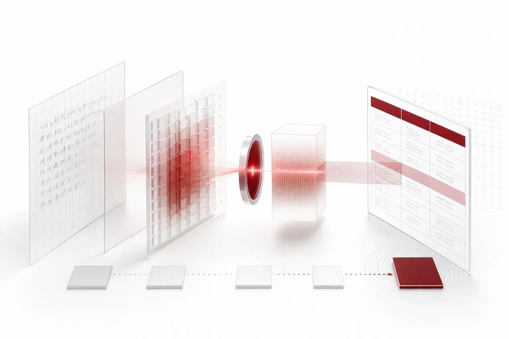
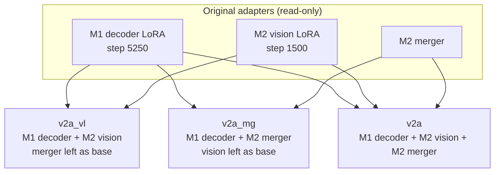

**The numbers below are diagnostic values on the development (Dev) set. They have not been independently verified and are not official performance figures. The model has not been released.** The Dev set was already used to select the previous model, so these numbers cannot decide final performance.

In one line: with no further training, we combined two LoRA adapters component by component. The arm that moved only the vision LoRA reached 4.80% Word CER and 9.78% handwriting CER on Dev and passed the table-structure checks. The preregistered independent evaluation data, however, fell short of its requirements, so we put the release on hold. We stopped because there is not enough data to evaluate on, not because performance was bad.

*A visual metaphor for the article's key idea.*

## In plain terms

Think of a reader as eyes plus a brain. One reader (M1) copies tables accurately but struggles with messy handwriting. The other (M2) reads handwriting better but sometimes splits table cells the wrong way when copying a table.

This experiment kept M1's brain and lent it M2's glasses. The result read handwriting better and did not scramble table structure. But the test used question sheets both readers had already seen, so it has to be repeated on sheets they have never seen. We have not yet collected enough of those new sheets.

## What problem we were trying to solve

When we selected ThakiOCR-KO-v1 there were two candidates. Both were LoRA fine-tunes of OvisOCR3 (Apache-2.0).

- **M1**: LoRA on the language decoder only. On the 50 tables of the sealed set, kept aside for evaluation only, it reached a structure match rate of 1.00 and kept table structure. Under the preregistered rule it was released as KO-v1.
- **M2**: on top of the decoder LoRA, it also trained a vision-encoder LoRA and the merger (the part that turns vision features into language-model input). Handwriting errors dropped by a statistically significant margin, but the structure match rate on the 50 sealed tables fell to 0.80, so it failed the predefined structure criterion.

That left a question: which component did M2's handwriting gain come from, and could we keep table structure if we took only that component?

## What we combined

We did no extra training. We moved the weights of the two adapters component by component (decoder, vision, merger) to build three combinations. The original adapters stayed read-only.

We preregistered v2a as the primary combination and v2a_vl and v2a_mg as comparison arms that each moved only one component (ablations). Code checked that the combination was done correctly: the original adapter hashes matched the training records, the two adapters had the same LoRA settings (rank, alpha and so on) and the same decoder key set and shapes, there were zero trainable parameters after combining, and the per-component hashes of the merged weights matched the originals. The frozen v2a_vl has 96 decoder LoRA modules and 48 vision LoRA modules, with no merger delta. The adapter is 35.0MB.

## Why we kept only the vision LoRA

We ran all three combinations in the same job under the same decoding settings (greedy, at most 64 tokens, batch 1). Each result was mapped to one of four outcomes defined in advance.

| Arm | Components | Preregistered outcome | Handwriting gain transferred | Table structure | Reading order |
|---|---|---|---|---|---|
| v2a | M1 decoder + M2 vision + M2 merger | A (transfer, structure kept) | Yes | Kept | Kept |
| v2a_vl | M1 decoder + M2 vision | A (transfer, structure kept) | Yes | Kept | Kept |
| v2a_mg | M1 decoder + M2 merger | D (degraded) | No | Not kept | Failed |

v2a_mg, which moved only the merger, made more errors, not fewer, and failed the reading-order checks. Both arms that included the vision LoRA passed, and v2a_vl had the lowest error rate of the two. Under the rule fixed in advance ("if v2a_vl passes the structure diagnostic, it becomes the first candidate for independent evaluation"), we froze v2a_vl as the single primary candidate.

This comparison only supports a component-level diagnosis. The handwriting gain followed M2's vision LoRA. The table-structure drop seen in M2 did not appear in the arms that used the M1 decoder. That does not mean the M2 decoder is the only cause of the drop. Interactions among vision, decoder and merger are still possible.

## Dev diagnostic results

The Dev set has 2,400 items, 600 per source. It was already used when selecting the KO-v1 candidate, so the numbers here are diagnostic and are not grounds for a final verdict or a release. On the same Dev items, the base model OvisOCR3 had a CER of 25.28% (measured in the KO-v1 selection job).

| Dev source (600 items each) | v2a | v2a_vl | v2a_mg |
|---|---|---|---|
| AI Hub 105 outdoor photos | 6.57% | 5.84% | 9.56% |
| AI Hub 605 handwriting | 4.51% | 3.83% | 9.26% |
| AI Hub 91 handwriting (15 writers) | 11.66% | 9.78% | 20.77% |
| AI Hub 91 printed | 1.40% | 1.30% | 2.39% |

v2a_vl's overall Word CER, pooled across the four sources, is 4.80%. Whether the handwriting gain carried over to the combined model was decided with 95% confidence intervals from an item-level paired bootstrap and a writer-level bootstrap on AI Hub 91 handwriting. v2a_vl met both conditions.

## What the table-structure diagnostic measured

Changing the vision side can keep characters right while breaking table cell layout or reading order. So we measured with the same checks and tolerances as the KO-v1 selection, running the base model in the same job.

- **Sealed table structure match (structure_em)**: the share of the 50 sealed tables whose cells, spans and headers match the ground truth exactly. This check also has a separate floor of 0.96.
- **TEDS**: treats a table as a tree and measures similarity by edit distance to the ground truth.
- **Reading order**: fails if rank correlation (tau) or coverage drops more than 0.01 below the base model.
- **KDoc-OCRBench-V2 pass rate**: fails if the pass rate on table items or on all items drops more than 0.02 below the base model.

| Check (v2a_vl) | Base model | v2a_vl | Tolerance | Result |
|---|---|---|---|---|
| Sealed table structure_em | 0.98 | 1.00 | 0.04 | Pass |
| Sealed table TEDS | 0.9992 | 0.9916 | 0.02 | Pass |
| Reading order tau | 0.9976 | 0.9944 | 0.01 | Pass |
| Reading order coverage | 0.9982 | 0.9968 | 0.01 | Pass |
| KDoc table pass rate | 0.5199 | 0.5571 | 0.02 | Pass |
| KDoc overall pass rate | 0.5806 | 0.5999 | 0.02 | Pass |

## Error types and limits

- **Handwriting is still the hardest.** By source, AI Hub 91 handwriting CER (9.78%) is more than seven times the printed CER (1.30%). The 91 handwriting Dev split has only 15 writers, so we cannot tell whether it generalizes to new writers.
- **Many table items still fail.** A KDoc table pass rate of 0.5571 means more than four in ten table items do not pass. The diagnostic says it is no worse than the base model, not that table recognition is good enough.
- **TEDS went down slightly.** It fell 0.0075, from 0.9992 for the base model to 0.9916, within tolerance.
- **It is a word-crop model.** It is not a full-page OCR model, and this diagnostic makes no such claim.
- **The cause of the reproduction mismatch is not confirmed.** When M1 and M2 were re-run, their item-level agreement with the training-time predictions was 0.99167 and 0.99333, above the 0.97 threshold. That the difference comes from BF16 nondeterminism is still a hypothesis.
- **Dev reuse**: as noted above, every number comes from data that was already used.

## Why we put the release on hold

### The rules were set before the results, and we do not change them

The independent evaluation rules for the final verdict were preregistered and frozen before any results were seen. The order is: collect by fixed rule, run the overlap check in code, build ground truth in code, freeze the evaluation list (manifest) hash, and only then run each candidate model once. No candidate model runs on any evaluation page before the manifest is frozen. We also decided in advance that if the requirements were not met, we would not loosen the rules or extend the collection window.

### Independent document evaluation (I-DOC): not enough table pages or templates

We only took documents published under KOGL Type 1 or CC BY 4.0 that have tables in native HWPX, DOCX or LaTeX source. Issuers and templates used in earlier evaluations were excluded.

| Requirement | Target | Secured | Result |
|---|---|---|---|
| Table pages | at least 150 | 93 | Short |
| Templates with tables | at least 15 | 9 | Short |
| Documents | at least 40 | 183 | Met |

The 150-page target has a reason. Even if 50 sealed tables give a structure match of 0.96 (48/50), the Wilson 95% lower bound is only about 0.86, which is too loose for a meaningful verdict. We reviewed 1,330 pages from 242 rights-verified documents. Ground truth could be built for 451 pages. After removing 14 pages that overlapped earlier evaluation sets and 49 pages over the per-template cap (20 table pages), 388 pages remained, 93 of them table pages. The largest exclusion reason was a source table spanning several pages (2,752 cases). When a page holds only part of a table, the page's ground-truth table structure cannot be fixed from the source.

### Independent handwriting evaluation (I-HW): no source meets the writer-ID condition

Generalization to new writers can only be measured on handwriting from writers who never appeared in training or Dev. That needs an explicit writer ID.

- AI Hub 91: has writer IDs, but all 137 writers were already used in training or Dev, so there are no new writers.
- AI Hub 605, 81 and 71301: labels carry attributes such as age and gender only, with no writer ID.

We do not use age-gender combinations or file names in place of a writer ID. That would be an assumption about whether two samples come from the same person that we cannot verify.

### Why we do not reuse existing data

The 2,400 Dev items and the sealed table set were already used when selecting the KO-v1 candidate. Judging again on that data risks mistaking a result tuned to questions we have already seen for real performance. So the following are ruled out:

- Additional training (V2-B/C)
- Loosening evaluation or ground-truth rules (for example, the rule for tables that span pages)
- Reusing existing training or Dev data as the independent evaluation
- Re-selecting the model or the evaluation set

This is not a performance NO-GO. The official independent evaluation has never been run, so no verdict that performance is bad can be made either. The official state is INDEPENDENT_EVAL_DATA_INSUFFICIENT and RELEASE_HOLD.

## Next step

Once independent document and handwriting evaluation data is secured, we will evaluate under the same rules. The frozen v2a_vl files and decoding settings will not change.

## Models you can use today

This candidate is not released, so there is no download or inference code. The Korean OCR model you can download today is covered, including setup and inference, in the [ThakiOCR-KO-v1 post](/tech-blog/en/research/thakiocr-ko-v1-ovisocr3-korean-finetune/).

## On-premises and technical questions

ThakiCloud builds a platform for training models (Maxis), serving them (Metis) and connecting them to business work (Paxis), in environments the customer controls. This experiment went through the same procedure: preregistration, queue-based GPU jobs and hash verification. For document OCR adoption or technical questions, contact [ThakiCloud](https://thakicloud.com).

## Related posts

- [ThakiOCR-KO-v1: Korean fine-tuning of OvisOCR3](/tech-blog/en/research/thakiocr-ko-v1-ovisocr3-korean-finetune/)
- [ThakiOCR A: our own 2.13M-parameter Korean-English OCR](/tech-blog/en/research/thakiocr-a-small-korean-english-line-ocr/)
- [ThakiOCR G2M: numbers and symbols](/tech-blog/en/research/thakiocr-g2m-numbers-and-symbols/)
- [ThakiOCR A2 independent evaluation on 43,751 lines](/tech-blog/en/research/thakiocr-a2-independent-eval-43751-lines/)

## Data sources

- AI Hub (AI-Hub) datasets: Korean Character OCR in Various Forms (91), Large-Scale Handwriting OCR (605), Outdoor Real-World Korean Text Images (105). Only aggregate numbers are shown; no originals or samples. The data is for the applicant's own internal use and is not redistributed.
- Base model: ATH-MaaS/OvisOCR3 (Apache-2.0)
- Table diagnostic: KDoc-OCRBench-V2 (evaluation only)
