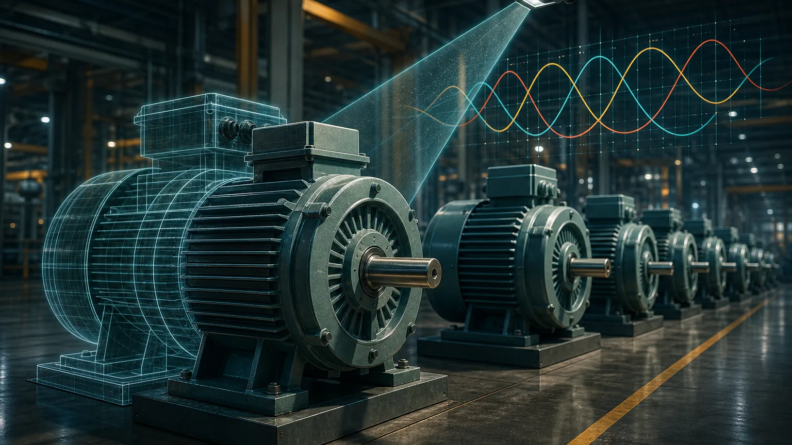
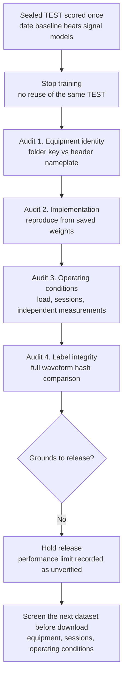

If you are building a fault classifier from plant data, here is the short version. We trained motor fault models on three-phase current from the AI-Hub machine facility fault prediction sensor dataset (#238) and scored them once on 10 motors held out from training. A baseline that only reads the date in the filename reached a binary macro-F1 of 0.593, higher than the physics feature model (0.559) and the fine-tuned MantisV2 model (0.533).

So we did not release a model. We also did not conclude that current cannot reveal faults. When we went back to audit the data and the code, we found an equipment identity bug, an operating-condition confound and waveform copies with different labels. This post records the order of that audit and what each step showed.

## The short analogy

Imagine judging a study method from the exam scores of 40 students, then finding that three pairs of students share one name on the roster. The exam date alone predicts the scores fairly well, and some answer sheets were handed in twice with only the name tag swapped. With a roster like that you cannot say the method works or that it fails. You fix the roster and the answer sheets first.

## What we trained and how we scored it

The data are three-phase current files recorded at 2 kHz for one second each, stored in per-equipment folders, 1,301,718 files in total. Labels are normal plus four faults: bearing, loose belt, misalignment and rotor imbalance. We split development (DEV) and test (TEST) by equipment and trained on 15,364 DEV files. The 5,400 TEST files (3,000 normal, 600 for each of the four faults) stayed sealed under a rule that no model or threshold changes after seeing results, and we opened them once.

We compared two models. One is HGB (Histogram Gradient Boosting) on spectral physics features. The other is the time series foundation model MantisV2, fully fine-tuned. Baselines ran in the same test: one that always answers "normal", and others that never look at current and only use filename metadata.

## The first warning: the date beat the models

| Test | Always normal | Physics features + HGB | MantisV2 fine-tuned | Filename date only |
|---|---|---|---|---|
| Binary macro-F1 | 0.357 | 0.559 | 0.533 | 0.593 |
| Binary accuracy | 0.556 | 0.560 | 0.535 | 0.598 |
| 5-class macro-F1 | 0.143 | 0.253 | 0.197 | 0.175 |

By accuracy, the physics feature model was almost identical to always answering normal (0.560 vs 0.556). In the 5-class task, imbalance recall was 0.000 for the physics feature model and 0.013 for MantisV2. Equipment with only normal data drew many false alarms.

We had two options at that point. We could change the model or preprocessing and rerun the same test, or we could find out why the scores looked like this. A score tuned against the same TEST is not an independent result, so we stopped training and audited first.

## The order of the audit

Every step ran without training. We reused the saved weights as they were, and we fixed the decision rules in documents before looking at results.

## Audit 1: one folder, two machines

We first identified equipment by the pair (rating folder, motor folder). When we added the nameplate fields from each file header (rated rpm, power and rated current) to the key, the number of distinct groups went from 40 to 43. Three folders each mixed two machines with different rpm and rated current. Matching the dataset page's official equipment list row by row showed that these three pairs share power rating and equipment ID but sit at different installation sites. The current folder paths carry no site field, so they were merged.

No machine appeared in both DEV and TEST, because we split by folder and every machine is a subset of one folder. The "per-motor" scores were wrong, though. Two TEST folders that looked like one machine with both normal and fault data were really a normal-only machine merged with a mostly-fault machine. Their high scores came from telling two machines apart, not from separating normal and fault on the same machine.

Recounted by equipment, only 6 TEST machines held balanced normal and fault data. On those 6, the physics feature model had a mean balanced accuracy of 0.537 and a minimum of 0.472. On the 4 normal-only machines, the false alarm rate averaged 0.584 with a maximum of 0.913. File-level macro-F1 stays as reported because the labels did not change; we corrected only the equipment-level metrics and confidence intervals.

## Audit 2: the model did train, and the results reproduce

When scores are low, the first suspect is a run that never trained properly. Fine-tuning ran exactly the declared 1,830 steps, and 51.3% of encoder parameters changed. Label encoding and class remapping had no defects.

Rerunning the saved weights on the same 5,400 files reproduced all four scores (binary and 5-class, two models) to the sixth decimal place. Switching the GPU precision setting (TF32) flipped predictions for 1 to 2 borderline files and moved F1 by 0.0004 or less. Implementation mistakes do not explain the low scores.

## Audit 3: normal and fault were recorded at different operating points

Next we looked at what preprocessing removed. The input path divided each phase by its fundamental amplitude and averaged the three phases, so absolute current level and differences between phases never reached the model. For each removed quantity we measured a single-feature AUC for separating normal and fault within one machine.

The result was lopsided. Absolute load alone (RMS divided by rated current) reached AUC 0.9 or higher on 21 of 24 mixed machines, with a median of 0.992. Phase amplitude imbalance (0.473), negative-sequence ratio (0.525) and supply frequency (0.522) sat near chance. Within each (machine, label) group, the 5 to 95% load range was ±1.6% of rating. Fault and normal recordings were taken at different operating points, and this data cannot tell whether the fault raised the load or the sessions simply differed.

The dataset has no measured speed, load torque, voltage or session ID. Reconstructing sessions from filename timestamps, labels switched 53,893 times inside the same sensor code streams, and 61% of those switches happened within one second. An experiment that physically introduces and removes faults cannot switch tens of thousands of times at one-second intervals. That structure is consistent with the date baseline beating the signal models.

## Audit 4: the same waveform with a different name tag

Finally we hashed the waveform body of all 1.3 million files. In one equipment folder, 5,223 file pairs had byte-identical waveforms and differed only in the two label lines of the header. Copies of misalignment recordings carried a normal label. Because the headers differed, file checksums differed too, so the copies passed our earlier deduplication and entered the DEV training data.

We also found 140,311 groups of identical waveforms with the same label and different timestamps. Measured three-phase noise over 2,000 samples cannot match bit for bit, so we treat these as file duplication. With a time-based split, the same waveform could land on both sides, which is a leakage path.

## Why we held the release

Three reasons decided it. First, on the sealed test the signal models did not beat a metadata baseline. Second, false alarms on normal-only machines were far too frequent for field alerts. Third, the confounds found in the audit mean this dataset cannot test whether a model separates normal from fault on the same machine under the same operating conditions. All 43 machines have already been used for training or evaluation, so no unseen machine is left either.

We did not release a model, and we did not settle the performance limit either. In our internal ledger the state is `RELEASE_NO_GO` and `MODEL_PERFORMANCE_LIMIT=UNVERIFIED`. What we can state is that the current pipeline failed to transfer to the field with this data. It is not evidence of a technical ceiling for current-based diagnosis. We will not report scores improved against the same test set as if they were independent validation.

## Screening the next dataset before download

The most practical outcome of the audit is the order in which we now pick data. Across the three datasets we have worked with (MCC5, the KAIST bearing set and AI-Hub #238), the shared problem was telling whether a model learned faults or learned the machine, the session or the operating condition. So the next candidate is checked against three conditions using only papers, data descriptions and file lists. If any condition lacks evidence, we do not download it.

| Condition | What to check |
|---|---|
| The same fault on several physical machines | At least 2 machines in every cell of the equipment by fault table |
| Normal and fault repeated across independent sessions | At least 3 sessions per condition, without a fixed measurement order |
| Normal and fault comparable under the same operating conditions | Every speed, load and torque cell has both normal and fault |

The AI-Hub #238 track is not closed for good. We will reopen it when data exists that collects normal and fault on the same motors across several loads and speeds, records independently measured speed, torque or power, voltage and session IDs, and allows evaluation on entirely different motors.

## Takeaway

If you change the model first when a fault classifier scores poorly, you end up retaking the same test, and a higher score no longer tells you what improved. We ran baselines and an audit first, which surfaced three merged equipment pairs, an operating-point confound and 5,223 relabeled waveform copies. No model came out of it, but it became clear what kind of data can test generalization to new machines. The model we did release under the same rules, and its limits, are covered in [our MCSA model release post](/tech-blog/en/research/thaki-mcsa-mantisv2-mcc5/).

If you are evaluating fault diagnosis AI on your own equipment data, [contact ThakiCloud](/contact?interest=industrial-ai&origin=aihub238-audit). We start with the equipment layout, the measurement conditions and how labels are assigned, before any model discussion.



---

*Data source: AI-Hub, machine facility fault prediction sensor dataset (#238). Raw and processed data are not redistributed and were used only for the applicant's internal research. This post contains aggregate figures only, with no waveforms, files or label rows.*
