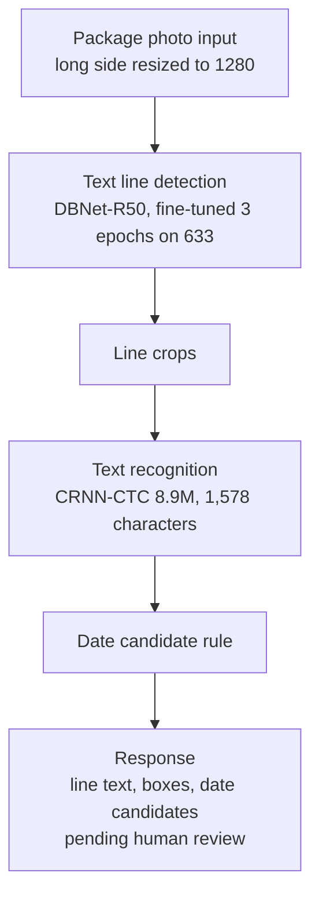
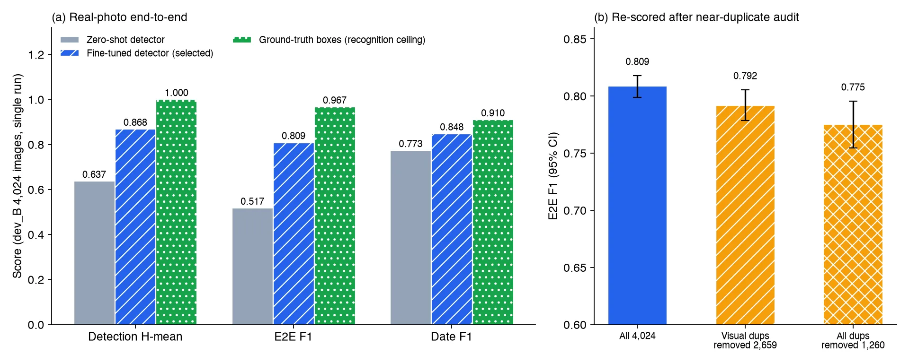

*Concept image. Not a real cosmetics package and not a dataset image.*

If you want to run text and date reading on product package photos on your own servers, here is the conclusion first. Our cosmetics packaging OCR, an 8.9M-parameter CRNN recognizer paired with a fine-tuned detector, reached an F1 of 0.809 on full-photo E2E. That number comes from a single evaluation on 4,024 photos from product groups never used in training.

The number should not be taken at face value, though. 33.9% of the evaluation photos were visually almost identical to training photos, and removing them brings F1 down to 0.775 to 0.792. We have not yet measured anything on photos taken in stores or by customers. This post sets out what has been confirmed and what remains, with numbers and conditions.

## In plain terms

Think of it as a dictation test. First we showed the student (the CRNN) one word card at a time and asked it to read each one, and it almost never got one wrong. Then we handed over a whole newspaper page and asked it to find where the text was and read it. At that stage the grade depended on the eye that finds the text (the detector).

After the test we looked at the papers again and found that about a third of the questions used newspapers nearly identical to the practice set. We removed those and regraded. The score dropped a little but did not collapse. What remains is a test on a newspaper we have never seen, meaning photos from a customer's site.

## What we built

The data is the AI-Hub cosmetics and pharmaceutical package OCR dataset (633). It contains 105,216 package photos taken indoors, each with text region labels. We split by product group so that photos of the same product never land in both training and evaluation.

The pipeline has three stages: a detector that finds text lines in the photo, a recognizer that reads each cropped line, and a rule that picks date candidates from the recognized strings.

We fixed the evaluation rules in a committed file before submitting any measurement job. We did not change thresholds or splits after seeing results, and the decision set was opened only once.

## The word card test: crop recognition

The first stage reads only text crops cut out with ground-truth boxes. Opening the sealed official test split once, the CRNN scored a character error rate (CER) of 0.0158.

The comparison is ThakiOCR-KO-v2, the general Korean OCR we built earlier. Paired on the same 6,128 crops, the CRNN's CER was 0.050 lower (95% confidence interval −0.058 to −0.043). Looking only at the 475 crops from products absent from the training product families, the gap narrowed to −0.040 (−0.055 to −0.026) but stayed clearly below zero. Against the public PP-OCRv5 model, exact match was 0.971 versus 0.884.

The speed gap was large as well. Reading one crop on a B200 took 1.74 ms for the CRNN and 153.8 ms for ThakiOCR-KO-v2. The CRNN takes 15.9 ms per crop even on a single CPU thread, so it can run on servers without a GPU.

What this result supports is narrow. The CRNN was trained on this data and the two models it was compared against never saw it. So the claim stops at "in this domain, a dedicated small model beats a general model." Fine-tuning ThakiOCR-KO-v2 on the same data might have closed the gap, and we did not run that comparison.

## The newspaper page test: full-photo E2E

A real service receives a whole photo. So we evaluated detection through recognition in one pass on 4,024 photos (dev_B) from 1,173 product groups never used in training. The detector and thresholds were chosen only on a different set of groups (dev_A), and dev_B was used once, in this evaluation.

| Metric (dev_B, single evaluation) | Zero-shot detector + same CRNN | Fine-tuned detector + CRNN | Ground-truth boxes + CRNN |
|---|---|---|---|
| Detection H-mean | 0.637 | 0.868 (0.859 to 0.877) | 1.000 |
| E2E F1 | 0.517 | 0.809 (0.799 to 0.818) | 0.967 |
| E2E CER | 0.368 | 0.117 (0.109 to 0.127) | 0.017 |
| Date F1 | 0.773 | 0.848 (0.826 to 0.868) | 0.910 |

The detector with public pretrained weights as-is reached only 0.517 E2E F1. Fine-tuning the same architecture on this data for 3 epochs raised it to 0.809, and the paired difference between the two conditions was +0.291 (0.279 to 0.302). The recognizer stayed the same; only the detector changed.

Given ground-truth boxes, E2E F1 rises to 0.967. That means most of the remaining gap comes from detection rather than recognition, mainly lines the detector missed (recall 0.879). So the next thing to improve is the detector.

This table carries one optimistic bias. The development split used to select the CRNN checkpoint contained dev_B product groups. The detector never saw dev_B, but the recognition side may have come out slightly generous.

## Rechecking the test papers: the near-duplicate audit

Because we split by product group, we assumed the evaluation photos showed packages the model had never seen. To check that assumption, we found the most similar training photo for each dev_B photo and compared them by image structure (SSIM) and feature point matching.

The result was worse than expected. 1,365 of the 4,024 dev_B photos (33.9%) were visually the same as training photos from other groups. Our guess is that the same physical package entered training under a different product name because of a volume or labeling difference. We did not open the group names ourselves, so the cause stays a guess.

We removed the duplicate photos and rescored the predictions we already had. Dropping the 1,365 visual duplicates gave an E2E F1 of 0.792 (0.778 to 0.805). Dropping every photo flagged by any of the visual, text or hash criteria left 1,260 photos and gave 0.775 (0.755 to 0.795). That is 1.7 to 3.4 points below the original 0.809, but it did not collapse.

This audit has its own counterargument. If different packages shot on the same stand under the same lighting were flagged as similar, 33.9% overstates the overlap. On the other hand, duplicates shot at very different angles may have been missed as candidates. No person reviewed the comparison sheets, so this ratio is a proxy estimate.

## beauty.ocr on your own servers

We exported the detector and recognizer to ONNX and bundled them as a tool called `beauty.ocr`. It uses only the onnxruntime CPU build and never loads PyTorch. The bundle, models plus character list, is 136.6 MB.

On 4 CPU threads (AMD EPYC 9355, the CPU of a GPU node), the median time per photo was 546.6 ms and the 95th percentile was 1,348.7 ms. Peak memory during the measurement was 4.12 GiB. On the same photos, the E2E F1 difference between CPU and GPU results was −0.0005, effectively identical.

We also ran a regression test with the tool served over HTTP for agents to call. On 4 threads of an Intel Xeon 8592V, 100 photos produced 9,571 lines that matched the evaluation code output line for line. Median round-trip latency was 876 ms. The server process had outbound network access blocked, with 0 blocked attempts and 0 sockets open to external addresses. It never calls an external OCR API.

Every response goes out in a "pending human review" state and writes nothing to any system. It does not extract the product name and returns `NOT_EXTRACTED` instead, because a simple rule based on line position reached a product name precision of only 0.044, which is unusable. We cover that problem in a separate post.

## What this means for ThakiCloud products

In Paxis, this result fits business automation where documents and photos move between people. Think of receiving inspection or label checks, where someone looks at a package photo and copies the date down: an agent fills in a draft and a person confirms it. That is also why `beauty.ocr` always answers in a pending-review state.

For customers who cannot send data outside, an on-premise installation such as Aegis is the starting assumption. Running on a 4-core CPU with 8 GiB of memory, without a GPU and without outbound network access, fits that condition. Training a separate small model on domain data instead of growing a general model is the same workflow that Maxis handles.

## Limitations and counterarguments

The strongest counterargument is that every evaluation photo came from the same dataset and the same capture method. Checking the labels, the capture environment was indoors in every case, and there were no fields marking reflection, curved surfaces or blur. There is no evidence yet that a detection recall of 0.879 holds under store lighting or on customer phone photos.

Latency is not a representative figure either. Both measurements used the CPU of a cluster GPU node, and different CPU types split the result into 546.6 ms and 772 ms (in-server processing). It has to be measured again on the CPU a customer will actually use.

The levels of judgment also need to be kept apart. Crop recognition and full-photo E2E both cleared the pass criteria we set in advance, so the model verdict is a pass. The commercial verdict is conditional, because customer photo validation and latency measurement on the target CPU remain. Customer validation has not happened yet, so we do not describe this as a feature that can be sold today.

## Summary

The small OCR that reads text and dates on cosmetics package photos reached an E2E F1 of 0.809 on the fixed evaluation and 0.775 to 0.792 on the conservative rescore without near-duplicates. It runs at about 0.55 to 0.77 s per photo (median processing time, depending on CPU type) on 4 CPU threads, without a GPU and without outbound network access. The next improvement is reducing the lines the detector misses, not the recognizer.

And the next test has to use photos the model has never seen. If you are evaluating the same capability, we suggest testing first on photos taken under your own capture conditions. The numbers in this post work well as a baseline when you design that evaluation.

---

*Data source: AI-Hub, cosmetics and pharmaceutical package OCR dataset (633). The data is not redistributed and was used only for the applicant's own internal training and evaluation. This post contains aggregate figures only, with no photos, crops or label values. The figures are charts drawn from ledger numbers and concept images.*
