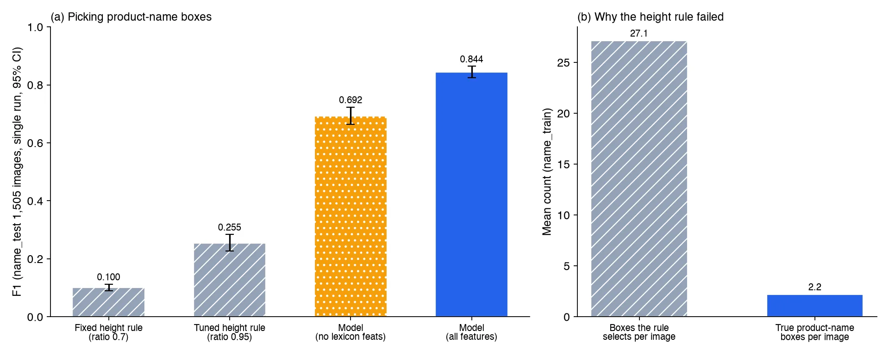

*Concept image. Not a real cosmetics package and not a dataset image.*

If you want to automatically pick which of the text lines read from a package photo is the product name, here is the conclusion first. A rule that picks the line with the largest text was nearly useless. A small tree model that looks at box position and text characteristics together reached an F1 of 0.844. That number comes from a single evaluation on 1,505 photos from 547 product groups never used in training.

This evaluation, however, gave the model ground-truth boxes and ground-truth text as input. An evaluation connected to the text a real OCR reads is being measured under separately fixed criteria and has no result yet. This post separates what has been confirmed from what has not.

## In plain terms

Think of finding book titles on a bookstore display. "The largest text is the title" sounds reasonable, but a cover is full of large text such as publisher logos and promotional bands. In practice this rule picks dozens of candidates per cover, while the real title is about two pieces of text.

So we trained a clerk to look not only at size but also at position, character types, and whether that phrase served as a title on other books. This clerk became far more accurate. But so far it has only chosen from cards with the correct text written on them, and we have not tested whether it still chooses well on covers that were read blurrily or wrongly.

## Why the rule failed

In our earlier cosmetics packaging OCR work, we decided not to extract the product name and to return `NOT_EXTRACTED` instead. The reason was that a rule based on line height reached a product name precision of only 0.044. When we broke down the causes, the problem turned out to be that the rule picks far too much.

The data is the AI-Hub cosmetics and pharmaceutical package OCR dataset (633). The label type for product names averages 2.2 per image, while the height rule picked an average of 27.1 boxes per image. 51.2% of images had no product name box at all. Of the wrongly picked boxes, 44% were type 5, 27.5% type 2 and 22% type 4. Changing the reference did not change the conclusion. Even scoring against overlap with the metadata product name string gave a precision of 0.052.

## What we built

It is a binary classifier that decides, for each box, whether it is the product name. It uses no pixels, only 35 features such as box coordinates and size, the number of boxes on the same line, character type ratios, whether the text looks like a unit or a date, and how often that string served as a product name in the training data. The model is scikit-learn's HistGradientBoosting.

Training used about 8.04 million boxes drawn from 72,542 photos and ran on 12 CPU cores of a B200 node, with no GPU. The whole job, from training through evaluation, took 219 seconds. We did not measure inference latency per photo.

We split by product group into 20,978 training, 564 development and 547 test groups with no overlap. The decision threshold was chosen on the development split only, and the criteria and baselines were fixed in a committed file before measurement.

## Results: when the correct text is given

These are the results from opening the 1,505-photo test split once.

| Method (name_test, single run) | Precision | Recall | F1 (95% confidence interval) |
|---|---|---|---|
| Fixed height rule (ratio 0.7) | 0.055 | 0.566 | 0.100 (0.090 to 0.112) |
| Tuned height rule (ratio 0.95) | 0.282 | 0.232 | 0.255 (0.227 to 0.284) |
| Model without lexical features | 0.730 | 0.659 | 0.692 (0.664 to 0.723) |
| Model with all features | 0.875 | 0.816 | 0.844 (0.825 to 0.864) |

The paired F1 difference against the tuned rule was +0.590 (0.563 to 0.618). Precision is about 16 times that of the fixed rule. Split into 996 cosmetics photos and 509 pharmaceutical photos, F1 was similar at 0.844 and 0.846.

The biggest contribution came from a lexical feature that counts whether a string was a product name in the training data. Removing it dropped F1 to 0.692, and the paired difference was +0.152 (0.131 to 0.174).

## What this number does not prove

The strongest counterargument is that the lexical feature may have memorized strings. 40.2% of test photos (605) were visually almost identical to training photos. If the same physical packages and the same brand strings were already in training, the model did not judge, it remembered.

There is evidence in the other direction too. On the 425 photos left after removing visual or text near-duplicates, F1 was 0.815. This is a reference value without a computed confidence interval. Recall on 149 product name strings absent from the training data was 0.711. Even so, on truly unseen brands the lexical feature carries no information, and performance could fall toward the level without it (F1 of about 0.69).

The second limitation is the input condition. This evaluation supplied ground-truth boxes and ground-truth text. In the real pipeline, detection H-mean is 0.868 and the character error rate is 0.117, so even a slightly wrong string makes the lexical lookup miss. The full-photo evaluation connected to OCR output is being measured on a new evaluation set under new criteria. At the time of writing there is no result, so it remains unverified.

## What this means for ThakiCloud products

In the document and photo handling flows of Paxis, the product name belongs as a field candidate that a person confirms. For now the OCR tool keeps returning `NOT_EXTRACTED` for the product name, and this model can be attached as a candidate suggestion only after it passes the full-photo evaluation.

Because this model trains on CPU without a GPU and never looks at pixels, it is easy to place in an on-premise installation such as Aegis. Training a small classifier on domain data instead of a large vision language model is the same workflow as Maxis small domain models. Since it has not been validated on customer data, we do not describe it as a feature that can be sold.

## Limitations and counterarguments

Beyond the two points above, other conditions remain. Every photo is an indoor capture from the same dataset, so we do not know how it performs under reflection, curved surfaces or blur. The product name label type consists of fragments averaging 3.1 characters and covers only 32.7% of the characters in the metadata product name. We have not checked whether that unit matches the product name a customer wants.

The levels of judgment also need to be kept apart. This result cleared the three criteria set in advance (beating the tuned rule, a point estimate bar and a confidence interval bar), so the model verdict is a pass. The full-photo evaluation and customer validation remain, so no commercial verdict has been made.

## Summary

Picking the product name could not be solved by text size alone. A small tree model that looks at position, character types and the past use of a string reached an F1 of 0.844 when the correct text was given, 0.59 above the tuned rule.

A large part of that number may rest on remembering strings from the training data. The evaluation connected to real OCR output is still being measured, and automatic product name extraction stays off until it reports. If you are evaluating the same capability, we suggest judging by scores on real OCR output, not by scores under the correct-text condition.

---

*Data source: AI-Hub, cosmetics and pharmaceutical package OCR dataset (633). The data is not redistributed and was used only for the applicant's own internal training and evaluation. This post contains aggregate figures only, with no photos, crops or label values. The figures are charts drawn from ledger numbers and concept images.*
