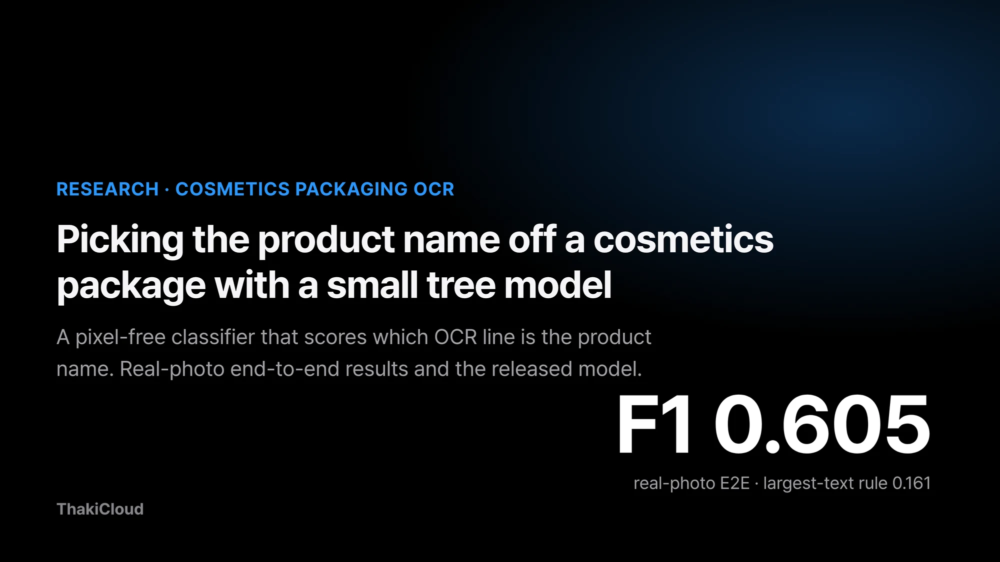
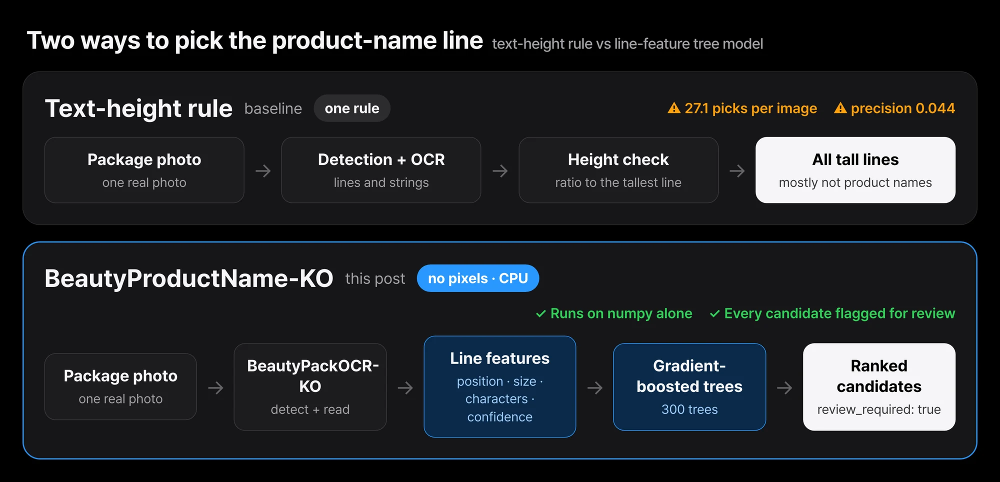
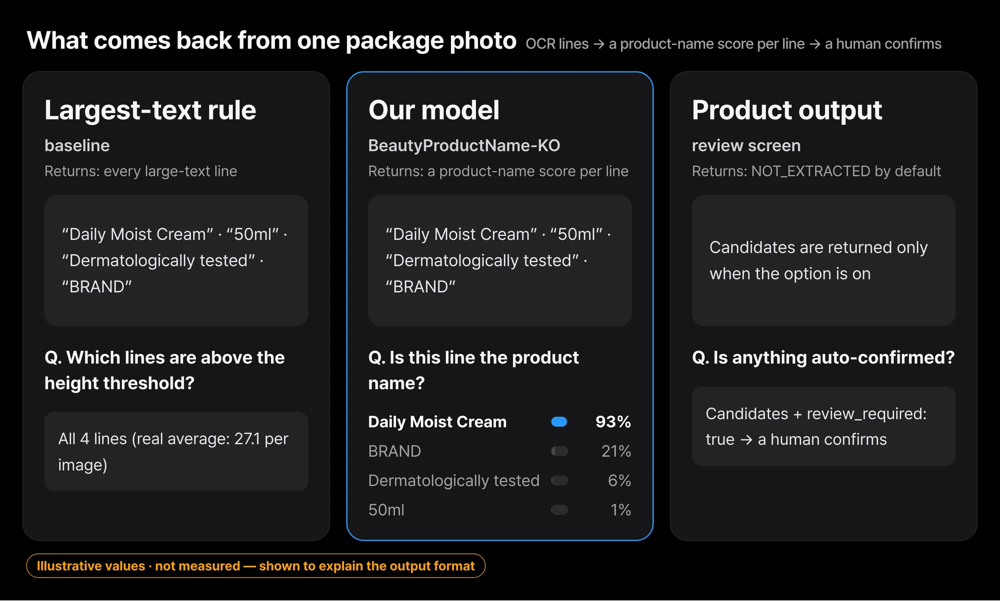
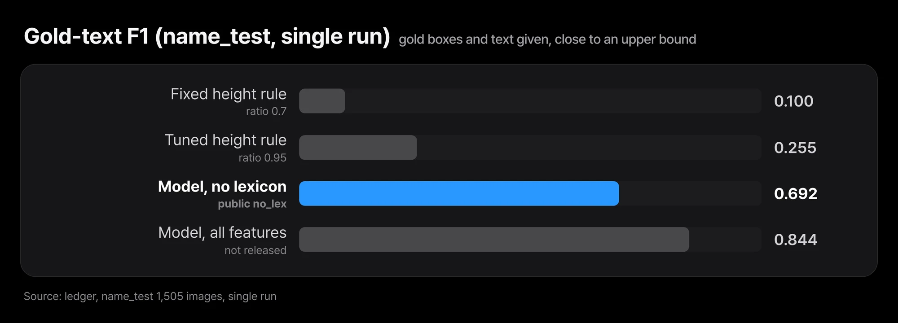
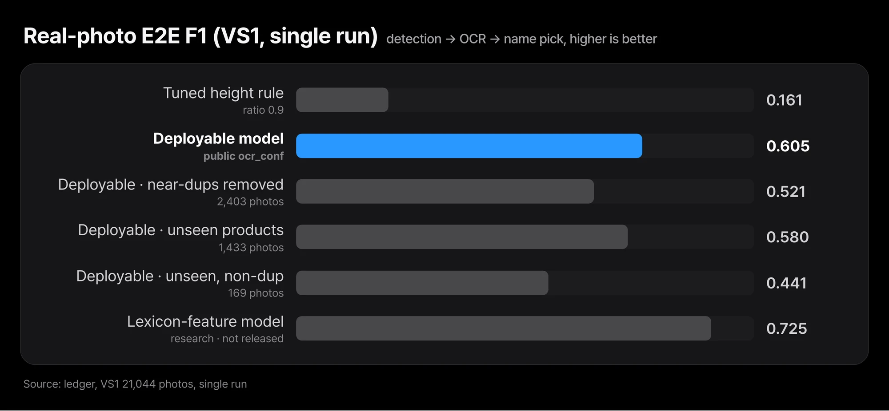
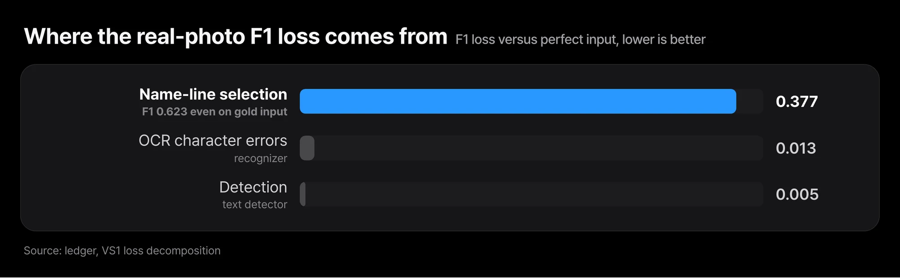

*Building BeautyProductName-KO*

Read a cosmetics package with a text recognizer and the product name, volume, ingredients, expiry date and brand logo all come out as mixed lines of text. To fill a single product-name field on a listing screen, someone has to pick which of those lines is the name. Picking the line with the largest text sounds like it should work, but real packaging is full of large text.

If you want to automatically pick which of the text lines read from a package photo is the product name, here is the conclusion first. In an evaluation that ran full photos all the way through detection, OCR and product name selection, the small deployable tree model reached an F1 of 0.605 (95% confidence interval 0.599 to 0.612). Under the same conditions, a rule that picks the line with the largest text reached 0.161. The evaluation set of 21,044 photos was opened once, and all three preregistered criteria were met.

Even so, this model is not good enough to extract product names automatically. The share of photos where every product name was found exactly is 0.196. So the product's default output stays `NOT_EXTRACTED`, and we use this model only to suggest candidates for a person to confirm. The two models that need no label statistics are released on Hugging Face as [ThakiCloud/BeautyProductName-KO](https://huggingface.co/ThakiCloud/BeautyProductName-KO).

## In plain terms

Think of finding book titles on a bookstore display. "The largest text is the title" sounds reasonable, but a cover is full of large text such as publisher logos and promotional bands. In practice this rule picks dozens of candidates per cover, while the real title is about two pieces of text.

So we trained a clerk to look not only at size but also at position, character types and reading confidence. On a real display that mixes in covers read blurrily, this clerk did far better than the rule. Still, it found every title without a miss on only about one cover in five. That is why we use the clerk's picks as candidates that a person checks.

## Picking the largest text grabs 27.1 lines per image

In our earlier cosmetics packaging OCR work, we decided not to extract the product name and to return `NOT_EXTRACTED` instead. The reason was that a rule based on line height reached a product name precision of only 0.044. When we broke down the causes, the problem turned out to be that the rule picks far too much.

The data is the AI-Hub cosmetics and pharmaceutical package OCR dataset (633). The label type for product names averages 2.2 per image, while the height rule picked an average of 27.1 boxes per image. 51.2% of images had no product name box at all. Of the wrongly picked boxes, 44% were type 5, 27.5% type 2 and 22% type 4. Changing the reference did not change the conclusion. Even scoring against overlap with the metadata product name string gave a precision of 0.052.


## A tree model that sees only line position and character shape, no pixels


*The rule picks lines by text height alone; the model scores each line from position, size, character mix, detection score and recognition confidence together. Neither looks at pixels again.*

It is a binary classifier that decides, for each box, whether it is the product name. It uses no pixels, only features such as box coordinates and size, the number of boxes on the same line, character type ratios and whether the text looks like a unit or a date. The model is scikit-learn's HistGradientBoosting.


*Feed in the lines the OCR model read and each line gets a product-name score; every candidate carries a review-required flag. The text and scores in the figure are made-up examples showing the format.*


The first model used 35 features. One of them was a lexical feature that counts how often that string served as a product name in the training data. Training used about 8.04 million boxes drawn from 72,542 photos and ran on 12 CPU cores of a B200 node, with no GPU. The whole job, from training through evaluation, took 219 seconds.

We split by product group into 20,978 training, 564 development and 547 test groups with no overlap. The decision threshold was chosen on the development split only, and the criteria and baselines were fixed in a committed file before measurement.

## With gold text: 0.692 for the released model, 0.844 with lexical features

First, the condition where ground-truth boxes and ground-truth text are given as input. These are the results from opening the 1,505-photo test split once.

| Method (name_test, single run) | Precision | Recall | F1 (95% confidence interval) |
|---|---|---|---|
| Fixed height rule (ratio 0.7) | 0.055 | 0.566 | 0.100 (0.090 to 0.112) |
| Tuned height rule (ratio 0.95) | 0.282 | 0.232 | 0.255 (0.227 to 0.284) |
| Model without lexical features (released, `no_lex`) | 0.730 | 0.659 | 0.692 (0.664 to 0.723) |
| Model with all features (not released) | 0.875 | 0.816 | 0.844 (0.825 to 0.864) |


*With gold text, the released lexicon-free model scores 0.692 and the full-feature model 0.844.*

The paired F1 difference against the tuned rule was +0.590 (0.563 to 0.618). Split into 996 cosmetics photos and 509 pharmaceutical photos, F1 was similar at 0.844 and 0.846. Removing the lexical feature dropped F1 to 0.692, and the paired difference was +0.152 (0.131 to 0.174).

This table is close to an upper bound that assumes OCR never misreads a character. How useful the model is in a real product has to be judged from the full-photo results in the next section.

## Through the full real-photo pipeline: F1 0.605, 0.444 above the rule

The second evaluation starts from real photos. The text detector and the text recognizer are frozen, and the product name line is chosen on top of their output. The evaluation set VS1 has 21,044 photos (13,549 groups) and was opened once. This set had already been used for an earlier crop recognition verdict and was opened again for a different claim. The decision threshold, the rule's height ratio, the model to deploy and the score bar for marking a candidate as confirmed were all chosen only on a separate development split of 4,457 photos.

The deployable model drops the lexical feature, is retrained on OCR output, and adds the detection score and recognition confidence as features. The lexical feature is string statistics derived from the labels, so it cannot be deployed or published.

| Condition (VS1, single run) | Precision | Recall | F1 (95% confidence interval) |
|---|---|---|---|
| Tuned height rule (ratio 0.9) | 0.127 | 0.218 | 0.161 (0.156 to 0.166) |
| Deployable model (released, `ocr_conf`) | 0.618 | 0.593 | 0.605 (0.599 to 0.612) |
| Deployable model, 2,403 photos after near-duplicate removal | 0.539 | 0.504 | 0.521 (0.496 to 0.545) |
| Deployable model, 1,433 photos of products absent from training | 0.644 | 0.528 | 0.580 (0.557 to 0.602) |
| Deployable model, 169 photos of products absent from training and not near-duplicates | 0.539 | 0.373 | 0.441 (0.357 to 0.520) |
| Reference: model with lexical features (research only, not published) | 0.738 | 0.713 | 0.725 (0.720 to 0.731) |


*The deployable model is far above the rule (0.161), but drops to 0.44 to 0.58 once near-duplicates or seen products are removed.*

The paired F1 difference between the deployable model and the rule was +0.444 (0.437 to 0.452). The three preregistered criteria were a point estimate of F1 at least 0.50 with precision at least 0.60, a lower F1 confidence bound of at least 0.45, and a lower bound on the paired difference against the rule above 0. All three were met, so the verdict is a pass (GO). The share of photos where every product name box was found exactly is 0.196 (0.188 to 0.205).

The 0.844 in the previous section comes from a different condition with correct text and a different split, so it should not be compared directly with this table. We read the higher 0.725 of the lexical model as largely the effect of remembering strings seen in training. That model stays as a research comparison only.

We also broke down where the loss comes from. Even when the deployable model is given ground-truth boxes and ground-truth text, its F1 is 0.623. So the 0.377 lost against perfect input belongs to the name line selection step. OCR character errors added a loss of 0.013, and detection added 0.005. The place to improve is not detection or recognition but the model that picks the product name line.


*Most of the loss (0.377) comes from choosing the name line; OCR character errors (0.013) and detection (0.005) add little.*


If only candidates scoring 0.90 or higher are grouped into a high-score bucket, precision is 0.916 (6,725 candidates). This bucket, however, is 22.2% of the correct candidates and only about 13% of all product name lines. The remaining candidates have a precision of 0.566 and go to human review. The bucket sets review order; it is not an auto-accept rule.

### Turning off spin-wait got the 4 vCPU latency under the bar

Latency was measured on 100 photos in an environment limited to 4 vCPU and 8 GiB. In the first measurement, with product name candidates on, the median was 1,618 ms and p95 was 3,653 ms, which missed the p95 condition of 3,000 ms. A follow-up measurement found that the cause was not the number of threads but onnxruntime worker threads spin-waiting and using up the CPU quota. With spinning turned off, the median was 992 ms and p95 was 2,483 ms, which passes the condition, and the output on all 105 photos was byte-identical. The margin is about 17% from a single 100-photo run, so it needs to be measured again on customer hardware. Peak memory was 3.76 GiB, within the 6 GiB condition.

Spin-waiting means an idle worker thread keeps the CPU busy polling for the next task instead of sleeping.

<figure class="fig-video"><video src="/assets/images/beautypack-product-name-lightweight-model-fig-race-en.mp4" poster="/assets/images/beautypack-product-name-lightweight-model-fig-race-en.webp" autoplay muted loop playsinline preload="metadata" aria-label="Animation replaying per-photo latency with spin-wait on and off at real speed"></video><figcaption>On the same 4 vCPU box, turning spin-wait off cut the per-photo median from 1,618 ms to 992 ms (p95 3,653 ms to 2,483 ms). The number on the right is photos processed during the replay.</figcaption></figure>

## On products it has never seen, F1 falls as low as 0.441

The strongest counterargument is that the evaluation set looks too much like the training data. 88.6% of VS1 photos are near-duplicates of training photos, and 93.2% of the products were in training. So 0.605 is closer to performance on the same capture protocol and on products already seen.

Indeed, removing near-duplicates drops F1 to 0.521, and on the 169 photos of products absent from training that are also not near-duplicates it falls to 0.441. For those 169 photos the point estimate is below the preregistered bar of 0.50, and the confidence interval is wide. For products seen for the first time, it is safer to expect performance in this range.

Every photo in this set is an indoor single-product photo from the same dataset. There are no photos with several products in one frame, no photos with strong reflection, curved surfaces or blur, and no photos from customer stores or warehouses, so none of these could be evaluated.

## In Paxis it only ships as a candidate for a person to confirm

In the document and photo handling flows of Paxis, the product name belongs as a field candidate that a person confirms. The default output stays `NOT_EXTRACTED`. Only when the setting is turned on does the tool return candidates marked "unverified" and "review required". There is no automatic approval path.

Because this model trains on CPU without a GPU and never looks at pixels, it is easy to place in an on-premise installation such as Aegis. Training a small classifier on domain data instead of a large vision language model is the same workflow as Maxis small domain models. The 4 vCPU latency condition now passes with spin-waiting off, but turning the candidate feature on still waits for validation on real customer photos.

## Two numpy-only variants are on Hugging Face

We kept product name selection out of the OCR model and made it a separate model. Most of the loss came from choosing lines, not from reading characters, and line choice can be retrained cheaply from boxes and text without pixels. The pipeline has three stages. [ThakiCloud/BeautyPackOCR-KO](https://huggingface.co/ThakiCloud/BeautyPackOCR-KO) finds and reads text lines, [ThakiCloud/BeautyProductName-KO](https://huggingface.co/ThakiCloud/BeautyProductName-KO) scores each line, and a person confirms the product name.

The repository holds two variants. The default `ocr_conf` is the full-photo E2E 0.605 model trained on OCR output, and `no_lex` is the 0.692 model for the correct-text condition. Both are 300 trees exported to JSON that holds only numbers, and they run with numpy alone. Re-scoring the same splits with the released files gave exactly the ledger values (0.60529 and 0.69238). The checkpoint sha256 values are 7789f00db297831e… for `ocr_conf` and 4325603cad8af34e… for `no_lex`, and the release commit is [`d34abcff`](https://huggingface.co/ThakiCloud/BeautyProductName-KO/commit/d34abcfffa141b098aa415a4418ab33e7e7896ec).

```bash
pip install numpy huggingface_hub
hf download ThakiCloud/BeautyProductName-KO --local-dir BeautyProductName-KO
cd BeautyProductName-KO
python productname.py --selftest
python productname.py examples/synthetic_ocr_output.json   # fictional example; BeautyPackOCR-KO output JSON works as is
```

The output is a ranked candidate list, and every result carries `review_required: true`. Candidates are line fragments at label granularity, not a reconstructed full product name. The license is Apache-2.0. The repository holds only weights, code and a hand-written fictional example, with no photos, crops, labels, product name lists or string frequency tables. The model card also states that it has not been tested on customer photos.

## Two things to know before you use it

The product name label type consists of fragments averaging 3.1 characters and covers only 32.7% of the characters in the metadata product name. We have not checked whether that unit matches the product name a customer wants.

The levels of judgment also need to be kept apart. This GO means the research is complete and passed an independent evaluation inside the dataset. It is not grounds for automatic product name extraction. Changing the default requires a separately preregistered evaluation on customer photos that passes, confirmed precision of at least 0.90 on customer data, and a flow where a person approves in a review screen. Customer validation remains, so no commercial verdict has been made.

## Closing thoughts

Picking the product name could not be solved by text size alone. A small tree model that looks at position, character types and reading confidence reached an F1 of 0.605 in the full-photo E2E evaluation, well above the rule (0.161), and passed the preregistered criteria.

Still, four photos in five need a person to correct them, and on products seen for the first time performance falls to the 0.44 to 0.58 range. Most of the loss comes from choosing the name line, not from OCR. At this level the model suggests candidates that help human review rather than extracting names automatically, and using it requires validation on real customer photos first.

What we released are the two models without lexical features. The 0.844 model with lexical features cannot run without a frequency table of label strings, so it will not be published.

The first experiment to run today is the `python productname.py --selftest` command above. Then feed in one OCR output JSON of your own and compare the ranked candidates with the product name a person would pick on a handful of photos. That tells you roughly which range this model falls into on your photos.

---

*Data source: AI-Hub, cosmetics and pharmaceutical package OCR dataset (633). The data is not redistributed and was used only for the applicant's own internal training and evaluation. This post contains aggregate figures only, with no photos, crops or label values. The figures are charts drawn from ledger numbers and concept images.*
