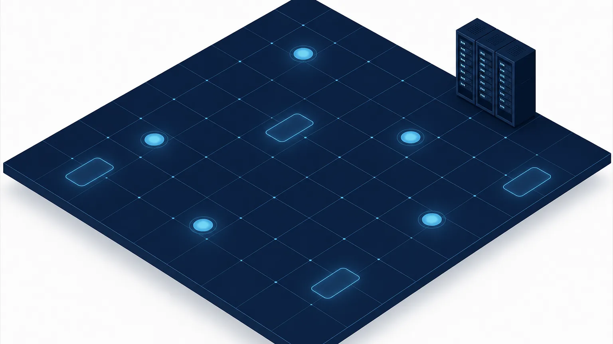
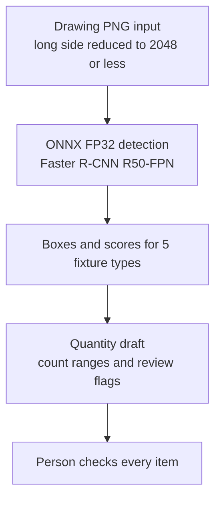
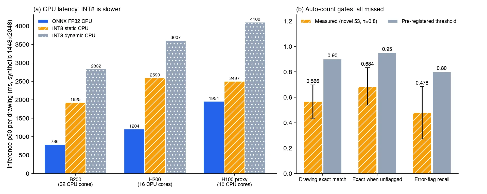

*Concept image. Not a real drawing and not a dataset image.*

If you want to pull plumbing fixture counts out of architectural drawings to draft a cost estimate, here is the conclusion first. We succeeded in packaging a detector for five fixture types (toilets, washbasins, sinks, bathtubs and gas ranges) for on-premise servers. On a GPU it detects a drawing in about 26 ms, and on 53 drawings that do not overlap with the training drawings it reached an AP50 of 0.922.

On those same 53 drawings, however, only 56.6% had all five counts right. The bar we set in advance was 90%. So we do not use this model to fill quantities automatically, only to produce a draft that a person checks item by item. This post separates what passed from what fell short, with numbers and conditions.

## In plain terms

Think of a warehouse stock count. A clerk looks at a photo of each shelf and circles every box. Almost every circle is correct (detection accuracy). But what goes into the ledger is the count per shelf, and missing a single box on a shelf makes that shelf's entry wrong.

Drawings work the same way. A drawing holds 7.6 fixtures on average, and missing just one makes the estimate for that drawing wrong. The point of this result is that even when circles are accurate, ledger accuracy has to be measured separately.

## What we built

The data is the AI-Hub architectural drawing dataset (OBJ) (71465). We split the drawings into 7,900 for training, 199 for development and 1,014 for the official test. 94.8% of the 1,014 test drawings were near-duplicates sharing almost the same layout as training drawings. So we judge generalization only on the 53 drawings that are not near-duplicates (the new drawings below).

The model is a Faster R-CNN detector with a ResNet-50 FPN backbone. We exported it to ONNX (opset 17) so that GPU and CPU use the same file.

We fixed the package selection rules and the counting criteria in a committed file before submitting any measurement job. The official test split was opened only once.

## Detection accuracy: passed

Running the official test once with the ONNX FP32 package gave mAP50-95 0.926 and AP50 0.9805 on 1,014 drawings. The difference from the training job's PyTorch result (0.9269, 0.9805) was −0.0009 and 0.0. Exporting cost no accuracy.

On the 53 new drawings it dropped to mAP50-95 0.7875 and AP50 0.922. By type, sinks were weakest at AP50 0.79, while the other four types were around 0.95. The 1,014-drawing numbers come from the same layouts as the training drawings, so we do not cite them as what a customer should expect.

## Latency by hardware, and why we skipped INT8

We measured latency on a synthetic input (1448×2048), not on the dataset, with batch size 1, onnxruntime 1.28 and the CUDA execution provider. Median inference time per drawing:

| Hardware (CPU cores) | ONNX FP32 GPU | ONNX FP16 GPU | ONNX FP32 CPU | INT8 static CPU | INT8 dynamic CPU |
|---|---|---|---|---|---|
| B200 (32) | 26.1ms | 24.69ms | 786.1ms | 1,925.01ms | 2,831.59ms |
| H200 (16) | 27.33ms | 22.23ms | 1,204.46ms | 2,590.13ms | 3,607.11ms |
| H100 proxy weights (10) | 30.12ms | 25.2ms | 1,953.59ms | 2,496.96ms | 4,100.12ms |

On the B200 GPU the 95th percentile was 32.34 ms, and GPU memory grew by 3.9 GB per session. The H100 row was measured with proxy weights, not the trained weights. On the B200 the latency gap between proxy and trained weights was within ±3%, so we use the H100 numbers only as approximations.

INT8 for CPU failed on speed before accuracy even came into it. Dynamic INT8 lost 0.0735 mAP50-95 on the development split and was 2 to 3 times slower than FP32. Static INT8 lost only 0.0033, within the allowed margin, but at 1,925 ms on the B200 CPU it was slower than FP32 (786 ms). The adoption rule required 0.77 times FP32 or less. The integer path in onnxruntime CPU appears to give no benefit for this model and input size.

We did not adopt FP16 for GPU either. Mixed FP16, which keeps only the box computations in FP32, actually gained 0.0014 in accuracy, but on the reference hardware, the B200, it ran at 0.946 times FP32 and missed the adoption rule (0.9 times or less). On the H200 it was 0.81 times, so an FP16 package for H200 and H100 customers is a candidate to judge again under its own criteria. Converting the box computations to FP16 as well dropped mAP50-95 by 0.057, and localization precision fell apart.

The result is a single FP32 ONNX file for both GPU and CPU. On the same B200, PyTorch FP32 ran at 18.17 ms, faster than onnxruntime, so the TensorRT execution provider or serving PyTorch directly is the next thing to try.

## Latency on real drawings

On real drawing PNGs we measured the full time from preprocessing to the quantity draft. We used 20 dense drawings with 28 fixtures each and 10 typical drawings with 7.

On the B200 GPU, inference alone took 22.76 ms and the full pipeline including preprocessing took 135.21 ms. On the H200, inference took 27.49 ms and the full pipeline 88.85 ms. What dominated the total was not inference but preprocessing, which reads and shrinks the roughly 17.4 MP source PNG. Preprocessing took 96 ms on the B200 node and 52 ms on the H200 node.

The number of detections barely affected latency. The median GPU inference time differed by less than 1 ms between dense and typical drawings. On CPU, 32 threads gave 788 ms for inference and 889 ms end to end, and 16 threads gave 1,204 ms and 1,256 ms. With 8 threads, results ranged from 1,324 to 1,792 ms depending on the node. Peak memory per process was about 2.3 GB. CPU alone is too slow for real time but fits batch or overnight processing.

## Automatic counting: missed

What an estimate needs is not boxes but the fixture count per drawing. So before measuring, we set criteria for two ways of operating. Filling quantities automatically required a per-drawing exact match of at least 0.90 and a mean cell error of at most 0.05. Auto-confirming only the drawings without a review flag required an exact match of at least 0.95 on unflagged drawings, a flag recall on wrong drawings of at least 0.80, and a flag rate of at most 0.60.

The score threshold of 0.8 was chosen on the 199 development drawings only. Results on the 53 new drawings:

- Per-drawing exact match 0.566 (95% confidence interval 0.434 to 0.698), bar 0.90
- Mean cell error 0.1925 (0.102 to 0.321), bar 0.05
- Exact match on unflagged drawings 0.684 (0.539 to 0.833), bar 0.95
- Share of wrong drawings caught by a flag 0.478 (0.273 to 0.684), bar 0.80
- Flag rate 0.283, passing the bar of 0.60 or less

Even the upper ends of the confidence intervals sit below the bars, so the small sample of 53 drawings does not flip the conclusion. Both modes missed. Of 23 wrong drawings, flags caught only 11. Among unflagged drawings, 32% still had a wrong count. Running "auto-confirm when there is no flag" has no evidence behind it.

The errors leaned toward undercounting. On the 53 new drawings, sinks were counted too low 12 times and too high 4 times, and toilets too low 10 times and too high 4 times. That matches the detection stage, where sinks had the lowest AP50. Even on the 1,014 near-duplicate test drawings, the 7 drawings with more than 30 fixtures had an exact match of only 0.14.

## What this means for ThakiCloud products

In Paxis, this model's place is helping an estimator draft quantities. The model proposes a count range per fixture, and the estimator checks every item against the drawing before confirming. This result removed the auto-confirm step and made a human-approved flow the default.

For a construction company that cannot send drawings outside, an on-premise installation such as Aegis is the starting assumption. With a GPU, a drawing takes about 0.09 to 0.14 s including preprocessing, and with 32 CPU threads alone about 0.89 s, which is plenty for overnight batch processing. Keeping a separate small detector tuned to specific drawing layouts fits the domain model workflow of Maxis.

## Limitations and counterarguments

The strongest counterargument is that the 53 new drawings do not represent customer drawings. They are simply drawings within the same dataset whose layouts do not overlap with training, and the small sample leaves wide confidence intervals. On customer drawings the numbers could be lower, or higher if the layouts are simple.

The ground truth is also the box count from the AI-Hub labels. Any missing or duplicated labels show up as model error, and we did not audit label quality. The dense drawings in the development split topped out at 28 fixtures, so we did not measure latency or counting on large floor plans with hundreds of fixtures. The labels carry no scale, floor or room information, so the caller has to supply units and location for the quantity draft.

The levels of judgment also need to be kept apart. Detection and packaging passed the criteria set in advance, and automatic counting missed. Whether to commercialize is a separate question from these two model verdicts, and no customer drawings have been tested yet. Customer validation has not happened, so we do not describe this as a product that produces estimates automatically.

## Summary

The plumbing fixture detector uses the same ONNX FP32 file on GPU and CPU and runs at about 26 ms per drawing on a B200 GPU (synthetic input), or 135 ms on real drawings including preprocessing. We skipped INT8 because it was actually slower on CPU, and held back FP16 because its gain on the B200 was small.

Accuracy was high at the box level, but only 56.6% of the new drawings had every count right. So this model goes only as far as a quantity draft that a person checks item by item. The next step is to break down the causes of sink and toilet undercounting on the development split, then evaluate again on independent customer drawings.

The trained detection model is published on Hugging Face at [ThakiCloud/BlueprintParse-R50](https://huggingface.co/ThakiCloud/BlueprintParse-R50). The training data and anything derived from it are not included.

---

*Data source: AI-Hub, architectural drawing dataset (OBJ) (71465). The data is not redistributed and was used only for the applicant's own internal training and evaluation. This post contains aggregate figures only, with no drawings, crops or label values. The figures are charts drawn from ledger numbers and concept images.*
