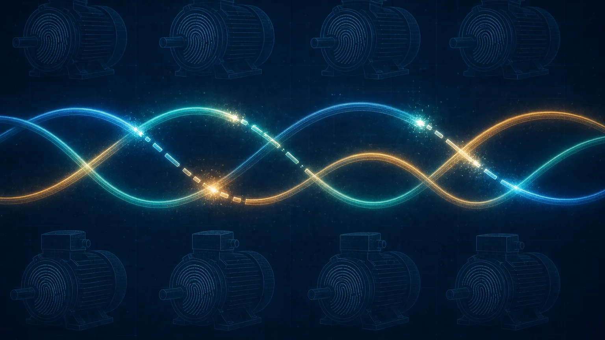
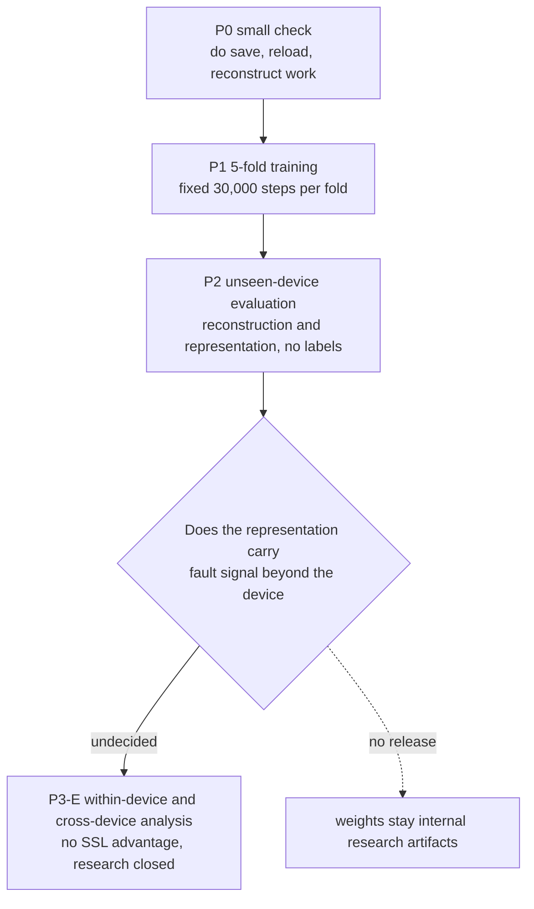
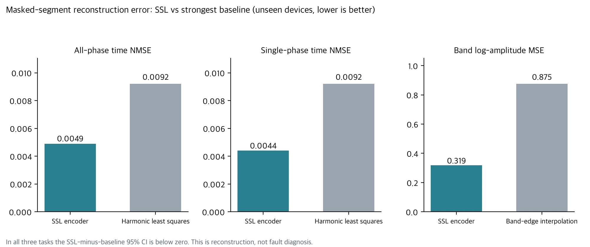
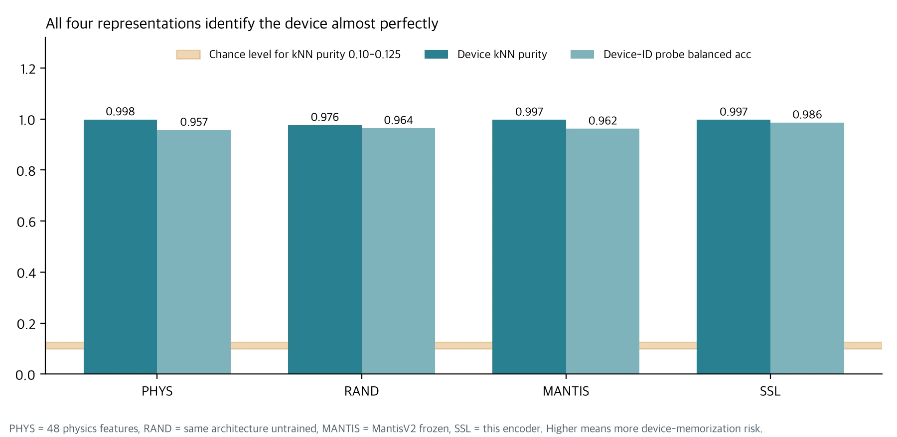

> **Updated 2026-11-08 with the final experiment results.** The analysis that separates normal from fault within a device (P3-E) finished under the criteria fixed in advance, and its results are added in the "Final Evaluation" section below. The P0 to P2 results are left as first published.

We trained a self-supervised (SSL) encoder on 1.1 million current waveforms from 42 industrial motors, without using any fault labels. When we masked parts of waveforms from devices left out of training and asked it to fill them in, its error was roughly half that of a baseline fitted with the fundamental and its harmonics. That part worked.

Then we put its representation next to three others and found that all four could tell which device a window came from almost perfectly. An untrained random encoder did it. So did 48 hand-designed physics features. That leaves no evidence yet that this encoder is a better representation for fault diagnosis. This post does not release new model weights. It is a validation record: what we fixed before seeing results, and what the results failed to prove.

## The short version

Picture a grader who can tell whose answer sheet it is from the handwriting alone. If that grader also gets the answers right, it could be because they understand the problems, or because they remember that this student is always right. In this data, each device has a nearly fixed fault type, so recognizing the device can look like recognizing the fault. This experiment confirmed that the encoder learned waveform structure. It did not confirm that the structure goes beyond the device's handwriting.

## Why train without labels

We first tried supervised learning with fault labels on the same AI-Hub industrial current data. Evaluated once on 10 motors it had never seen, binary F1 was 0.559. On motors with only normal data, the false-alarm rate was 77% and 91%. Five-class accuracy was 0.253. We closed that track without a release.

Part of the failure came from the data's structure. Each fault type appears on only a few devices, so a model can raise its training score by memorizing the device instead of the fault signal. So we changed the question. If the model never sees labels and learns only the structure of the current waveform, does a representation emerge that transfers across devices? We also wanted an in-house encoder trained only on real industrial current, unlike the public time-series foundation model MantisV2.

## What we fixed before seeing results

We sealed a protocol document before training began. If you change the criteria after seeing the results, any result can be written up as a success.

The data is 1,111,199 waveforms from 42 devices, after removing duplicates and a label-copy error. We split it into five folds by device folder. The fold-k model never receives the waveform files of fold-k devices. Each training job checks at startup that the hash intersection between training and evaluation data is zero. Fault labels were split into a separate file that training and evaluation jobs could not receive. If that file was present inside a job, the job stopped instead of starting.

Training length was fixed at 30,000 steps. Loss on a 1% held-out set of windows was recorded but never used to stop training or select a checkpoint. Metrics, baselines, and the scope of interpretation were fixed at the same time. The scope is "devices not seen in training." Data from other devices in the same months went into training, so we cannot claim generalization to unseen time periods.

## The encoder and its training objective

The model has about 7.9 million parameters. It takes the three phases as separate channels instead of averaging them. Normalization divides by a single scalar computed over the whole training set. Per-window normalization would erase absolute amplitude and the amplitude ratio between phases, which may be clues to motor condition, so we kept them.

The time branch builds tokens with 1D convolutions at several kernel sizes. The frequency branch builds them from log amplitude and relative phase. A 4-layer Transformer fuses the two. There are two training tasks. The model either restores a few 10 to 50 ms segments erased in time, or restores the amplitude of a few 5 to 40 Hz bands removed in frequency. Augmentation stayed within physically plausible limits: a common gain change of ±10% across all three phases, cyclic rotation of phase order, and very small added noise.

Each fold trained separately on one H200, and all five folds finished the full 30,000 steps. We also checked that embeddings from a reloaded checkpoint matched the saved ones exactly. Actual GPU use from P0 through P2 was 4.045 GPU-hours.

## Result 1: reconstruction beat the baselines

On devices left out of training, we masked fixed positions and measured reconstruction error. The baselines were zero fill, linear interpolation, a least-squares fit of the fundamental plus harmonics 1 to 7 on the visible samples, and, when only one phase was masked, a Kirchhoff prediction based on the three phase currents summing to zero.

| Task | SSL | Harmonic least squares | Kirchhoff | Linear / band-edge interpolation | Zero fill / band left removed | SSL minus strongest baseline, 95% CI |
|---|---|---|---|---|---|---|
| All-phase time NMSE | **0.0049** | 0.0092 | - | 1.372 | 1.001 | −0.0043 [−0.0075, −0.0012] |
| Single-phase time NMSE | **0.0044** | 0.0092 | 0.208 | 1.373 | 1.001 | −0.0048 [−0.0079, −0.0020] |
| Band log-amplitude MSE | **0.319** | - | - | 0.875 | 33.3 | −0.556 [−0.588, −0.514] |

Confidence intervals come from 2,000 bootstrap resamples at the device level. In all three tasks the interval lies below zero.

By the reading rule fixed in advance, we can say this encoder "learned waveform structure that the fundamental, harmonics, and the three-wire constraint do not explain." We have to stop there. Restoring a waveform well and telling faults apart well are different claims.

## Result 2: all four representations recognized the device

The second evaluation looked at the representations themselves. We built four of them for the same windows.

PHYS is 48 hand-designed physics features, the reference for information that standard signal processing already explains. RAND is the same architecture initialized without training, which separates the effect of the architecture from the effect of learning. MANTIS is MantisV2, frozen. Its input is resampled to 512 Hz, so information between 256 and 1000 Hz is lost, and we wrote that down in advance. SSL is the encoder trained in this work.

| Metric | PHYS | RAND | MANTIS | SSL |
|---|---|---|---|---|
| Device kNN purity (chance 0.10 to 0.125) | 0.998 | 0.976 | 0.997 | 0.997 |
| Device-ID probe balanced acc | 0.957 | 0.964 | 0.962 | **0.986** |
| Device variance ratio η² | 0.52 | 0.63 | **0.94** | 0.72 |
| Physics transfer R², f0 | (included) 0.87 | 0.98 | 0.98 | 0.96 |
| Physics transfer R², negative-sequence ratio | (included) 0.55 | 0.53 | −0.31 | **0.56** |
| Physics transfer R², THD orders 2 to 7 | (included) 0.06 | 0.23 | **0.41** | 0.07 |
| Physics transfer R², log RMS | (included) 0.94 | 0.96 | **1.00** | 0.99 |

kNN purity is the share of a window's 10 nearest neighbors that come from the same device, excluding neighbors from the same recording session. Chance would give 0.10 to 0.125. All four representations exceeded 0.97.

Here is how we read the table.

First, device-memorization risk is a property of the data, not of any one representation. An untrained encoder and 48 physics features both separate devices almost perfectly from short windows of 2,000 samples. In this data, device identity is hard to hide.

Second, SSL recognizes devices better than the random encoder. The kNN purity difference is +0.021 [+0.010, +0.035], and the probe difference is +0.022 [+0.001, +0.056]. Training appears to improve the representation, but in this data stronger device separation is a warning sign, not a strength. Against MantisV2, the differences are kNN +0.0007 [−0.0005, +0.0022] and probe +0.024 [−0.000, +0.061], both intervals including zero.

Third, physical information that transfers across devices gave mixed results by metric. When a regression fitted on training devices was applied to unseen devices, SSL scored highest on negative-sequence ratio, and MantisV2 went negative. Resampling probably discarded phase information between phases, but that is our guess. On harmonic distortion (THD), MantisV2 scored highest and SSL stayed at the physics-feature level. So the claim that SSL carries more transferable physical information than MantisV2 does not hold.

## Fold instability hidden by the average

The R² values in the table pool all five folds. Fold by fold, the picture changes. In fold 0, f0 R² was strongly negative for every representation: −61 for physics features and −100 for SSL. In fold 4, negative-sequence ratio R² was negative for every representation. In both cases the evaluation devices' values appear to lie outside the range seen in training.

Splitting 42 devices into five folds leaves only 8 or 9 evaluation devices per fold. If a few devices fall outside the training range, one fold can collapse while the average still looks reasonable. That is why we kept the per-fold tables in the result file instead of reporting a single pooled number.

## What these results do not claim

We do not claim that this encoder is a better representation for fault diagnosis. P2 used no labels, and the labeled P3-E evaluation showed no advantage either. We do not claim it beats MantisV2: the intervals on device-identification differences include zero, physics transfer is mixed across metrics, and the P3-E cross-device medians were nearly identical, 0.610 for SSL and 0.612 for MantisV2. We do not claim it generalizes to unseen time periods or other plants, since the scope is unseen devices from the same period. And we do not claim it works regardless of operating conditions. Without speed, torque, or voltage records, those conditions were not controlled.

The trained weights are not released. They are kept as internal research artifacts only, and the release decision is `RELEASE_NO_GO`.

## The planned next step: separating normal from fault within a device

One question remains. Does a fault signal survive once device recognition is taken away? To see that, we have to look only at devices that have both normal and fault data. Within the same device, the device ID cannot give away the answer. We decided in advance not to count high accuracy on devices with only normal or only fault data as performance.

We ran this analysis (P3-E) once, on 2026-11-08. The verdict followed the criteria fixed before seeing the results.

## Final Evaluation: Did SSL Training on 1.1 Million Current Waveforms Improve Generalization to Unseen Motors?

P3-E looked at two things. The first was whether a representation separates normal segments from fault segments within the same device. Cross-validation was grouped by recording date, so windows from the same day never appeared in both training and evaluation. We selected 25 device and fault combinations that had both normal and fault data, and dropped 3 as confounded because recording time or sensor information alone reached an AUROC of 0.90 or higher. The second was whether, after training on the other devices with the same fault, the same separation holds on one device left out of training. We evaluated 25 devices, holding each out in turn.

| Item | Value |
|---|---|
| Real training waveforms | 1,111,199 |
| Internal SSL checkpoints | 5, private |
| Total SSL GPU use | 6.665 GPU-h |
| Median within-device AUROC | PHYS 0.998 / MantisV2 0.999 / SSL 0.991 |
| Median unseen-device AUROC | PHYS 0.519 / MantisV2 0.612 / SSL 0.610 / Random 0.638 |
| Within-device pairs with a significant SSL advantage | 0 of 22 |
| Devices meeting the preregistered cross-device advantage criterion | 8 of 25, short of the required 17 |
| Final verdict | P3E_FAULT_SIGNAL_NO_SSL_ADVANTAGE |

Within a device, all three representations reached an AUROC of about 0.99. Even the untrained random encoder had a median of 0.960. Inside a single device, almost anything separates normal from fault segments, so these numbers cannot rank the representations. Even so, SSL was significantly ahead of both the physics features and MantisV2 in none of the 22 pairs. It was significantly behind the physics features in 16 pairs and behind MantisV2 in 18.

On motors left out of training, the numbers fell to near chance. Separation that reached 0.99 within a device stayed at medians of 0.52 to 0.64. Some devices scored below an AUROC of 0.5, meaning the ranking was inverted: 12 for physics features, 7 for SSL, 5 for MantisV2, and 4 for the random encoder. The criterion fixed in advance required SSL to beat both the physics features and MantisV2 on at least 17 of 25 devices, with a positive mean difference. It did so on 8, and the mean difference was −0.098.

The random encoder's cross-device median of 0.638 was the highest, but that does not mean the random encoder is a better representation. All four representations swung widely from device to device around 0.5, and the order among them is only an observed value. The advantage test was defined in advance for SSL only, and we never tested whether the random encoder is better.

We did confirm that a signal separating fault segments exists within a device, because the representations beat the time and sensor confound baselines. This design cannot tell whether that signal is fault physics or a difference in device state or operating conditions during that period, because there are no speed, torque, or voltage records.

The verdict, by the rule fixed in advance, is `P3E_FAULT_SIGNAL_NO_SSL_ADVANTAGE`. SSL used 6.665 GPU-hours in total: 4.045 for P0 to P2 and 2.62 for P3-E. We closed this research with no further training, fine-tuning, or re-evaluation on this data. The five checkpoints are kept internally and remain private. If new industrial data with operating conditions and maintenance history becomes available, we will start again as a separate project.

We hit the same problem on a different dataset in [We Released a Motor Current Signature Analysis (MCSA) Model](/tech-blog/en/research/thaki-mcsa-mantisv2-mcc5/). In that experiment, a baseline that used only the recording time outscored the model.

## Summary

The industrial current encoder trained without labels learned waveform structure. On devices it never saw, it restored masked segments more accurately than a harmonic baseline. But in this data any representation separated devices almost perfectly, and the final evaluation, which split within-device from cross-device performance, showed no SSL advantage either.

Self-supervised learning improved the ability to reconstruct masked current waveforms, but we found no evidence that it represents real fault information better than existing physics features or MantisV2. High classification performance within a device did not carry over to new motors.

Between "loss went down and reconstruction improved" and "this is a diagnostic representation you can use in the field," there was a separate step to check, and this data did not get past it. Our only public model remains the MantisV2 Research Preview trained on MCC5.

If you want to check whether your own equipment's current or sensor data hides a device shortcut like this, [contact ThakiCloud](/contact?interest=industrial-ai&origin=current-ssl). We review the data structure before choosing a model.



---

*Data source: AI-Hub, Machine Facility Failure Prediction Sensor dataset (#238). Raw and processed data were used only for the applicant's internal research and are not redistributed. This post contains aggregate figures only. Comparison model: [paris-noah/MantisV2](https://huggingface.co/paris-noah/MantisV2) (Apache-2.0). The five encoder checkpoints trained here are not released.*
