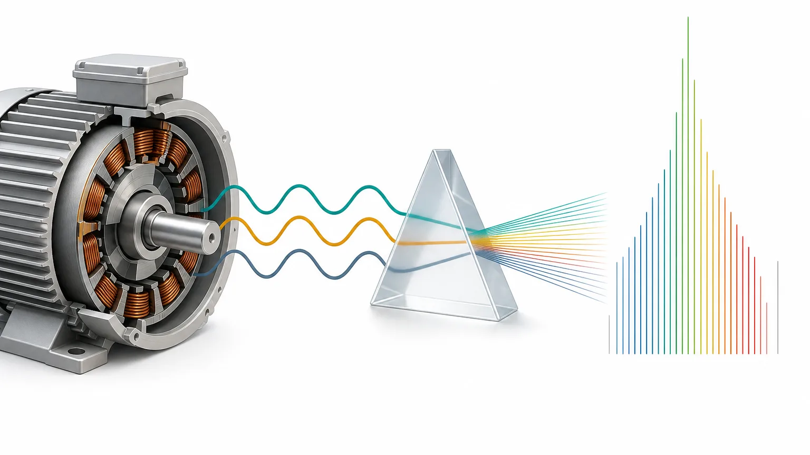
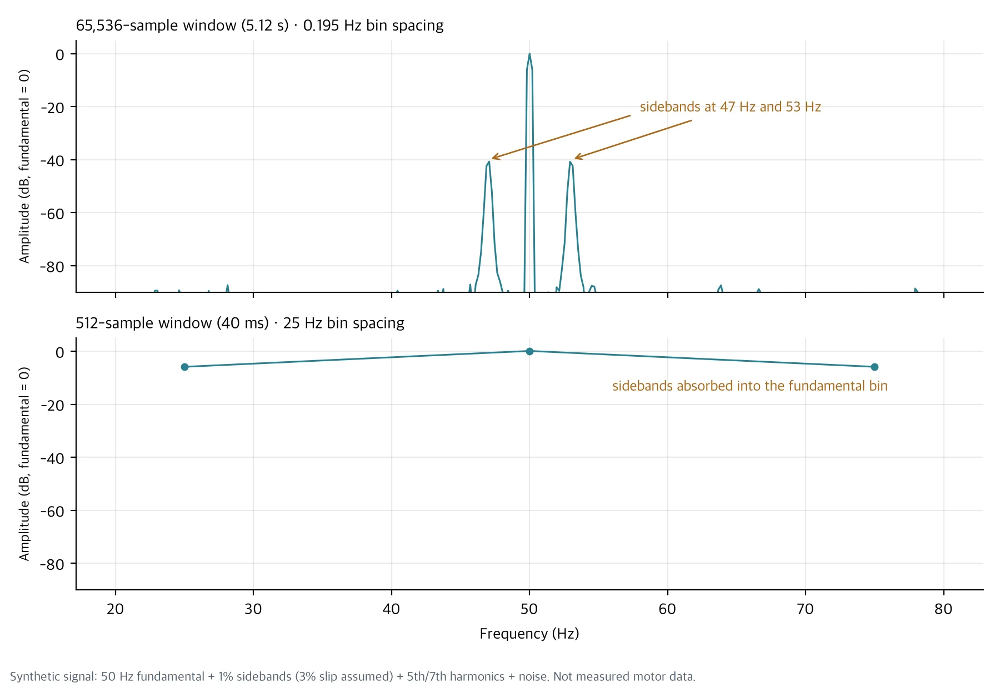
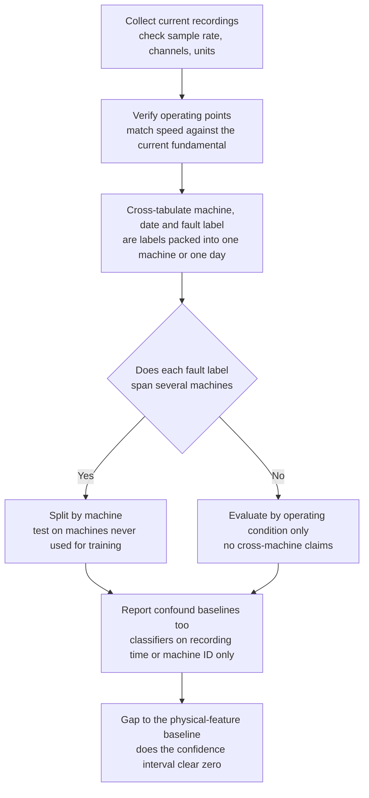

Motor current signature analysis (MCSA) looks for clues about a machine's condition in the current flowing into an electric motor. It needs no new vibration sensor, and current is often already measured at the switchboard, so it comes up often in industrial projects.

Current carries a lot of information, but not all of it. This post covers the signals you can read from current alone, what you lose when you pick an analysis window, and how a model can score well by recognizing the machine instead of the fault. It is background for the [MCSA research model we released](/tech-blog/en/research/thaki-mcsa-mantisv2-mcc5/).

## In plain terms

Listening to current is a bit like judging a car by its engine sound. The loud tone (the fundamental) is almost always there. The fault clue is often a faint tone right next to it (a sideband). To hear the faint tone you have to listen long enough, and if you cut the recording short or compress it coarsely, the faint tone disappears into the loud one. Every car also sounds a little different, so a listener who only learns "that is car number 7" can still ace the test.

## Four signals in motor current

Four signals in three-phase induction motor current do most of the diagnostic work. The fault frequency relations below follow Thomson and Fenger's review (IEEE Industry Applications Magazine, 2001).

**The fundamental (f0).** This is the frequency supplied by the grid or the inverter: 50 Hz or 60 Hz on mains, and a different value at each operating point when an inverter changes speed. For a motor with p pole pairs, synchronous speed is 60·f0/p rpm, so the fundamental is the reference for checking operating conditions. When we audited the MCC5 data, the key-phase channel chattered and could not count revolutions in 41 recordings, so we verified operating points from the current fundamental instead. The median ratio f0·60/rpm was 1.002, consistent with a two-pole machine. Three recordings that drifted more than 10% from their nominal speed were set aside before any evaluation.

**Harmonics and THD.** These are integer multiples of the fundamental. Total harmonic distortion (THD) is the combined harmonic magnitude divided by the fundamental. Harmonics can come from magnetic saturation or winding problems, but also from inverter switching and supply quality. A higher THD alone does not mean the motor is faulty.

**Phase unbalance and the negative sequence.** Splitting three-phase current into symmetrical components gives positive and negative sequences. A growing negative-sequence ratio means the phases are out of balance. A stator inter-turn short can cause that, and so can an unbalanced supply voltage. MCC5 includes voltage unbalance as its own state, so telling the two apart is part of the test.

**Sidebands.** When a rotor or mechanical defect modulates the current, small components appear on both sides of the fundamental. Broken rotor bars show up at (1±2ks)·f0, where s is slip and k is an integer. Eccentricity shows up at spacings of the rotation frequency. Bearing defects can also produce sidebands, but the vibration weakens on its way into the current, so they are usually the hardest to find. Sidebands sit tens of dB below the fundamental and only a few Hz away from it.

## Window length sets frequency resolution

The spacing between frequency bins equals the sampling rate divided by the number of samples in the window. MCC5 is recorded at 12.8 kHz, so a 65,536-sample window (5.12 s) gives 12,800 ÷ 65,536 = 0.195 Hz. Cut the same signal into 512 samples (40 ms) and the spacing widens to 25 Hz.

The figure below uses a synthetic signal: a 50 Hz fundamental, sidebands at 47 Hz and 53 Hz at 1% of the fundamental (assuming 3% slip), 5th and 7th harmonics, and noise. No measured motor waveform is shown.

With the long window the sidebands appear as separate peaks at −40 dB next to the fundamental. With 512 samples only three bins remain, at 25, 50 and 75 Hz, and sidebands 3 Hz away fall inside the 50 Hz bin. The information is still in the signal, but the analysis step erased it.

Longer is not always better. If load or speed changes inside the window, peaks smear, and fewer windows means fewer training samples. That is why we chose candidate window lengths by frequency resolution and preregistered them before looking at any model score.

## What a 512-point input throws away

Many pretrained time-series models are trained on 512-point inputs. There are several ways to fit high-rate current into that length, and each one loses something different.

| Method | What survives | What is lost |
|---|---|---|
| Crop 512 raw samples | 40 ms of waveform shape | 25 Hz bin spacing, so sidebands cannot be separated |
| Resample the time signal to 512 Hz | Content below 256 Hz | On 50 Hz mains, little above the 5th harmonic (250 Hz) |
| Pool a long-window spectrum into 512 bins | The full 0 to 6,400 Hz band | 12.5 Hz bins merge sidebands near the fundamental, and no inter-phase phase information |

Our released MCSA model used the third option. It computes a Welch power spectrum per phase and splits 0 to 6,387.5 Hz into 512 bins. It sees a wide band, but sidebands a few Hz from the fundamental are not separable in that input. We note this as an input design choice rather than a flaw of the model itself.

## What current alone struggles to show

Finding a clue in current is not the same as confirming a cause. Three cases are hard to judge from current alone.

First, physical units. In the MCC5 audit the torque channel read about −1% to 4% of the nominal torque in Nm, and raw current magnitudes did not match the units in the dataset description. So we made no claims from absolute current or torque and used only values normalized within each recording. Field data without sensor calibration records has the same problem.

Second, telling causes apart. A rising negative sequence appears with both winding shorts and voltage unbalance, and rising harmonics appear with both motor condition and the drive. Load fluctuation can also create modulation that looks like sidebands. Without speed, torque and voltage logged alongside, the interpretation stays open.

Third, prediction over time. Classifying the state of a short recording is a different problem from predicting time to failure. Remaining useful life (RUL) cannot be measured without continuous records that link failure times and maintenance history.

## Models can learn the machine before the fault

This is the part we watch most closely when evaluating current-based models. Each motor differs a little in supply, wiring, load and sensors, and that difference is often larger than the fault signal. If machines and fault labels overlap in the training data, a model learns to recognize the machine, and when the same machine reappears in the test, the score looks high.

We saw this directly in two datasets. On MCC5, the released model scored Macro-F1 0.943 on the sealed TEST, while a baseline that ignored current and used only the recording time scored 0.986, because each state's recordings were packed into about one day. On the AI-Hub "Machine Facility Failure Prediction Sensor" dataset (#238), we compared 42 machines without labels. With only 48 physical features computed from current, the share of nearest-neighbor windows that came from the same machine (kNN purity) was 0.998, more than eight times the 0.10 to 0.125 expected by chance. Machine identification was nearly complete before any fault was taught.

So we check evaluation data in this order.

Running a classifier on recording time or machine ID alone costs almost nothing. If that baseline beats the model, you first need to ask what the model's score is actually measuring.

## Summary

Current gives four kinds of clues: the fundamental, harmonics, phase unbalance and sidebands. To see small clues such as sidebands, you have to settle the window length and input compression first, and a 512-point input loses something whichever way you compress. Until a current-based model is checked on machines it never trained on, you cannot tell whether its score reflects fault recognition or machine recognition.

If you want to explore diagnostics on your own equipment's current data, [contact ThakiCloud](/contact?interest=industrial-ai&origin=mcsa-basics). We start by checking which machines and operating conditions the data actually covers.



---

*The spectra in the figure come from a synthetic signal generated with numpy. MCC5 figures come from our audit and evaluation of MCC5-THU (Mendeley Data, CC BY 4.0). The machine identification figure is an aggregate from an unlabeled representation evaluation on AI-Hub "Machine Facility Failure Prediction Sensor" (#238); no source data is included. Fault frequency relations: W. T. Thomson and M. Fenger, "Current signature analysis to detect induction motor faults", IEEE Industry Applications Magazine, 2001.*
