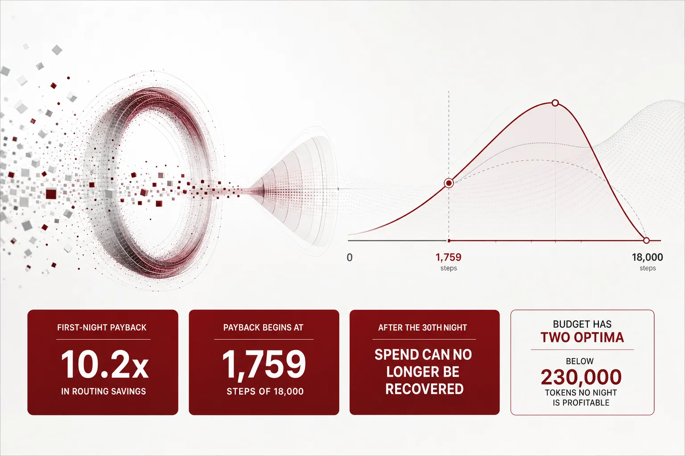
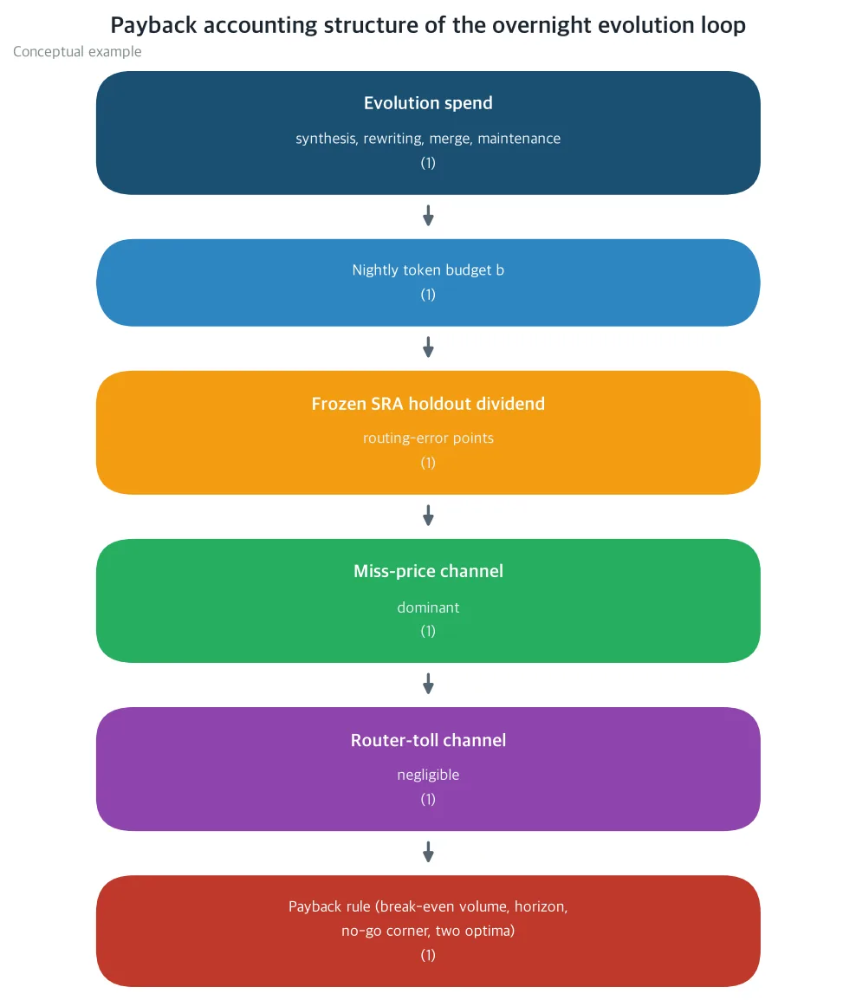
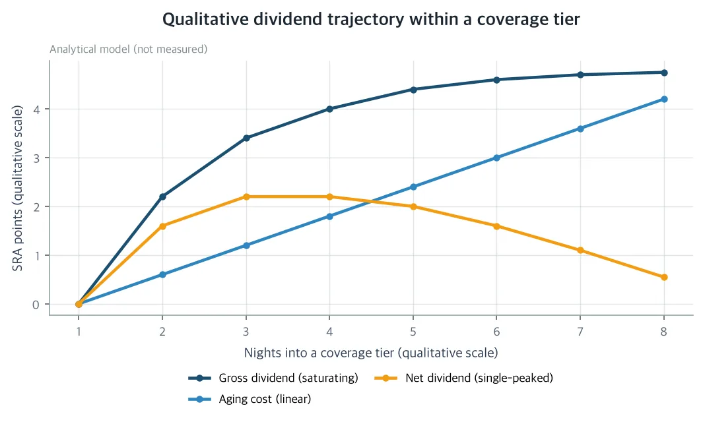
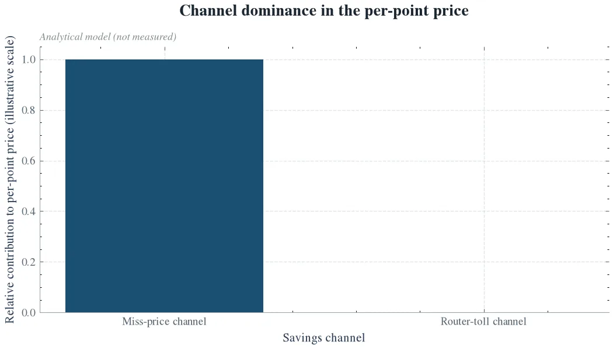

The overnight self-evolution spend of a skill registry is a budget line whose return can be computed in closed form. If you run unattended agents on your own GPU and manage the token ledger of a skill router yourself, this post gives you the break-even number to set that budget with. At the prices the paper declares, the first-night spend comes back 10.2x in routing savings. Note, however, that every number in this paper is a closed-form prediction on top of a declared nominal price card, and no new measurement is reported. Confirmation or refutation is the job of a pre-registered 4-branch frozen holdout protocol.

*A visual metaphor for the article's key idea.*

## In plain terms

Think of the skill registry as a warehouse of 2,200 items. The unattended agents on your own H200 cluster process 18,000 jobs every night. Each job takes one item out of the warehouse. The router is the side that picks the item.

When the picker is wrong, it pays for it. A mis-route spawns a redo and delays the next job. The ThakiCloud skill router series has already attached a price to that cost. 1.4 dollars per miss, and that is the miss price.

The warehouse has a nightly cleanup crew. It shelves new items, rewrites labels, merges similar items, and updates the shelf index. All of it spends tokens. The paper of the day is pricing exactly this nightly spend of the cleanup crew.

The work of the cleanup crew reduces the misses of the picker. The ThakiCloud skill router series had, up to now, only priced the router side of the cost, step by step. The evolution side that fixes the warehouse still sat there as an unpriced budget line. The paper of the day is that price.

The warehouse is always in motion. As items come in and go out, 21 of the 63 cases in the watch test quietly went stale. So this paper freezes the test. Cases, answers, scoring, tokenization, and routing configuration are fixed, and the only thing that moves is the content of the warehouse. If the score rises because the warehouse improved, that rise is the credit of the cleanup crew.

So the question this paper asks is whether the overnight cleanup spend comes back as saved miss losses. From the same ledger it also answers where payback begins, in how many picks, and at which night it stops.

The answer is that it comes back, but with a limit. Spend saturates, because each additional increment works less, and the warehouse slowly gets messy again on its own, so after a fixed number of nights the spend can no longer be recovered. In plain terms, do not keep working the cleanup crew forever; let it rest on the nights the alarm rings.

## What was tried

The paper defines the payback ratio of the overnight evolution budget, that is, of the number of tokens the cleanup crew spends in one night. The payback ratio is the rate at which that spend comes back as downstream routing savings. The savings are converted through two channels.

The first channel is the miss price. For every 1 point that skill routing accuracy (SRA) rises, routing errors fall by that amount, and savings accrue at the cost of a miss.

The second channel is the toll. A tidy warehouse means fewer cases where the whole stock has to be searched, and that difference is savings too. The prices of both channels are already recorded in this series, so the paper creates no new price. It only connects values already in the ledger to the evolution spend side.

*The pricing accounting structure of the paper. The overnight evolution spend buys a quality improvement on the frozen holdout, the dividend, and that dividend is converted into downstream routing savings through the miss-price channel and the toll channel. A conceptual illustration, not measured data.*

The spend side collects into four tasks: synthesis that creates new skills, rewriting that rewrites skill descriptions, hygiene that merges duplicate skills and demotes rarely used ones, and index updates that rebuild the indexes. Each task carries a rate that is already priced; those are blended into a mixed rate, and multiplying it by the nightly budget gives the spend of that night. Synthesis is priced at the creation-side price per skill; everything else is priced at the serving rate.

The return, the dividend, is the sum of two forces. A bigger budget gives a bigger dividend, but the effect saturates in step with the shrinking amount of newly covered work. Night by night, that effect decays exponentially.

The warehouse also gets messy again on its own. This is aging: skills go stale, and the more skills there are, the harder picking becomes. The dividend is the value of the saturation curve minus this aging.

With both sides in place, the break-even becomes a calculation. The minimum number of jobs at which the return covers the spend, the break-even step count. The last night at which the spend is recovered, the marginal payback horizon. Both values are closed-form functions of the budget, and nudging the budget moves them along a V-shaped curve.

Below that lies a region where no night is profitable. If the nightly budget does not cross 230,000 tokens, payback never happens no matter how large the job volume is. The paper calls this region the labor corner.

There are two optima as well. The efficiency optimum, which maximizes the payback ratio, and the net-profit optimum, which maximizes the nightly net profit, sit at different places. Depending on whether the goal is how many times back or how much is left, the budget changes too.

The instrument that decides whether this calculation holds in a real warehouse is the protocol the paper pre-registered. It is split into four branches: a frozen-registry branch, a current-budget branch, an efficiency-optimum branch, and a net-profit-optimum branch with pruning added. The dividend is rechecked with roughly 300 cases of an auxiliary test, and the regression of the stock is fenced off by the SRA gate of 63 cases.

Refutation criteria F1 through F5 fix in advance which observation confirms or overturns each prediction. The protocol cost is about 650 dollars for the pilot and about 6,500 dollars for the full run, inside the declared nightly budget.

## What came out

At the declared nominal prices, the current nightly budget is 2.0 million tokens. The spend of that night is 38 dollars, and the net dividend of the following night is 1.54 SRA points.

Converted at 252 dollars per point, the first-night savings are 389 dollars. The payback ratio is 10.2x.

In plain terms, then: spend 38 dollars, and 389 dollars comes back the next night.

Stacked over 30 nights, the cumulative dividend is about 108,000 dollars, and the cumulative spend is 1,140 dollars. Because the dividend level is maintained while the spend only lands once per night.

The break-even comes at 1,759 steps. That is 9.8 percent of the 18,000 steps routed every night. In plain terms, then: if only one-tenth of the overnight jobs pay back, the evolution spend is recovered.

The marginal payback horizon is the 30th night. The net profit of the 30th night is 2.76 dollars, and the 31st night comes back as minus 2.44 dollars.

The peak of the dividend itself is the 39th night. After that, aging eats into the dividend. At roughly the 141st night, the cumulative net dividend is computed to touch zero.

*The trajectory of cumulative net dividend within a coverage tier, a schematic of the analytic model. Saturated gross dividend minus linear aging, and the net dividend peaks at the 39th night and touches zero around the 141st night. The marginal break-even horizon, the 30th night, comes earlier than the peak, so each coverage tier must be rebased before its peak. An analytic model, not a measurement.*

Past the peak, the dividend of the warehouse is borrowed. Run without rebasing, and tokens may go into recreating the value that aging already erased.

On the other hand, below 230,000 tokens, no night is profitable. Spent inside the labor corner, the spend outgrows aging first, so payback never happens no matter how large the job volume is.

The optima of the budget are two. The payback-ratio optimum lands at 1.3 million tokens with a 10.6x payback ratio.

The first-night net-profit optimum lands at 8.2 million tokens with 651 dollars per night. There, even as the payback ratio falls to 5.2x, the dollars left over are the largest.

| Overnight budget | Overnight spend | First-night payback ratio | Break-even steps | Marginal horizon |
|---|---|---|---|---|
| 500,000 tokens | 9.5 dollars | 8.2x | 2,197 | 13 nights |
| 1,000,000 tokens | 19 dollars | 10.5x | 1,717 | 23 nights |
| 2,000,000 tokens | 38 dollars | 10.2x | 1,759 | 30 nights |
| 4,500,000 tokens | 85.5 dollars | 7.7x | 2,333 | 32 nights |
| 8,200,000 tokens | 155.8 dollars | 5.2x | 3,476 | 28 nights |

*Closed-form predictions on the declared nominal price card, not measurements. The efficiency optimum (1.3 million tokens, 10.6x) and the net-profit optimum (8.2 million tokens, 651 dollars) are values of adjacent grid cells.*

The source of the savings is one-sided. The toll channel holds a share of less than one part in 2,000 of the per-point price, and payback is the story of the miss-price channel.

*The channel composition of the price of 1 SRA point, a schematic of the analytic model. The miss-price channel occupies most of the price, and the router toll channel is 0.053 percent, less than one part in 2,000. An analytic model, not a measurement.*

In plain terms, then: tidying the warehouse reduces the labor of searching everything, but what produces the money is the value of the misses that get fewer.

Nudging the declared values one at a time does not flip any sign. Cut the dividend ceiling in half, and the payback ratio stays at 4.25x.

Halve the holdout representativeness, and the payback ratio halves while the break-even doubles. Under any of the nudges, the marginal horizon stays at 15 nights or more, and the break-even stays at 4,236 steps or fewer, inside the overnight load.

## So what should be changed

For companies, this becomes the operating rule of the overnight evolution loop. Do not leave the loop on in the background like ambient noise; choose the budget for the purpose. If the payback ratio comes first, 1.3 million tokens; if the net profit comes first, 8.2 million tokens.

When the marginal horizon, roughly 30 nights, approaches, rebase the warehouse with pruning and merging, and restart. Below 230,000 tokens, it is more profitable not to run at all.

The budget that was being spent reluctantly should be redirected to the indifference-band tie-break that the earlier parts of this series priced. Those savings are a separate line item of 60.5 dollars per night.

Societally, this is the calculation that a self-improving agent does not have to be always on. If every dollar spent at night is tied to a dollar of routing savings that comes back, the compute and energy cost of always-on agent infrastructure gets a ceiling.

Tokens are energy too, so a loop with a computed stop also cuts the power bill. The command "stop" becomes a number, the labor corner, rather than a guess.

Scientifically, three things remain. The per-point price of the frozen-holdout dividend is a new object that converts to the same ledger as the router's.

The economic payback frontier of a self-evolving skill registry was priced for the first time against a frozen holdout. Voyager-style skill libraries and offline prompt evolution could not price this payback.

And the frozen holdout is a premise of measurement, not a convenience. If the warehouse itself moves, there is no way to tell whether a score change belongs to the cleanup crew or to the tests.

## What cannot be trusted

First, every number is a closed-form prediction on a declared nominal price card. There is no new measurement, and what the paper sets down is the predictions and the ledger for confirming or refuting them.

The shape results, the channel decomposition, the closed form of the marginal horizon, the labor corner, and the two optima are algebraic outcomes independent of the price card. Even if the values wobble, this structure holds.

Second, the three most dangerous inputs for the values. The holdout representativeness is declared at 1.0, and halving it halves every dollar number.

The dividend ceiling is a declared fraction of the recorded 37.8-point gap, discounted by the holdout ratio of 5 of 21 cases surviving. The aging term itself is a model prediction, so the marginal horizon should be read as an upper bound.

Third, the movement of the warehouse. The registry changes every night, and 21 of the 63 cases have already been invalidated by that movement. The frozen holdout separates this out, but it is the ledger recomputation of the protocol that catches the drift of the values.

The numbers in this paper are less evidence of "it comes back" than the ledger of "what observations must appear if I claim it comes back." The pilot at about 650 dollars and the full run at about 6,500 dollars are the next step that fills that ledger.

---

The paper and its companion materials are available here: [The Evolution Payback](https://huggingface.co/datasets/thaki-AI/daily-paper-2026-11-08-overnight-skill-evolution-payback)

*Every number in the body is a closed-form prediction under the explicit assumptions (A1-A8) and the declared nominal price card, or a result attributed to the cited references. This post reports no measurement. All three figures are schematics of the analytic model, not measured data. The body was rounded for readability; the precise values are kept in the table and the captions.*
