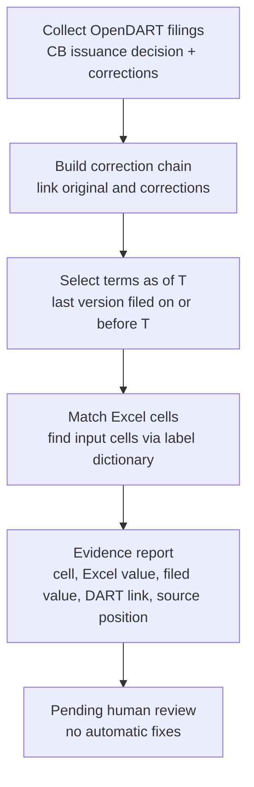
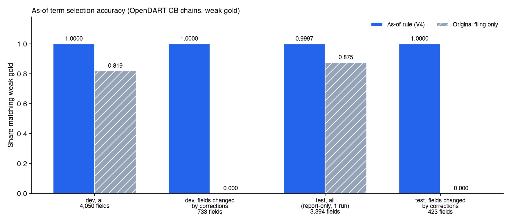
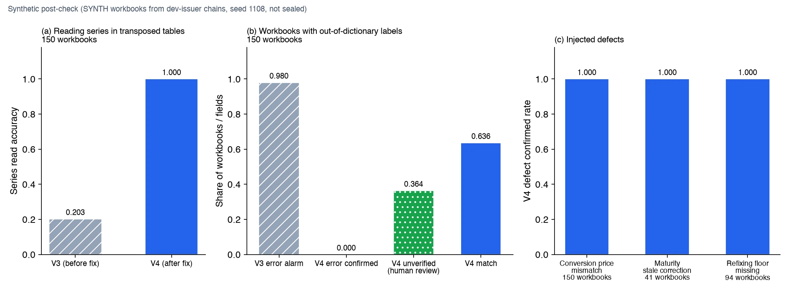
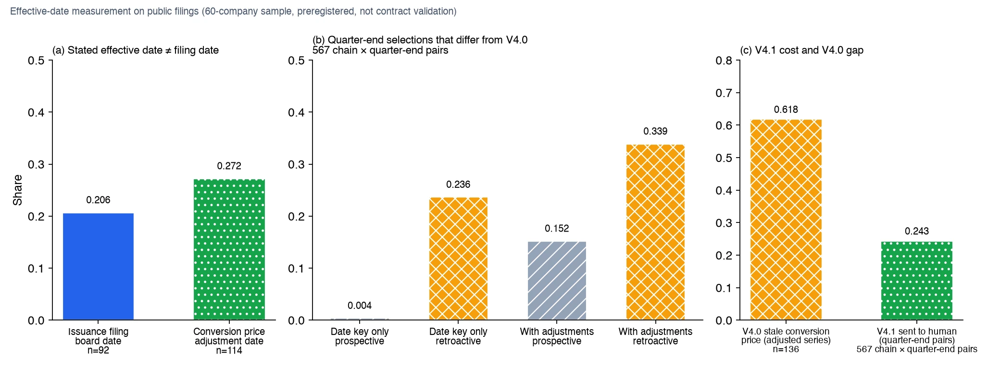

If you review valuation models for convertible bonds, here is the result first. Rebuilding the terms in force at a valuation date from public filings, we found three things a filing-date rule misses. The effective date stated in a filing came before its filing date in 20.7% of original issuance filings and 27.2% of conversion price adjustment filings. Filings alone cannot tell whether a correction applies retroactively, and reading corrections as retroactive changes 23.6% of quarter-end selections. The biggest problem: the first version (V4.0) did not include conversion price adjustment filings and returned a stale conversion price in 61.8% of quarter-end pairs for adjusted series.

The fixed V4.1 brought silent wrong values to zero on the same sample. That does not mean 100% accuracy. It comes from sending values with an uncertain effective date to "needs review" instead of judging them, and it holds only for this 60-company sample and the two readings we tested. The price is that 24.3% of quarter-end pairs go to a person.

The comparison with valuation Excel models has so far been checked only on synthetic workbooks we built ourselves. We have not validated real accounting-firm models, unlisted RCPS contracts or fair value calculations, and we do not claim a complete audit of every term disclosed on DART. This post separates what we built, what we verified and what remains open.

## In plain terms

Think of a contract with a stack of dated amendment notes stapled to it. The convertible bond issuance filing is the original contract, and each correction filing is a dated note added on top. Every time the conversion price changes, the maturity moves or a refixing floor appears, another note goes on the stack.

A valuation is done as of a specific date. So you need to rebuild "the contract with only the notes that were attached by that date." Applying a note filed after the valuation date is wrong, and so is missing one filed before it. V4 sorts the notes by date, rebuilds the contract as of the valuation date and checks the numbers in the valuation Excel model one cell at a time.

## What we built

ValuationProof V4 works in three steps. It collects convertible bond issuance filings and their corrections from OpenDART and links them into a single chain. It then selects the version in force at valuation date T and compares it with the input cells of the valuation Excel model, producing a report with evidence for every value.

The as-of rule is deliberately simple. Use the last version whose filing date is on or before T. Exclude corrections filed after T, but flag the fields whose values they changed. If T is earlier than the original filing, report that nothing had been filed yet. When the link between filings was recovered by rule signals, mark it for human confirmation.

The terms checked are principal, conversion price, refixing floor, coupon rate, yield to maturity, maturity date, payment date, and the start and end of the conversion period. Each value carries its receipt number, filing date, DART link, source hash, line position in the source and the version in which the value first appeared. Put and call options are extracted only as presence and first exercise date candidates, and always go to human review.

Each result falls into one of five classes: match, mismatch, missing, unverified, or not applicable. Mismatches include stale corrections (the Excel value equals a prior filing's value), corrections applied before they were filed, unit errors and links to the wrong series. The tool proposes fixes but never edits the workbook.

## Verified on public filings: as-of term selection

The data is public OpenDART filings. We reused 2,472 filings and 1,364 structured convertible bond issuance records collected for the previous version. Chains whose original filing was before 2026 (549 chains) were used to develop the rule (dev), and 2026 chains (412) were held out for reporting (test).

The numbers in this section come from the V4.0 rule, which picks versions by filing date. The nature of the gold labels matters. The gold is the latest structured record from the OpenDART API, which comes from the same filings as the input. It is weak gold: it only checks whether we picked the latest version correctly. There is no gold for intermediate versions, and no independent expert reviewed the values.

*Chart drawn from ledger numbers. The test split was run once and not used to choose rules.*

| Slice | Fields | As-of rule (V4) | Original filing only |
|---|---|---|---|
| dev, all | 4,050 | 1.0 | 0.819 |
| dev, fields changed by corrections | 733 | 1.0 | 0.0 |
| test, all (report-only, 1 run) | 3,394 | 0.9997 | 0.875 |
| test, fields changed by corrections | 423 | 1.0 | 0.0 |

The gap comes from fields that corrections actually changed. On 733 dev fields and 423 test fields, the original values were never right and the as-of rule was always right. Per field, the original-only approach did worst on schedules and floors, for example 0.768 on the refixing floor and 0.772 on the maturity date in dev.

The one test miss is a payment date field. We had decided in advance not to use test for rule changes, so we report it as is without fixing the cause.

We also checked the timing rule on its own. If T is set to the day before a correction was filed, that correction must be excluded. This check passed on all 816 dev cases and all 390 test cases, and no value from after T leaked into a result.

## Verified on synthetic Excel: finding errors

We have not yet received a real valuation workbook. These results also come from V4.0. So we built synthetic workbooks from public chain values to test the audit. Every result below is from synthetic workbooks.

First we took one public chain ([original DART filing](https://dart.fss.or.kr/dsaf001/main.do?rcpNo=20220816000660)), set the valuation date to July 30, 2026, and built four workbooks. This chain has a correction filed the day before the valuation date and another filed after it. In all four workbooks V4 picked the correction from the day before and excluded the later one.

The clean workbook produced no errors. In the workbook where the maturity date and conversion end date were left at a prior filing's values, V4 flagged both cells as stale corrections and named the version they came from. In the workbook with a mistyped refixing floor and maturity date, it flagged both cells as value mismatches. In the workbook with a transposed table and labels outside the dictionary, it confirmed no errors and sent 5 fields to unverified.

Next we generated workbooks in bulk from 150 dev issuer chains for a post-check. This is not a sealed evaluation. The same people wrote the workbook vocabulary and layouts and fixed the code, so the results may be generous.

*Synthetic workbook results. Accuracy on real valuation models was not measured.*

The previous version (V3) had two weaknesses. First, it misread the series in transposed tables where series run across columns. After we changed it to read the series tag from the first header cell on the left instead of the nearest cell, series reading accuracy on 150 synthetic workbooks rose from 0.203 to 1.0.

Second, it treated unknown labels as errors. V3 raised error alarms on 0.98 of the new-vocabulary workbooks. V4 does not try to guess labels outside its dictionary and marks them unverified. Confirmed errors dropped to 0, but 0.364 of fields went to human review. Fewer false alarms came at the cost of more items for a person to look at.

All injected defects were found. Conversion price mismatches (150 workbooks), stale maturity corrections (41) and missing refixing floors (94) were confirmed at a rate of 1.0. The rate of clean cells confirmed as errors and of wrong values passed as matches was 0 in every batch.

## Effective dates: what the filing date alone misses

V4 picks versions by filing date. But filings also state a board resolution date or an adjusted-price application date, which can differ from the filing date. We preregistered a measurement plan and then measured, on public filings, how much this changes the as-of selection. The sample is 60 companies chosen by hash, mostly with 2025 to 2026 filings, so we do not generalize the rates to the whole market.

*A measurement of public filing fields. Effective dates are the dates issuers wrote in filings, not dates confirmed from contracts.*

In 19 of 92 original issuance filings (20.7%) the board resolution date differed from the filing date. In 31 of 114 conversion price adjustment filings (27.2%) the application date differed from the filing date. The direction was always the same. No effective date fell after its filing date; the effect always came first and the filing later. So a filing-date rule can only be wrong by reflecting new terms late.

Corrections are harder. Filings alone do not tell whether a correction takes effect from its filing date (prospective reading) or reaches back to the previous effective date (retroactive reading). Across 567 chain and quarter-end pairs, changing only the date key alters 0.35% of selections under the prospective reading but 23.6% under the retroactive reading. This measurement does not decide which reading is right.

The biggest problem was not the date key. V4.0 did not put conversion price adjustment filings into the chain at all. In 22 chains matched to adjustment filings, V4.0 returned a stale pre-refixing conversion price as "in force at the valuation date" in 84 of 136 quarter-end pairs (61.8%). The weak gold used earlier is an issuance record too, so it could not catch this gap either.

V4.1 fixes three things. It uses the stated effective date as the primary key. It applies adjustment filings to the conversion price. Fields whose value depends on an unconfirmed effective date are no longer auto-classified as match or mismatch; they go to "needs review (effective date unconfirmed)." Re-measuring 508,528 daily field pairs on the same sample, V4.0 silently returned a different value in 108,835 pairs against the retroactive reading, while V4.1 did so in 0 pairs against both readings. Zero against the prospective reading is trivial because the fixed code uses that key; the meaningful check is zero against the retroactive reading, meaning every value that changes under it carries a "needs review" flag. This zero is not 100% accuracy. It was obtained by handing undecidable values to a person, and it holds only for this sample and the prospective and retroactive readings. It says nothing about circumstances outside those two readings or filing types absent from the sample.

The cost is clear. In 138 of 567 quarter-end pairs (24.3%) at least one field goes to a person. Re-measurement also exposed a bug in the V4.1 draft. A correction that restated the original conversion price was filed later, so the draft rolled back the adjusted value and produced 719 silent wrong day-fields. After making adjustment filings take precedence over such corrections, that count went to 0.

## Next steps

We are developing V4.2. It will collect conversion price adjustment filings automatically. It will add a bitemporal model that records separately when a term took effect and when it became known through a filing. And when it cannot confirm that all relevant filings were collected, it will flag results as "event coverage unverified." There are no results yet. The public repository is pinned to V4.1 (commit 800a601).

## What we have not verified

We have not checked a single valuation workbook prepared by a practicing accountant. Real models may differ from our synthetic ones in formulas, sheet structure and terminology.

The effective-date measurement validates public DART fields, not contracts. We could not confirm whether stated dates match the effective dates of signed contracts or whether corrections apply retroactively. V4.1 therefore keeps "contract effective date not confirmed" on every result.

Automatic collection of conversion price adjustment filings is not implemented yet. V4.1 applies them when they are in the chain, but the default command-line path does not gather them. Unless the caller supplies them, the stale conversion price problem remains.

For unlisted RCPS there is only an input schema and a checklist: 4 items on early redemption, 2 on preferred dividends, 4 on conversion ratio adjustment and 2 on fair value. That function always returns "customer evidence required" and never declares success on synthetic input.

Fair value is not calculated. V4 only checks whether the terms entering the model match the filings. It does not touch valuation assumptions such as discount rates, volatility or lattice models.

We set aside 75 filing links as a human review sample, but no human verdicts have been recorded yet. 15 dev chains and 14 test chains relied on links recovered by rules, and their results carry a "link review required" flag.

## What this means for ThakiCloud products

The target is work automation in Paxis. A valuation reviewer opens filings, orders the corrections by date and checks Excel cells against them. An agent can draft that repetitive work, leaving a person to judge only mismatches and unverified items. That is why every V4 result goes out pending approval and never edits the workbook.

All judgments are made by deterministic rules in code. No external AI API is called, and when invoked as an agent tool it runs behind an egress block. Accounting firms and companies that cannot send valuation material outside can run the same flow on-premises with Aegis. Because every result carries a receipt number and source position, it also leaves an audit trail.

## Limits and counterarguments

The strongest objection is that the gold is weak. Dev 1.0 and test 0.9997 mean "the latest version was picked correctly," not "intermediate valuation dates are also right." Intermediate versions were checked only by the timing rule, and that check is also based on filing dates. The weak gold is an issuance record that ignores conversion price adjustments, so the stale price problem found in the effective-date measurement was invisible on the gold side too.

The Excel numbers come from a test we wrote ourselves. The same side built the vocabulary and layouts and fixed the code, so real models may produce more unverified items or error types we cannot see yet. We did not reopen the V3 sealed set after the fix, so the improvement on that set is unknown.

A filing is not a signed contract. Most terms of private placements and unlisted investments never appear on DART, and this tool cannot check terms that were not disclosed.

## Summary

The most useful outcome of this work was finding three traps in real filings: the gap between effective and filing dates, the unknown retroactivity of corrections, and missing conversion price adjustment filings. Selecting the terms in force at a valuation date itself can be done with deterministic rules. On public filings it was clearly more accurate than using original values, and no value from after the valuation date leaked in. On synthetic workbooks the Excel audit found every injected defect and sent unknown labels to a person instead of calling them errors. The effective-date measurement exposed a bigger problem, a filing-date rule missing conversion price adjustments, and V4.1 pays for not auto-judging uncertain values by sending 24.3% of quarter-end pairs to human review.

What remains is testing on real valuation models. Only the structure and wording of workbooks used in practice, and the gap between filings and contracts, can tell whether this tool is useful.

## Looking for accounting firms to validate with us

We are looking for accounting firms and valuation teams that would like to test this tool on real valuation models for convertible bonds or RCPS. The work can be designed so that your material stays inside your environment. If you are interested, please reach us through the contact page on the [ThakiCloud website](https://thakicloud.com).

The V4.1 code is public on GitHub at [ThakiCloud/thaki-valuationproof](https://github.com/ThakiCloud/thaki-valuationproof), and a browser demo runs as the Hugging Face Space [ThakiCloud/ValuationProof-Demo](https://huggingface.co/spaces/ThakiCloud/ValuationProof-Demo). The public release contains only code and fully synthetic data, with no filing text or values derived from real filings. The demo's valuation date and results therefore differ from the numbers in this post.

---

*Data source: public filings from the Financial Supervisory Service's [DART](https://dart.fss.or.kr) and [OpenDART](https://opendart.fss.or.kr). This post contains only aggregate numbers and no filing text. All Excel results come from synthetic workbooks, and the charts are drawn from ledger numbers.*
