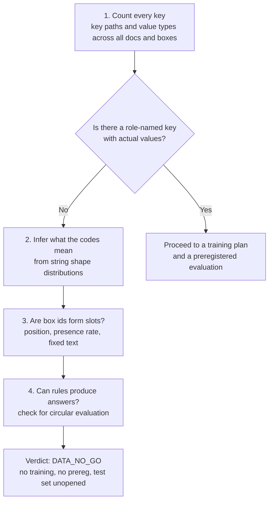
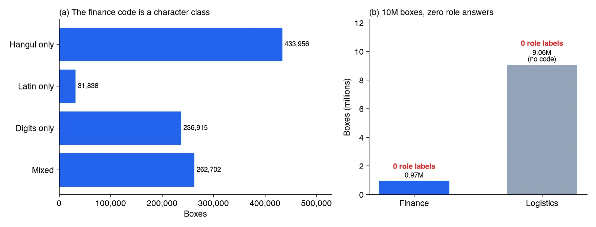
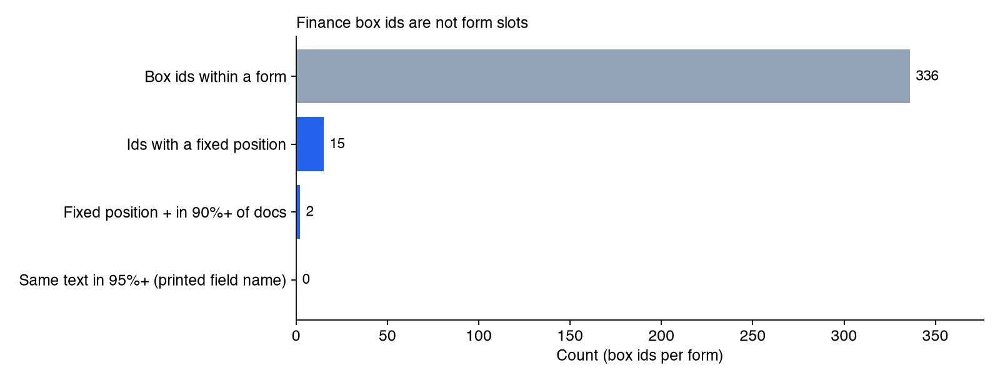

If you are preparing a model that pulls amounts, dates and business registration numbers out of invoices, here is the conclusion first. We secured a public dataset with 142,111 documents and roughly 10 million text boxes. Not one of those boxes came with an answer saying whether it was an amount or a date. So we did not train a field role classifier, and we recorded the decision as DATA_NO_GO.

Because we audited the label structure mechanically before any training, we used no GPU time at all. This post walks through what we checked to reach that conclusion and how you can run the same checks on your own data.

## In plain terms

Think of judging a cooking contest. The storeroom is piled high with ingredients. What the judging needs, though, is not ingredients but a score sheet that says how many points each dish earned. No matter how many ingredients you have, without score sheets you can neither train a cook nor measure one.

The data we received was rich in ingredients. Every document image recorded where each piece of text sat and what it said. What it lacked was a score sheet like "this piece of text is the value of the amount field." To train without score sheets we would have had to invent them ourselves. A model trained that way proves nothing beyond its ability to reproduce the rules we invented.

## What we set out to do

The goal was a classifier that assigns a role (amount, date, business registration number, counterparty and so on) to each text box in scanned finance and logistics documents. Text recognition is handled by an existing OCR. This model decides which field a recognized string belongs to.

The candidate dataset was 'OCR 데이터(금융 및 물류)' (71301) on AI 허브(AI-Hub), the Korean AI data platform's finance and logistics document OCR set. It holds 44,990 finance documents and 97,121 logistics documents across 34 form types. Finance documents average 21.5 text boxes each and logistics documents average 93.3. On size alone it looked more than enough for a role classifier.

The applicant downloaded the data personally and handled it only in storage that only the applicant can access. The data may not be redistributed, so this post contains only aggregates such as counts and ratios. It contains no document images, box strings or form examples.

## Four checks before training

Before writing a training plan we asked one question: are the answers this task needs actually in the labels? To answer it we did not page through label files by hand. We ran a CPU job that counts over every label, three times on the cluster (one smoke run, one full run, one follow-up on a suspicious key). We checked four things.



### 1. Count every label key

The first step counts every key path in the label JSON along with its value types. At box level there were only five keys: an id, a list of corner x coordinates, a list of corner y coordinates, the box string, and a character class code that appears in finance documents only. At document level there was metadata such as image size, form type, capture device and writer information, but no key pointing at the role of a box.

We pulled out every path whose name contains words like label, class, field, role, tag or type and looked at those again. In 15 documents a tag-like key was attached to 378 boxes, and every value was empty. Another options key existed in the same 15 documents only and held fixed tool metadata.

### 2. Infer what the codes mean from the data

Boxes in finance documents carry a code from 0 to 3. If that code were a role, the problem would be solved. There was no official code table in the files, so for each code we measured how often the box string contained Hangul, Latin letters, or only digits and punctuation.



*Chart drawn from audit ledger aggregates. No document images or box strings were used.*

The result was clear. Every code 0 box contained Hangul and not a single digit. Every code 1 box contained Latin letters. Every code 2 box consisted only of digits and punctuation. Code 3 boxes were mixed strings, 94.8% of them containing digits. The code says what characters a box is written in, not which field it is. Logistics documents did not have this code at all. This is an interpretation inferred from distributions, not a confirmed official definition, and we say so plainly.

### 3. Check whether box ids are form slots

Even without a role key there is a way out if, within a form, the same box id always points at the same field. Then you could label one slot per form and propagate it to every document. So, within each form, we measured how much the center of each box id moves, what share of documents it appears in, and whether its string stays the same (up to 1,000 documents per form).



*Chart drawn from audit ledger aggregates. A fixed position means the standard deviation of the normalized center is below 0.02.*

Of 336 box ids within finance forms, only 15 had a fixed position, and only 2 of those appeared in at least 90% of documents. Box ids behave like per-document serial numbers, not form slots. Zero ids repeated the same text in 95% or more of their boxes. That means boxes for the printed field names are absent from the labels and only the filled-in values are present. In logistics documents every box id was unique to its document. The printed text was boxed too, but nothing recorded which field name paired with which value.

### 4. Why rules must not produce the answers

Last, we looked at generating answers with rules. Running regular expressions shaped like amounts, dates and business registration numbers over the boxes does yield candidates. Among mixed finance boxes, 7.6% looked like amounts and 4.6% like registration numbers. Among logistics boxes, 0.95% looked like amounts and 0.63% like dates. These are candidate rates, not performance. Without true roles, neither recall nor precision can be defined.

Train a model on those candidates as answers and it learns to imitate the regular expressions. It then scores well on a test set built from the same regular expressions. That score proves nothing except that the rules were reproduced. Treating the value next to a printed field name as that field has the same problem. On top of that, finance labels have no field name boxes, so it could not even be applied. We rejected synthetic documents as a substitute for the same reason.

## Audit code you can run on your own data

The procedure above works on any document label set. The code below takes a collection of label JSON objects, counts key paths and types, and picks out role-like keys. It then measures whether box ids behave like form slots. You only need to adapt the accessor functions and the key names for coordinates and strings to your schema. Box strings are never stored, only hashed, so no raw content ends up in the audit output.

```python
import json, re, zlib
from collections import Counter, defaultdict
from statistics import pstdev

ROLEISH = re.compile(r"(label|categor|class|key|field|name|role|entity|link|tag|kind|type)", re.I)

def walk(o, path, keys, types):
    """Count every key path and value type."""
    if isinstance(o, dict):
        for k, v in o.items():
            p = f"{path}.{k}" if path else k
            keys[p] += 1
            types[p][type(v).__name__] += 1
            walk(v, p, keys, types)
    elif isinstance(o, list):
        for v in o[:500]:
            walk(v, path + "[]", keys, types)

def audit(docs, boxes_of, form_of, box_id, center, text):
    """docs: list of label dicts. The rest are accessors for your schema."""
    keys, types = Counter(), defaultdict(Counter)
    slot_pos = defaultdict(list)          # (form, box id) -> normalized centers
    slot_txt = defaultdict(Counter)       # (form, box id) -> string hash counts
    docs_per_form = Counter()
    for d in docs:
        walk(d, "", keys, types)
        f = form_of(d)
        docs_per_form[f] += 1
        for b in boxes_of(d):
            slot_pos[(f, box_id(b))].append(center(d, b))
            slot_txt[(f, box_id(b))][zlib.crc32(text(b).encode())] += 1
    roleish = {p: dict(types[p]) for p in keys if ROLEISH.search(p.split(".")[-1])}
    stable = present = const = 0
    for (f, i), pts in slot_pos.items():
        sx, sy = pstdev(x for x, _ in pts), pstdev(y for _, y in pts)
        stable += sx < 0.02 and sy < 0.02
        present += len(pts) >= 0.9 * docs_per_form[f]
        const += slot_txt[(f, i)].most_common(1)[0][1] / len(pts) >= 0.95
    return {"key_paths": dict(keys), "roleish_paths": roleish,
            "slots": len(slot_pos), "pos_stable": stable,
            "present_ge90": present, "text_const_ge95": const}
```

Fixing the order in which you read the results keeps the decision steady. First, if a role-like key exists, check that its values are not empty and count how many distinct values it has. Second, if there is a code field, measure the string shape per code (share of Hangul, Latin and digits, and length distribution) to tell a role from a character class. Third, if most box ids have fixed positions, you can label once per form and propagate; if only a few do, you need box-level human labels. Fourth, if no answers have appeared by this point, stop, and do not manufacture them with rules or synthetic data.

## Why this decision was worth making

The biggest gain is the wrong number we never produced. Training on regex-made answers would likely have produced a high accuracy figure. That figure could have ended up in a report and then in a customer proposal, with nobody knowing how the model actually performs on real invoices. The audit removed the chance of such a number before training began.

The cost was small too. The three aggregation jobs ran on CPU only, with no GPU. We trained nothing and opened no test set, so the evaluation data stays clean for the day real answers exist.

What the verdict leaves behind is not a flat "no" but conditions for resuming. Because box ids are not form slots, per-form labels are not enough. We need role labels that people review box by box. Evaluation must hold out forms that were never used in training, so that a model which memorized form layouts gets caught. The alternative is role labels on a customer's real invoices and tax invoices. When either is ready, we will preregister the training plan and evaluation criteria and then start.

## What this means for ThakiCloud products

In Paxis, document automation means an agent pulls values from paperwork, fills a draft, and a person confirms it. In that flow a number like "amount field extraction accuracy X%" becomes the basis for a customer's adoption decision. Not inventing an unsupported number therefore matters more than shipping one more feature. Today what ThakiCloud has for document fields is a baseline that extracts amount, date and registration number candidates with regular expressions and attaches the source position and hash as evidence. We do not dress it up as an accuracy figure.

The same audit can sit in the Maxis domain model training flow as a pre-training check. When customer data arrives, a label schema audit job runs before any training job and confirms whether the answers the task needs exist. The audit runs on CPU and keeps no raw strings in its output. That makes it usable in on-premise environments such as Aegis, where data cannot leave the site.

## Limitations and counterarguments

The strongest objection is "couldn't you have known this by reading the official documentation?" Fair point. The dataset guide's description alone suggests role labels may be missing. Still, suspecting and confirming are different things. Keys not described in the guide can hide in some documents (a tag key really did exist on 378 boxes), and the possibility that the code was a role had to be ruled out with data. The full count closed those possibilities with numbers.

The meaning of the codes is inferred. We could not confirm an official code table and judged from string shape distributions. That said, code 0 boxes were 100% Hangul with no digits, code 1 boxes were 100% containing Latin letters, and code 2 boxes were 100% digits and punctuation, which leaves little room for a role interpretation.

The slot analysis used up to 1,000 documents per form. A larger sample could shift the count of fixed-position ids a little, but we do not expect it to overturn a gap of 15 out of 336.

## Summary

Having data and having the answers your task needs are different things. Here we had 140,000 documents and 10 million boxes but zero field role answers. Four checks confirmed that before training: a full count of label keys, the code value distribution, whether box ids are form slots, and whether rule-made answers would be circular.

If you are preparing document field extraction, run a label audit before writing the training plan. A CPU job like the code above is enough to get an answer. If the answer is "there are none," it also tells you where and how much human labeling you need.

## Sources

- [AI-Hub dataset: 'OCR 데이터(금융 및 물류)' / document OCR for finance and logistics (71301)](https://www.aihub.or.kr/aihubdata/data/view.do?dataSetSn=71301)

---

*Data source: the AI 허브(AI-Hub) dataset 'OCR 데이터(금융 및 물류)' (71301). The data is not redistributed, and the audit was carried out only under the applicant's internal-use terms. This post contains only aggregates such as counts and ratios, and no document images, box strings, form examples or identifiers. The figures are charts drawn from the audit ledger aggregates.*
