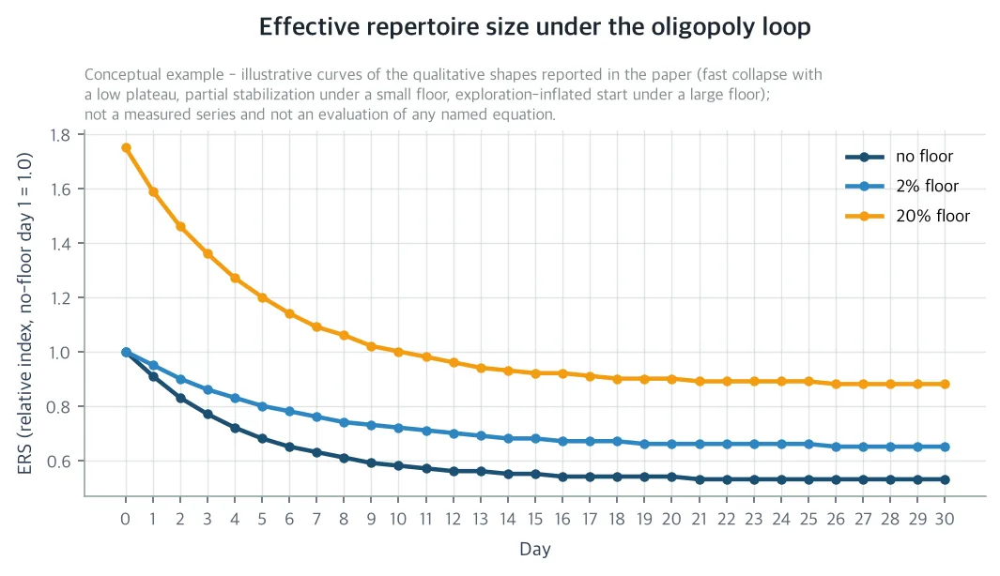
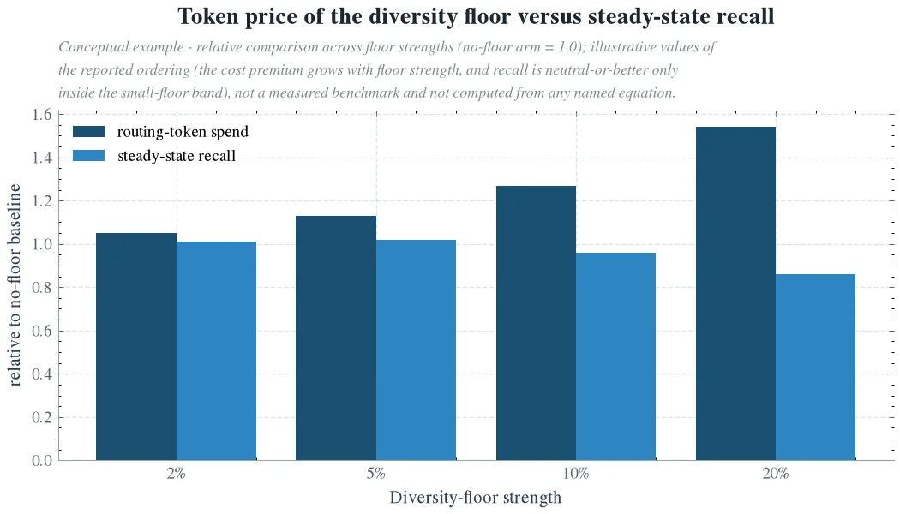

If you run an unattended agent harness that self-evolves its skill registry overnight and serve tasks with a router on top of that registry, you should read this paper. The overnight self-reinforcing loop quietly shrinks the menu it serves while the quality metrics improve. This paper measures that shrinkage with two numbers and prices the small amount of forced exploration that holds recall. Leave a 2,200-skill registry alone for 30 days and the practical menu halves, with over 98% of the skills gone from routing. Yet in the same period recall goes up. The state of affairs is invisible on quality metrics, and buying it back with 2~5% forced exploration, a 'diversity floor', costs 5~13% of routing spend.

One thing to know up front. The numbers in this paper are a seed-fixed simulation at production scale, not a production measurement. Production confirmation is the job of the protocol the paper pre-wrote.

*A visual metaphor for the article's key idea.*

## The problem: a loop that narrows the menu as the metrics improve

Our production harness routes 300 task steps a day to one of 40 domains and 2,200 skills. Overnight the harness synthesizes, validates, rewrites, and merges skills. The next day the router serves from that registry. The earlier studies in this series priced the stages of this loop one by one. How many candidates to show, which of the near-tied candidates to pick, how much this evolution loop recovers per token, those were the questions. All of these prices are the answer to the question of how much it costs once selection pins down quality. One question is still left. What is this loop doing to the object it serves itself, the scorecard of the router's menu.

The overnight evolution step edits the scores with that day's outcomes. The score of a skill that was routed and succeeded above average is multiplied. A skill that succeeded below average decays. A skill that got no routing shrinks by 5% a day. The restaurant strip analogy is exact. The guidebook edits its review notes every night with the day's results. Customers only visit the restaurants with the good reviews, and the famous restaurants take more customers, get more reviews, and earn more seats. The small shop with no customers quietly closes. The mechanism is the rich-get-richer process already known as the Matthew effect in recommendation platforms, the brand popularity bias in generative search, and the starvation of new creators on creator platforms.

The hypothesis this paper sets up is that left alone, the loop oligopolizes the ecosystem it lives in. Routing concentrates into a few super skills, the practical menu shrinks, and the long tail goes extinct. Moreover, the shrinkage is invisible on the quality metrics you check every day, or even rewarded. To make the hypothesis falsifiable, a number to measure with is needed. The paper uses the effective repertoire size (ERS), the number of skills that actually carry the routing mass, the Shannon entropy, and the long tail extinction rate, the fraction of skills with zero routings in 5 days.

## The 30 day reality: how the menu halves and 98% of the shops close

Without a floor, the loop becomes a machine for concentrating wealth. The effective repertoire size falls 46%, from 14.0 on day 1 to a steady state of 7.5. The entropy drops from 0.46 to 0.30, and in the last 5 day window of day 30, 98.4% of the skills have zero routings, extinct. On the router's scorecard too, 86.2% of the skills grind down to less than 1/1000 of the maximum skill score. The collapse is mostly over within the first 10 days, and plateaus after that. It becomes a stable oligopoly with only a few super skills left in each hot domain.

The collapse happens as two channels overlap. The first is the 'never routed' channel. The score is low, so the router does not pick it, and not being picked it shrinks 5% a day. By a proposition in the paper, a tail skill that starts at 10% of the core skill score falls below the collapse threshold within 90 days. Under Zipf demand, 61.2% of the registry is inside the 'cannot survive to day 30' set from day 1. The second is the 'picked but below average' channel. Even when routed, if the success is below average the score is not multiplied but decayed. So the measured collapse of 86.2% exceeds the 61.2% of the first channel. The extinction rate has a structural floor too. With 1,500 routings over 5 days, even if the routing were split evenly, at least 31.8% of the skills must be extinct. The measured 98.4% is that floor plus the 66.6% of concentration the loop makes on top of it. In plain terms, a third of the closed shops is unavoidable because there simply are too few customers, and the rest is what the loop made.

*Without a floor, the effective repertoire size shrinks quickly and plateaus at a low level. A small 2% floor stabilizes it at a mid level, and a large 20% floor keeps it high, inflated by the exploration itself. The effective repertoire size means the number of skills that actually carry the routing mass. A figure of the analytic model, not measured data.*

The most important result is the second one. This shrinkage is invisible on the quality metrics. In the same period, the coverage recall, that is the domain match success rate, rises from 0.17 on day 1 to 0.26 in steady state. Concentration is exactly that mechanism. Keep reinforcing the skills that fit the current demand, and recall rises for that demand. Looking only at the task success rate dashboard, the loop appears to have raised quality. What the dashboard cannot see is the extinction ledger. 98.4% of the 2,200 skills are left with no routing at all. Now, if demand shifts, or a super skill in a hot domain falls, there is no long tail to catch it. The coverage of the registry becomes a single point of failure with only a few redundant copies.

## The diversity floor: the price of forced exploration and the recall fixed point

The fix is to ignore the scorecard with probability ε and sample uniformly from a wide net of 96 candidates instead of the narrow net of 24. Exploration bypasses the scorecard by construction, so even the tail skills become eligible for routing. ε is a single dial.

The price of this dial has a closed form. The daily routing token excess Δ(ε) is 'exploration probability × steps per day × (wide net - narrow net) × mean description length', approximated as εT(K_e-K)ḿ. In other words, the cost of the floor is the price of the extra candidate descriptions put into the prompt. Evaluated on the day 1 scorecard, it is roughly 520,000 tokens a day per unit of ε. The steady state excess measured in the seed simulation agreed with this closed form within 7% on every arm.

The next question is how far to turn it. Find the recall fixed point, the largest ε for which the steady state recall holds above the no-floor baseline, and the interval is from 5% to under 10%. At a 5% floor the steady state recall is 0.266, slightly above the 0.261 baseline, and at 2% it is 0.263. At 10% it is 0.250, below the baseline, and at 20% it is 0.224, a 3.7 percentage point drop. The token prices are these. The baseline routing spend is roughly 194,000 tokens a day. A 2% floor is 9,750 tokens a day, a 5.0% addition, and a 5% floor is a 12.7% addition. A 20% floor is a 54.2% addition, and it cuts recall too. The frontier is strongly concave. The first 2% buys 1.7 of effective repertoire for 5,800 tokens, about 3x cheaper than any point above it. At 5% it is 17,300, and at 20% it is 19,700. In plain terms, a little exploration is cheapest, and the more you turn it, the higher the price per unit climbs until recall goes with it.

The operating rule comes out in three lines. The default is ε=2%. If the alarm rings that the effective repertoire size has fallen below 70% of day 1, raise it to 5%. That alarm rings around the 6th day of the collapse, so it is caught before the plateau. And do not pay for 20%. It is expensive, and it hurts recall.

*As the floor strength rises, the routing token spend keeps rising. But the interval where the steady state recall holds above baseline is limited to the 2~5% floor, and the 20% floor cuts recall. A figure of the analytic model, not measured data.*

## Company, society, science: where the same experiment lands in three places

What it gives the company is a health check with two numbers and one dial. The effective repertoire size and the extinction rate over a 5 day rolling window are the alarm, and the floor strength ε is the prescription. Because the steady state and the token price are measured for a 2,200-skill registry, a quietly collapsing registry is caught and fixed before the long tail coverage degrades. The floor's 9,750 tokens a day sits two to three orders of magnitude below the loop's own nightly spend of 1.3M~8.2M tokens. So the 10.2x first-night payback conclusion of the earlier Evolution Payback study does not waver even with the floor running. The interaction with the Indifference Band study is concrete too. The tie candidate band was certified against the scorecard as it stood, and this loop moves the scorecard toward the super skills. The band composition drifts from 'super skill and its clone' to 'super skill and super skill', and the band's 60.5 dollars per cycle savings is a statistic that depends on the ecosystem state. Recompute the band certification for each scorecard state and report the savings as a function of the effective repertoire size, and the collapse alarm and the tie-break repricing come out of the same signal.

What it gives society, or more precisely the operation of unattended self-improving systems, is one named failure mode. 'Ecosystem oligopoly under self-improvement'. Unattended self-improving agent ecosystems are being deployed at scale right now, and they can concentrate their own skill diversity while the standard quality metrics stay flat or rise. In a way that no one who only looks at the task success rate dashboard notices. Recommendation systems found this as the Matthew effect, generative search as the brand popularity bias, creator platforms as the starvation of new creators, and all of them are mitigated with a 'floor' intervention. The agent skill ecosystem adds two things here. First, exposure is a routed job. Every assignment has a real token price and a real user. Second, the allocator relearns itself every night from its own outcomes, with no human in the loop. So this failure mode is not a bias to audit once, but a dynamic to monitor continuously. Fortunately the monitoring is cheap. Two rolling window statistics and a 2~5% exploration surcharge.

What it gives science is adding one axis to the self-evolving harness literature. The existing literature measured cost, quality, and ROI. This paper creates the third axis that those three cannot see, the ecosystem dynamic. The wealth concentration and long tail extinction of the self-reinforcing routing+evolution loop, and its cost-quality-diversity frontier. The upgrade of the earlier work is here too. While the Indifference Band priced the decision inside the tie, this paper shows that the tie landscape itself is endogenous to the loop. The reminder it leaves the field is this. An allocator that learns from its own assignments, left without intervention, optimizes the menu away.

## Limits: what has not changed into a production measurement

First, it is a recall proxy. The domain coverage recall of the simulation is a proxy standing in for the SRA holdout routing recall. The fixed point criterion was used to transfer 1 to 1, but the production numbers have to be measured in the harness. The paper pre-writes the confirmation protocol and the refutation criteria. If, without a floor, the effective repertoire size falls below 70% of day 1 within 30 days, or the extinction rate passes 0.8, the hypothesis is refuted.

Second, model fidelity. The simulation reproduces the mechanics all the way down to score routing, outcome-fed reinforcement, decay of the unrouted, and the token-metered prompt. But the production overnight step also synthesizes, merges, and deduplicates skills. Merging removes a skill whole, so it is an added concentration pressure. The measured dynamic may therefore be optimistic for the no-floor case.

Third, the demand regime. It is a single Zipf regime (α=1.1) over 30 days. If demand flattens, or if demand shifts during the period, the absolute numbers change. The structural floor of extinction and the closed form of the price do not depend on demand, however.

Fourth, the floor design. Uniform wide exploration is the simplest floor, not the cheapest. A structural floor that targets the tail skills, or that only explores when the alarm rings, could buy the same diversity at a lower price. Pricing that is the job of the next study.

Every number in this post is a seed-fixed simulation run at production scale, not a production measurement. The two figures are figures of the analytic model. The full paper and the setup are on the Hugging Face paper detail page. https://huggingface.co/datasets/thaki-AI/daily-paper-2026-11-09-skill-oligopoly-diversity-collapse
