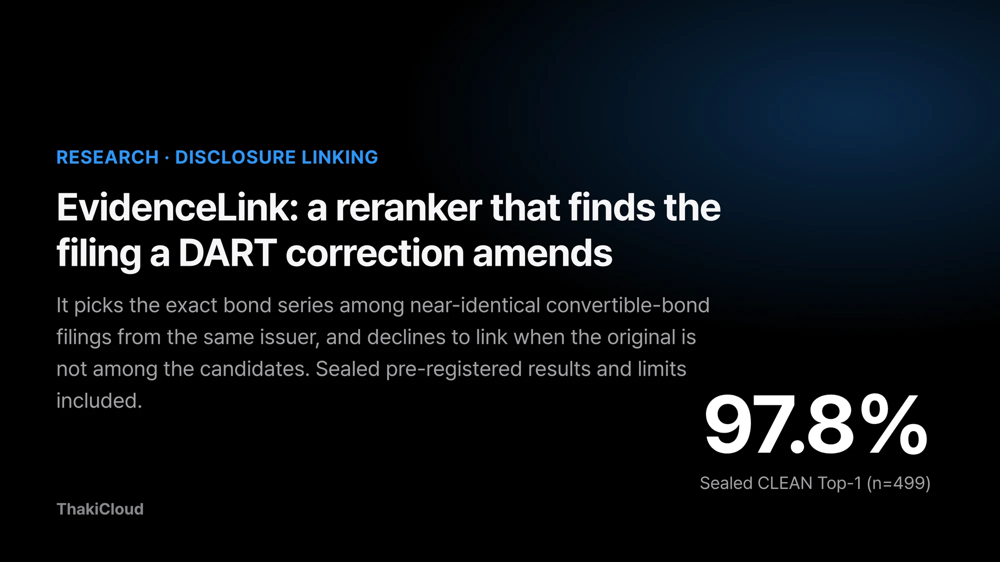
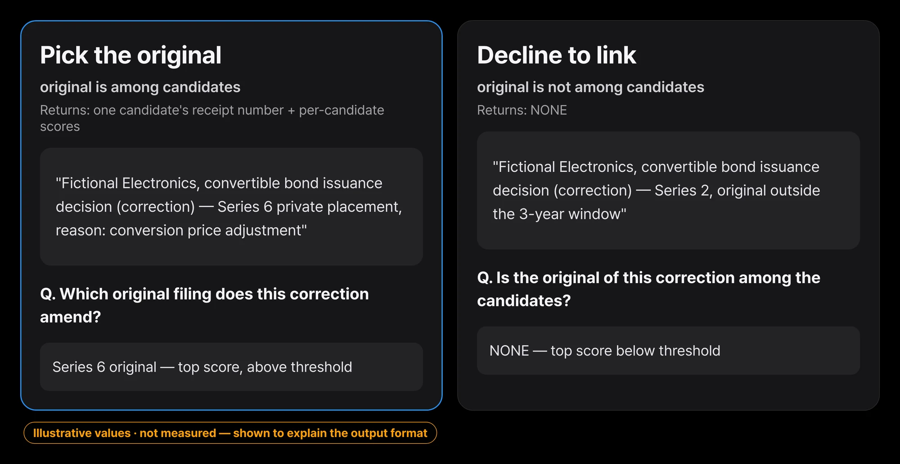
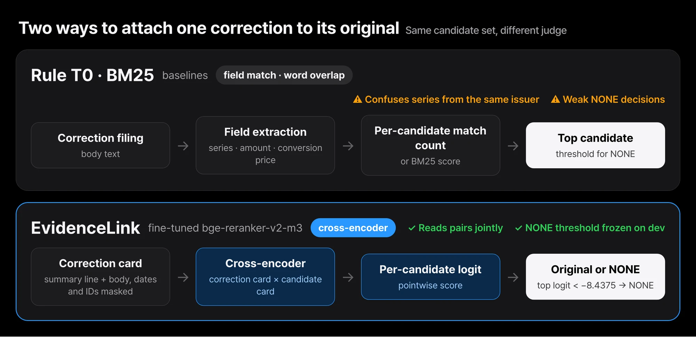
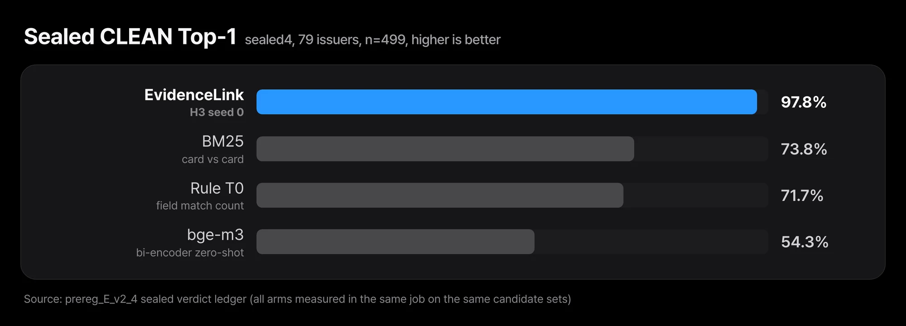

A company that has issued convertible bonds files a correction whenever the issuance terms change. Every time it adjusts the conversion price, postpones the payment date, or revises the total face amount, another filing is added to the pile. For anyone who collects and analyzes filings, each incoming correction has to be matched to the original filing it amends.

If the same company issued its 4th, 5th, and 6th bond tranches back to back, the right tranche has to be picked from several filings whose tables are almost identical.

ThakiCloud has released EvidenceLink-DART-Reranker-KO on Hugging Face, a Korean cross-encoder built for this matching job. Give it one correction filing and a few candidate original filings, and it returns one original filing, or NONE if no candidate is the original.

On a sealed evaluation built from correction filings by 79 issuers that were not used in training, it reached a CLEAN Top-1 of 0.978. BM25 scored 0.7375 under the same conditions.

This post explains what the model takes as input and what it returns, how it differs from existing approaches, and what the sealed evaluation did and did not confirm.

Model: [ThakiCloud/EvidenceLink-DART-Reranker-KO](https://huggingface.co/ThakiCloud/EvidenceLink-DART-Reranker-KO)

## For each correction filing, it returns one original filing or NONE

A correction filing states the reason for the correction, the items that changed, and the date of the first submission. When the same company filed several tranches on the same day, the date alone cannot tell them apart, and rules that compare tranche numbers and amounts often fail when the candidates have the same table layout.

EvidenceLink solves this as a reranking problem. Reranking means taking a list of candidates, scoring how well each one fits the query, and sorting them. Here the correction filing is the query. The candidates are up to 10 original filings from the same company within the previous 3 years, plus 3 filings from other companies.

The model scores every candidate, and if the highest score is below the frozen threshold of −8.4375, it returns NONE instead of linking.

*A format example built with a fictional issuer. The model scores each candidate (a logit, not a probability) and returns NONE if the top score is below the frozen threshold of −8.4375.*

NONE matters because a wrong link costs more than no link. If a correction is attached to a filing that is not its original, conversion price tracking, dilution calculations, and term-change history all pile up against the wrong bond. The ability to say "I don't know" when the answer is not among the candidates has to be measured separately from accuracy.

## It reads the correction and the candidate as a pair instead of counting fields

There were two baselines. Rule-based T0 extracts fields such as tranche number, total face amount, and conversion price from the correction and the candidate, then counts how many match. BM25 scores by word overlap between the two documents. Both are weak against candidates whose fields mostly overlap, such as a different tranche from the same company.

EvidenceLink is a cross-encoder made by fully fine-tuning `BAAI/bge-reranker-v2-m3` on public OpenDART filings. A cross-encoder concatenates the query and the candidate into a single input, reads them together, and outputs a score.

It is slower than a bi-encoder, which turns the query and the candidate into separate vectors and compares them, but it picks up finer differences between two documents.

*Rules and BM25 count field matches or word overlap, while EvidenceLink reads the correction card and the candidate card as a pair and scores them. All three were measured on the same candidate sets.*

The input is a card format, not the raw text. It starts with a `[요약]` (summary) line holding the tranche number, total face amount, conversion price, coupon rate, yield to maturity, and minimum adjusted price, followed by the filing body. The first submission date and the 14-digit receipt number are masked, to block shortcuts that guess the answer from dates.

The code that builds the cards is released with the model as `evidencelink.py`. If you use a different format, the score distribution shifts and the threshold no longer fits.

## On 79 issuers unseen in training, it beat BM25 by 0.2387

The evaluation followed a pre-registered plan (`prereg_E_v2_4`). Pre-registration means writing down, before looking at the data, what counts as a pass and by what criteria. The sealed evaluation set, sealed4, has 648 correction filings from 79 issuers, all of which were excluded from both the training set and the development validation set (dev).

The pass criteria (gates) are judged on the CLEAN set (n=499). CLEAN excludes queries where the candidate's receipt date is visible as is in the query card.

*On correction filings from issuers unseen in training, EvidenceLink beat BM25 by 23.9 percentage points (issuer-level bootstrap 95% interval +16.5 to +30.9 points).*

| Method | Top-1 | Link accuracy | NONE precision | NONE recall | Same-issuer mislink rate |
|---|---|---|---|---|---|
| EvidenceLink (H3, seed 0) | 0.978 | 0.9946 | 1.0 | 0.9308 | 0.0246 |
| BM25 | 0.7375 | 0.7642 | 0.5548 | 0.6615 | 0.1387 |
| Rule T0 | 0.7174 | 0.6856 | 0.5899 | 0.8077 | 0.1432 |
| bge-m3 bi-encoder zero-shot | 0.5431 | 0.5339 | 0.3289 | 0.5692 | 0.1723 |

All four methods were measured in the same sealed evaluation run on the same candidate sets. The same-issuer mislink rate is the share of corrections wrongly attached to a different tranche from the same company. It fell from 0.1387 under BM25 to 0.0246. This confusion is exactly what the model was built to resolve.

To check whether the gap could be chance, we ran a 10,000-resample paired bootstrap grouped by issuer. The CLEAN Top-1 difference was +0.2387 against BM25 (95% interval 0.1645 to 0.3091) and +0.2573 against T0 (0.1635 to 0.3497).

Neither interval contains 0. On all 648 filings (ALL), Top-1 was 0.9722, above BM25 at 0.7454 and T0 at 0.7068. All pre-registered pass criteria G1 through G5 were met, so the verdict is PASS_V24.

Splitting by receipt year did not change the picture much. CLEAN Top-1 was 0.97 for 2022 (n=100), 0.9552 for 2023 (n=67), 0.9857 for 2024 (n=140), 0.9817 for 2025 (n=109), and 0.988 for 2026 (n=83). BM25 ranged from 0.57 to 0.8143 over the same years.

## Five things to know before you use it

These results are the verdict of this experiment, `prereg_E_v2_4`, and do not guarantee general filing-linking performance. Please check the following before use.

**Natural NONE is not demonstrated.** The pre-registration set recall on naturally occurring NONE (the original filing lies outside the 3-year window) as G6, to be judged only when there are at least 30 samples. sealed4 has only 25, so G6 was judged UNDERPOWERED and left out of the verdict. Of the 130 CLEAN NONE cases, 105 were built by deliberately removing the original filing from the candidates. On the 25 natural NONE cases, the model scored 0.92, equal to BM25 (0.92) and below rule T0 (0.96). With 25 samples, the three methods cannot be told apart.

**The ground truth was not reviewed by humans.** The ground-truth original filings come from the correction chain that DART attaches to the original report when a correction is submitted. The training labels are weaker rule labels, made by matching the first submission date in the correction body to the candidate's receipt date. On CLEAN queries where this rule produced an answer, agreement with the chain ground truth was 0.8868.

**dev has almost no 2022 to 2023 filings.** dev has 11 issuers and 93 filings, with 0 from 2022 and 1 from 2023. Because the epoch and the NONE threshold were chosen on this dev set, the sealed numbers for 2022 to 2023 come from outside the distribution used to select the model.

**The decoder decides the result.** OpenDART documents from before mid-2022 are encoded in cp949. The earlier pipeline read them as UTF-8 and replaced the broken characters with replacement characters, which corrupted 1,427 cached documents. As a result, field extraction for 2022 to 2023 collapsed, and the earlier sealed evaluation (sealed3) was NO_GO. With the decoder fixed in v2, the extraction rate for tranche number and total face amount on sealed4 queries is 0.948 to 0.992 by year. If you feed text that was not read with the released `dart_zip_to_text`, expect accuracy to drop. After the decoder fix, we rescored sealed3 with the earlier model, and CLEAN Top-1 on the same 385 filings rose from 0.6571 to 0.9455. But that evaluation set had already been exposed, so this is a report-only diagnostic and not used as evidence for passing.

**The scope is narrow.** The target is convertible bond issuance decisions and their correction filings, with receipt years 2022 to 2026. We did not measure performance on other filing types or on customer documents such as contracts and spreadsheets. Candidates include only original filings from the previous 3 years, so older originals cannot be linked. Input is truncated at 1024 tokens, and all of the 4,000 training pairs and 432 dev pairs we checked exceeded that length. This is why the `[요약]` line comes first.

## Training used public filings only, and what we released is the weights and code

The training data is 1,430 public filings (205 issuers) fetched through the OpenDART API. The model was trained with pointwise BCE, scoring each candidate individually and treating all other candidates in the same set as negatives. Settings: max_len 1024, batch 16, 2 epochs, lr 2e-5, positive weight 3, with epoch 1 chosen by dev score.

The dev scores of the two seeds were tied (0.9085), so under the pre-registered tie-break rule seed 0 was chosen before the sealed evaluation. Seed 1 was not evaluated on sealed4.

The Hugging Face repo contains the weights (`model.safetensors`, sha256 `a402de3dc80fa8d45b42551ef381f063ec997fdba7d5d6e31462108fd48f6c19`), the tokenizer, `evidencelink.py` with the card format and decoder, and one example built with a fictional issuer.

It does not include the original filings, extracted fields, queries, candidate sets, or labels. The license is Apache-2.0, the same as the base model.

## Closing

EvidenceLink is a model for one narrow task: attaching a convertible bond correction filing to the correct tranche among similar original filings from the same company. On the sealed evaluation of 79 issuers unseen in training, it recorded a CLEAN Top-1 of 0.978 and a same-issuer mislink rate of 0.0246.

Generalization on natural NONE, the ground truth without human review, and the dev set that lacks 2022 to 2023 are limitations that remain.

To try it, download the repo, run `python evidencelink.py --selftest` to check the decoder and card format, then run the example with `--example examples/synthetic_query.json`. For your own filings, read the OpenDART documents with the released decoder, and first check Top-1 and the NONE decision on a few dozen corrections whose answers you know before putting it into use.

- Model: [ThakiCloud/EvidenceLink-DART-Reranker-KO](https://huggingface.co/ThakiCloud/EvidenceLink-DART-Reranker-KO)
- Base model: [BAAI/bge-reranker-v2-m3](https://huggingface.co/BAAI/bge-reranker-v2-m3)
- Data source: [OpenDART](https://opendart.fss.or.kr/) (the Financial Supervisory Service's public API for electronic disclosures)
