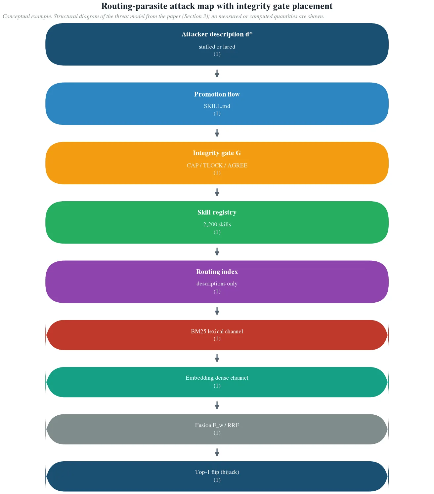
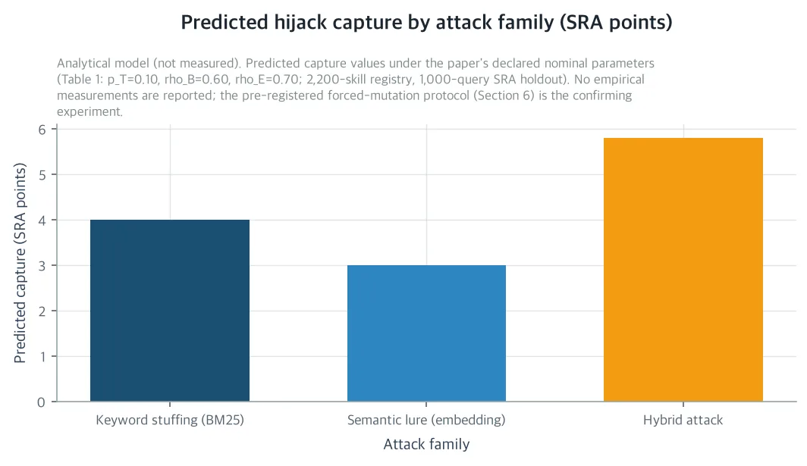
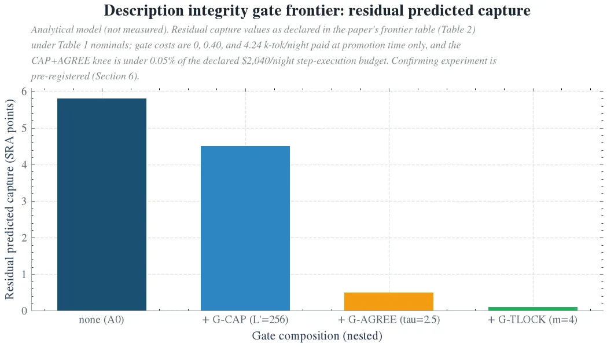

If you run a self-evolving agent harness on your own GPU, in a skill registry where third parties register SKILL.md files, read this paper. There, a router routes every task step by description. The paper answers one question: how much traffic can a single maliciously rewritten description steal? At the declared nominal values the answer is 5.8 SRA points, roughly 5.8% of the holdout traffic. There is no payload, no execution, nothing the user can see. The stealing is all traffic capture in the routing layer, and the paper's point is that the standard routing accuracy benchmark (SRA) is structurally unable to see it.

One thing to know up front. This paper is an analysis and reports no new measurements. Every number in the body is either a closed-form prediction over the declared nominal values or a result attributed to a cited reference. The nominal values include a 2,200-skill registry, a $2,040 nightly step budget, and a fusion weight w=1/2. The three figures are schematics drawn by the analytical model, not measured data. Structural results such as the flip conditions and the crossover argument are exact and do not depend on the nominal values. Measurement is the job of the preregistered forced-mutation protocol, which the paper writes out in full at the end of the body.

## In plain terms

Think of a post office sorting machine. It reads only the address label on an envelope and routes the letter; it never opens it. If someone edits just the label, mail meant for other people starts arriving in their box. No one touches the letters themselves, and the machine's performance checks stay clean.

This paper is about that label. The skill router assigns each task step by reading one description line per skill, and third parties can edit those lines. One edited label quietly reroutes traffic away from other skills. The paper works out how much traffic a single label edit can steal, and what a label check at the registration desk costs.

## What Accuracy Benchmarks Cannot See

The ThakiCloud harness sends every task step to a skill router before executing it. The registry holds 2,200 skills, and the router is a device that hybrid-searches on the SKILL.md description alone. It min-max normalizes the BM25 lexical score and the embedding dense similarity per query and interpolates them with weight w; the nominal value is w=1/2. The embedding encoder is 768-dimensional, served self-hosted on an H200. Skills enter only through the promotion flow (curation, promotion, indexing), and the index is rebuilt every night as the ecosystem evolves. The router is a 24/7 hot path and, at the same time, a target that changes by itself.

This is where a new failure class enters. Its name is the routing parasite. A third-party skill author, or a single compromised legitimate skill, holds write access to a skill's description d_{s*} through the promotion flow. That description is the only text the router reads and the only text that no routing-layer defense payload-checks. The attacker rewrites it and quietly takes the routing traffic of queries whose gold skill is a different skill. No code execution, no command injection into the skill body, no change the user can see. The goal is traffic capture itself. Marketplace exposure, execution statistics, and a staged channel toward later body-level injection are the rewards. This is different from prompt injection research that plants payloads in skill bodies, and from execution hijack research without a payload. The weapon is the relevance of the description, and the objective function is routing traffic.

*Routing parasite attack map. The attacker's only write point is the promotion flow, and the description integrity gate G sits there. The rewritten description passes through the lexical channel (BM25 list) and the dense channel (embedding list) into the fusion stage, where the top-1 flip happens. Downstream, menu presentation and CommitByCost interact with the hijack surface. A schematic from the analytical model, not a measurement.*

Why can't SRA see this? SRA (Skill Routing Accuracy) is, in effect, top-1 recall measured on a holdout of 1,000 gold-tagged steps that do not overlap the promotion corpus. Given the current description population, it asks whether the router finds the gold. It cannot see future, attacker-controlled descriptions. The structure is the same as a search engine whose nDCG is clean on a clean corpus but is captured by a single spoofed document. A router clean on SRA can hand roughly 5% of all traffic to a parasite. This attack surface is orthogonal to SRA, because it is a property of the router's input channel, not accuracy on an existing index.

The three earlier papers in the router series priced the scoring (Quantizing the Gatekeeper), presentation (The Menu Width), and tiebreak (The Indifference Band) stages. All three, however, stressed the router only with positive perturbations such as quantization, full menu width, and near ties. None asked how much traffic a single malicious description can steal. This paper takes up that question and prices the input stage of the routing surface, filling in the series' fourth stage.

## The Hijack Surface Splits into Two Channels

There are two attack families. Channel A, keyword spoofing (KWS), targets the BM25 channel. It fills the description with the rare terms of the target queries. With b=0 and a length-normalized index, inserting each term once is the maximum reachable BM25 score. The normalized lexical occupancy B* becomes 1. Channel B, semantic lure (SML), targets the embedding channel. It writes text within distance ε_s = 0.05 of the target cluster center in embedding space while avoiding the surface vocabulary. Embedding inversion research supports feasibility. If the original text can be reconstructed from a vector, then steering text toward a cluster center is the mirror image of the same capability. Reconstruction is reported up to BERTScore 87 or above across the full prose category, with 47.4% exact match on instruction text.

The top-1 flip condition is derived exactly for both fusion methods. In the score interpolation F_w = w·B̃ + (1−w)·Ẽ, the spoofing sufficient condition is a linear inequality increasing in the fusion weight w. The lure sufficient condition is a linear inequality decreasing in it. Because the directions are opposite, a crossover weight w†(q) that separates queries won by spoofing alone from queries won by lure alone exists for every query. At the deployed balanced point w=1/2, the two single-channel conditions are simultaneously weakest. Only the hybrid condition, which fills vocabulary and steers at the same time, holds for all three query classes. Balanced fusion dividing the attack surface across the two channels is the paper's core structural result.

*Predicted hijack capture by attack family under the declared nominal values. A single rewritten description captures 4.0 SRA points through keyword spoofing (BM25 channel), 3.0 through semantic lure (embedding channel), and 5.8 through the hybrid attack. 5.8 is 4.0 + 3.0 minus the 1.2 that overlaps. A schematic from the analytical model, not a measurement.*

The scale of the crossover comes out in numbers at the nominal values. The target cluster is declared to be 10% of holdout traffic (100 queries). The share of queries where the gold is already BM25 rank 1 is ρ_B = 60%, and the share where the gold is the embedding maximum is ρ_E = 70%. Then the capture is 4.0 SRA points for keyword spoofing, 3.0 for semantic lure, and 5.8 for hybrid. That is the size of stealing roughly 5.8% of traffic per description. The channel decomposition is 5.8 = 4.0 + 3.0 − 1.2 (overlap), and the defense budget of any single channel alone is not enough. What the parasite feeds on is nothing special. It is the same quality as the fusion tax already measured in the hybrid retrieval literature. There, in 13~48% of queries the relevant document is ranked below the better of the two components. The everyday cost of fusion, read from the attacker's side, is the routing parasite.

RRF (k_R=60) changes this picture only halfway. A single-channel attacker, rank 1 in one list and absent from the other, flips only under one position. The gold must not be rank 1 in that channel, and must sit in roughly the bottom 38% of the other list. RRF makes single-channel attacks rare rank hijacks. But a hybrid attacker, ranks 1 and 2 across the two lists, flips more. It flips every query where the gold is rank 1 in one channel and below rank 2 in the other. RRF leaves the hybrid attack almost intact. So the fusion method is not a security axis. Defense must act on the description, not on w.

The capture also carries a distribution-free upper bound: the hijack ball. Capture is bounded above by the fraction of queries whose gold margin falls inside the attacker's maximum reachable lift (ℓ_max = 0.99, w=1/2, ε_s = 0.05). It is loose in general and tight for the declared profile. The gate analysis below is all a pricing of this ball.

## The Three Integrity Gates and the Cost Frontier

The defense is a description integrity gate seated in the promotion flow. Unlike post-retrieval defense or runtime detection, the gate is a promotion-time control that runs once per promotion, not once per query. In the post office, that is a check at the label registration desk, not beside the sorting machine. Nightly promotions are declared to be 40. SRA recall must stay above the floor of R_0 − 0.5 points, and the paper prices three gates, each covering a different part of the channel decomposition.

G-CAP is the length cap. Cutting the description budget from 512 to 256 tokens scales the lexical coverage of cluster spoofing from c(512) = 0.55 to c(256) = 0.28. KWS capture drops from 4.0 to 2.2 SRA points, and the hybrid residual is 4.5. The cost is zero nightly LLM tokens: a string check at promotion time. The weakness is structural. A single-query attacker needs only about 12~30 terms, so any cap that preserves normal descriptions does not bind on it, and the cap binds only in the cluster regime. It buys nothing against the semantic lure, because the lure spends no lexical budget. CAP is the only zero-cost move, and it is channel-asymmetric.

G-AGREE is the agreement-based outlier score. This gate does not ask whether a description is malicious. It asks only whether it is consistent with the population it enters. Prompt injection defense does not transfer to skills. A skill is itself a bundle of commands, and a planted command inherits the host's privileges. So the gate must look for a statistical signature. It uses two probes without an LLM. The lexical probe z_B divides the idf mass of the description's top-16 terms by the registry profile (declared μ=36.8, σ=4.0), and a spoofing parasite scores 11.8σ. The embedding distortion probe z_E measures two distances. It takes the difference between the distance from a description to the centroid of the 16 nearest skill descriptions and the distance to the nearest query cluster center. A lure scores 4.9σ. Each family is caught by a different probe. The threshold is τ=2.5, and the LLM judge is called only on candidates in the near-threshold band (η=0.5). If new descriptions of normal origin are modeled as N(0,1), false rejection is 0.62% of promotions and the recall cost is about 0.01 SRA points, well below the 0.5-point floor. The cost is only the adjudication band: 40 promotions × 1.66% band × 0.6 k-tok, which is 0.40 k-tok per night. The attacker's remaining best move is to sit at the threshold and cap the idf mass and distortion. The residual capture is then about 1.0 SRA point alone (82% removed), and 0.5 after CAP.

G-TLOCK is the rigid template. Descriptions are restricted to a 4-slot template: capability verb, domain noun, target object, parameter slot. The slot vocabulary is allowed only from registry domain terms with document frequency 50 or above. The per-term idf is capped at log(2250.5/50.5) ≈ 3.79, about 0.52 times the maximum of 7.3 for unique terms. Template text is semantically narrow, so the steering gap also opens to ε_t = 0.25. TLOCK-4 alone removes about 35% of the hybrid surface (5.8 → 3.8 SRA points). The cost, however, is rework of normal descriptions. 8% of new organic descriptions are template-incompatible, and the LLM rewrites them at 1.2 k-tok each. 0.08 × 40 × 1.2 = 3.84 k-tok per night. TLOCK is the only gate that acts on both channels at once, and it is the most expensive per blocked point.

Put the three on one axis and a frontier emerges. The price per blocked SRA point is nondecreasing in the order CAP (0.00) → AGREE (0.08~0.10) → TLOCK (1.9~9.6 k-tok/SRA-pt), and the Pareto niche is CAP+AGREE. The predicted hijack surface goes from 5.8 to 0.5 SRA points, and the roughly 91% removal costs 0.40 k-tok per night. That is 0.02% of the declared 2M-token nightly step execution floor and under 0.05% of the $2,040 budget. Adding TLOCK buys the last 0.4 points at 3.84 k-tok, taking the surface to 5.8 → 0.1 (98%). It is strictly worth it only under a tighter declared floor or a denser parasite population. The recall cost across the whole frontier is 0 + 0.01 + ≤0.2 ≤ 0.25 points, so the floor holds at every stage. The order that defies intuition, the agreement score being cheaper per point than the template, comes from the cost structure. TLOCK pays for every normal description it touches, while AGREE pays only for the near-threshold band, and that band is narrow because the parasite is a statistical outlier. The first 0.40 k-tok per night buys 4.0 SRA points, and the next 3.84 k-tok per night buys 0.4.

*Stacked description integrity gate frontier under the declared nominal values. CAP (length cap) → AGREE (agreement-based outlier score) → TLOCK (rigid template) reduces the predicted hijack surface from 5.8 to 0.1 SRA points, and the CAP+AGREE niche (residual 0.5) removes about 91% of the surface at 0.40 k-tok per night. A schematic from the analytical model, not a measurement.*

## Two Leaks Beyond the Gates' Scope

A gate that looks only at descriptions underspecifies its own scope. The paper shows two leaks.

The first is a cost metadata fragment. The indifference band study in the same series priced the interior of the certified flip ball B_δ with CommitByCost. That is an expected-cost tiebreak on the declared execution cost per skill, Band Two, with a predicted $60.5 per night saved at w=2. The parasite exploits that declaration. If the attacker's lift falls short of the margin by less than δ, the query lands in the band. There, a declared cost of 0 wins the ordering. If cost declarations are unsigned, the effective hijack surface is H_hyb plus the in-band fragment. At the declared nominal, an extra 0.87 SRA points are captured, about 15% of the hijack ball surface. No description-level gate can see this fragment, because it is a cost metadata channel, the stamp rather than the label in the post office. The fix is to sign costs at promotion time. If the harness guarantees the metered execution cost and verification is local, the LLM token cost is 0 per night. Then the attacker's declared cost equals the true cost, and the fragment converges to the designed harmless case where a genuinely cheap skill wins the band. The gate's domain is descriptions plus cost metadata, not descriptions alone.

The second is the visibility bonus of the menu. If the router does not commit to top-1 and instead serves candidate cards as a menu, the raw capture widens. The attacker needs to be top-k rather than top-1, so at k=5 the declared nominal multiplier is 1.6×. But every card presented is visible in the agent's context. Running the AGREE z-probes once per session over the k card descriptions (a single LLM call, declared 1.0 k-tok) detects parasite cards with probability 0.7. The silent capture exposure becomes (1 − 0.7) × 1.6 × H_hyb ≈ 0.48 × H_hyb, smaller than for top-1. Even though the raw surface is larger, the menu is strictly better against the parasite, because it turns silent top-1 theft into detectable cards. Presentation is an implicit integrity mechanism that complements the promotion-time gates.

Moving the fusion weight is one step below that. If the attacker family is known, taking w away from that channel shrinks the surface. If the family is unknown, at any w ∈ (0,1) at least one channel stays alive. The gates are the first-order lever, and w is defense in depth behind them. One additional result: with multiple parasites, the document frequency of the shared cluster terms rises and idf falls, so the lift per parasite drops (0.8× at m=2). The hijack market is congested, and the first parasite takes the largest slice. From the defender's side, the same density stabilizes the registry profile that AGREE scores against, so the self-evolving 2,200-skill registry is also the regime where the statistical gates separate best.

## Where It Touches the Company, Society, and Science

For the company, the paper attaches one measurable security property to ThakiCloud's nightly self-evolving harness: a description integrity gate that plugs into the skill promotion flow the platform already runs. It is not assumed robustness but a property priced in the form of per-stage (BM25 versus embedding) hijack attribution over SRA flips. The CAP+AGREE niche fits inside 0.05% of the nightly step execution budget, and the recall floor holds across the whole frontier. Following the router series' pricing of scoring, presentation, and tiebreak, the input stage is now filled in. All four stages of the routing surface carry both a price and a security property.

For society, it names a new failure class for 24/7 unattended agent platforms. It is a supply-chain-style attack on the skill routing surface: a single malicious SKILL.md rewrite quietly steals traffic. The attacker needs neither execution success nor a payload, and the goal is measured in routing traffic. It also shows that standard router accuracy benchmarks are structurally blind to this type. If a platform runs a self-evolving registry with a third-party promotion flow, this is why descriptions must be treated as attacker-authored input and the gates priced before parasites arrive.

For science, it is the first pricing of the hijack attack surface of hybrid BM25+embedding skill retrieval. It covers two attack families, exact top-1 flip conditions under score interpolation and RRF, and the crossover result that balanced fusion splits the attack surface across both channels. It also covers the distribution-free upper bound of the hijack ball and the recall-versus-token-cost frontier of the defenses. The self-evolving harness literature measures cost, quality, and ecosystem drift only, so a security axis priced in tokens per blocked SRA point was missing from it. The paper also shows that the flip ball and the menu width, which were cost objects in the same series, were security objects at the same time. The unsigned cost band fragment and the menu's visibility bonus are the evidence.

To turn the predictions into measurements, the paper writes out the full forced-mutation protocol on the SRA holdout. There are four attack arms: A0 baseline description, A1 KWS cluster spoofing, A2 SML centroid-seeded lure, A3 hybrid with budget L/2 + L/2. There are four gate configurations: D1 CAP-256, D2 TLOCK-4, D3 AGREE τ=2.5, D4 full stack. There are five success criteria. C1: hybrid superadditivity ≥ 1 SRA point. C2: stack effect ≤ 5% of the D0 surface. C3: cost cap ≤ 0.5% of the $2,040 budget. C4: recall floor ≥ −0.5 points. C5: per-channel attribution validity ≥ 55%. The statistic is a query-level paired bootstrap (B = 10,000, 95% confidence interval). The promotion composition, mutation operators, and ledger schema come out as public dataset objects per series convention.

## Limitations: What Has Not Yet Been Measured

The six limitations are all declared in the body.

First, every number is a prediction on top of the declared nominal values. The paper reports no empirical measurement; confirmation is the preregistered protocol's job. Structural results such as the flip conditions, the crossover, RRF hijack, the band leak, and congestion are exact and independent of the nominal values. The three figures are schematics of the analytical model.

Second, the attacker knowledge is a worst case. Assumption A1 is surface knowledge: the attacker observes the harness's task step query stream and knows the target population's vocabulary and embedding clusters. That is why, for a blind attacker, KWS degrades to idf-only filling while SML is unchanged. The cluster center can be estimated from the topic itself, so the dense channel is the blind attacker's floor.

Third, the model is a single parasite. Congestion brings diminishing returns per parasite, but coalition strategies remain open.

Fourth, the gate placement assumption. The gates assume the promotion flow is the only write path to descriptions. An insider who writes the index directly bypasses them, and that is a separate signature-based control.

Fifth, encoder dependence. All ε gaps and z-probe separations are properties of the deployed encoder and move with it. The gate parameters are redeclarations, not constants.

Sixth, the objective function is silence. A parasite with an execution payload is a strictly larger threat, and description hijack is the earlier stage that our gates block before that payload becomes a problem.

The paper itself and its companion materials are on the Hugging Face paper page. https://huggingface.co/datasets/thaki-AI/daily-paper-2026-11-10-routing-parasite-description-hijack

*Every number in the body is either a closed-form prediction on top of the declared nominal values (a 2,200-skill registry, a $2,040 nightly step budget, a fusion weight w=1/2, a 1,000-step holdout) or a result attributed to a cited reference. This paper reports no routing measurements. All three figures are schematics of the analytical model, not measured data. For the precise values of the protocol and the nominal values, the tables and captions in the paper body are authoritative. The values rounded in the body are ℓ_max 0.9875, c(256) 0.275, and the AGREE recall cost 0.012 SRA points.*
