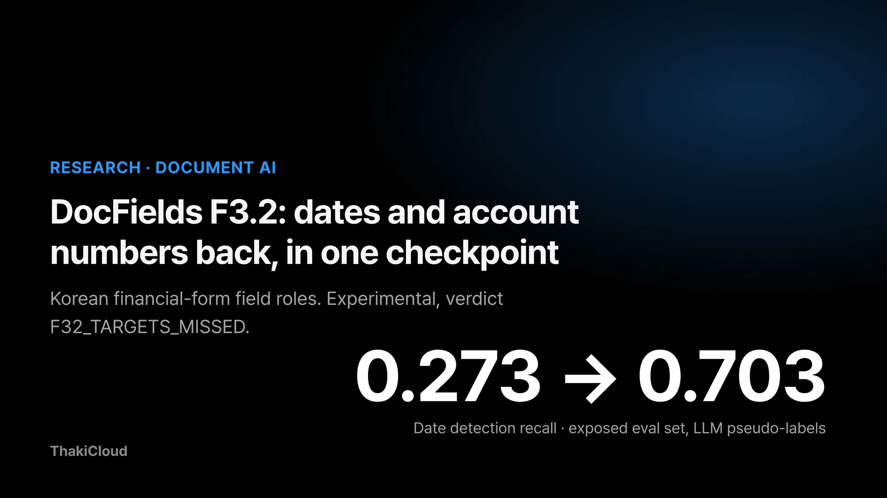
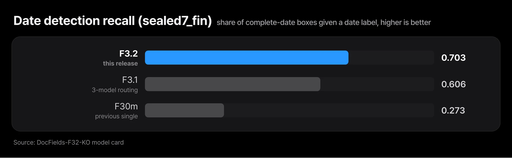
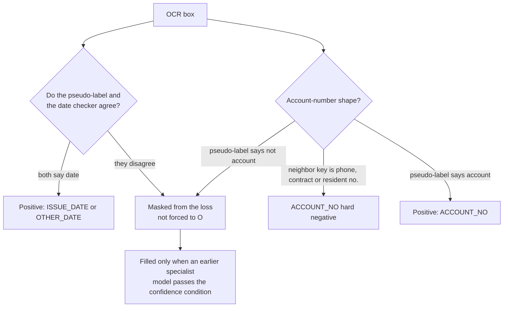
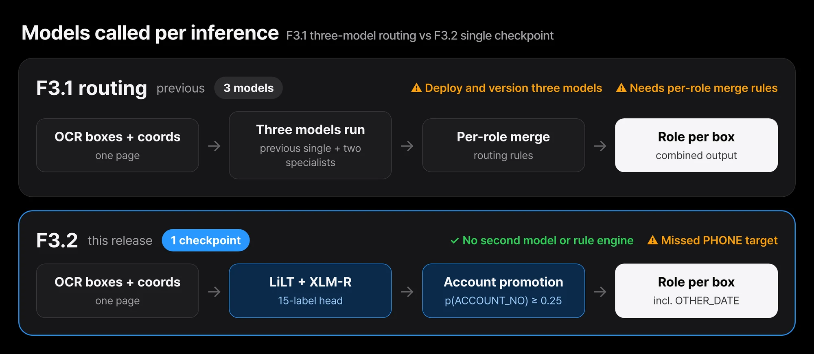
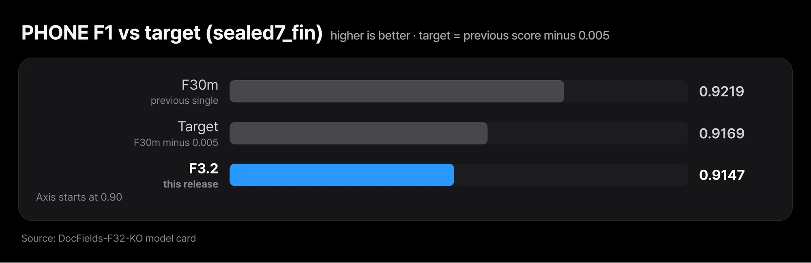
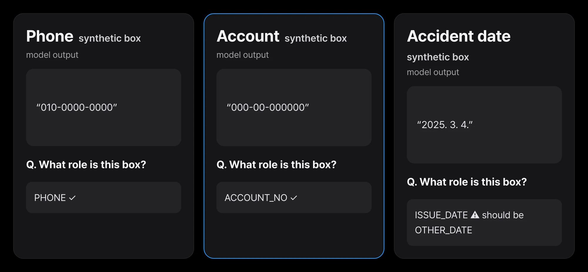

A single insurance claim form carries several dates: the signing date, the accident date, the hospital stay. Next to the account number field sit a phone number and a contract number that look almost the same. If you extract values from Korean financial forms and pass them downstream, you have probably watched models trip on exactly these two spots.

ThakiCloud has released [DocFields-F32-KO](https://huggingface.co/ThakiCloud/DocFields-F32-KO), a model that labels each OCR box with a field role, under the MIT license. Its status is **EXPERIMENTAL / RESEARCH PREVIEW** and its quality verdict is **`F32_TARGETS_MISSED`**. It met 6 of its 7 pre-registered development targets; phone F1 came in at 0.9147 against a target of 0.9169. On the development split used to pick the checkpoint, it also failed the claim-amount gate (0.8946 against a floor of 0.9013). It is a research artifact, and there is no accuracy guarantee for real business documents.

One thing did change clearly. Date detection recall went from 0.273 with the previous single model to 0.703, and one checkpoint does this without calling another model or a rule engine. Below are the four decisions behind that change, followed by the limits you need to keep in view when reading the numbers.


*DocFields F3.2 at a glance. Numbers measure agreement with LLM pseudo-labels on an evaluation set that has been opened several times.*

## In plain terms

Picture a clerk who sorts papers into drawers. The previous model had exactly one drawer for dates: "issue date". Any date that was not an issue date, such as an accident date or a birth date, had nowhere to go and ended up in the "not relevant" drawer. After enough of that, the clerk learned to throw dates away on sight.

F3.2 gives the clerk a second drawer for "other dates". Papers the clerk cannot judge are no longer forced into "not relevant"; they are simply left out of grading. And the clerk is taught separately that a number shaped like an account number does not go in the account drawer when the label next to it says "phone". The rest of this post is the same drawer story in more precise words.

## The date label had only "issue date", so we restored OTHER_DATE

DocFields does not read pixels. Its input is the text boxes an OCR engine produced plus their coordinates, and its output is a role label per box. The base model is [`nielsr/lilt-xlm-roberta-base`](https://huggingface.co/nielsr/lilt-xlm-roberta-base), which combines LiLT (a layout-aware document model) with the multilingual XLM-RoBERTa encoder, fully fine-tuned with 15 labels.

The previous single model (F30m) had one date label, `ISSUE_DATE`. In its training data, every non-issue date went to `O` (no role). During training, most date-shaped strings therefore kept arriving with the signal "this is `O`". The model learned to ignore dates, and date detection recall stalled at 0.273.

F3.2 gives non-issue dates their own label, `OTHER_DATE`. Training resumed from F30m. The 14 existing rows of the classification head were copied, and only the new `OTHER_DATE` row was freshly initialized, so that the model would not relearn from scratch the address, amount and phone decisions it already made well.


*Date detection rose from 0.273 with the previous single model to 0.703. Measured on an exposed evaluation set against a deterministic date checker that was also used to build training labels.*

Date detection here asks whether a box holding a complete date string gets any date label, `ISSUE_DATE` or `OTHER_DATE`. The reference is a deterministic checker that judges date formats by rule, not a human-verified answer. Precision stayed at 0.417, the same as the previous model. That means more than half of the boxes the model calls a date are not complete dates by that checker, about 0.79 false date boxes per document.

## Ambiguous boxes were masked from the loss instead of being taught as "no role"

The training answers are pseudo-labels from a large language model. A pseudo-label is an answer produced by a model without human review. Some boxes had the pseudo-label and the date checker disagreeing: the checker saw a complete date while the pseudo-label gave another role, or the reverse. There were also account-shaped strings that the pseudo-labeler did not mark as accounts.

Pushing those boxes into `O` would repeat what taught the previous model to ignore dates. So F3.2 left them out of the loss. On those boxes, being wrong or right produces no training signal. About 1,200 boxes were masked this way. Another 3,147 boxes, whose pseudo-role has no label in this head, were masked as before.

We compared two training recipes, and the released one is the distillation recipe. Distillation borrows an already trained model's judgment as the answer for a new model. Only for masked boxes, labels from earlier specialist models were used, and only when they passed a confidence condition fixed in advance. Boxes with a confirmed answer were never overwritten, and no new LLM labeling was done.



## An account-shaped number next to a phone key is not an account

On a financial form, a string of digits and hyphens can be an account number, a phone number, a contract number or a resident registration number. Its shape alone cannot tell them apart. A person looks at the printed key right next to it.

F3.2 puts that judgment into the training labels. An account-shaped string whose immediate neighbor key is a contract number, resident number or phone number is kept as a hard negative for `ACCOUNT_NO`. A hard negative is a deliberately included wrong example that is easy to confuse with the right one, so the model learns to separate the two. At inference there is one threshold on the account side: a box whose argmax is not a date or account label is promoted to `ACCOUNT_NO` when p(`ACCOUNT_NO`) is 0.25 or higher. Date promotion is switched off in the release.

On the evaluation set `sealed7_fin`, `ACCOUNT_NO` F1 rose from 0.694 with the previous single model to 0.797. A document-level paired bootstrap (2,000 resamples, 95% interval) puts the difference at +0.104 with an interval of [0.016, 0.219]. Resampling documents from the same set, the gap stays above zero. This comparison still carries every caveat in the limits section below.

## Three-model routing folded into one checkpoint

F3.1, the version right before F3.2, used three models together: a routing that merged, role by role, the outputs of the previous single model and two specialist models. It produced the numbers, but it was heavy to operate. Three models had to be deployed and kept in version step, and the merge rules had to be maintained too.

The goal of F3.2 was to replace that routing with one checkpoint that calls no other model at inference. The account threshold also lives in the checkpoint folder's `decode.json`, so inference ends with this one checkpoint.


*F3.1 merged the outputs of three models by role. F3.2 does the same job with one checkpoint and the threshold in decode.json. Quality is only shown to be at a similar level.*

The numbers below were measured on `sealed7_fin` (204 financial-form documents, 198 of them with complete labels). The five-role macro-F1 averages the F1 of account number, address, claim amount, issue date and phone.

| Metric | F3.2 | F30m (previous single) | F3.1 (3-model routing) | Target | Met |
|---|---|---|---|---|---|
| Macro-F1 over 5 roles | 0.9035 | 0.879 | 0.890 | ≥ 0.890 | ✅ |
| Date detection recall | 0.703 | 0.273 | 0.606 | ≥ 0.606 | ✅ |
| Date detection precision | 0.417 | 0.417 | 0.337 | ≥ 0.337 | ✅ |
| `ACCOUNT_NO` F1 | 0.797 | 0.694 | 0.767 | ≥ 0.767 | ✅ |
| `CLAIM_AMOUNT` F1 | 0.9231 | 0.9231 | not reported | ≥ 0.9181 | ✅ |
| `ADDRESS` F1 | 0.9978 | 0.9985 | not reported | ≥ 0.9935 | ✅ |
| `PHONE` F1 | 0.9147 | 0.9219 | not reported | ≥ 0.9169 | ⚠️ missed |

The paired bootstrap against F3.1 belongs next to this table. Date detection recall is +0.097 [0.018, 0.181] and precision +0.081 [0.044, 0.121], both intervals above zero. Macro-F1, however, is +0.014 [−0.016, 0.042] and account F1 +0.030 [−0.016, 0.087], and both intervals include zero. So we do not claim F3.2 beats F3.1 on those two metrics. We claim only that one checkpoint reaches a similar level to what three models did.

## The phone target was missed, and the evaluation is not independent

The phone target was the previous model's score minus 0.005. F3.2 lost 0.007. Every phone error we inspected was a swap between `PHONE` and `ACCOUNT_NO`. That fits the account-number recovery pulling some phone numbers along, but we did not isolate the cause.


*F3.2 scored 0.9147 on PHONE F1, below the 0.9169 target. Every phone error we inspected was a swap between PHONE and ACCOUNT_NO.*

The development split used to pick the checkpoint (823 documents) has a failed criterion as well. Of seven pass criteria (gates) fixed in advance, the checkpoint passed six; the claim-amount gate came in at 0.8946 against a floor of 0.9013. It is the last-round checkpoint, evaluated once as the pre-registration required, and reported as is. On the development split, date precision was 0.166, noticeably lower than the 0.417 on `sealed7_fin`.

The bigger issue is that the evaluation is not independent. Read every number above with all of the following in mind.

1. **The gold labels are pseudo-labels.** They come from an internally deployed Qwen-family large language model, so the scores measure agreement with that labeler.
2. **`sealed7_fin` is an exposed evaluation set.** It was used to evaluate earlier versions (F2.7, F3.0, F3.1) and was opened twice during F3.2 work. It cannot support a release decision.
3. **The initial weights had seen evaluation groups.** The training data of F30m, the starting point, overlapped 259 form groups with the evaluation splits. F3.2's own training documents were filtered to zero overlap in both document id and form group, but exposure through the initial weights remains.
4. **Date detection recall is not an independent check.** The same date checker was used as a condition when building training labels.
5. **There is no external evaluation.** We have no independent set of real customer forms with human labels (the E3 external evaluation is `DATA_UNAVAILABLE`). Accuracy on your forms is unknown.
6. **No production accuracy is guaranteed.** On held-out synthetic forms, F3.2 scored 0.843 against 0.844 for the previous model, i.e. no change, and that synthetic score does not stand for real-form performance either.

In short, there is an observed improvement on dates and account numbers. We have not shown that it carries over to unseen templates or issuers. This section is long so that the two are never phrased as one.

## Trying it yourself

The card ships a hand-written synthetic claim form (19 boxes) for a smoke test. Part of the actual output of the released weights on CPU is below. Phone and account came out right. The value next to the accident-date key came out as `ISSUE_DATE` where `OTHER_DATE` fits better. The applicant name "Hong Gil-dong" was missed as `O`, because the name label was learned from synthetic forms only.


*Part of the actual CPU output of the released weights on the hand-written synthetic claim form (19 boxes) shipped with the card. One easy form is a smoke test, not evidence of accuracy.*

Input is a list of OCR boxes for one page, with `bbox` as `[x0, y0, x1, y1]` normalized to 0..1. The first box below is the printed Korean key for "account number".

```python
from huggingface_hub import snapshot_download
import sys
d = snapshot_download("ThakiCloud/DocFields-F32-KO"); sys.path.insert(0, d)
import docfields_f32 as df

model, tok, labels, dec = df.load(d, device="cpu")
boxes = [{"text": "\uacc4\uc88c\ubc88\ud638", "bbox": [0.44, 0.31, 0.56, 0.34]},  # Korean key: "account number"
         {"text": "000-00-000000", "bbox": [0.60, 0.31, 0.84, 0.34]}]
for r in df.predict(model, tok, labels, dec, boxes):
    print(r["text"], "->", r["label"])
```

Two things keep you in the same conditions as the card's numbers. First, decode with the bundled script that applies the account threshold in `decode.json`; plain argmax or the stock `pipeline()` gives different results. Second, box order affects the encoder, so feed boxes as your OCR emits them, top to bottom and left to right. Of the 15 labels, only six were trained and scored on real forms: `ADDRESS`, `PHONE`, `ACCOUNT_NO`, `CLAIM_AMOUNT`, `ISSUE_DATE` and `OTHER_DATE`. Treat the other outputs as unverified.

## In Paxis, it belongs in the draft step a person reviews

Document automation in Paxis is a flow where an agent pulls values from paperwork, fills a draft, and a person reviews it. In that flow, the number of models is itself an operating cost. Collapsing three separately deployed and versioned models into one checkpoint cuts what has to be deployed and kept in step from three to one. Still, F3.2 today is a candidate to sit in front of the human review step; there is no evidence yet that it is good enough to finalize values without one.

## Closing

F3.2 kept the base model and changed the label design. It restored `OTHER_DATE` to a date scheme that only had the issue date, masked ambiguous boxes from the loss instead of teaching them as `O`, and separated account numbers from phone numbers by the neighboring key. As a result, one checkpoint reached a level similar to the three-model routing and, on the exposed evaluation set, catches more dates. In exchange, it missed the phone target, and its evaluation leans on pseudo-labels and an exposed set.

If you work on a similar form model, the first check you can run today is simple: count how many boxes labeled `O` in your training data look like dates or account numbers. If that count is large, your model is likely learning to ignore those roles. The model and code are on [Hugging Face](https://huggingface.co/ThakiCloud/DocFields-F32-KO).

## Sources and data

- Model: [ThakiCloud/DocFields-F32-KO](https://huggingface.co/ThakiCloud/DocFields-F32-KO) (MIT; base model [`nielsr/lilt-xlm-roberta-base`](https://huggingface.co/nielsr/lilt-xlm-roberta-base), MIT). Every number in this post comes from the model card and the same experiment ledger.
- Training data: AI-Hub, OCR data (finance and logistics) (71301), plus Korean statutory form templates (law.go.kr) filled with synthetic values. **The data is not redistributed.** AI-Hub data is limited to the approved applicant's internal use, and neither this post nor its figures contain any dataset image, text, label, crop or sample. All examples are hand-written synthetic values.
- Previous post: [Why We Did Not Train a Document Field Extraction Model](/tech-blog/en/research/docfields-label-audit-why-we-did-not-train/)
