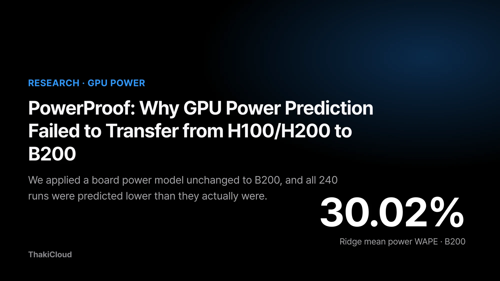
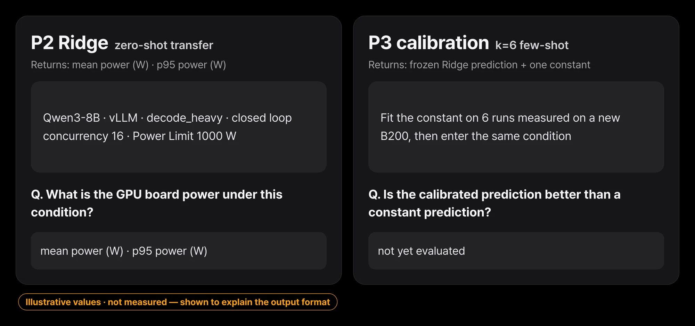
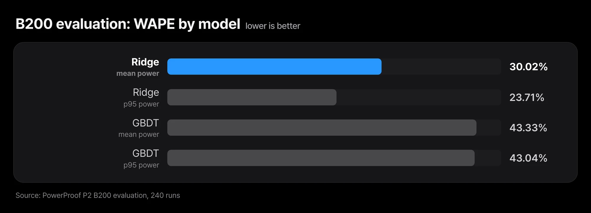
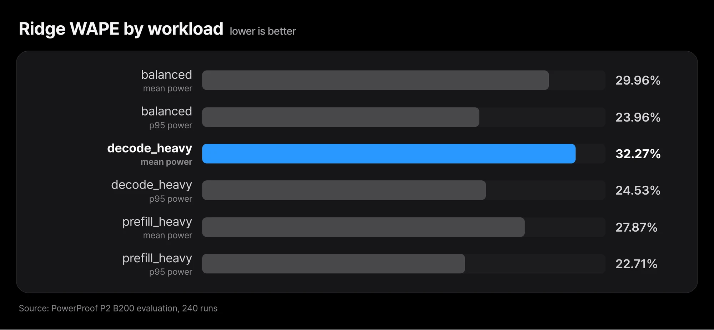
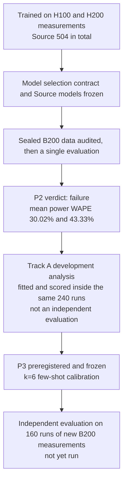
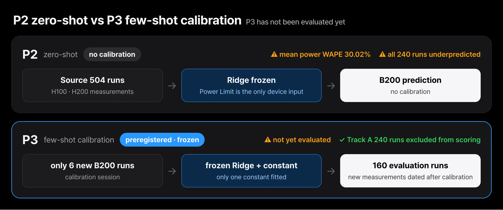

If you could estimate serving power before a new GPU generation arrives, the people planning infrastructure could lock in rack layouts and power budgets much earlier.
We trained power models on measurements from H100 and H200, then applied them unchanged to B200, a GPU that contributed nothing to training.
It did not work. On mean power, the Ridge model was off by 30.02% and the GBDT model by 43.33%.
Every one of the 240 runs was predicted lower than it actually was.
What this experiment cannot tell us is why: GPU architecture, the Power Limit setting, and other environmental factors all remain open.
This post walks through the evaluation procedure and the shape of the failure, a development analysis on the same data, and the plan for the next independent test.

## Reading Meta's PowerSight raised a question

The question took shape while we were reading a datacenter power planning paper that Meta presented at OSDI 2026.
According to the paper, Meta has run a hardware lifecycle-aware rack power budgeting method for more than a decade.
With it, Meta oversubscribes power by about 20% on average across its compute, storage, and AI racks.
The method depends on production-level power telemetry.
That data does not exist yet in the early phase of a new hardware generation.

So the paper proposes PowerSight, a machine learning model.
It predicts server system power from performance counters instead of power sensors.
For a new architecture running a new workload, neither seen in training, the MLP model's system power prediction error rate was 7.89%.
Using the same model to estimate the rack power budget for a new generation, the error was 2.5%.

Our question points the same way but measures something different.
PowerSight predicts whole-server system power from performance counters and reports its error as a MAPE-style metric.
We measure the board power of a single GPU through NVML during LLM serving, predict it from serving conditions only, and score it with WAPE.
The measured quantity, the inputs, and the metric all differ, so the two papers' error numbers cannot be lined up to say which is better.
What we wanted to know was one thing.
Using measurements from GPUs we already have, can we predict the serving power of a new GPU we have not measured yet?

## We checked the repeatability of the measurement path first

Before any prediction, we checked whether the measurement path itself could be trusted.
On each of H100 NVL, H200 NVL, and B200, we repeated the same serving load three times and looked at how much the request-window energy per token (J/token) moved.
The coefficient of variation (CV) across repeats was about 1% on H100, 0.05% on H200, and 0.94% on B200.
All three devices passed the repeatability criterion set in advance.

These numbers show how closely each device reproduces the same measurement.
They are not a comparison of absolute values between devices. Device, runtime environment, Power Limit, and request count all differ at once, so no single cause can explain a gap between devices.

A few facts about the measurement setup, stated up front.
Power is GPU board power as reported by NVML, not node or server power.
The Power Limit is 400 W on H100, 600 W on H200, and 1000 W on B200, and it was only read, never changed.
H100 and H200 were measured in VMs with the GPU passed through in full, and B200 on bare metal.
Temperature and clock speed tended to drift with repeat order, so from the next stage on we randomized run order and recorded the starting temperature.

## P2: trained on H100 and H200, evaluated once on B200

The target is the GPU board power drawn while vLLM serves Qwen3-8B.
We used two labels over the request-processing window: mean power and p95 power.

*The inputs are serving conditions fixed before the run plus the Power Limit, and the outputs are mean power and p95 power over the request window. The condition combination is an example that shows the format.*

The training data (Source) is 186 runs on H100 and 318 runs on H200, 504 in total.
The evaluation data (Target) is 240 runs on B200, measured in 6 replicate blocks.
All 240 measurements passed the validity checks.

There are two models. The primary model is Ridge regression and the secondary model is GBDT.
The only input that tells devices apart is the Power Limit in watts.
The hope was that with the Power Limit as an input, the model could follow the power scale onto a new device.

A negative result only means something if nobody went hunting for a better number by changing settings.
So the evaluation order was fixed in advance:

1. Freeze the model selection contract (2026-11-09).
2. Freeze the models trained on Source data (2026-11-10).
3. Audit the integrity of the sealed B200 measurements; 240/240 passed.
4. Run the evaluation exactly once (2026-11-11).

The B200 labels stayed encrypted until the evaluation ran.
Which model was primary and which was secondary was decided before the B200 evaluation and not changed afterwards.

One inconsistency is worth recording.
In Source-only cross-validation (LODO, see the appendix), GBDT beat Ridge by 0.51 percentage points.
That is just over the pre-set tie margin of 0.5 percentage points.
We kept Ridge as the primary model anyway, as fixed in advance.

For reproduction, we released the frozen models from this stage on Hugging Face ([PowerProof-P2-ZeroShot-Baseline](https://huggingface.co/ThakiCloud/PowerProof-P2-ZeroShot-Baseline)).
It is the baseline that failed on B200, and it should not be used as a general-purpose power predictor for new GPUs.

## On B200: WAPE of 30.02% and 43.33%, all 240 runs underpredicted

The error metric is WAPE: the absolute errors of all runs added up and divided by the sum of the measured values, so lower is better.
The signed bias divides the sum of the errors without absolute values by the same denominator, so it keeps the direction of over- and underprediction.

| Model | Mean power WAPE | p95 power WAPE | Signed bias (mean / p95) |
|---|---|---|---|
| Ridge (primary) | 30.02% | 23.71% | −30.02% / −23.71% |
| GBDT (secondary) | 43.33% | 43.04% | −43.33% / −43.04% |

*Ridge has the smaller error on both mean and p95 power, but even its best value is 23.71%.*

The signed bias has the same magnitude as the WAPE, just with a negative sign.
A run-by-run check confirmed it: for both models, on both mean and p95 power, all 240 runs were underpredicted, and the errors did not scatter around zero but all leaned the same way.

Splitting by workload type, Ridge's error stays at a similar level.

| Ridge, by workload | Mean power WAPE | p95 power WAPE |
|---|---|---|
| balanced | 29.96% | 23.96% |
| decode_heavy | 32.27% | 24.53% |
| prefill_heavy | 27.87% | 22.71% |

*Mean power error ranges from 27.87% to 32.27% across the three workloads.*

107 runs had a measured mean power at or above 80% of the Power Limit, and in that subset Ridge's mean power WAPE was 28.89%, not far from the overall figure.

A bootstrap over the 6 replicate blocks gives a range of 29.82% to 30.28% for Ridge's mean power WAPE.
With only 6 blocks, the coverage of this interval has not been validated, so please read it as a computed value only.

Three things are established by observation.
Two models, frozen in advance, missed by 30% and 43% on a B200 they had never seen.
The errors all pointed the same way: underprediction in all 240 runs.
Feeding in the Power Limit as a device feature did not make the models generalize to B200.

The underprediction is an observed pattern, and we did not identify its cause. The items below are candidate hypotheses, and none of them has been tested.

- B200's power behavior may simply differ from that of H100 and H200.
- The same Power Limit value may mean different things on different devices.
- Source runs were measured in VMs and B200 runs on bare metal, and that difference may have played a part.
- Differences in workload or serving environment may be mixed in.

From a design standpoint, the experiment fitted a device axis on two devices and extrapolated it to a third.
Whether that extrapolation is what caused the failure cannot be decided from this data.

The scope of the result matters too.
It comes from three GPU types and a single model and serving stack.
It should not be stretched into "GPU power prediction never transfers between devices."
In practice, this means it is risky to budget power for a new GPU generation with a power model built on existing GPU measurements.
When the errors lean one way, as they did here, actual power comes in above plan.

## Track A: looking at the shape of the failure with the same 240 runs

Once P2 was closed as a failure, the 240 B200 labels no longer needed to stay sealed.
We used those 240 runs for a development analysis, Track A, that looks at how the models went wrong.
One point comes first. Every number in this section was fitted inside the existing 240 B200 runs and scored inside the same 240 runs.
Scoring was split by block, but it is still the same devices, the same few days, and the same experimental conditions. These are not independent evaluation results, and neither the frozen P2 models nor the P2 verdict change.

The first thing that stood out was a simple baseline: predicting nothing but B200's mean power, with no model at all, gave a mean power WAPE of 8.3% when scored with one replicate block held out.
On B200, mean power stays close to a single device average even as conditions change.
That means an absolute bar such as "mean power error at or below 10%" is passed with no model at all, so it does not discriminate on this data.

So what did the failure look like?
Adding one constant to the frozen Ridge predictions brought the mean power WAPE, scored the same way, down to 5.7%, and that constant, fitted on all 240 runs, was about +235 W.
The observation is that Ridge mostly got the relative ordering of conditions right and mostly got the power level wrong.
It does not explain why B200 draws that much more. Which of the hypotheses in the previous section produced the gap is still not identified.

How many calibration runs would this need?
Fitting the constant on 6 runs drawn from one block and scoring only the conditions not used for calibration in the other blocks gave a median mean power WAPE of 6.2%.
This too is a distribution of random draws inside the same 240 runs, not the performance of a real calibration procedure.

## P3: the independent evaluation plan for k=6 few-shot calibration

Track A leaves one question.
On a new B200 unit, if we measure only 6 runs and add one constant to the frozen P2 Ridge, is it substantially better than a constant prediction that uses only the mean of the same 6 runs?
We preregistered and froze this question as P3. There are no measurement results yet.

*P2 was applied to B200 with no calibration. P3 measures only 6 runs on a new B200 to fit one constant, then evaluates on new measurements not used for calibration. P3 has not been evaluated yet.*

The core of the design is that the 240 runs used in Track A are never scored.
Calibration sessions and evaluation blocks are paired into 4 pairs, and each evaluation block is measured with new seeds on a date later than its calibration session.
Each evaluation block has 40 runs, for 160 runs in total.
In every block, 10 of the 40 runs use mid-range load conditions that P2 did not include.
The comparison is a constant prediction built from exactly the same 6 runs as the primary.

The pass criteria are fixed in advance as well. All of the following must hold.
Mean power WAPE must be at or below 8%, and better than the constant prediction by at least 2 percentage points in absolute terms and at least 20% in relative terms.
The WAPE on the p95 power label must be at or below 5%.
Separately, the 95th percentile of the per-run absolute percentage error on mean power must be at or below 15%.
These three metrics have similar names but are different quantities, and we do not mix them.

Even if P3 passes, what it shows is B200 adaptation with a small amount of calibration measurement.
It does not show zero-shot generalization to a new GPU architecture without calibration, and the P2 failure verdict stands.
When the results are in, we plan to publish them through the same procedure, pass or fail.

## Next goal: GPU/NPU power-aware serving

What this experiment leaves us with is a hypothesis: rather than predicting a new device with no measurements, it may be more practical to fit it with a small number of measurements.
P3 tests that hypothesis on independent data.

The goal after that is to bring power prediction into serving operations.
We are thinking about a structure where the serving scheduler, when deciding which device a request goes to, looks at expected power as well as throughput and latency.
NPUs are in scope alongside GPUs.
We have not yet measured NPUs the same way, though. We can only say something about their power once the same measurement procedure is in place and the data is in.

## ThakiCloud starts new GPUs with measurement

ThakiCloud builds its products around Paxis, its work automation platform, with the Metis inference platform, the Telox GPU cloud, and the Velox bare metal cloud underneath it supplying models and hardware.
In that stack, the moment a new GPU generation arrives is the moment with the least power telemetry.
Carried over to that situation, this result gives us one principle: do not take a power model built on existing GPU measurements and apply it as-is to the power budget of a new GPU.
Instead, we plan to use P3 to check whether measuring a small amount on the new device first and fitting to those values actually works.

Each piece of work that Paxis automates also runs as inference on a GPU.
The better we know each device's serving power in advance, the more precisely we can plan how much work fits in the same power budget, and the power-aware serving described above is about pushing that planning down to the serving scheduler.
ThakiCloud ran this experiment as pre-freeze, seal, audit, and a single evaluation, and we publish a failed result through the same procedure.

## Closing

A power prediction model trained on H100 and H200 measurements reached a mean power WAPE of 30.02% (Ridge) and 43.33% (GBDT) on B200, and all 240 runs were predicted lower than they actually were.
If you are setting a power budget for a new GPU generation, we suggest measuring on the new device a few times first rather than reusing a model built on existing hardware.
In Track A, which looked inside the same 240 runs, fitting the level with a single constant brought the mean power WAPE down to 5.7%.
P3 is the step that rechecks that value on independent data, and we will publish its results through the same procedure, pass or fail.
The frozen models are available at [PowerProof-P2-ZeroShot-Baseline](https://huggingface.co/ThakiCloud/PowerProof-P2-ZeroShot-Baseline); since they are the baseline that failed on B200, please use them only for reproduction and comparison.

## Appendix: experimental setup

This section collects the measurement conditions for anyone who wants to rebuild them.

The served model is Qwen3-8B in bf16, running on a single GPU with vLLM 0.28.0.
Server arguments were `--max-model-len 8192`, `--gpu-memory-utilization 0.80`, and `--seed 0`, with prefix caching turned off, and a fresh server was started for every replicate block.

| Item | Condition |
|---|---|
| Workloads (input / output tokens) | balanced 1024 / 256, decode_heavy 256 / 512, prefill_heavy 4096 / 128. EOS ignored so output length is fixed |
| Closed loop | Concurrency 1, 4, 8, 16 |
| Open loop | 25, 60, 85% of each GPU's reference throughput. Burstiness 1.0 and 0.35, max concurrency 16 |
| Absolute load | 25, 60, 85% of H100's reference throughput, also run as-is on H200 and B200 |
| Target request-window length | 75 seconds |
| Power Limit | H100 NVL 400 W, H200 NVL 600 W, B200 1000 W. Read only, never changed |

Reference throughput is the completed requests per second measured in a pilot with a closed loop at concurrency 16.
So the same 60% maps to a different actual arrival rate (req/s) on each GPU.
Inter-arrival times were drawn from a Gamma distribution. Burstiness 1.0 is Poisson arrival, and 0.35 makes requests arrive in tighter clumps.
The arrival-time arrays were generated ahead of time, and every GPU used the same array for the same condition.
The 318 H200 runs include 78 runs where only the prefill_heavy conditions were extended to 12 replicates.

Power is GPU board power as reported by NVML, not whole-node power.
The request window runs from the start of the first request to the end of the last one.
Mean power is the increase in NVML's cumulative energy counter over that window, divided by the window length.
p95 power is the 95th percentile of power readings taken every 0.2 seconds within the same window.
NVML power is itself roughly a 1-second moving average, so this is an upper quantile of 1-second average power, not an instantaneous peak.
Each run was preceded by 60 seconds of idle time.
Only measurement validity was checked, such as exclusive GPU access, an increasing energy counter, and a duration of at least 30 seconds. Request errors and latency were not grounds for exclusion.

Model inputs are the requested input tokens, requested output tokens, max concurrency, target arrival rate, burstiness, Power Limit, workload type, and loop type.
For closed-loop runs, target arrival rate and burstiness were set to 0.
Anything you can only know by actually running the workload, such as power, throughput, temperature, or clock speed, was excluded from the inputs.
Ridge was trained with alpha 1.0 after standardizing the numeric inputs.
GBDT used scikit-learn's HistGradientBoosting with settings fixed at 200 iterations and a learning rate of 0.05.
Neither model went through any hyperparameter search.

Cross-validation was split by replicate block. The code prevents the same block from appearing on both the training and evaluation side.
The model selection score is LODO: train on one Source device and predict the held-out block of the other device.
LORBO, which trains on both devices and predicts the held-out block, was used only as a within-device diagnostic.
Because LODO also trains on just one device, it cannot test how the power scale shifts on a new device.

Reference: Ruihao Li et al., "Hardware Lifecycle-Aware Power Planning in Commercial Hyperscale Datacenters", OSDI 2026. https://www.usenix.org/conference/osdi26/presentation/li-ruihao
