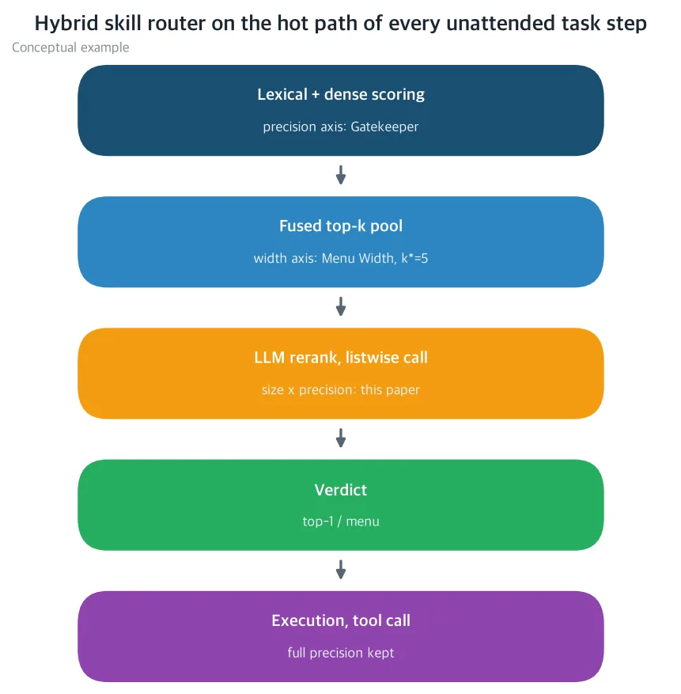
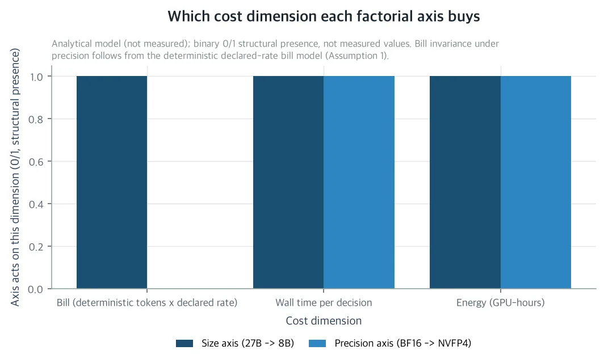
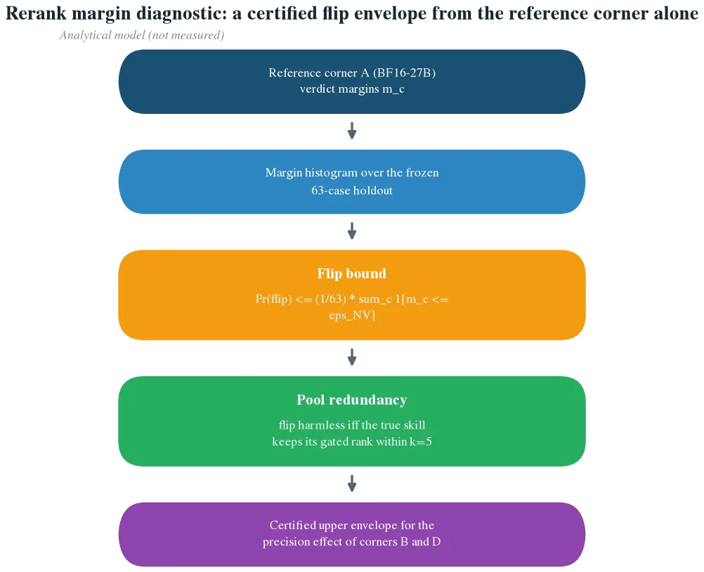

If you are trying to redesign the final stage of a skill router from the perspective of serving cost, this is the paper you need to read. Every task step in an unattended agent harness passes through the skill router, and the router's final stage, the LLM rerank, is the invoice paid on every decision. With retrieval window quality held fixed, this stage accounts for 71.6% of total routing spend and uses roughly 9.9 seconds of wall time per decision. Savings on a stage that fires toward 100% of routing decisions compound across the entire night workload. The ThakiCloud router series has already priced this surrounding set of axes one at a time. Gatekeeper priced the precision axis of the scoring stage (embedding quantization), Apprentice Reranker priced the size axis of the rerank stage (27B teacher versus 8B DPO distilled student), and Menu Width priced the width axis of the candidate pool (knee at k=5). But the factorial that crosses size and precision in the rerank stage, the four corners of {27B, 8B} × {BF16, NVFP4}, is still the unpriced cell. This paper places those four corners on a self-hosted H200 and shows which cost dimension each axis buys under deterministic token billing, where the knee of the cost-quality frontier falls, and why the factorial's new measurement is only a single interaction term κ.

One thing to know before reading. This is an analytical paper. The body contains no new measurements. The cost-side numbers are derived on top of a declared self-hosted billing model (decision tokens × declared unit price), and the quality-side structure is carried by the margin diagnostic inherited from Gatekeeper. The measurements of the four corners, the value of κ, and the deployment rule selected as a result are the job of the pre-registered factorial protocol written out in full at the end of the body. The evidence that its run costs under a dollar on self-hosted billing is also attached to the protocol table.

## In Short

Think of the rerank stage as the final gate in a hiring process. If the preceding stage (BM25 + embedding scores) narrows 2,200 applicants down to 5, the reviewer reads those 5 profiles and names one. That gate, which opens once for every task step of an unattended agent, is the rerank.

You can swap out the reviewer using two levers. The first lever is the reviewer's brain capacity, the size axis. The 8B DPO distilled student is a reviewer that learned the 27B teacher's decision style, and it decides about 14.6 times faster. But because the two model families' tokenizers split the same profile differently, the invoice actually comes out about 7.1% higher. Size is the lever that buys time and adds change to the invoice. The second lever is the precision axis, which points to the format in which the reviewer works. NVFP4 is a 4-bit block-scale format half the weight of BF16, and the reviewer reads faster and uses less energy. Yet not a single line on the invoice changes. That is because self-hosted billing is computed from token count and declared unit price, and the format does not enter that computation. Precision buys speed and energy at zero billing.

Because the two levers buy different things, most of the price of the four corners (27B-BF16, 27B-NVFP4, 8B-BF16, 8B-NVFP4) is already derivable from the measurements taken when each lever is measured alone. What stays unknown to the end is a single interaction. It is the value by which the quality loss from pulling both levers at once exceeds the sum of each lever's loss, the value called κ, and the paper attaches a falsifiable hypothesis H1. If |κ| is within one holdout case (about 1.6 points of top-1 accuracy on the 63-case basis), H1 holds and deploying the 8B-NVFP4 corner becomes arithmetic. If H1 breaks, the two levers combine to erode more, so the knee of the frontier retreats to the NVFP4-27B corner. Either way, the four-corner run is the deployment decision.

## The Problem: The Most Expensive Stage That Fires on Every Decision

The router in the ThakiCloud harness routes each task step to a single skill from a registry of 2,295 entries (roughly 2,200 valid skills). It fuses BM25 lexical scores with embedding dense scores to build a top-k candidate pool, then makes the decision of a top-1 or a menu in a single listwise LLM call on that pool. This shape, fusing dense + sparse evidence and then deciding with an expensive last pass, is the standard of enterprise RAG, and the rerank stage is where quality is bought at the highest price.

There are two reasons this stage becomes the object of cost engineering: the invoice and the firing frequency. Starting with the invoice, with retrieval window quality held fixed, the LLM rerank accounts for 71.6% of total routing spend (Apprentice measurement, 2026-10-27). In terms of firing frequency, the escalation tier only runs when things are uncertain and the lite tier only runs on some decisions, conditional stages, whereas the rerank is a mandatory stage that unconditionally runs toward every decision. Because the output is the execution path, each defect sends the agent to the wrong skill, and roughly 9.9 seconds per decision and about 59 seconds per session (D=6) are spent in this stage. The per-decision savings here compound across the entire night, over every decision of every unattended task.

*Schematic of the axes priced by the ThakiCloud router series (precision, width, and this paper's size×precision factorial) attached to each stage. A conceptual example, not a measured result.*

The series' three earlier studies each fixed one axis and moved another. Because the teacher arm of the Apprentice measurement was already being served in NVFP4, what that study identified was only the size edge measured at the teacher's precision, one side of the square. The precision side of the student tier (BF16-8B, NVFP4-8B) and the κ that comes out of the intersection of the two sides are invisible from any single-axis arm. That is why the factorial is the last cell that completes the square.

## The Two Axes Buy Different Things: Decomposing the Factorial

Under self-hosted deterministic billing, an arm's rerank invoice is a function of the size axis alone. Once the prompt text, the family tokenizer, the declared output cap, and the declared self-hosted unit price are fixed, the token count does not move, and neither serving precision nor sampling variation enters the billing computation. It is a structural premise set up by the Apprentice billing model and a property that corresponds to self-hosted declared unit price billing. Under marketplace pricing where the unit price varies by precision, this premise breaks, and at that moment the factorial becomes computationally infeasible.

*Under deterministic self-hosted billing, does the size axis act on all three cost dimensions while the precision axis acts only on wall time and energy, leaving the invoice invariant? A schematic of the analytical model, not measured data.*

So the cost-quality frontier of the four arms decomposes. The invoice is set by the size frontier and wall time by the precision frontier (at the same parameter count, NVFP4 decoding is faster than BF16 decoding, monotonic). The two axes meet only through the quality band, the pair of top-1 accuracy and gated recall@5 on the frozen holdout. The Pareto knee of the factorial is the invoice-optimal size × the wall-time-optimal precision (NVFP4), and that corner has to be inside the band. Otherwise it comes to the closest corner inside the band. And the factorial's new measurement is a single term.

κ = Q(27B, BF16) + Q(8B, NVFP4) − Q(27B, NVFP4) − Q(8B, BF16)

The two main effects on the right-hand side are already measured, or at least bounded. The distillation gap is carried by the Apprentice measurement, and the 4-bit effect is carried by Gatekeeper's perturbation bound and the serving-precision delta literature. The quality of each corner becomes the reference quality minus the two main effects plus κ, and the cost coordinates are determined without κ. The four-corner run has to answer one sentence only: whether κ is 0 within its confidence interval or substantively negative. If κ is substantively negative, the composite compression is worse than the sum of its parts, and the knee retreats to the NVFP4-27B corner.

The compounding arithmetic of the night run attaches here too. The nightly delta is the sum of the per-decision deltas across the whole session, and because the rerank fires toward 100% of decisions, the number of decisions is what sets the compounding factor. The size axis's per-decision delta contributes to all three terms, the invoice refund, energy, and throughput, but if the distillation gap erodes the band it has to pay back the misroute risk premium. The precision axis's share is only the energy and throughput terms, because it does not refund the invoice. The Apprentice measurement shows this arithmetic in measured values. Even though the size axis's billing delta was a minus (student +7.1%), the corner dominated the frontier because, at the scale of the number of decisions, the wall time refund (about 14.6x) swallows that change.

## Does Reranking Survive Quantization: Short Verdicts and Pre-Measured Margin

The back half of the research question asks whether the loss from using the precision axis in the rerank stage is much smaller than the loss that 4-bit serving inflicts on generative execution. The paper's answer is yes, and it names the mechanism decision exposure.

A rerank decision is a short listwise discrimination over a fixed pool. The output cap binds to a few tokens naming the k candidates plus some structural tokens, and the model does not generate the content of its judgment. The pool being judged was already fixed by the scoring stage, so the exposure of the decision, the number of output positions where a serving perturbation can change the verdict, is on the order of O(k) tokens at k=5. Execution tool calls are the opposite. They are long structured generation of thousands of tokens, verified downstream by the environment. An early deviation changes the transition that the next step sees, and that deviation accumulates into the failure forms named by the quantized-agent literature. So the probability that 4-bit flips a rerank decision is bounded by the decision margin, while the probability that it contaminates an execution trajectory is bounded by a trajectory margin over a much longer exposure, and the latter is far larger. Even a flipped decision is caught. The pool does not change, and the wrong top-1 is still a skill the retriever trusted. Gated recall@5 is maintained as long as the true skill does not leave the gated set. In execution, a wrong call changes the state of the world, so this second layer of protection has no counterpart.

The paper gives a diagnostic that measures the size of the quantization loss from the reference corner alone, extending Gatekeeper's first-order perturbation bound to the decision distribution. The decision margin m_c is the probability gap between the 1st and 2nd candidates in the rerank listwise output. A serving perturbation that shakes the decision logit by no more than ε_NV can only flip the cases c where m_c ≤ ε_NV. The diagnostic has three steps. Record m_c for the 63 holdout cases at the reference corner, bound the flip probability from above by the fraction of cases whose margin lies below the 4-bit error, and analytically rescore a single flipped case against gated recall@5. If the true skill keeps its gated rank within the k=5 pool, that flip is harmless. There is no need to serve the quantized arm. That is exactly the content of the quantization-resistance claim. The error channel of the rerank stage is narrow, and the width of flips inside it can be pre-measured.

*A 4-bit perturbation can flip a holdout case only when the decision margin m_c is at or below ε_NV, and a single flipped top-1 is caught by the gated recall@5 pool check. A schematic of the analytical model, not measured data.*

Two compression channels overlap at corner D (NVFP4-8B). The distillation gap is a shift of the mean of the decision distribution (the student systematically prefers different decisions), and the 4-bit perturbation is mean-0 jitter on the same distribution (block-scale rounding). If the two channels act on different scales of the decision logit, the quality effect is roughly additive and κ hovers near 0. The paper does not assume additivity; it states it as hypothesis H1, with the pre-registered tolerance τ_κ set at one holdout case, about 1.6 points of top-1 accuracy on the 63-case basis. H1 is falsifiable, and if it breaks it means the two channels combine at the rerank stage. That is the case where the student's already-narrow decision margin leaves no room to give to the jitter, and the knee retreats to the NVFP4-27B corner.

## Three Deployment Rules Attached to the Four Corners

The paper narrows the platform's choice down to three rules with a priority order.

R1, the student corner. If corner D (NVFP4-8B) certifies the band and H1 holds, deploy D. It is the wall time optimum (fastest decoding at the smallest parameter count) and the only corner inside the band, and the roughly 7.1% billing premium fixed by the tokenizer is paid back by the energy and throughput terms at the scale of the number of decisions.

R2, the quantization-only lever. If D fails the band and B (NVFP4-27B) certifies, deploy B. The precision axis refunds wall time and energy with zero change in billing, and the margin diagnostic pre-certifies B's precision effect from the reference corner alone. It is Gatekeeper's lever extended to the rerank stage.

R3 is the conservative hold rule: if both B and D fail certification, keep the reference corner A (BF16-27B) and rerun the margin diagnostic on every registry revamp. Since the band is certified query by query by the gated margin, the isolated variable at this point is not serving but registry drift.

The three rules cover the whole by construction and do not overlap. Each corner's fate is decided by whether it is inside the band, and the only measurement that can change a rule's outcome is the single factorial run. This is a case of writing the deployment policy objective function stage-locally: it scores, in net terms, the policy of which corner serves the rerank stage against billing, energy, throughput, and the priced expected misroute cost.

## The Pre-Registered Protocol That Resolves κ for Under a Dollar

The protocol is designed as the smallest run that identifies κ and certifies all four corners. All four arms are served from a single frozen serving configuration on the self-hosted H200 cluster, and the only free variables are (size, precision). The 2,295 production registry entries are audited as a frozen artifact before the run, the holdout is a frozen 63-case SRA set, the pool width is fixed at k=5, and decisions are scored by top-1 accuracy and gated recall@5. The cost metrics are the per-decision deterministic invoice and p50/p95 wall time, and the quality metrics are the 95% confidence interval for κ on the 63-case holdout and the decision margin histogram. The decision rule is the pre-registered tolerance (about 1.6 points), applied in order from R1 through R3.

The evidence that the run costs under a dollar is that Menu Width's 6-arm confirmation run came in under 50 cents of self-hosted billing, and a 4-arm run with the same per-decision invoice is strictly smaller. The single-axis series has already paid for the main effects. What remains unmeasured is only κ and the band certification of the whole square. κ is identified only in a design where the four corners run from a single frozen configuration. Comparing corners after the fact across studies mixes in the interaction and configuration drift. The rerank replication literature warns here. A study that re-implemented anchor-based pointwise LLM reranking from the paper text hit 0.24 nDCG@10 against the reported 0.66, and it took 8 undocumented details to close that gap. Since decision quality moves together with undocumented details, a frozen-holdout pre-registered comparison is the only disciplined way to price a serving change at this stage. This paper provides the frontier structure, the resistance argument, the decision rule, and the protocol, and the measured corners are reported at the point the run completes.

## Where It Reaches Company, Society, and Science

What the company gets is a measured break-even map for running the skill router's LLM rerank stage of the ThakiCloud token factory in either NVFP4 or the 8B distilled tier. The four factorial corners, the cost dimensions each axis moves, the quality band each corner must satisfy, and the compounding arithmetic across the night run are all attached to the body. It lowers the serving cost of the stage that fires toward every decision of every unattended night task while SRA top-1 and gated recall@5 hold the frozen holdout band. The condition under which the savings become cost engineering rather than a quality trade-off is stated alongside.

What society gets is stage-selective precision budgeting. There is no need to choose a single precision for the whole agent loop. The execution tier, where a single wrong token changes the environment, keeps BF16 or residual-compensated NVFP4, and the routing tier, whose error channel is a short verdict over an unchanging pool, spends the low-bit budget. It lowers the energy and dollar cost of always-on unattended autonomy and opens unattended automation below break-even for self-hosted small teams and on-prem operators. This is budget allocation across stages, not a compression technique.

What remains for science is the first factorial pricing that crosses size with precision at the decisive final stage of a 2,200-skill self-evolving harness. Its content is the disconnection that, under deterministic billing, the four-arm frontier decomposes into the intersection of two one-dimensional frontiers and the quality band, the decision exposure argument (quantifying whether discriminative reranking is more task-resistant to low-bit quantization than generative tool calls), the margin diagnostic that pre-measures the flip bound from the reference corner alone, and the sub-$1 pre-registered protocol that positions the Pareto knee of the stage cost-quality frontier. The empirical face of the interaction term already exists in the serving literature. It is the result that, in precision-grid measurements, joint optimization (9 of 15 settings) touches the frontier more often than a single axis, and this paper formalizes it at the arm level.

## Limitations: What Has Not Been Measured Yet

The body declares five limitations. I go through them one by one.

First, this paper is analytical. The axis disconnection follows from the declared billing model, and the margin diagnostic is a first-order bound at the reference corner, not a measurement at corners B through D. The measured corners, κ, and which rule among R1 through R3 gets selected come as the result of the pre-registered run.

Second, the results are platform-specific. The deterministic billing premise holds under self-hosted declared unit price billing and must be restated under marketplace pricing where the unit price depends on precision.

Third, the holdout is only a single frozen 63-case set from one production registry. Registry revamps are not a design variable but the variable that reopens rule R3.

Fourth, the perturbation logic rests on the premise that block-scale 4-bit serving bounds the decision logit jitter by per-block scale. Margins smaller than the jitter are what the histogram detects, and the bound is only as strong as the premise.

Fifth, the pool width is fixed at k=5. The decomposition is independent of width, and the dilution band behavior is bounded by the Menu Width frontier.

The paper text and accompanying materials can be viewed on the Hugging Face paper detail page. https://huggingface.co/datasets/thaki-AI/daily-paper-2026-11-12-quantized-reranker-size-precision-factorial

*The cost numbers in the body are either derived values on top of the declared self-hosted billing model (decision tokens × declared unit price) or measurements attributed to earlier series studies. 71.6%, +7.1%, about 14.6x, 9.9 seconds, and 59 seconds are values from earlier measurements and not new measurements of this paper itself. The measurements of the four corners, the value of κ, and the rule selected among R1 through R3 are reported as the result of the pre-registered 4-arm run. The three figures are conceptual schematics and analytical-model schematics, not measured data.*
