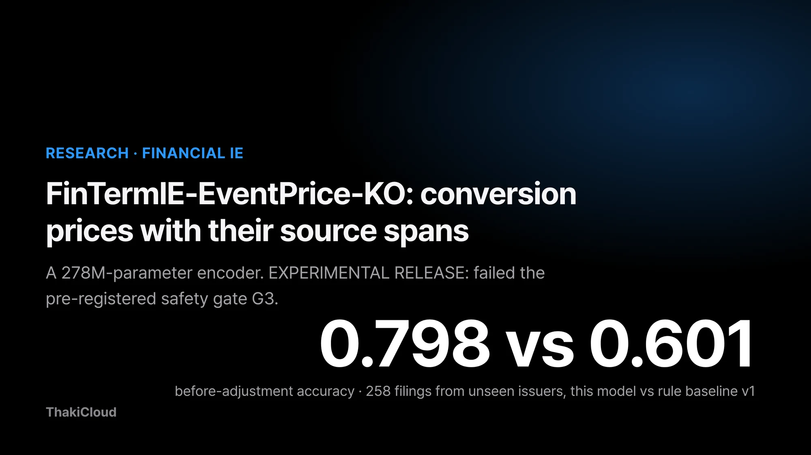
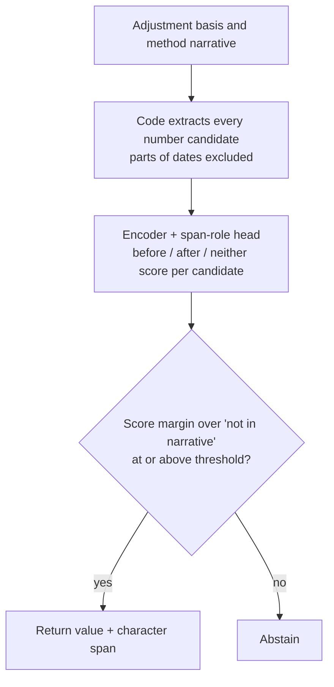
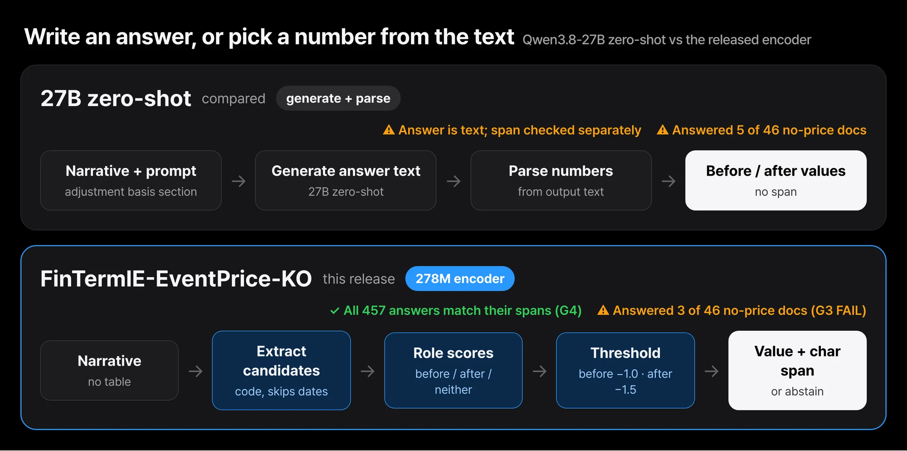
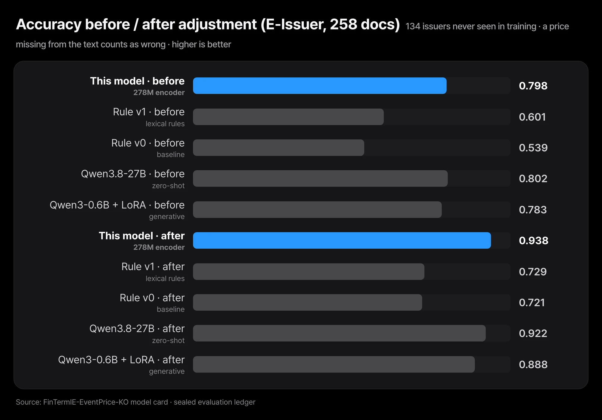
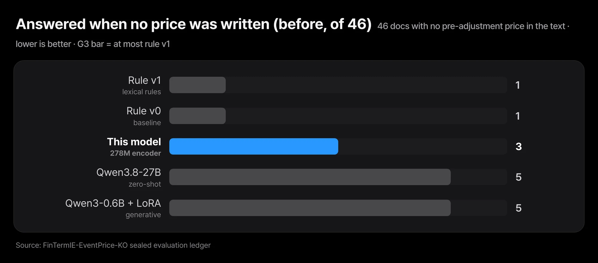

When a Korean company with convertible bonds sees its share price fall, it lowers the conversion price and files a notice. Developers who build filing datasets usually need two values from that notice. One is the price before adjustment, and the other is the price after. Pulling those two numbers out of the narrative gets hard quickly. The narrative also lists average share prices and a minimum adjustment floor. Some narratives never state the pre-adjustment price at all.

ThakiCloud has released a 278M-parameter encoder that finds these two numbers in the narrative and returns them with their character positions. It reads the "basis and method of adjustment" narrative in conversion price adjustment filings. The model is [FinTermIE-EventPrice-KO](https://huggingface.co/ThakiCloud/FinTermIE-EventPrice-KO), released under the MIT license. Its status is **EXPERIMENTAL RELEASE**. On 258 filings from unseen issuers, accuracy was 79.8% before adjustment and 93.8% after. On the same filings, the rule baseline scored 60.1% and 72.9%. Every one of the 457 values the model returned was a number actually written at the reported position.

It did not pass the pre-registered safety gate G3, however. Of 46 documents whose narrative does not state the pre-adjustment price, the model answered on 3. The rule baseline answered on 1. The 2025 filing set had only 67 documents, too few to judge, and it gives no evidence that the model beats the rules. Below we cover how the model picks a value, what it scored, and this failure and its limits.


*FinTermIE-EventPrice-KO at a glance. Measured on 258 filings from unseen issuers (E-Issuer); the pre-registered safety gate G3 was not passed.*

## In plain terms

Picture a clerk who reads a long notice and highlights "the price before the change" and "the price after the change." This clerk can only highlight numbers already printed on the page. The clerk cannot write in a new number by hand. So looking at the highlighted spot tells you right away where each answer came from.

The hardest job for this clerk is a notice with no such number. If the old price is not written down, the right move is to highlight nothing. This model rarely highlighted the wrong number. Instead, it put the highlighter on 3 of 46 notices it should have left blank. The rest of this post restates the highlighter story in more precise terms.

## It picks only from candidates, so it cannot invent a number

This model does not generate text. First, code pulls every number in the narrative out as a candidate. A candidate is a number with a thousands comma, or a number without commas whose integer part has three or more digits. Parts of dates are excluded. The model then scores each candidate as "before", "after", or "neither".

The backbone is the multilingual encoder [XLM-RoBERTa base](https://huggingface.co/FacebookAI/xlm-roberta-base). We fine-tuned it fully and attached a small span-role head. The span-role head is a small layer that scores which role each candidate number plays. A value is returned only when its score clears the "not in the narrative" option by enough. We call this cutoff the threshold, set to −1.0 for before and −1.5 for after. The thresholds were chosen by looking only at the development set.



Built this way, the answer is always a number from the input. The character position comes with it, so a person can jump straight to that spot in the narrative. Each position holds only one role. If both fields pick the same number, the one with the larger margin keeps it.


*27B zero-shot writes its answer as text, and the number has to be read back out of it. This model picks one of the candidate numbers in the narrative and returns its span.*

The training labels are the pre- and post-adjustment prices written in each filing's table. No person or LLM added labels. So at inference time we feed only the narrative and leave the table out. Feeding the table would amount to showing the answer. During training, each epoch removed the sentence holding one field's value in 20% of training documents. This was meant to teach the model to abstain when the value is missing.

## On 258 filings from unseen issuers, it beat the rule baseline by a wide margin

The evaluation set E-Issuer holds 258 filings from 134 issuers. They were filed between 2019 and 2024. None of these issuers appear in the training or development sets. None appear in the documents we read while building the rule baseline either. We froze the set first, recorded the final checkpoint and thresholds, and only then scored.

Accuracy is the share of all 258 filings where the returned value equals the value in the table. A document whose narrative lacks the value counts as wrong for every system. That caps accuracy at 0.82 before and 0.97 after. The pre-adjustment value appears in the narrative in 212 filings, and the post-adjustment value in 250.

| System | Before accuracy [95% CI] | After accuracy [95% CI] |
|---|---|---|
| **This model** (278M) | **0.798** [0.731, 0.863] | **0.938** [0.900, 0.969] |
| Rule baseline v1 (lexical rules) | 0.601 [0.523, 0.679] | 0.729 [0.655, 0.798] |
| Rule baseline v0 | 0.539 [0.458, 0.618] | 0.721 [0.648, 0.789] |
| Qwen3.8-27B, zero-shot, fixed prompt | 0.802 [0.732, 0.868] | 0.922 [0.880, 0.961] |
| Qwen3-0.6B + LoRA (generative model trained alongside) | 0.783 [0.716, 0.851] | 0.888 [0.840, 0.929] |

The confidence intervals come from a bootstrap that resamples by issuer. Filings from the same issuer are grouped, so they cannot pile up on one side. Every system read the same input file and was scored by the same code.

Accuracy in the table is a ratio between 0 and 1, and the text gives the same values as percentages. Compared on the same documents, the gap over rule baseline v1 is +19.8pp before and +20.9pp after. The 95% intervals of those gaps are [13.2, 26.3]pp and [14.9, 27.2]pp, both above 0. Split by filing format, it still beat rule v1 on the pre-adjustment price. The gap was +18.0pp on 217 regular filings and +29.3pp on 41 notice-style filings.


*Before/after accuracy on 258 filings from unseen issuers (E-Issuer). This model scores 0.798 before and 0.938 after; rule baseline v1 scores 0.601 and 0.729. The gap to the 27B model has a CI that includes 0.*

Most of the gap came from documents where the rules abstained. Among documents whose narrative contains the value, rule v1 failed to answer 57 before and 57 after. This model abstained on 4 before and 5 after. Looking only at documents with the value, this model got 206 of 212 before and 242 of 250 after. It returned a wrong value 2 times before and 3 times after, and swapped before and after once on the pre-adjustment field.

## It answered more often when there was no value, so one safety gate failed

We registered four gates before evaluation. A gate is a pass criterion fixed in advance to decide the release verdict. The verdict rule said a verified release required G3 to pass or to be underpowered.

| Gate | Result | Evidence |
|---|---|---|
| G1 before, gap over rule v1 at least +0.08 and CI lower bound above 0 | PASS | +0.198 [0.132, 0.263] |
| G2 after, gap over rule v1 at least −0.03 | PASS | +0.209 |
| G3 answers on documents without the value at most those of rule v1 (per field) | **FAIL** | before: 3 of 46 vs 1. after: 1 of 8 vs 1, too few to judge |
| G4 returned value exactly equals the number at the reported position | PASS | E-Issuer 457 of 457, E-Temporal 123 of 123 |

G3 looked at 46 documents whose narrative does not state the pre-adjustment price. On these documents the right answer is to return nothing. This model returned a value on 3 of them (6.5%). Rule v1 did so on only 1. Since it failed on the pre-adjustment field, the verdict is EXPERIMENTAL RELEASE. The gates and thresholds were fixed before evaluation and were not changed afterward.


*Number of the 46 documents without a pre-adjustment price in which each system still answered. Lower is better. This model answered 3 times and rule baseline v1 once, so G3 failed.*

The practical meaning is simple. A returned pre-adjustment price does not prove the narrative stated that price. Open the returned character position and check that the number really is the pre-adjustment price. On the same 46 documents, the 27B model and the 0.6B LoRA model each answered 5 times. On this set, the generative models showed the same problem.

G4 looked at the opposite risk. It checks whether the returned value exactly equals the number at the reported position. All 457 answers on E-Issuer and all 123 on E-Temporal matched. Because the model only picks from candidates, a value absent from the input cannot come out. The evaluation confirmed that. Still, a correct position means "it copied a written number", not "it got the role right".

## No winner against the 27B model, and the 2025 filings are underpowered

Subtracting the accuracy of Qwen3.8-27B zero-shot from this model's gives −0.4pp [−3.0, 2.1] before and +1.6pp [−2.0, 5.4] after. Both intervals include 0. So we do not say it is better or worse than the 27B model. On this set it reached similar accuracy with a 278M-parameter encoder. The only difference is that it returns a verified position instead of generated text.

The throughput below was measured while running the evaluation documents. Serving conditions differ across rows, so do not read these numbers as cost savings.

| | Parameters | Throughput | Memory |
|---|---|---|---|
| This model, 1x H200 GPU | 278M | 300 docs/s | 1.7GB GPU |
| This model, 8 CPU cores | 278M | 0.9 docs/s | not measured |
| Qwen3-0.6B + LoRA, 1x H200 GPU | 600M | 2.9 docs/s | 5.4GB GPU |
| Qwen3.8-27B endpoint, 4 concurrent requests | 27B | 1.7 docs/s (wall-clock on a shared endpoint) | - |

The 27B endpoint figure is wall-clock time on a shared endpoint with other users' load mixed in, so it is not a strict comparison. CPU and GPU runs produced the same values on 325 evaluation documents. We did not measure per-document latency percentiles.

The evaluation set E-Temporal holds 67 filings from 54 issuers, filed in 2025. The pre-registered minimum was 100 documents, so we report this set as underpowered and do not use it for the verdict. On this set, pre-adjustment accuracy was 82.1% for this model and 83.6% for rule v1. The gap, this model minus rule v1, is −1.5pp [−6.6, 3.2]. There is no evidence that the model beats the rules on later filings.

Two things need to be read together with this result. First, the rule baseline was built while looking at 2025 filings. Filings from the same round were removed from this set. Even so, the rules may be tuned to 2025 wording, so it is not a temporally independent baseline. Second, of the 54 issuers, 38 actually still have documents in the training set (46 filings). On those 46, this model got 35 before and 44 after, and rule v1 got 36 and 43.

| System (E-Temporal, 67 filings) | Before accuracy | After accuracy |
|---|---|---|
| This model | 0.821 [0.729, 0.908] | 0.955 [0.900, 1.000] |
| Rule baseline v1 | 0.836 [0.746, 0.917] | 0.925 [0.855, 0.985] |
| Qwen3.8-27B, zero-shot | 0.836 [0.746, 0.919] | 0.955 [0.899, 1.000] |

## Limits to know before using it

- **It sometimes answers when it should not.** On E-Issuer it returned a value on 3 of 46 documents whose narrative lacks the pre-adjustment price (G3 FAIL). When it returns a value, check the position.
- **Behavior when the post-adjustment price is missing is unverified.** The evaluation set has only 8 such documents.
- **Later filings are unverified.** The 2025 set had only 67 documents, too few, and gives no evidence of beating the rules.
- **It handles single-round filings only.** Filings that adjust several rounds at once cannot be paired automatically between table and narrative, so we left them out of training and evaluation.
- **The answers came from tables, not from people.** If the table parser misread a table, that error is in the labels.
- **Training labels were cleaned with context cues.** When a table value appears in several places, positions whose preceding context points to the opposite role were dropped from the training labels. This was applied to training data only, not to evaluation data.
- **Model selection came down to small margins.** The final checkpoint ranked highest of 12 runs on the 141-document development set. The 8 encoder runs differed by one or two documents. A 112M-parameter KoELECTRA run also scored almost the same on the development set, but it was not scored on the evaluation sets and is not released.
- **Evaluation set isolation has one timing limit.** The training label cleanup rules were documented after the split was frozen, and by then 14 raw E-Issuer filings had already been downloaded. Those filings had not yet been parsed, labeled, or scored, and the rules were applied only to training data.
- **Numbers the candidate rule skips cannot be answered.** A price under 100 written without commas is one example.
- **There was one scoring mistake.** The first scoring command passed this model's file under the wrong argument name, so only baseline numbers were printed. We left predictions, thresholds, and gates unchanged and reran with the command fixed.
- **No accuracy guarantee for production use.**

## Trying it yourself

The model repo includes three synthetic narratives written by hand for this release. They are not sentences from real filings. Below is what the released checkpoint produced on CPU. The first example is a miss, and we show it as is on purpose.


*Actual CPU output of the released checkpoint on the three synthetic narratives in the model repo. In the first one, the text states 4,686 won after adjustment, yet the model abstained on the after price. Hand-written examples are a smoke test, not evidence of accuracy.*

The first example contains a sentence saying the price is adjusted "from 6,050 won before adjustment to 4,686 won after adjustment". Even so, the model returned only 6050 for before and abstained on after. The best margin among after candidates was −3.73, below the threshold of −1.5. The second example is a narrative that states only the post-adjustment price of 2,251 won. The model abstained on before and returned 2251 for after. The third narrative contains no price, so it had no candidates and abstained on both.

Hand-written text differs from real filing wording, so it says nothing about accuracy. It does show what the most common failure will look like. The model is more likely to miss an answer than to invent a value.

```bash
pip install -r requirements.txt
python fintermie_eventprice.py --selftest
python fintermie_eventprice.py --model . --example examples/synthetic_notice.json
```

```python
from huggingface_hub import snapshot_download
import sys
d = snapshot_download("ThakiCloud/FinTermIE-EventPrice-KO"); sys.path.insert(0, d)
import fintermie_eventprice as ep

model, tok, cfg = ep.load(d, device="cpu")          # "cuda" also works
prose = "위 산정에 따라 전환가액을 조정 전 6,050원에서 조정 후 4,686원으로 조정한다."
r = ep.extract(model, tok, cfg, prose)
print(r["before"], r["after"], r["before_span"], r["after_span"])
```

To run under the same conditions as the card's numbers, follow three rules. First, feed only the narrative, not the filing's table. Second, the bundled script reads 512-token windows with a 128-token overlap and takes each candidate's highest score across windows. Third, use the thresholds in `eventprice_config.json`. Raising a threshold makes the model abstain more often. The output holds the values (`before`, `after`), character spans (`before_span`, `after_span`), margins (`before_margin`, `after_margin`), and the candidate count (`n_candidates`).

## In Paxis, it belongs in the draft step a person reviews

Document work automation in Paxis has an agent pull values from paperwork into a draft, and a person reviews it. In that flow, the evidence position matters as much as the value. This model returns the character position in the narrative along with the value, so the reviewer can open that spot right away.

The model's small size also matters in operation. The 278M-parameter encoder processed 300 documents per second on one GPU. On CPU it ran at 0.9 documents per second, slower but with the same predictions as the GPU. Since it did not pass G3, for now it is a candidate to sit in front of human review. There is no basis yet for using it to finalize values without a person checking.

## Closing

FinTermIE-EventPrice-KO does not generate numbers; it picks from candidates in the narrative. Thanks to that, all 457 values it returned matched their evidence positions, and it clearly beat the rule baseline on unseen issuers. In exchange, it answered more often than the rules on documents without a value and did not pass the safety gate G3. On 2025 filings there is no evidence it beats the rules, and there was no winner against the 27B model.

If you work with filing data, the first check you can run today is simple. Count what your current extractor returns on filings whose narrative does not state the pre-adjustment price. If that count is not zero, it is safer to keep the evidence position along with the value. The model and code are on [Hugging Face](https://huggingface.co/ThakiCloud/FinTermIE-EventPrice-KO).

## Sources and data

- Model: [ThakiCloud/FinTermIE-EventPrice-KO](https://huggingface.co/ThakiCloud/FinTermIE-EventPrice-KO) (MIT; base model [XLM-RoBERTa base](https://huggingface.co/FacebookAI/xlm-roberta-base), MIT). Every number in this post was copied from the same experiment ledger as the model card.
- Training data: 2,030 conversion price adjustment filings collected from DART, the Financial Supervisory Service's electronic disclosure system (592 issuers, filed 2019 to 2024, at most 8 per issuer). The development set is 141 filings from 69 other issuers. Training, development, and evaluation were split by a hash of the issuer code, so no issuer overlaps.
- **Neither the model repo nor this post contains original filing text.** The three example narratives are synthetic sentences written for the model card.
- Previous post: [DocFields F3.2: Better Field-Role Extraction on Korean Financial Forms by Restoring Generic Date and Account Number Labels](/tech-blog/en/research/docfields-f32-other-date-account-recovery/)
