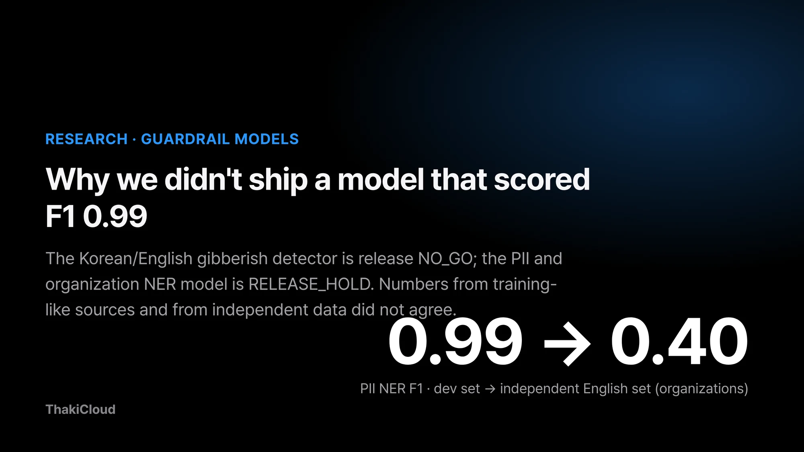
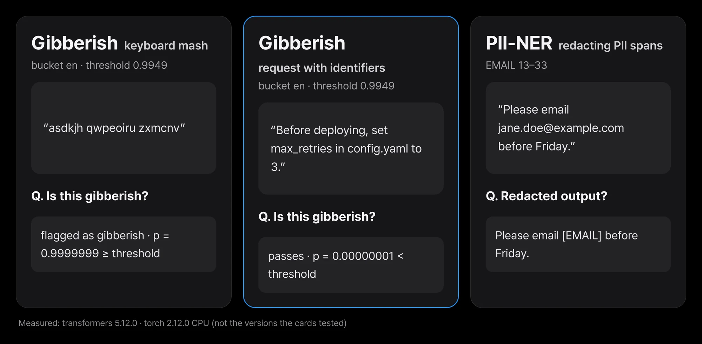
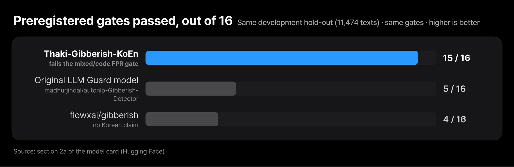
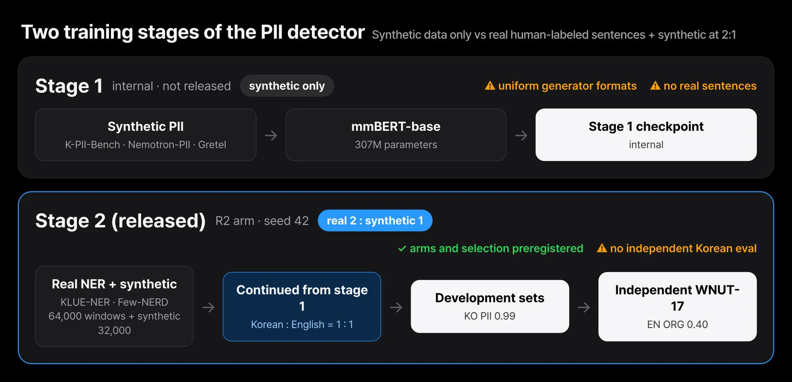

Put a filter in front of an agent and it can make two kinds of mistakes. It can block a normal user's question, or it can let through an input it should have stopped. A string of random key presses should be filtered, but a developer's Korean question with one variable name in it should not.

A customer's name and card number should be masked, yet it is hard to tell how much a masking model misses on writing in a style it has never seen.

ThakiCloud has published two candidate models for that filter position. One flags meaningless Korean and English strings; the other finds spans that contain personal data or organization names.

They are [Thaki-Gibberish-KoEn-Experimental](https://huggingface.co/ThakiCloud/Thaki-Gibberish-KoEn-Experimental) and [Thaki-PII-NER-KoEn-v2-Preview](https://huggingface.co/ThakiCloud/Thaki-PII-NER-KoEn-v2-Preview), both on Hugging Face.

**Both models are published, and neither is approved for production.** The gibberish detector's release decision is NO_GO, and the PII detector is on RELEASE_HOLD.

They are released for research inspection so that others can look at them and reproduce the results.

The two models share one finding. Numbers measured on the same sources as the training data were high. Numbers measured on data that was never used for training were lower, or too uncertain to support a decision. On its development set the gibberish detector passed 15 of 16 gates and failed on the remaining one.

The PII detector scored F1 0.99 for Korean personal data on its development set, and F1 0.40 for organization names on an independent English set. This post covers the distance between those numbers and why it led to holding both releases.


*The two experimental models at a glance. The gibberish detector passed 15 of 16 gates and is release NO_GO; the PII NER model is RELEASE_HOLD.*

## In plain terms

Think of a student who studied from one workbook. A test taken from the back pages of the same workbook goes well, because the question types and wording are familiar. A workbook from another publisher often brings the score down. To see what the student really knows, you have to test with a workbook they have never seen.

These two models are the same. Tests taken from the training workbook scored high. On an unfamiliar workbook, the gibberish detector hovered just above the line for one kind of input, and the PII detector scored much lower on English organization names. We could not find an unfamiliar Korean workbook at all. The rest of this post turns that workbook story into numbers.

## Both models are candidate scanners for agent input and output

[LLM Guard](https://github.com/protectai/llm-guard) is an open-source tool that checks what goes into and comes out of an LLM with a set of scanners. Each scanner looks at one kind of risk. A gibberish scanner catches keyboard mashing, random syllables, word salad, shuffled words and repetition.

A PII scanner finds spans such as names, phone numbers and card numbers and masks them. We built these two models as Korean/English candidates to sit behind such scanners.

The gibberish detector is a binary classifier made by fully fine-tuning the multilingual encoder mmBERT-small. It has about 140M parameters and labels each text `clean` or `gibberish`. The PII detector is a token classifier fine-tuned from mmBERT-base with 307M parameters.

It finds the character spans that contain personal data or organization names and returns them with a type. There are 17 types, including person, phone number, card number, email, location and organization.


*Output of the released checkpoints run on a Mac CPU. The three inputs were written for this post; this is a smoke test, not evidence of accuracy. We ran transformers 5.12.0, which is not the version the cards tested (5.14.1 for gibberish, 4.51.3 for PII).*

The three inputs above were written by hand to show the behavior. The keyboard mash was flagged with a gibberish probability above 0.99. The deployment request that mentions `max_retries` and `config.yaml` passed. The PII detector found the email address and replaced it with `[EMAIL]`. It did not tag "Friday" as a date or time.

Three hand-written sentences say nothing about accuracy; the evaluations below do.

## The gibberish detector passed 15 of 16 gates and still failed

A gate is a pass criterion fixed before evaluation in order to make a release decision. We preregistered 16 gates for the gibberish detector. Three are false positive rates per language bucket: Korean (KO), English (EN), and mixed Korean-English or code (mixed). The other 13 are recall floors per noise type. Recall is the share of real gibberish the model catches.

The false positive limit is 1%. More precisely, the one-sided 95% upper bound (Clopper-Pearson) on the clean-text false positive rate has to be at most 1%. We look at the upper bound so that a point estimate that came out low by luck on a small sample is not trusted. In a guardrail, a false positive blocks a normal user.

A blocked user does not know why, and either rewrites the same question or leaves. Gibberish is a rare input to begin with, so even blocking 1 in 100 normal inputs can mean that most of what the filter actually blocks comes from normal users.

The decision thresholds were also frozen before any evaluation data was opened. For each bucket we used the 99.5th percentile of clean calibration scores. All three are above 0.99, and the exact values are in the table below. Moving the thresholds after seeing the results could push the false positive rate as low as one likes, so we kept that order.

| Measure (evaluation half of the development set, 11,474 texts) | KO | EN | Mixed / code |
|---|---|---|---|
| AUROC (clean vs gibberish) | 0.994 | 0.999 | 0.998 |
| FPR, 95% upper bound (gate ≤ 0.01) | 0.0084 | 0.0054 | **0.0133, fails** (2 of 541 clean texts flagged) |
| Mean recall over noise types (lowest type) | 0.931 (word shuffle 0.727) | 0.988 (word shuffle 0.966) | - |
| Decision threshold (frozen before evaluation) | 0.9967 | 0.9949 | 0.9919 |

AUROC measures how well the score separates clean text from gibberish; closer to 1 is better. All three buckets were 0.99 or higher. In the mixed/code bucket, however, the model wrongly flagged 2 of 541 clean texts. The point estimate is 0.4%, but with only 541 texts the 95% upper bound rises to 1.3%. Because this one gate failed, the checkpoint failed development selection (DEV_SELECTION_FAIL).


*Gates passed on the same development set with the same 16 gates. This model passed 15, the original LLM Guard gibberish model 5, and flowxai/gibberish, the best other public model we found, 4. No model passed all 16.*

The comparison models were measured on the same set with the same gates. The [gibberish model](https://huggingface.co/madhurjindal/autonlp-Gibberish-Detector-492513457) that LLM Guard uses by default passed 5 of 16. Its AUROC was 0.63 for Korean, 0.93 for English and 0.51 for mixed text.

It was built mainly for English, so it scored low on Korean and mixed input. [flowxai/gibberish](https://huggingface.co/flowxai/gibberish), the best other public model we found, passed 4; it does not claim Korean support either. Our model passed the most gates, but no model passed all 16.

## On new data, Korean sentences with identifiers sat near the 1% line

The clean text in the development set came from the same source families as training. The sentences differ, but the style and topics are similar. So after training we built a separate set of clean text only, and removed anything that overlapped with the training or development text.

There is no gibberish in this set, so it can only measure false positives. It was opened once, on November 9, 2026, and scored under a preregistered rule.

The set has three strata. The first is 5,400 Python snippets of 1 to 4 lines from 175 PyPI packages and the standard library. The second is 3,600 Korean sentences with an ASCII code identifier inserted, and the third is 3,600 English questions with an identifier inserted.

The second and third strata were built from 144 template frames each. A stratum meets its criterion when both the corrected upper bound and the cluster-bootstrap upper bound are below 1%. It fails if the point estimate is 1% or higher, and anything in between is INCONCLUSIVE.


*False positive rate and corrected upper bound per stratum of the new clean set. Code was 0.33% (bound 0.52%) and English + identifier 0.36% (bound 0.66%), both meeting the criterion. Korean + identifier was 35 of 3,600, 0.97% (bound 1.47%), so INCONCLUSIVE. The limit is 1%.*

The code and English strata met the criterion. The problem was Korean sentences with an identifier. The model flagged 35 of 3,600 as gibberish, and all 35 fell in the mixed bucket. The point estimate was 0.97%, just under the line, and the corrected upper bound was 1.47%.

It could be called neither a failure nor a pass, so the overall result was INCONCLUSIVE. The project lead reviewed this result, closed the study, and kept FAIL and RELEASE_HOLD.

This result should not be read as just a small-sample problem. If the true false positive rate is near 1%, more samples only narrow the interval around that value; they do not bring it below the line. Korean developers mixing `user_id` or `config.yaml` into a question is common, and that is exactly where the model showed a weakness. The development numbers did not reveal it.

The cluster assumption is still open as well. The within-frame correlation in the Korean stratum was about 0.05, roughly 5 times the planned value of 0.01. Sentences from the same frame moved together. The corrected bound relies on an assumption about frame clusters that was not checked against real input.

The template strata are not real user traffic either, because the guard has never been deployed and there is no service input distribution.

## The PII detector was trained in two stages, adding real human-labeled sentences

Stage 1 of the PII detector was trained on synthetic personal data only: K-PII-Bench, Nemotron-PII and Gretel synthetic financial PII. Synthetic data is made by a generator that fills values into templates, so the formats are uniform. The stage 1 checkpoint was used internally and not released.

Stage 2 continued from stage 1 and added real named entity recognition (NER) sentences labeled by people. NER is the task of finding spans that hold names of people, places, organizations and the like. We used KLUE-NER for Korean and Few-NERD for English. Real sentences and synthetic data were mixed 2:1, and Korean and English 1:1.

In training units that is 64,000 and 32,000 windows. A window is a fixed-length piece cut from a long text and read at once. The training configurations to compare (arms) and the rule for picking one were preregistered before training. The released checkpoint is stage 2 arm R2, seed 42.


*Stage 1 is an internal checkpoint trained only on synthetic PII; stage 2, the released checkpoint, mixes human-labeled real NER sentences with synthetic data at 2:1. Evaluation was split into development and independent sets.*

Neither model used AI-Hub data or a paid API. The PII detector also used no LLM-generated data. The gibberish detector's clean text comes from Korean and English comments and reviews, Wikipedia, Tatoeba, KLUE-YNAT headlines, permissively licensed Python code and similar sources; its gibberish was made by applying our own rule-based noise generators to that text.

## There is a gap between 0.99 on development and 0.40 on independent data

The metric is strict span F1. A predicted span counts as correct only if its start, end and type all match the gold span. One character off counts as wrong.

| Set | Nature | Measure | This model |
|---|---|---|---|
| K-PII-Bench official dev | synthetic text from the training generator | KO PII, common 8 types | **0.9911** |
| Nemotron-PII, held-out split | synthetic text from the same generator | EN PII, common 8 types | **0.9749** |
| Gretel synthetic finance, held-out split | same generator | EN PII, common 8 types | 0.8466 |
| KLUE-NER train, held-out part | same source, used for configuration selection | KO organization | 0.8246 |
| Few-NERD official validation | same source | EN organization | 0.6929 |
| **WNUT-17 test** (1,287 sentences) | **independent source**, never used for training or selection | EN organization / person / location | **0.4037** / 0.6408 / 0.5850 |

"Common 8 types" narrows PII scoring to person, email, phone, credit card, IP, ID number, bank account and crypto address. This model has no crypto label, so that type was not scored.


*Development numbers from the same sources and numbers from an independent source (strict span F1). The synthetic PII development sets score 0.99 and 0.97, while organizations on WNUT-17, English social media text never used for training, score 0.40. There is no independent Korean number.*

The development numbers are high for exactly the workbook reason. The PII development sets are synthetic text made by the same generator as the training data, so phone and card numbers appear in the same positions and formats as in training.

The Korean organization set comes from the training source and was also used to choose the stage 2 configuration, so it is even more optimistic. Other splits of the same sources gave similar numbers: 0.78 for organizations on the official KLUE-NER validation set and 0.72 on the official Few-NERD test set.

An unfamiliar source was different. WNUT-17 is English text collected from Twitter, Reddit, YouTube and StackExchange. It was scored once after training with fixed post-processing rules. F1 was 0.40 for organizations, 0.64 for persons and 0.59 for locations.

Seeds 43 and 44 of the same recipe also scored 0.41 for organizations, so the low value is not a fluke. That is why the wrapper does not mask organizations by default and only marks them for review.

The independent Korean evaluation is INCONCLUSIVE. We could not find a cleanly licensed, human-labeled third-party Korean evaluation source for organizations or personal data. So there is no number for how well the model handles unfamiliar Korean text.

The numbers for pattern-like types such as phone numbers, card numbers and bank accounts also all come from the same generator as the training data. Real forms, OCR output and chat logs may behave differently.

We also compared against [Thaki-KoPII-Guard-v1](https://huggingface.co/ThakiCloud/Thaki-KoPII-Guard-v1), the Korean-only model we published earlier, on the same set. On the K-PII-Bench official dev set with the common 8 types, both models scored F1 0.99. The 95% interval of the difference includes 0, so the two cannot be told apart.

This model also covers English personal data and Korean/English organizations. In exchange, its per-document latency on a shared-node CPU was 100.2 ms, about twice KoPII-Guard-v1's 46.4 ms, and its peak memory was higher at 2,222 MB.

## Cost has not been measured for either model

The CPU cost verdict for both models is COST_BLOCKED, which means it was not measured in an isolated benchmark. There are numbers from a shared environment. The gibberish detector ran at about 12 ms p50 per text at batch size 1, with peak memory around 1.5 GB. The PII detector ran at about 100 ms p50 per document on 8 CPU threads.

Both were measured on a node shared with other work, so we do not use them as cost evidence.

The project lead gave three reasons for the PII detector's RELEASE_HOLD. There is no evidence of independent Korean generalization, the independent English organization F1 is around 0.40, and CPU cost has not been measured in isolation. The gibberish detector stands at development selection FAIL, follow-up re-verification INCONCLUSIVE, and release NO_GO. This upload changes none of these verdicts.

## Limits to know before using them

- **Do not use them as production guardrails.** Neither model is approved for production use.
- **Korean input with identifiers produced real false positives.** The gibberish detector blocked 35 of 3,600 texts in that stratum of the new set.
- **Korean word shuffling is the weakest noise type.** Development recall is 0.73.
- **The thresholds are very high.** All are above 0.99, so small changes in scoring code, library versions or truncation can flip decisions near the boundary. Use the pinned versions and the rules in the profile as they are.
- **A preregistration file was edited once.** After committing the gibberish detector's follow-up preregistration, a reference key was fixed before the data was opened. The original is kept, and the deviation is recorded with the results.
- **Organizations from the PII detector are for review only.** Precision is low on unfamiliar text, so they are not masked by default.
- **Secrets are out of scope.** API keys, passwords and tokens are not labels; use a dedicated secret scanner alongside it.
- **It does not guarantee privacy.** Spans will be missed, so do not decide regulatory compliance or data export on this model alone.
- **Long text is cut into 1,000-character windows.** Entities on a window boundary may be missed or split.
- **The tokenizer is not in the repository.** It is loaded from mmBERT at a pinned revision, so the HF hosted inference widget does not work.

## In Paxis, we treat them only as input and output scanner candidates

Agents in Paxis take a user request, read documents and call tools. That flow needs filters on both ends: one that removes meaningless input from incoming requests, and one that masks personal data in outgoing responses and tool-call arguments. We built these two models as candidates for those positions. They are not deployed in Paxis today.

In those positions, false positives and misses cost different things. A false positive in the input scanner stops a normal user's work. If one in every 100 requests from Korean developers who mix in variable names were blocked, the agent would be hard to rely on.

A miss in the PII scanner means a value that should have been masked goes out to logs or external tools. Neither cost could be estimated from development numbers, and this independent evaluation showed why.

## Trying them yourself

Both repositories ship wrapper code, and the decision rules are fixed in each repository's profile JSON.

```python
from huggingface_hub import snapshot_download
import sys

g = snapshot_download("ThakiCloud/Thaki-Gibberish-KoEn-Experimental"); sys.path.insert(0, g)
from thaki_gibberish import ThakiGibberish
print(ThakiGibberish(g).classify(["Please summarise the meeting notes from Thursday.", "asdkjh qwpeoiru zxmcnv"]))

p = snapshot_download("ThakiCloud/Thaki-PII-NER-KoEn-v2-Preview"); sys.path.insert(0, p)
from thaki_pii_ner import ThakiPIINER
m = ThakiPIINER(p)
print(m.redact("Please email jane.doe@example.com before Friday."))  # ORG is not masked by default
```

To reproduce the card numbers, use the versions the cards tested: transformers 5.14.1 for the gibberish detector and transformers 4.51.3 for the PII detector. The input/output figure in this post was run on 5.12.0, so its conditions differ from the cards. The sha256 of the downloaded weights matched the values in both cards.

## Closing

Both models produced good numbers on their development sets. The gibberish detector passed more than three times as many gates as the two public models we compared (5 and 4), and the PII detector scored F1 0.99 on synthetic personal data.

On data never used for training, however, Korean-plus-identifier false positives stayed near 1%, and English organization F1 dropped to 0.40. That is why both models are published but not approved for production.

If you are choosing a guardrail model, the first check you can run today is simple. First confirm whether the candidate's numbers come from the same sources as its training data. Then collect a few thousand normal inputs your real users are likely to send, such as Korean requests with variable names mixed in, and count the false positives yourself.

If that count sits near your limit, suspect a weakness in the model before reaching for more samples. The models and wrapper code are on Hugging Face at [Thaki-Gibberish-KoEn-Experimental](https://huggingface.co/ThakiCloud/Thaki-Gibberish-KoEn-Experimental) and [Thaki-PII-NER-KoEn-v2-Preview](https://huggingface.co/ThakiCloud/Thaki-PII-NER-KoEn-v2-Preview).

## Sources and data

- Models: [ThakiCloud/Thaki-Gibberish-KoEn-Experimental](https://huggingface.co/ThakiCloud/Thaki-Gibberish-KoEn-Experimental), [ThakiCloud/Thaki-PII-NER-KoEn-v2-Preview](https://huggingface.co/ThakiCloud/Thaki-PII-NER-KoEn-v2-Preview). Weights and config are CC BY-SA 4.0 and wrapper code is MIT. The base models are [jhu-clsp/mmBERT-small](https://huggingface.co/jhu-clsp/mmBERT-small) and [jhu-clsp/mmBERT-base](https://huggingface.co/jhu-clsp/mmBERT-base) (MIT). All evaluation numbers in this post are taken from the two model cards.
- Training sources: for the gibberish detector, KOTE, NSMC, GoEmotions, DynaSent, Wikipedia, Tatoeba, KLUE-YNAT and code from permissively licensed Python packages. For the PII detector, K-PII-Bench, NVIDIA Nemotron-PII, Gretel synthetic financial PII, KLUE-NER (Park et al., 2021) and Few-NERD (Ding et al., 2021). The independent evaluation is WNUT-17 (Derczynski et al., 2017). Revisions and licenses per source are in each repository's NOTICE.md.
- No AI-Hub data or paid API was used. Training and evaluation text is not included in the repositories or in this post. The sentences in the input/output figure were written for this post.
- Previous post: [Mask Personal Data Before the Agent Starts Working](/tech-blog/en/agentops/thaki-kopii-guard-paxis-pii-gate/)
