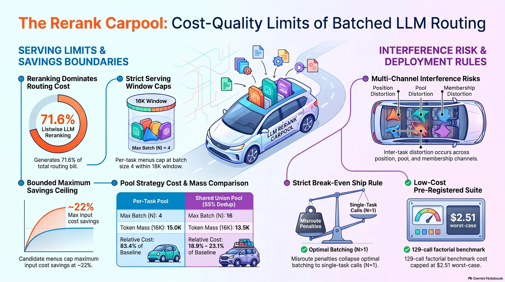
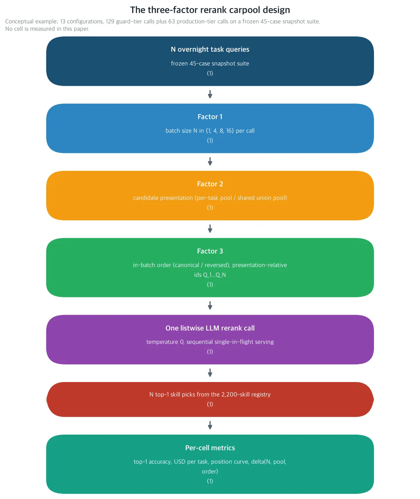
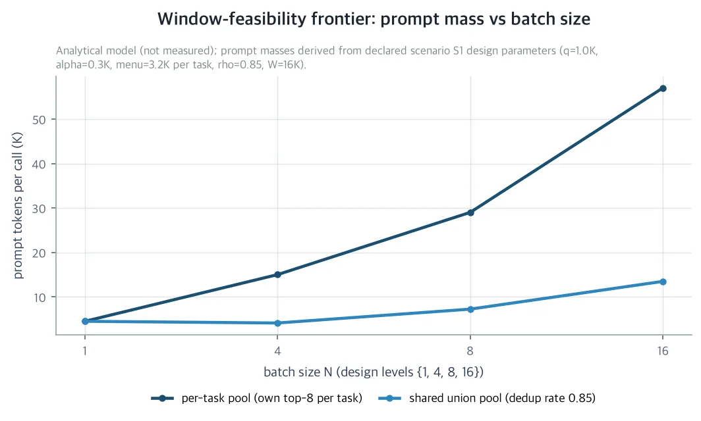
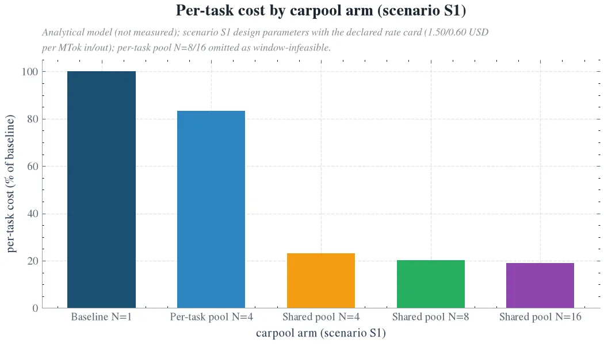
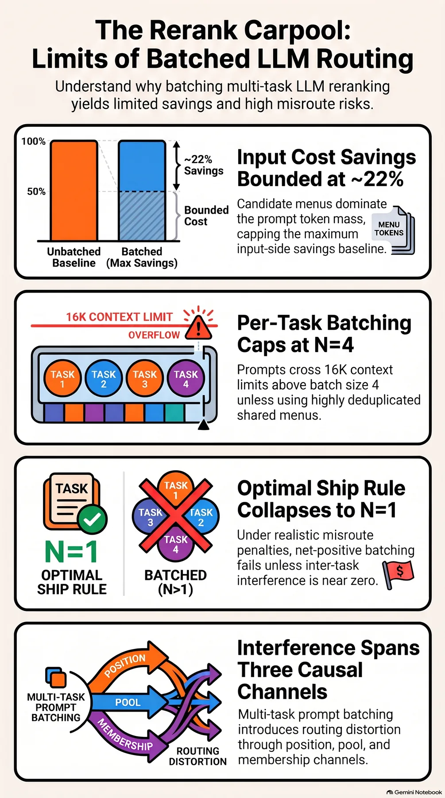

Packing several independent decisions into one LLM call lets you split the fixed cost that attaches to every call across those decisions. But if the decisions packed into one call disturb each other, the savings can vanish entirely. If you run unattended agents on self-hosted GPUs and set the cost policy for the router's final LLM call, this paper is worth reading.

The ThakiCloud unattended agent harness runs thousands of task steps every night on a self-hosted H200. Each step is routed to one skill out of a registry of roughly 2,200 skills, and the last stage of that routing is the LLM rerank call. That single call accounts for 71.6% of the routing bill. Every stage of this cost stack has been priced at one call per decision. How many independent decisions one call can share is the last lever still unpriced, and this paper prices it in closed form.

One thing to know before you read on. This is an analytical paper, and the body contains no new execution-stage measurements. Every frontier value is a closed-form model estimate derived on top of the declared self-hosted rate card and the stated scenario parameters. The structural results hold without depending on the scenario's exact numbers. The scenario-dependent numbers are the job of the preregistered protocol written at the end of the paper. That run costs under $2.51 in the worst case for the factorial and under $3.75 for the full protocol at the declared rate card.

## In plain terms

A carpool, literally. If everyone drives to work in their own car, the fuel bill scales with the number of people. If they ride one car together, the fixed part, tolls and parking, is divided by that number. The rerank carpool works on the same arithmetic. Pack N independent routing decisions, each asking "of these 8 skills, which is the best for this task?", into one LLM call, and the fixed overhead q that attaches once per call is divided by N.

But in a skill-routing prompt the fixed overhead is small and the candidate menu is large. Eight skill cards, each 200 to 400 tokens. Most of the prompt is menu, not overhead. So the ceiling on carpool savings is the share of the prompt that the overhead occupies, and in this scenario it is 22.2%. In plain words, bundling orders never shrinks the price of the menu itself; the only thing you can save is the per-call packaging fee.

Then a second problem stacks on top. Packing several questions into one call makes the questions interfere, and an LLM answers the middle of a long list less accurately than the two ends, the known U-curve. In routing, the top 2 skills are frequently a near tie, so a small context perturbation can flip the final answer. Whether the savings beat the flip cost is exactly the question the break-even ship rule answers, and we get to it below.

<!-- nlm-visual -->

*Infographic generated by NotebookLM from the sources.*

## What we did

The ThakiCloud cost-quality series has priced the router stage by stage. Each paper fixed one axis and kept the one-call-one-decision constraint. One paper fixed the precision axis of the scoring stage (Gatekeeper). One fixed the width axis of the candidate menu (Menu Width, the knee at k*=5, commit versus menu). One priced the in-band decision (Indifference), an expected-cost tie-break of $60.5/night at 1.18 SRA points. One fixed the model tier of the final call (Apprentice Reranker, 27B teacher versus 8B DPO distilled student). This paper lifts that constraint. If the Apprentice paper priced which model tier runs the rerank stage at N=1, this paper prices, on top of model tier, how many decisions to load per call. The constants the harness ships to production widen to four dimensions: model tier, carpool size, pool, order.

Three facts make the carpool non-trivial. First, in the skill-routing prompt the candidate menu dominates the text, so dividing the fixed overhead by the number of tasks has a ceiling. Second, the serving window binds the batching size. It is the window, not the rate card, that binds, and the pool mode and the batching size are coupled through the union menu. Third, batching introduces inter-task interference, and that interference can erase the entire savings.

The closest external work is the in-context batched LLM verdict study. On randomly formed batches with no candidate set, it reports that 11 to 22% of verdicts change on 4 to 9B models. It gives an exact decomposition over the order, slot, and membership channels, and it recommends one call per item with a cached prefix. That recommendation is sound where the cached prefix is most of the cost. But in the routing prompt the only cacheable thing is q, and in the scenario it is just 22.2% of the input. So the carpool's economics must be priced not a priori but against the one misroute penalty M.

The design is a 3-factor factorial. Factor 1 is the batching size N, with values 1, 4, 8, 16, where N=1 is the production baseline. Factor 2 is the candidate presentation mode: the per-task pool, where each task carries its own top-8 menu with duplicates allowed, and the shared pool, a single union menu whose feasibility is set by the deduplication rate. Factor 3 is the in-batch order, canonical (suite order) versus reversed.

*Schematic of the preregistered factorial. A single listwise LLM call carries N independent routing decisions, and candidate presentation (per-task pool versus shared union pool) and in-batch order (canonical versus reversed) are the other two factors. This figure is a conceptual schema, not a measured result.*

Task ids become presentation-relative ids. So the order comparison does not end in a correlation with task identity; it identifies the position effect, primacy versus recency. The configurations number 13: one at N=1 and four each at N=4, 8, 16. The four per-task pool N=8/16 configurations are under the window guard. At the scenario's card scale they do not fit inside the window, so they can be recorded as infeasible without being executed.

The serving controls are the reason the channels read as identifications rather than correlations. Strict sequential execution, a single in-flight call, identical vLLM flags on every tier, sampling temperature 0, and the 2-call warmup per session discarded. GPU-side concurrent batching is held constant by design, and the only thing that varies across cells is the prompt text. That is why every identified channel is prompt-side. The serving window being a physical bound rather than a tunable parameter is the same story: on long context, self-attention over the KV cache dominates the execution time.

The measurement host is the frozen 45-case SRA-bench snapshot. The menus are the per-case top-8 offline snapshot of the production hybrid retriever (BM25 and dense retrieval), built by the production embedding server. The host issues only rerank calls and does no runtime retrieval, so menu confounding is removed. Of the 45 cases, the gold skill is inside the menu for 39. The 6 retrieval misses cannot be fixed by any rerank, so accuracy is reported in two slices, overall and gold-in-menu.

The confirmation run is preregistered. The Qwen3-4B guard tier runs the full 13-configuration factorial, 129 calls (45 + 12×4 + 6×4 + 3×4). The Qwen3.8-27B NVFP4 production tier runs a 63-call canonical-order subset (45 + 12 + 6, N ∈ {1, 8, 16}, both pools). Interference is tier-dependent, so the 4B tier covers the 13-configuration surface, and the ship constants as deployed are the 27B side's job. At the declared rate card, the worst-case cost is under $2.51 for the factorial and under $3.75 for the full protocol.

Each cell pins a constant. N=1 anchors accuracy and the baseline cost. The four N=4 configurations pin the per-task pool frontier at the binding window. The N=8 and 16 shared configurations pin the deduplication regimes and the union menu cross-contamination. The canonical versus reversed comparison bounds the asymmetric position weighting at every N.

## What came out

First, in this harness the axis that binds the carpool size is the serving window. It is the window, not the rate card, that binds. The three inputs of scenario S1 are q=1.0K, the task block p̄=3.5K, and the window W=16K.

The per-task pool's prompt mass grows linearly as q + N·p̄. It fits the window at N=4, 15.0K. It does not at N=8, 29.0K. In plain words, a carpool carrying per-task menus holds a full car at four riders and will not fit on the road at eight.

Shared-pool feasibility is coupled to the deduplication rate. N=8 is possible only at 51 percent or more. N=16 only at 81 percent or more. The longest prompt in the scenario snapshot, about 12.9K at N=16 shared, implies a deduplication rate of about 86 percent. At 85 percent, the union menu stays inside the window up to N=16.

*Prompt token mass per call in scenario S1. The per-task pool grows linearly and fits the window at N=4 (15.0K), while N=8 (29.0K) crosses the 16K serving window. The shared union menu with 85% deduplication is feasible up to N=16 (13.48K). This figure is an output of the closed-form cost model, not a measured result.*

There is a design fact to read off this frontier. Because popular skills overlap enough across task menus, the union menu does not explode. When the window binds, a cheaper model does not increase the number of questions that fit in one call. If the rate card bound it, a cheaper model would open the carpool, but that is not the case here. Pool mode and batching size are coupled through the union menu and cannot be chosen independently.

Second, when the candidate menu dominates the prompt, the savings ceiling is 22.2%. The input-side savings of carpooling are exactly r_in·q·(1−1/N) per task, independent of the pool mode. The N→∞ ceiling is r_in·q, which in S1 is q/(q+p̄) of the input bill, 22.2%. In plain words, no matter how much you bundle, the menu never gets cheaper; only the per-call fixed overhead divides.

Even with zero interference, N=16 reaches only 20.8% of the baseline per-task cost c1, about 0.7 cents with a 99.8% input share. On the per-task pool, N=4, the only level the window allows, is 83.4% of baseline. The shared pool adds the deduplication gain on top, whose ceiling is the menu share, 71.0% of c1. At 85 percent in S1, the per-task cost drops to 18.9~23.1% of baseline.

*Model per-task cost of each carpool arm that is window-feasible in scenario S1, as a share of the one-call baseline. Because the menu dominates the prompt, N=4 of per-task pooling saves little (83.4% of baseline), while the shared union menu with 85% deduplication drops to 18.9~23.1% of baseline. This figure is an output of the closed-form cost model, not a measured result.*

The cost side alone does not close the case. The ship rule N_ship = min(N*, N_qn, N_win) prices the savings against the one misroute penalty M. N* is the largest N at which break-even holds. N_qn is the largest N whose quality degradation stays inside the tolerance. N_win is the window bound. The tolerance is about 1.2 points, the predicted quality cost used by the series' in-band tie-break.

Under the parametric interference schedule δ(N) = δ_16·(N/16)^γ, the scenario table converges the same way. Only the zero-interference row ships the carpool, where the rule lands on the window bound, 4 on the per-task pool and 16 on the shared pool. In every other row, at every value of the scenario M from $2 to $10, the rule converges to N_ship = 1. The series-declared M, the $50 to $200 penalty that prices the commit-versus-menu fork and the in-band tie-break, needs no further comment: every frontier's break-even is under 78 cents. The frontier maxima, about 68 and about 77 cents, both come from N=2 outside the grid; the exact values are in the closing note. One misroute priced at the series M cannot be bought back with the few-tenths-of-a-cent menu deduplication at N=16.

Third, batching introduces inter-task interference on three channels: position, pool, membership. The position channel is canonical versus reversed at fixed N and pool. Because task ids are presentation-relative, the order comparison isolates the primacy and recency effects and removes the label effect. The pool channel is per-task versus shared at fixed N. It identifies the cross-contamination effect of the candidate menus, and the deduplication rate is known from the snapshot. The membership channel is the only channel left after subtracting the predicted position penalty from the per-task pool's N trend. It is the effect of which carpool-mates share the prompt.

This extends the exact order/slot/membership decomposition of the in-context batched LLM verdict study. That study scored verdicts on randomly formed batches with no candidate set. It reports that 11 to 22% of verdicts change on 4 to 9B models. Ours is the top-1 choice made out of a presented candidate menu, so the pool channel and the economic frontier are added.

Routing amplifies small perturbations because the top 2 skills are frequently a near tie. Let g_t be the latent top-1 margin, the score gap between the gold skill and the runner-up. Let σ_ctx be the standard deviation of the context perturbation caused by the N−1 carpool-mates. If the carpool-mates contribute independent noise, the perturbation standard deviation scales with the square root of N−1. Near-tie tasks, the ones with a small margin, flip at a nonzero rate even under a small perturbation. Score-level effects smaller than the perturbation standard deviation are invisible. The form matches the flip-rate scaling with the square root of the context variance reported by the verdict study, the 11 to 22% verdict change on 4 to 9B models.

Long-context theory gives four position-curve predictions to be tested in the protocol. P1: a U-curve, the position-averaged accuracy dips in the middle third of the batch, an interior minimum. The primacy tail is carried by causal masking, the recency anchor by residual connections. P2: the dip deepens as N grows. P3: the dip is larger on near-tie tasks, and the indifference-band slice should show it first. P4: adding a per-task chain-of-thought output reduces the dip, but it multiplies the completion overhead, so the relief comes with a price tag. These four are written down as predictions to be tested in the protocol, not as results.

The paper also separates what had been attributed to serving-side concurrency alone. The accuracy drift is split from prompt-side, context-side interference. It is the first attempt to causally decompose inter-task interference in LLM multi-query ranking with a 3-factor factorial of batch size, shared versus individual candidate pool, and in-batch order. The identification adds the candidate pool channel to the verdict study's order/slot/membership analysis. P1 to P4 give testable consequences of long-context theory. And the economic frontier prices carpool size against the misroute penalty M.

## What to change

First, the ship rule can be adopted as a fixed value before any measurement. It is computed in closed form in scenario S1, where every constant is fully specified. The overnight loop of the 2,200-skill ThakiCloud harness issues one LLM rerank call per task. The paper answers what fraction of the token spend is saved by bundling that call N-to-1, and the largest batching size with no quality loss.

Cost-wise, bundling works. The per-task menu reaches N=4, the shared union menu N=16, both inside the window. But the ship rule prices it against the misroute penalty. At every value of the series M, $50 to $200, and the scenario M, $2 to $10, unless measured interference is zero, it converges to one call per decision. In plain words, the question is not how many fit in the car; it is how much you lose if you drop the wrong one.

Second, this is the first protocol that reproducibly measures the prompt-side batching economics of production LLM routing. Any organization running large-scale LLM calls can take three design rules. The serving window binds the batching size. Menu dominance is the ceiling on overhead-side savings. Interference must be priced against the misroute penalty. They are rules that cut unnecessary inference spend and the energy cost it carries. Every number in the paper traces to closed-form model output on top of design parameters, cited sources, and the declared rate card, because the cost model is fully public.

<!-- nlm-visual -->

*Infographic generated by NotebookLM from the sources.*

## What not to trust

The limits are stated explicitly.

First, this paper is analytical. Every frontier value is a closed-form derivation under S1, or a number from stated assumptions, the declared rate card, or cited sources. Not a single factorial cell is pinned down by measurement. The measured values of δ, ρ_N, the parse success rate, and N* are the job of the preregistered protocol.

Second, a single platform. Self-hosted H200 only, and the menus are an offline snapshot built by the production embedding server. Menu confounding at measurement time is zero, but online retrieval drift is not covered.

Third, the rate card is declared and uniform across model sizes. Marketplace rates would reprice the baseline, but they do not change the structure.

Fourth, the 45-case suite has the gold skill in the menu for 39 cases. It leaves 6 retrieval misses that no rerank can fix, and every accuracy statement is slice-conditional. Deterministic serving at temperature 0 excludes the unpriced sampling channel.

Fifth, the single 2,200-skill registry makes ρ_N registry-dependent. The 400-token card in S1 is the conservative top end of the snapshot menu's 200 to 400-token per-card range.

The validity threats are written down alongside. A tier or model update changes the δ schedule, which is the reason for the guard/production split. Menu drift changes ρ_N and p̄, so a re-snapshot is needed when the retriever changes. A rate card change rescales the dollar values but does not change the ship rule's ratio structure.

On prefix caching: sequential, single in-flight serving does not disable automatic prefix caching. So the billed tokens are cache-independent at the declared rate card and do not affect the cost model. But the per-cell wall-time channel depends on cache state, so the caching state is declared per tier, disabled on the 4B guard tier. The 400-token card in S1 is the conservative top end, and the protocol recomputes the snapshot's actual card sizes.

The paper's full text and companion materials are on the [Hugging Face paper detail page](https://huggingface.co/datasets/thaki-AI/daily-paper-2026-11-14-rerank-carpool-batch-routing-interference).

*The cost numbers in the body are closed-form model estimates derived on top of the declared self-hosted billing model (deterministic token count × declared rate card) and scenario S1. The values in the three figures are model outputs (one conceptual schema, two cost-model outputs), not measurements. The baseline c1 is $0.006764 per task (99.8% input share). The shared-pool feasibility thresholds are ρ_8 ≥ 0.508 and ρ_16 ≥ 0.801. The N=16 shared prompt mass is 13.48K; the deduplication rates are 0.85 in the scenario and about 0.86 implied by the snapshot. The break-even tolerance is tol = 1.18pt, the predicted quality cost of the series' in-band tie-break. The frontier maxima are $0.6829 (shared, γ=0.5) and $0.7726 (shared, γ=1), both from N=2 outside the grid. The union-menu deduplication gain at N=16 is $0.0055 per task. Serving flags: window 16384, memory utilization 0.90, max concurrent sequences 32, temperature 0, 2-call warmup discarded per session. The 13-configuration 129-call guard-tier factorial (Qwen3-4B) and the 63-call production-tier subset (Qwen3.8-27B NVFP4) are preregistered in this paper; the measured values of δ, ρ_N, N_ship are reported when the run completes. The worst-case cost is under $2.51 for the factorial and under $3.75 for the full protocol at the declared rate card.*
