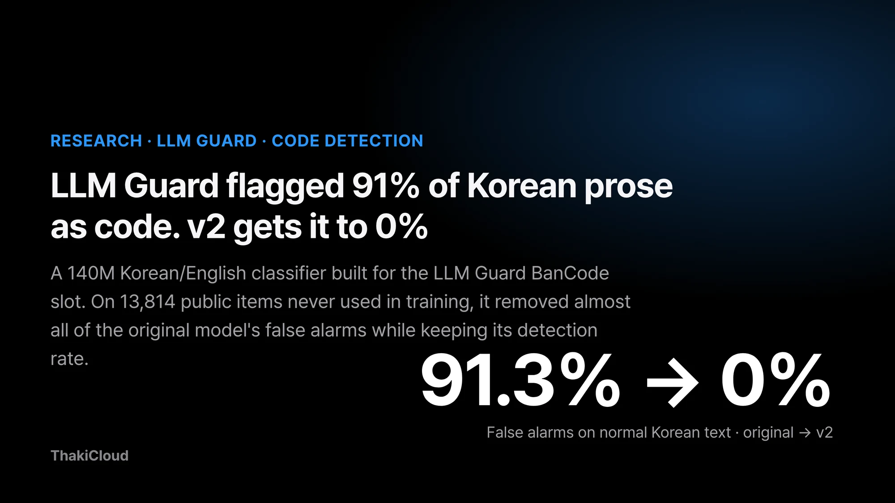
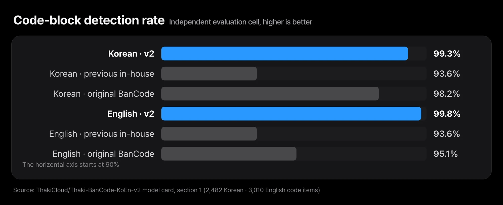
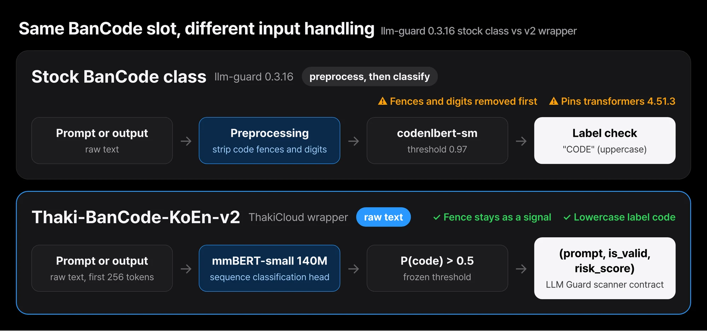
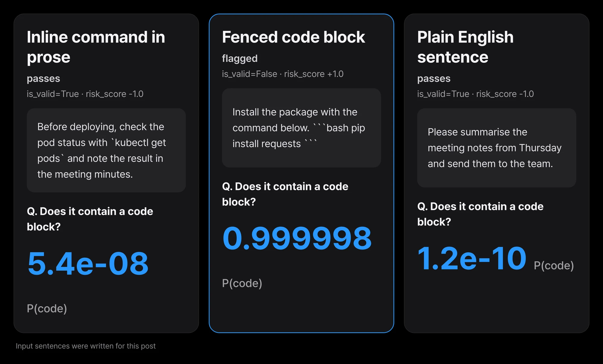

Some teams put a "no pasting code in this channel" policy on their internal chatbot. A policy like that is usually enforced by a single code-block detector. LLM Guard, an open-source guardrail toolkit, ships a BanCode scanner for this job.

Feed the scanner's default model a few Korean work sentences, though, and the problem shows up quickly. Meeting requests and report sentences without a single line of code get flagged as code. A user sends an ordinary question and gets a block message back. A request can be blocked just because one command name appears in the sentence.

ThakiCloud has released [Thaki-BanCode-KoEn-v2](https://huggingface.co/ThakiCloud/Thaki-BanCode-KoEn-v2), a Korean/English code-block detector built for that slot. It is a 140M-parameter classifier on the [mmBERT-small](https://huggingface.co/jhu-clsp/mmBERT-small) backbone.

We evaluated it on 13,814 public items that were never used in training. The original BanCode model flagged 91.3% of normal Korean text and 60.7% of normal English text as code. v2 flagged 0 of 4,200 Korean items and 26 of 3,600 English items (0.7%). Its code detection rate was 99.3% in Korean and 99.8% in English.

Below we look at where the false alarms came from, what data v2 was trained on, the independent results and the weak slices. We close with why this model must not be dropped into the stock llm-guard BanCode class, and how to use the bundled wrapper instead.


*Thaki-BanCode-KoEn-v2 at a glance. Measured on an independent cell of 13,814 items built from sources never used in training (0 false alarms on 4,200 normal Korean items).*

## In plain terms

Picture a smoke alarm on a kitchen ceiling. It should go off only when there is smoke. An oversensitive alarm goes off when a pot merely steams. After a few of those, people take the alarm down.

On Korean text, the original BanCode model was the oversensitive alarm. It went off on 9 of every 10 normal Korean sentences. It went off on nearly every sentence that briefly mentioned a command name such as `kubectl`.

That is like treating air with a little steam in it as smoke. In the same kitchen, v2 stayed quiet for steam and went off for more than 99% of real smoke. The rest of this post restates why we replaced the alarm, and how to mount the new one, in more precise terms.

## The original BanCode model read 9 of 10 normal Korean sentences as code

The evaluation used a frozen set built from sources that were never used in training. The model card calls it the independent evaluation cell. It contains the official documentation of Kubernetes, React, FastAPI, es-toolkit and Docker, a Korean chatbot corpus, and sentences from UD Korean-Kaist and UD English-EWT.

It is separated at the source level from everything used for training, model selection and testing. One exact duplicate and 46 near-duplicates were removed as well.

Labels come from a single markup rule. A fenced block with a language tag is code. A fenced block is a code region wrapped above and below by three backticks. Paragraphs outside blocks are not code, even when they contain inline `code`. No person judged items one by one, so the labeling rule does not drift.

The original model `vishnun/codenlbert-sm` was scored at LLM Guard's default threshold of 0.97, and v2 and the previous in-house model at 0.5. ThakiCloud scored all three models itself, on the same raw text of the same set, with the same code. The original model flagged 91.3% of 4,200 normal Korean items and 60.7% of 3,600 normal English items as code.


*Share of normal text flagged as code on public documentation never used in training. The original BanCode model flagged 91.3% (Korean) and 60.7% (English); v2 flagged 0.00% (0/4,200) and 0.72% (26/3,600). All three models were scored on the same raw text with the same code.*

The worst case was prose with inline code, the kind of sentence common in technical docs, such as "apply it with `kubectl apply`." The original model read 99.9% of 1,200 such Korean sentences and 86.3% of 1,200 English ones as code. Work questions often mention command names, so false alarms in this slice turn directly into friction for users.

## We retrained on raw text from Wikipedia and Stack Exchange

v2 was trained on raw text from real documents: Korean and English Wikipedia and Wikibooks, plus Stack Exchange posts from askubuntu, devops, dba and codereview. Together these gave 47,448 rows.

On top of that we added 1,802 rows of synthetic Korean/English code and prose, generated with a self-hosted quantized copy of Qwen3.8-27B. The generation prompts held only topic and format instructions, with no seed data and no external API.

Training text went in raw, with no preprocessing. Fences and digits were not stripped. Because the label rule is "a fenced block means code," the fence is also the first signal the model needs to learn. Inline code and command names inside sentences, on the other hand, appeared in plenty of not-code examples.

The previous in-house model was trained on synthetic data only. Its false-alarm rate was much lower than the original's, at 3.5% in Korean and 4.9% in English, but its detection rate stayed at 93.6% in both languages. It also flagged about 11% of prose with inline code. With real documents in the training data, v2 reduced both weaknesses together.

Fine-tuning ran for 3 epochs with batch size 32, max length 256, learning rate 5e-5, fp32 and seed 42. Class imbalance was corrected with square-root class weights, and the epoch was chosen by development macro-F1. The development split holds 237 public items from KLUE-MRC, SQuAD and HumanEval and was not used for weight updates. No AI-Hub data was used.

## On documents never used in training, false alarms vanished and detection held

Scoring was done once, as preregistered. That means the evaluation set, checkpoint and threshold were recorded and frozen before scoring. The table below is that single run. The bound in parentheses next to each false-alarm rate is the Clopper-Pearson 95% upper bound. Given the observed count, there is at most a 5% chance that the true false-alarm rate exceeds it.

| Language (code / normal) | Model | False alarms on normal text (95% CP upper) | Code detection rate | AUROC |
|---|---|---:|---:|---:|
| Korean (2,482 / 4,200) | **v2** (threshold 0.5) | **0.00%** (0 / 4,200; ≤ 0.07%) | **99.3%** | 0.9999 |
| | previous in-house model, synthetic data only (0.5) | 3.45% | 93.6% | 0.9867 |
| | original BanCode `vishnun/codenlbert-sm` (0.97) | 91.3% | 98.2% | 0.9025 |
| English (3,010 / 3,600) | **v2** (threshold 0.5) | **0.72%** (26 / 3,600; ≤ 1.00%) | **99.8%** | 0.9999 |
| | previous in-house model, synthetic data only (0.5) | 4.94% | 93.6% | 0.9825 |
| | original BanCode `vishnun/codenlbert-sm` (0.97) | 60.7% | 95.1% | 0.8445 |

Cutting false alarms did not cost detection. Korean detection went from 98.2% for the original to 99.3% for v2, and English from 95.1% to 99.8%. AUROC is worth reading too. It measures how well the scores rank code above normal text regardless of where the threshold sits.

The original model's AUROC was 0.90 in Korean and 0.84 in English, below v2, which was close to 1 in both. Retuning its threshold alone would make it hard to reach v2's level of separation.


*Code-block detection rate on the same cell. v2 reached 99.3% (Korean) and 99.8% (English), no lower than the original BanCode model (98.2%, 95.1%). The previous in-house model was 93.6% in both languages.*

The largest gap was in prose with inline code. False alarms in that slice fell from 99.9% to 0% in Korean and from 86.3% to 0.1% in English. The previous in-house model sat at 11.1% and 11.6% on the same slices.

## The weak spots are markup blocks and general English sentences

Averages hide weak spots. Below are the slices of the evaluation set, split by input type, where v2 was weakest among those with at least 50 items.

| Slice | n | v2 | Previous in-house | Original |
|---|---:|---:|---:|---:|
| Korean markup blocks (HTML/XML etc.), detection | 66 | 93.9% | 93.9% | 98.5% |
| Korean code-only snippets without surrounding prose, detection | 340 | 95.9% | 98.2% | 87.9% |
| English general sentences (UD English-EWT), false alarms | 1,200 | 1.83% | 1.42% | 16.6% |
| Korean prose with inline code, false alarms | 1,200 | 0.00% | 11.1% | 99.9% |
| English prose with inline code, false alarms | 1,200 | 0.08% | 11.6% | 86.3% |

v2 caught only 93.9% of 66 Korean markup blocks such as HTML and XML. The original model did better here, at 98.5%. Korean code-only snippets with no surrounding explanation were also lower, at 95.9% against the previous in-house model's 98.2%.

On general English sentences, v2 flagged 1.8% of 1,200 UD English-EWT items as code. Most of the 26 English false alarms came from this slice, and the rate is slightly higher than the previous in-house model's 1.4%.

One more item for the record. Of 91 normal Korean public-prose sentences (KLUE-MRC) checked at adoption, v2 flagged 1 and the previous model flagged none.

The model card also keeps development-stage numbers. On a split taken from the training sources and sealed before training, v2's false-alarm rate was 0.2% in Korean and 0.4% in English, with detection at 99.9% and 99.0%.

That split comes from the same sources as the training data, so it is not independent evidence. Read it only as the record of the adoption decision that cleared the model for release; the evidence that it works on unseen documents is the independent evaluation above.

## Do not drop it into the stock llm-guard BanCode class

v2 targets the LLM Guard scanner slot, but swapping its name into the stock `BanCode` class of llm-guard 0.3.16 is not supported. There are three reasons.

First, the stock class strips markdown code fences and digits before classifying. v2 was trained on raw text that keeps the fence, and the fence is its most important signal.

Second, the stock class compares the predicted label with the uppercase string `"CODE"`. v2's label is lowercase `code`. Third, the stock class pins transformers 4.51.3, which cannot load v2's ModernBERT config and tokenizer combination.


*The stock BanCode class in llm-guard 0.3.16 strips code fences and digits before classifying and compares the label with "CODE". v2 was trained on raw text that keeps the fence, so feed it raw text through the bundled wrapper.*

So use the wrapper `bancode.py` that ships in the repository. It returns `(sanitized_prompt, is_valid, risk_score)`, the same contract as an LLM Guard scanner. The risk_score follows LLM Guard's `calculate_risk_score(score, 0.5)` rule.

```python
from huggingface_hub import snapshot_download
import sys
d = snapshot_download("ThakiCloud/Thaki-BanCode-KoEn-v2")
sys.path.insert(0, d)
from bancode import BanCodeV2
scanner = BanCodeV2(d)
print(scanner.scan("Run this:\n```bash\npip install requests\n```"))   # (prompt, is_valid=False, risk_score)
```

The repository does not contain the tokenizer. The wrapper loads it from `jhu-clsp/mmBERT-small` at revision `abc32620dd4f6ab06f5fbe905dc25f310618e09f`, as written in the profile file `bancode_v2_profile.json`.

For the same reason, the Hugging Face inference widget does not work. The environment verified in the model card is Python 3.11, torch 2.9.0 (CPU), transformers 5.14.1 and tokenizers 0.22.2.

The operating profile was frozen at adoption. The score is P(`code`), and anything above 0.5 is judged code. Only the first 256 tokens are read, and the raw text goes in with no preprocessing. The model card says not to retune this threshold on deployment data.

We downloaded the public weights and ran them on CPU ourselves. The sha256 of the downloaded `model.safetensors` matched the value in the card. Three hand-written examples say nothing about accuracy, but they show how the scanner behaves.


*Real outputs from the public weights on CPU (transformers 5.12.0, pinned tokenizer revision, threshold 0.5). The work sentence with an inline command passes and only the fenced block is flagged. These are three hand-written examples, not accuracy evidence.*

A work request that mentions `kubectl get pods` inside the sentence got a P(code) close to 0 and passed. An install note containing a `pip install requests` fenced block got a P(code) close to 1 and was flagged. A plain English request about meeting notes also passed. This run used transformers 5.12.0, not the 5.14.1 verified in the card.

## In Paxis, it is a candidate for a code-block policy scanner

Paxis is a platform where agents take user requests and carry out the work. In that setting, policy scanners look at both the prompt and the agent's output. A "no code exchanged in this channel" policy can be one of them.

Korean work sentences, however, often contain command names and file paths. If a scanner flags those as code, users get ordinary requests rejected. When that keeps happening, teams end up switching the policy off.

v2 is a candidate for reducing that cost. It had zero false alarms on 1,200 Korean prose items with inline code and kept fenced-block detection above 99%. The direction for applying it follows the model card's advice.

Start in log or warn mode rather than block mode, look at the decision distribution on your own traffic, and only then decide whether to block. It has not been evaluated on real user inputs yet, so the numbers in this post cannot stand in for its accuracy on Paxis traffic.

## Limits to know before using it

- **Real user inputs were not evaluated.** The independent set was built from public technical documentation and general sentence corpora. Because Stack Exchange is a training source, Q&A-style sources are absent from the independent evaluation.
- **Log blocks could not be evaluated.** There were only 3 Korean and 4 English items, so they were report only. Blocks without a language tag (251 Korean, 264 English) and Korean config blocks with Hangul inside the code (39) were also report only.
- **Code written without a fence is, by definition, not code.** This follows from labeling by markup. If you need to catch long code pasted into a sentence without a fence, that does not match this model's definition.
- **Only the first 256 tokens are read.** Code blocks near the end of a long document are not seen.
- **The pretraining data may overlap.** The mmBERT backbone's web pretraining data may have included the same public documentation, and that cannot be measured.
- **Latency and CPU cost were not measured.** This release makes no speed claim.
- **Some uses are out of scope.** It does not judge whether code is malicious or whether it contains secrets. Languages other than Korean and English are out of scope too.
- **No ONNX export is included.**

## Closing

Thaki-BanCode-KoEn-v2 cut the original BanCode model's false alarms on normal text from 91.3% to 0% in Korean and from 60.7% to 0.7% in English. Its code detection rate, 99.3% in Korean and 99.8% in English, was no lower than the original's.

These numbers come from a single preregistered run on 13,814 public items never used in training. It is weaker on Korean markup blocks and general English sentences, and it has not yet been evaluated on real user inputs.

If you run a no-code policy with LLM Guard, the first check you can do today is simple. Feed your current scanner a few Korean work sentences that mention commands inline and count how many get blocked.

If that count is not small, it is worth running v2 alongside in log mode and comparing the decisions. When you wire it in, use the bundled wrapper rather than the stock BanCode class. The model and wrapper are on [Hugging Face](https://huggingface.co/ThakiCloud/Thaki-BanCode-KoEn-v2).

## Sources and data

- Model: [ThakiCloud/Thaki-BanCode-KoEn-v2](https://huggingface.co/ThakiCloud/Thaki-BanCode-KoEn-v2). Every number in this post is taken from the model card and was cross-checked against our internal evaluation ledger. Only the three CPU examples were run separately for this post.
- Licenses differ by part. The fine-tuned weights and config (`model.safetensors`, `config.json`) are CC BY-SA 4.0; the wrapper code and profile (`bancode.py`, `bancode_v2_profile.json`) are MIT. The tokenizer is not included in the repository; it is loaded from `jhu-clsp/mmBERT-small` at revision `abc32620dd4f6ab06f5fbe905dc25f310618e09f` under that repository's own terms. The CC BY-SA 4.0 label of the weights does not cover the tokenizer.
- Backbone: [jhu-clsp/mmBERT-small](https://huggingface.co/jhu-clsp/mmBERT-small) (MIT, Marone et al., 2025, arXiv:2509.06888). Original scanner: [LLM Guard](https://github.com/protectai/llm-guard) by Protect AI; original model [vishnun/codenlbert-sm](https://huggingface.co/vishnun/codenlbert-sm).
- Training data: Korean and English Wikipedia and Wikibooks, and Stack Exchange askubuntu, devops, dba and codereview (via `HuggingFaceH4/stack-exchange-preferences`), all CC BY-SA, plus 1,802 rows of in-house synthetic data. The data is not redistributed; attribution is in the repository's `NOTICE.md`.
- Independent evaluation sources: Kubernetes, React, FastAPI, es-toolkit and Docker documentation, a Korean chatbot corpus, and UD Korean-Kaist and English-EWT sentences.
- This model is one component of an internal LLM-guard research program and is released on its own. The program's URL phishing classifier did not pass independent evaluation and was not released, and the previous in-house BanCode model trained only on synthetic data stays unreleased too.
