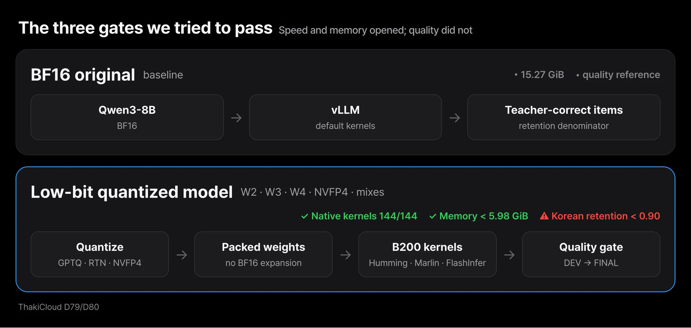
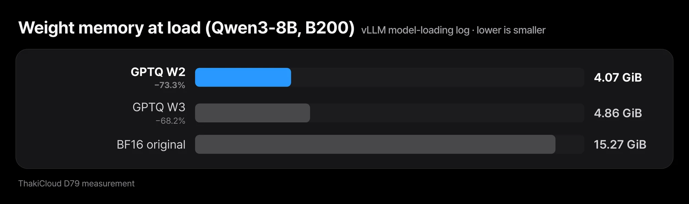
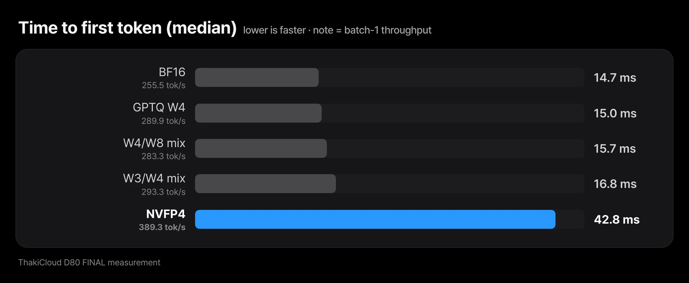
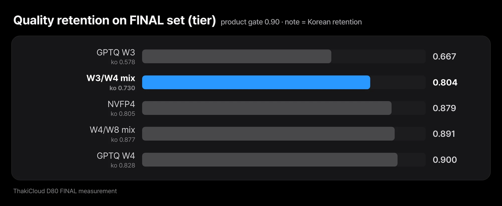
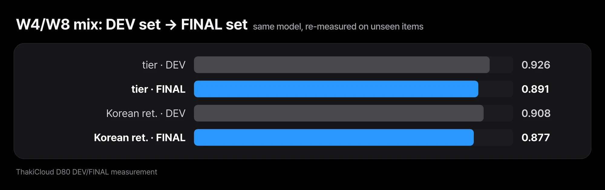

This is a measurement report for engineers weighing low-bit quantization to cut the GPU cost of self-hosted LLMs. ThakiCloud quantized Qwen3-8B from 2 bits to 4 bits on NVIDIA B200 and ran it through a real serving path. The memory and kernel problems were solved, but no model has yet passed our Korean quality bar.

So this is not a success story. It is a technical report that records, in numbers, which doors opened and which stayed shut. When a model passes the quality bar, we will publish it separately.

## In plain terms

Picture packing clothes into a suitcase with a vacuum compression bag. The more air you pull out, the smaller the bag gets. Model quantization works the same way: it reduces the number of bits used to store each weight so the model takes less GPU memory.

The catch is that squeezing too hard wrinkles the clothes. Two bits is close to pulling out nearly all the air. The bag became as small as it gets, but the clothes came out too wrinkled to wear. The rest of this post records how hard you can squeeze before the clothes give, and which clothes wrinkle first.

## The three gates we tried to pass

Every experiment asked the same three questions. First, do the low-bit weights run directly on B200 kernels without expanding back to BF16? Second, does weight memory at load fall below 5.98 GiB? Third, does the quantized model still answer the items the original model got right?

We measure the third with retention: among items the original answered correctly, the share the quantized model also answers correctly. The product bar is an overall retention score (tier) of at least 0.90 and Korean retention of at least 0.90. Accuracy drops on number and reasoning items must also stay within 3 percentage points.

*The execution path stayed low-bit end to end, but every arm stopped at the final quality gate.*

Below, an "arm" means one configuration under comparison. The model and the items are the same; only the quantization method changes.

## Two bits cut memory by 73% and produced no answers at all

The BF16 original uses 15.27 GiB to load its weights. GPTQ 3-bit used 4.86 GiB and 2-bit used 4.07 GiB, savings of 68.2% and 73.3%.

*2-bit cut memory by 73% but produced no answers.*

Bit counts need a stated basis. Counting only linear layers, 3-bit is 3.125 bits per weight and 2-bit is 2.125. Counting the whole model including embeddings and the output layer, they are 5.08 and 4.23 bits. The label "2-bit model" alone does not tell you the actual memory.

The execution path behaved as intended. All 144 linear layers, 72 in attention and 72 in the MLP, ran on low-bit kernels. We never caught packed weights expanding into BF16. Batch-1 throughput was also higher: GPTQ 2-bit reached 304.9 tokens per second against 253.8 for BF16.

But no answers came out. The 2-bit arm scored a tier of only 0.115. RTN 2-bit hit the maximum length on 76% of generation items. GPTQ 2-bit was truncated on 99.9%, and its distinct-2 score, the variety of consecutive word pairs, fell to 0.008. In other words, it repeated the same phrase without end. Neither method produced a single response from which a final answer could be extracted.

In suitcase terms, the bag got as small as possible, and not one piece of clothing was wearable.

## At 3 bits, GPTQ clearly beats RTN but falls short of the product bar

At 3 bits the choice of method mattered a great deal. In paired comparison on the same items, GPTQ 3-bit answered 29.9 points more accurately than RTN 3-bit, with a 95% confidence interval of 27.9 to 32.0 points. On number items the gap widened to 64.6 points.

Even so, GPTQ 3-bit reached a tier of 0.748, well short of the 0.90 bar. On the same set, 4-bit GPTQ came in at 0.898, right at the edge. One extra bit clearly leaves the clothes less wrinkled.

## A memory verdict can flip on a single rounding step

The NVFP4 arm showed up as 5.98 GiB in the vLLM load log. With the cap set below 5.98 GiB, that value alone means failure. But the log rounds to two decimal places. The true value lay somewhere between 5.975 and 5.985 GiB, so the log could not decide pass or fail.

From the next experiment on, we changed the definition. We count the weight bytes actually loaded and check whether that number divided by 2³⁰, with no rounding, is below 5.98. By that rule NVFP4 passed at 5.977 GiB. Near a threshold, the measurement definition decides the conclusion.

## NVFP4 has the highest throughput and the slowest first token

NVFP4, the FP4 path on B200, had the highest batch-1 throughput at 389.3 tokens per second, against 255.5 for BF16. Its median time to first token (TTFT), however, was 42.84 ms, about 2.9 times BF16's 14.68 ms.

*NVFP4 has the highest throughput but its first token is ~2.9x slower than BF16.*

This was not a one-off. In an earlier experiment with 4B and 8B models in NVFP4, TTFT was also 2.6 to 2.9 times BF16. GPTQ 4-bit had a TTFT of 15.04 ms, close to BF16, with throughput of 289.9 tokens per second. NVFP4 favors batch jobs that generate long outputs; GPTQ favors interactive responses where a person is waiting.

## GPTQ 4-bit barely cleared the overall score and stopped at Korean

On the final evaluation set, GPTQ 4-bit scored a tier of 0.9002, just over the line. Its Korean retention, however, was 0.828. In the preregistered paired comparison, GPTQ 4-bit was 2.0 points more accurate than NVFP4, with an interval of 0.7 to 3.4 points.

At roughly the same 4-bit budget, NVFP4's Korean retention was 0.805. Across experiments, Korean was the axis that broke most consistently. Some clothes in the bag simply wrinkle more easily than others.

## Mixing W4 into W3 raises quality, and the gain reproduces

Next, we returned some layers of the 3-bit model to 4 bits. Of 144 layers, the 41 that a diagnostic set flagged as sensitive went to 4 bits; the other 103 stayed at 3 bits. Load memory was 5.19 GiB.

*The W3/W4 mix improved a lot over W3, yet no arm cleared 0.90 Korean retention.*

This mix was 7.5 points more accurate than GPTQ 3-bit on the development set. On the unseen final set it was 10.3 points better, with an interval of 8.6 to 12.0 points. By axis, numbers rose 19.4 points, reasoning 12.4 and Korean 5.8. The 2.2-point English gain has an interval that includes zero, so we do not count it as an improvement.

Absolute quality was still low, though. With a tier of 0.804 and Korean retention of 0.730, it failed every quality gate. The gain over 3-bit reproduced on both sets, but it did not reach a level usable in a product.

## A gate passed on the development set closed again on the final set

We applied the same approach to the 4-bit model. 120 layers stayed at 4 bits, while the 24 most sensitive layers and the output layer moved up to 8 bits. Load memory was 5.980 GiB, just under the cap.

The development set looked promising. A tier of 0.926 and Korean retention of 0.908 cleared both bars. A 5.1-point drop on reasoning items remained, but this was the first arm to get past the Korean bar.

*Values that cleared the gate on DEV fell back below it on FINAL.*

On the unseen final set the result did not reproduce. Tier fell to 0.891 and Korean retention to 0.877. The reasoning drop widened to 9.0 points. Both values that had been above the line went back below it. The layer selection chosen on the development set was likely fitted to that set.

We add one comparison that was not in the preregistered plan. On the same final set, this mix was 2.4 points less accurate than plain GPTQ 4-bit, with an interval of −3.6 to −1.2 points. Because it is a post-hoc exploratory result, we did not use it for any verdict. Read it only as a hint that the layers promoted to 8 bits may have hurt reasoning.

## Which layers are sensitive depended on how we measured

Mixed precision lives or dies by which layers you protect. So we measured separately the loss from quantizing a single layer and the recovery from restoring a single layer after quantizing everything. We scored each with four metrics: output distribution divergence (KL), answer log-likelihood, answer margin and retention.

The rankings the four metrics produced barely agreed. At 4 bits, the median Kendall τ between metric pairs was 0.12 and 0.15. The correlation between the quantize-side ranking and the restore-side ranking was only 0.29. In suitcase terms, every way of measuring which clothes wrinkle easily gave a different answer. That is why we decided not to keep repeating the approach of protecting a few layers by this ranking.

## Two bits did not recover under any quantization grid

We also had to check whether 2 bits failed because of the symmetric grid. We ran seven grids on the same diagnostic set, including symmetric, asymmetric, ternary and a balanced four-level grid. All seven ended the same way: 100% repetition, 100% truncation and zero retention on generation items.

Asymmetric GPTQ 2-bit had 4.7 points higher retention than symmetric. That gap came only from multiple-choice items; it still did not rescue a single generation item. We concluded a grid change would not fix this and did not start research on a 2-bit kernel patch.

## Recovery through training was also blocked under this recipe

We also tried quantization-aware distillation (QAD), which retrains to recover quality after quantization. On a Qwen3-4B NVFP4 model, adding answer cross-entropy to the distillation loss lowered overall accuracy by 1.35 points. The interval was −2.63 to −0.10 points, with reasoning and numbers hit hardest. This comes from one fixed recipe, so it does not rule out training-based recovery as a whole.

## The results in one table

These are the main arms on the final evaluation set (4,061 items). Memory is unrounded loaded bytes; latency and throughput are at batch size 1.

| Arm | Load memory | Median TTFT | Throughput | Tier | Korean retention |
|---|---|---|---|---|---|
| BF16 original | 15.27 GiB | 14.68 ms | 255.5 tok/s | reference | reference |
| NVFP4 | 5.977 GiB | 42.84 ms | 389.3 tok/s | 0.879 | 0.805 |
| GPTQ W4 | 5.684 GiB | 15.04 ms | 289.9 tok/s | 0.900 | 0.828 |
| W4/W8 mix | 5.980 GiB | 15.67 ms | 283.3 tok/s | 0.891 | 0.877 |
| W3/W4 mix | 5.191 GiB | 16.77 ms | 293.3 tok/s | 0.804 | 0.730 |
| GPTQ W3 | 4.864 GiB | 16.04 ms | 296.8 tok/s | 0.667 | 0.578 |

Every quantized arm passed the memory and kernel checks. None cleared 0.90 Korean retention.

## Back to the execution economics of Paxis work automation

Paxis, ThakiCloud's work automation platform, often runs models directly inside the customer's environment. A smaller model lets the same GPU carry more work and lowers the unit cost of self-hosting. That keeps low-bit quantization an important lever.

In work automation, though, a wrong answer does not end in one step. A wrong tool call or a wrong number forces the steps after it to run again. These results show that cost cannot be computed from memory savings alone. The usable compression ratio stops where Korean quality still holds.

## What we can conclude, and what comes next

Three things are now established. On B200, 2-, 3- and 4-bit and NVFP4 weights can be served on native kernels without BF16 expansion. NVFP4 wins on throughput and GPTQ 4-bit wins on first-token latency. And no arm so far has passed the Korean quality bar.

Follow-up experiments are in progress. The pass conditions are the same as here: Korean retention and tier at or above 0.90, load memory under 5.98 GiB, and per-token latency within 1.10 times BF16. The result must also reproduce on an unseen final set and run on native packed kernels. Until all of these pass, we will not publish it as a success.

## Frequently asked questions

### Why not release the 2-bit model?

Memory and speed are good, but it cannot answer. Most generation items were truncated by endless repetition, and not one final answer could be extracted.

### Isn't 4-bit GPTQ good enough?

It barely cleared the overall bar at a tier of 0.9002, but Korean retention was 0.828. The loss is still too large for Korean work.

### Why reject a model that passed on the development set?

Looking good on the set used for selection may only mean the selection fit that set. We count a pass only when the result reproduces on an unseen final set. The W4/W8 mix fell below the bar in that step.

### Should I pick NVFP4 or GPTQ?

For batch jobs that generate long outputs, NVFP4 is better thanks to its throughput. For interactive services where a person waits for the first response, GPTQ, with BF16-level TTFT, is better. In both cases, check Korean quality separately.

## Limits of these measurements

All results come from one model (Qwen3-8B), one GPU type (B200) and one vLLM version (0.29.0). Numbers may differ on other models or serving engines. Latency and throughput are at batch size 1; we did not measure throughput under heavy concurrency.

Quality is measured as retention over items the original answered correctly. That does not mean the original model is strong in Korean. Post-hoc comparisons were not used for any verdict and are marked as exploratory. The evaluation items include external datasets, so we do not publish item text or samples.

## References

- [GPTQ: Accurate Post-Training Quantization for Generative Pre-trained Transformers](https://arxiv.org/abs/2210.17323)
- [vLLM documentation: Quantization](https://docs.vllm.ai/en/latest/features/quantization/)
- [NVIDIA: Introducing NVFP4 for Efficient and Accurate Low-Precision Inference](https://developer.nvidia.com/blog/introducing-nvfp4-for-efficient-and-accurate-low-precision-inference/)
- [Qwen3 Technical Report](https://arxiv.org/abs/2505.09388)
