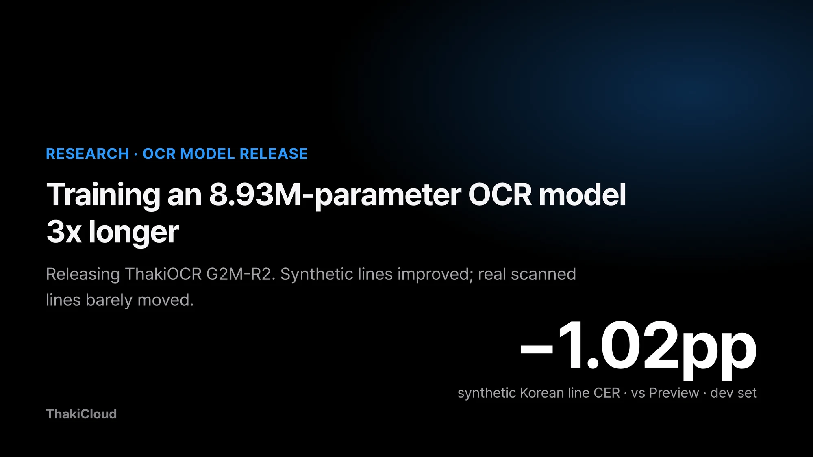
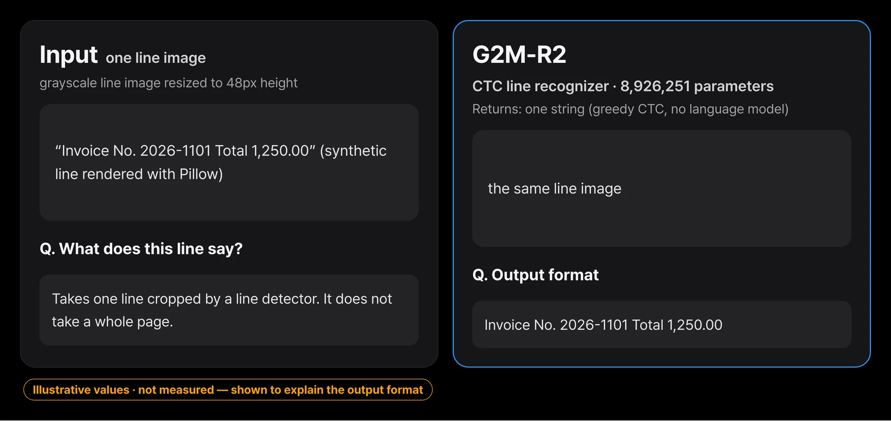
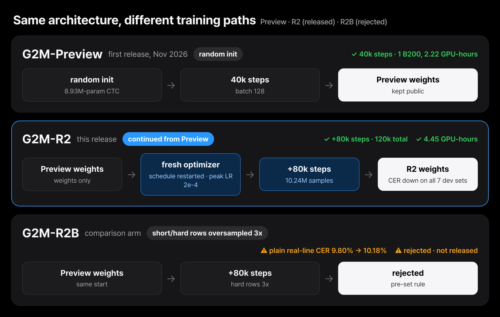
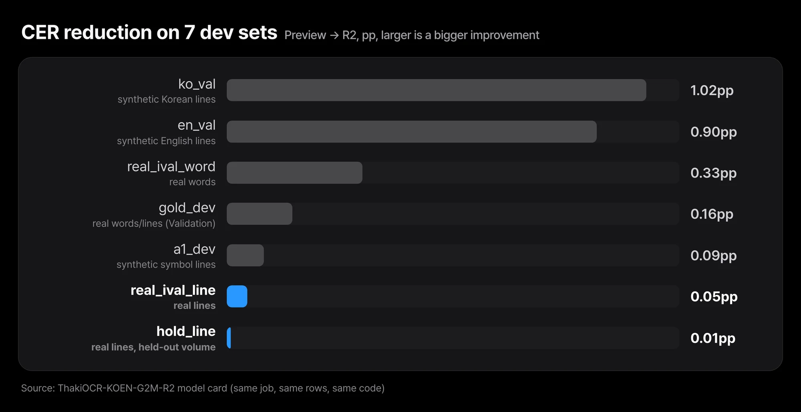

Developers who run small text recognition models face a familiar question. Before making the model bigger, is it enough to train the same model longer? A few more hours on one graphics card looks like the cheapest option. We tested that question directly on a Korean-English line recognizer with 8.93 million weights.

The answer is mixed. Character error rate on synthetic Korean lines fell from 6.38% to 5.36%. On real scanned document lines it went from 8.43% to 8.37%, which is almost no change. More training alone helped in a narrower place than we hoped.

Our earlier [ThakiOCR G2M-Preview](/tech-blog/en/research/thakiocr-g2m-numbers-and-symbols/) was trained for 40k steps. We continued from those weights for 80k more steps. The result, at 120k steps or 3x the training, is now public as [ThakiOCR-KOEN-G2M-R2](https://huggingface.co/ThakiCloud/ThakiOCR-KOEN-G2M-R2). This post covers how we continued training, where it helped, where it did not, and one candidate we rejected. R2 is a research preview and is NO-GO for product use. We make no state-of-the-art claim.


*ThakiOCR-KOEN-G2M-R2 at a glance. Numbers come from development sets that were also used to pick the R2 candidate.*

## Plain terms

Think of a student who works through the same workbook three times. Each pass raises the workbook score. But the score on an exam they have never seen rises much less. They only got more used to the problems in that workbook.

R2 behaved like that student. Synthetic lines can be generated almost without limit, so more training means more new problems. Real scanned lines are different. There were only 28,061 unique real line crops, so the model saw each one about 115 times on average. That is the same workbook, 115 times over.

## Same architecture, training simply continued

R2 keeps the Preview architecture and preprocessing. It is a CTC line recognizer that takes one cropped text line and returns one string. CTC is a training method that reads a whole line at once and turns it into characters without aligning each character position. The model has 8,926,251 parameters and can output 14,250 characters. The license is Apache-2.0.


*The input is one cropped text-line image and the output is one string. The sentence is the synthetic line that inference.py --demo renders; the output box shows the format only and is not a real inference result.*

Training started from the Preview weights. We took the weights only. The optimizer was created fresh and the learning-rate schedule restarted from the beginning. Batch size was 128 and peak learning rate was 2e-4. It took 4.45 GPU-hours on one B200.

We drew 10.24 million training samples. NVIDIA synthetic Korean lines made up 35% and synthetic English lines 15%. Lines from the Training split of AI-Hub dataset 71299 made up 31.5%, and words from the same data 3.5%. The last 15% were synthetic symbol lines we generated ourselves. Training and evaluation images were checked by SHA-256 hash, and none overlapped.


*R2 started from the Preview weights and trained 80k more steps. R2B, which oversampled short and hard rows 3x, made ordinary real lines worse, so the rule fixed before training ruled it out.*

## All 7 dev sets improved, but the gain sat on synthetic lines

Both models were scored in the same job, on the same rows, with the same code. Preview was scored before training began and R2 after it ended. Lower CER is better, and there was one seed.

| Eval set | Content | G2M-Preview | G2M-R2 | Change (pp) |
|---|---|---|---|---|
| ko_val | NVIDIA synthetic Korean lines | 6.38% | **5.36%** | −1.02 |
| en_val | NVIDIA synthetic English lines | 5.49% | **4.59%** | −0.90 |
| gold_dev | AI-Hub 71299 Validation words and lines | 4.34% | **4.17%** | −0.16 |
| real_ival_word | AI-Hub 71299 internal validation words | 8.87% | **8.53%** | −0.33 |
| real_ival_line | AI-Hub 71299 internal validation lines | 8.43% | **8.37%** | −0.05 |
| hold_line | real lines from a volume held out of training | 4.47% | **4.46%** | −0.01 |
| a1_dev | ThakiCloud synthetic symbol lines | 0.36% | **0.28%** | −0.09 |

All seven went down. But the two that moved a lot were the synthetic sets. The two real scanned-line sets moved 0.05pp and 0.01pp, which is hard to call an improvement. Put plainly, the workbook score went up and the unseen-exam score stayed about the same.


*Synthetic lines (ko_val, en_val) dropped by about 1pp each; real scanned lines (real_ival_line, hold_line) moved only 0.05pp and 0.01pp. All are dev sets also used to pick R2, single seed.*

All seven are development sets. We used them to choose between two R2 candidates, so they are not an independent test set. The independent evaluations on the Preview card (symbol test, real holdout) were not rerun for this release.

## Very short real text got slightly worse

The averages hide one thing. On real lines with three or fewer characters, not counting spaces, CER rose from 32.76% to 33.91%. There are only 49 such lines, so the sample is small. Short real words also rose slightly, from 8.68% to 8.72%.

Very short fields are where this model is weakest. Think of two or three characters in a single form cell. More training did not shrink that weakness.

Dates are unchanged too. On real development lines, exact match on date tokens was between 44% and 55%. The model is still weak on the `YYYY. M.DD` format with a space after the year's period, as Preview was.

We did not measure the confusion between the two won signs `₩` and `￦` again on R2. So we cannot say whether it is fixed. If you need the exact code point, do not rely on this model.

## The candidate that saw more hard rows was dropped by rule

We trained a second candidate, R2B, alongside R2. It had the same starting point and step count, but oversampled short and hard rows 3x. The idea was to practice the weak cases directly.

R2B beat R2 on synthetic data and on rows with digits and symbols. But on ordinary real lines, with no digits or symbols and not short, CER rose from 9.80% to 10.18%. Before training, we had written down a rule: do not pick a candidate that makes ordinary real text worse. So R2B was not chosen and is not released.

Put plainly, extra practice on the weak cases made ordinary sentences worse. We fixed the rule first so we could not move the bar after seeing results.

## We downloaded the public release without a token and ran it again

After making the repo public, we downloaded the public revision (01be3221) from an environment with no login. All 9 file hashes matched the originals. We then ran 512 rows each from ko_val and en_val on CPU in fp32.

Predictions matched the training-environment outputs on 511 of 512 Korean rows and 510 of 512 English rows. Three of 1,024 rows differed, which we attribute to CPU versus GPU arithmetic. CER on the same rows was 4.47% vs 4.47% for Korean and 4.93% vs 4.94% for English. So we do not claim a bit-for-bit reproduction.

## Limits to know before using it

- **Almost no gain on real images.** Real scanned-line CER moved only from 8.43% to 8.37%.
- **Very short real text got slightly worse.** Real lines of three characters or fewer went from 32.76% to 33.91% (49 lines).
- **Dates and won signs are unchanged or unmeasured.** The `YYYY. M.DD` weakness remains, and `₩`/`￦` confusion was not measured again on R2.
- **Not an independent test.** Every number comes from dev sets also used for selection, with one seed.
- **Do not use it on critical fields in financial or contract documents.** Amounts, account and ID numbers, dates, and contract terms need human review.
- **Line input only.** It cannot find text on a page, so it must be paired with a line detector.

## In Paxis document work it sits in front of verification

When Paxis automates document work, OCR is only the first step that fills in values. A small line OCR like R2 runs on CPU, so it is easy to keep inside a private network. Because short fields and dates are weak, critical-field checks and human review must follow it. That setup is covered in the [Paxis verification post](/tech-blog/en/agentops/thakiocr-paxis-verify-before-commit/).

## Closing

Training the same 8.93M model 3x longer improved all seven dev sets. But most of the gain landed on synthetic lines, which we can generate without limit. Real scanned lines barely moved, and very short real text got slightly worse. Working the same workbook more did not raise the unseen-exam score.

So the next study, R3-Real, looks at real images instead of training time. The plan is to add more variety in real images and augmentation closer to real photographs. We do not know the result yet.

To try it, download the model repo and start with `python inference.py --demo`. The [Preview repo](https://huggingface.co/ThakiCloud/ThakiOCR-KOEN-G2M-Preview) stays up so the two versions can be compared.

```bash
pip install torch numpy pillow safetensors
python inference.py line.png              # one or more line images
python inference.py --demo                # renders an English line and reads it back
```

## Sources and data

- Model: [ThakiCloud/ThakiOCR-KOEN-G2M-R2](https://huggingface.co/ThakiCloud/ThakiOCR-KOEN-G2M-R2) (Apache-2.0, research preview, revision 01be3221). All numbers in this post come from the model card and the same experiment ledger.
- Training data: NVIDIA OCR-Synthetic-Multilingual-v1 (CC BY 4.0), AI-Hub dataset 71299 (Training split), and synthetic symbol lines rendered with SIL OFL 1.1 fonts.
- AI-Hub data and anything derived from it are not redistributed. Neither the model repo nor this post contains AI-Hub images, crops, or labels.
- Earlier posts: [ThakiOCR G2M: our second public model, built to read numbers and symbols more accurately](/tech-blog/en/research/thakiocr-g2m-numbers-and-symbols/) · [Five open Korean OCR models compared](/tech-blog/en/research/korean-ocr-open-models-2m-to-27b/)
