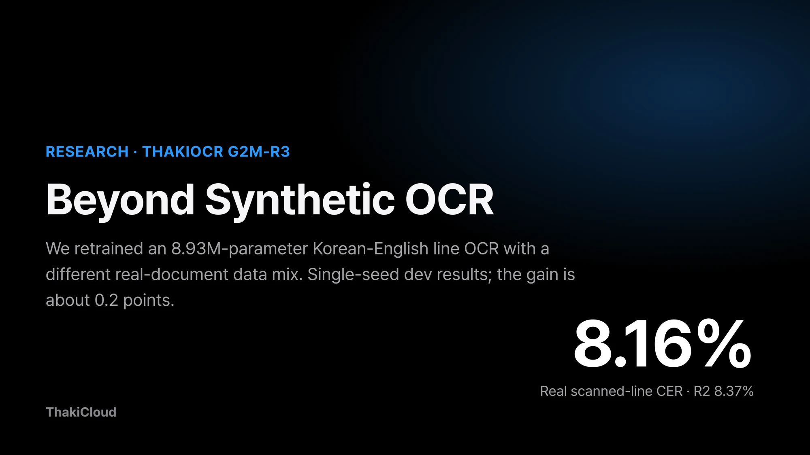
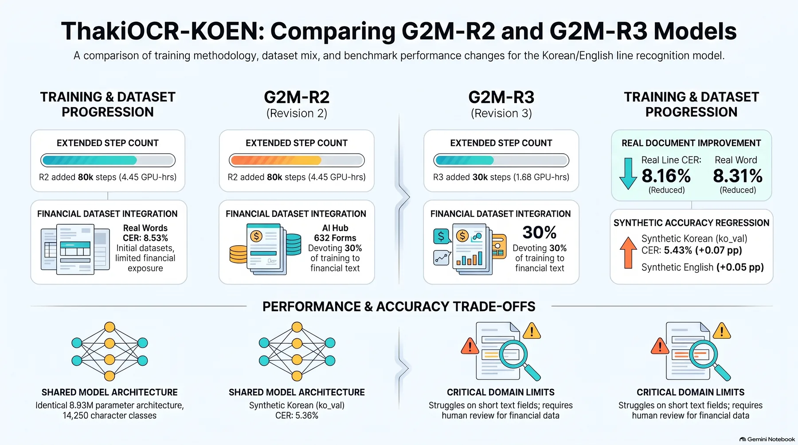
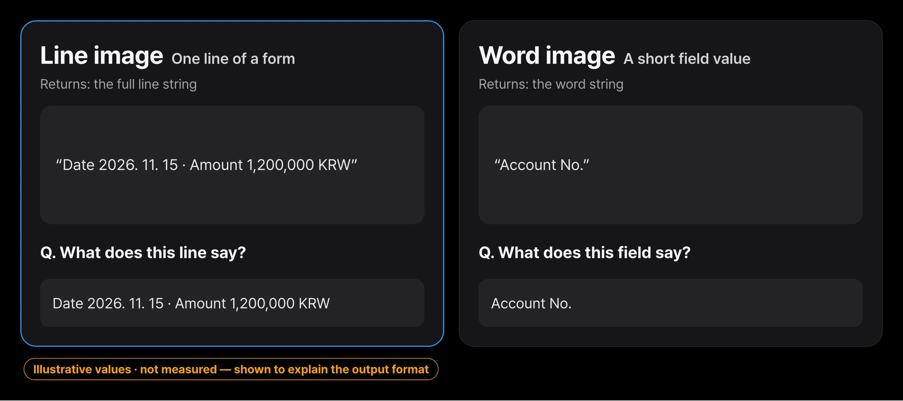
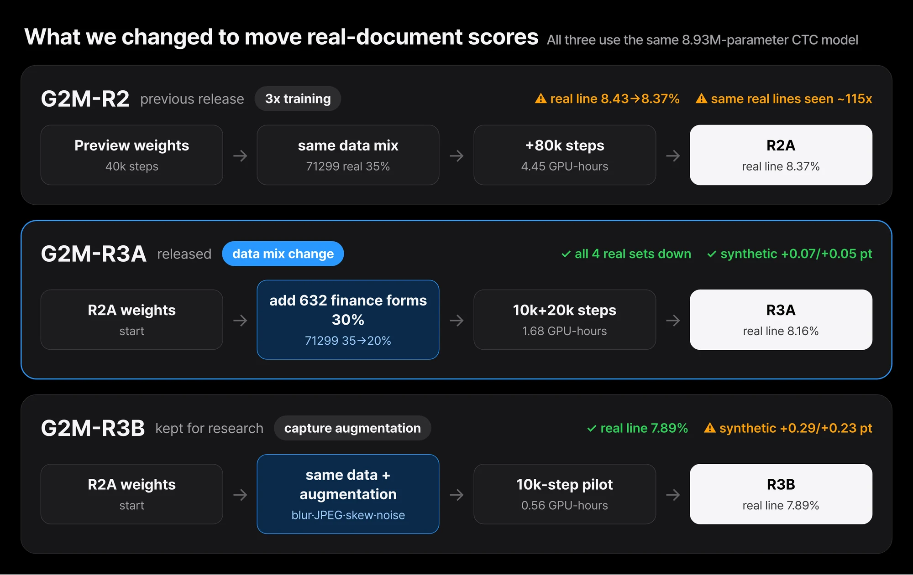
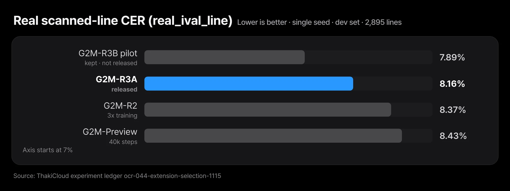
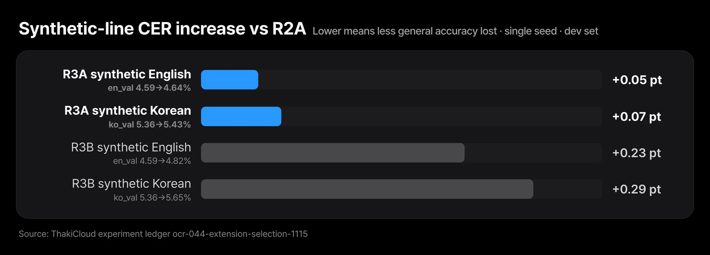
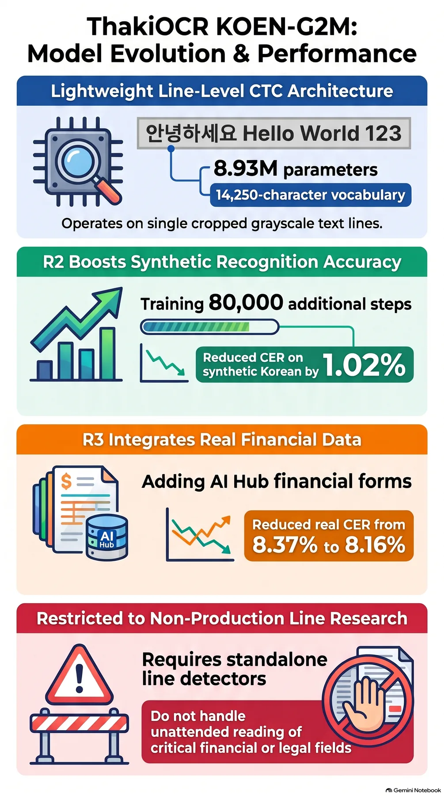

If you have ever put a small text recognizer in front of real paperwork, you know the pattern. Scores on synthetic text look fine, but a scanned application form still comes back with wrong characters. So you train longer, and the real-document score barely moves.

We hit exactly that wall last time. We trained our 8.93M-parameter Korean-English line recognizer three times longer, and character error rate on synthetic lines dropped by about 1 point. Real scanned lines went from 8.43% to 8.37%, almost unchanged.

Character error rate (CER) is the share of ground-truth characters the model gets wrong; lower is better. The previous experiment is written up in the [G2M-R2 release post](/tech-blog/en/research/thakiocr-g2m-r2-three-times-training/).

This time we changed the training data instead of the training time. We trained two candidates side by side: R3A adds a second real-document source, and R3B keeps the data but adds augmentation that imitates capture conditions.

Both lowered real-line CER, but they fixed different kinds of errors. We released R3A, which lost less synthetic accuracy, as [ThakiOCR-KOEN-G2M-R3](https://huggingface.co/ThakiCloud/ThakiOCR-KOEN-G2M-R3). Its real-line CER went from 8.37% to 8.16%.

This post covers what each method changed, the rules we wrote down before seeing results, and what those rules selected. The gain is small, about 0.2 points. Every number here comes from single-seed dev sets, not from an independent test.


*ThakiOCR-KOEN-G2M-R3 at a glance. Numbers are dev-set values that were also used for selection.*

## In plain terms

Let us continue the analogy from the last post. R2 was a student who worked through the same workbook 115 times. The workbook score went up, but the score on an unseen exam barely changed.

This time we tried two things. R3A is the student who gets a second workbook from a different publisher and spends less time on the old one. R3B keeps the old workbook but practices on copies that are blurred, faded, or photographed at an angle.

Both students scored a little higher on the exam. The student with the new workbook improved more on short word questions. The student who practiced on blurry copies improved more on long sentence questions, but lost more points on the original clean workbook.

<!-- nlm-visual -->

*Infographic generated by NotebookLM from the sources.*

## Same model, one data change per candidate

Both candidates start from the released G2M-R2 weights. Architecture and preprocessing are the same as R2: a CTC line recognizer that takes one cropped text line and returns one string, with 8,926,251 parameters. CTC is a training method that maps a whole line to a character sequence without aligning each character to a position.


*Input is one cropped text-line image; output is one string. The sentences on the cards are format examples we wrote, not real inference results.*

Both used the same training setup: a fresh optimizer, learning rate 1e-4, batch 128, seed 42. We first ran a 10k-step pilot on one B200. If the pilot passed the improvement condition we had fixed in advance, we continued for another 20k steps with the same setup.

R3A changes the real-document source. We added the Training split of AI-Hub's finance-document OCR dataset (632), a set of financial forms, as 30% of training samples.

In return, the share of AI-Hub's public-sector OCR dataset (71299), which R2 relied on, went from 35% to 20%. The ratio was designed so that each real line is seen about 25 times on average instead of about 115. The rest is 35% NVIDIA synthetic lines and 15% ThakiCloud synthetic symbol lines.

R3B keeps R2's data mix and adds transformations to training images only. This is called augmentation. It mixes lighting and contrast changes, JPEG compression, blur, low resolution, mild skew, rotation and perspective warp, and noise. It is applied with probability 60% to real images and 30% to synthetic ones. No transformation crops characters or changes the label.


*R2 only trained longer. R3A added a second real-document source; R3B added capture augmentation to the same data.*

Neither candidate trained on the evaluation sets or the holdout. The official 71299 Validation split, the sealed 632 evaluation sets, and other AI-Hub data received for evaluation only were also excluded from training.

## We wrote the selection rules before reading results

With differences this small, it is easy to pick a favorable metric after the fact. So we wrote the selection rules into the experiment ledger first, in two steps.

The first rule was set before training started. A pilot counts as "improved" only if both real-line and real-word CER are lower than the starting point, and none of the four real evaluation sets gets worse by more than 0.10 points. A synthetic set that gets worse by more than 0.5 points is flagged.

The second rule was not in the original plan. We added it after seeing the pilot results, and froze it in the ledger before reading any extension result. An extension is adopted only if it is not worse than its pilot on real lines and real words; otherwise the pilot checkpoint is kept. The final pick between R3A and R3B weighs real-image gains against synthetic losses.

In other words, we wrote "drop it if any real-document score gets worse" before opening the results.

## R3A lowered all four real sets a little

All three checkpoints were scored on the same rows with the same code. R2A is the same weights as the released G2M-R2.

| Eval set | What it is | R2A (start) | R3A pilot | R3A extended (released) | Change (pt) |
|---|---|---|---|---|---|
| real_ival_line | AI-Hub 71299 internal validation lines | 8.37% | 8.17% | **8.16%** | −0.21 |
| real_ival_word | AI-Hub 71299 internal validation words | 8.53% | 8.36% | **8.31%** | −0.22 |
| gold_dev | AI-Hub 71299 Validation words and lines | 4.17% | 4.12% | **4.09%** | −0.08 |
| hold_line | Real lines from volumes held out of training | 4.46% | 4.40% | **4.38%** | −0.08 |
| ko_val | NVIDIA synthetic Korean lines | 5.36% | 5.50% | 5.43% | +0.07 |
| en_val | NVIDIA synthetic English lines | 4.59% | 4.69% | 4.64% | +0.05 |

The extension was not worse than the pilot on real lines or words, so the rule selected the extension. All four real sets went down, and the synthetic sets went up by 0.07 and 0.05 points.


*Training 3x longer (R2) moved it 0.05 points; changing the data mix (R3A) moved it 0.21 points. On line CER alone, the R3B pilot is lower.*

In the R2 post, three times more training moved real scanned lines by 0.05 points. This time, less training moved them by 0.21 points. That is evidence that the data mix, not training time, moved this number. Still, 0.2 points is a small difference. Retraining with a different seed could shift it by that much, and we have not measured that spread yet.

The gap was large on the newly added 632 side. On 632 dev lines from form templates not used in training, the pilot went from 10.88% to 6.63%. Because that is the same source as the training data, we did not use it for selection.

## R3B did better on lines but lost more elsewhere

R3B, with augmentation, also passed the pilot condition. Its real-line CER dropped further than R3A's.

| Eval set | R2A | R3B pilot (kept) | R3B extended (rejected) | R3A extended (released) |
|---|---|---|---|---|
| real_ival_line | 8.37% | **7.89%** | 7.82% | 8.16% |
| real_ival_word | 8.53% | 8.44% | 8.53% | **8.31%** |
| gold_dev | 4.17% | 4.19% | 4.11% | **4.09%** |
| hold_line | 4.46% | **4.35%** | 4.33% | 4.38% |
| ko_val | 5.36% | 5.65% | 5.52% | **5.43%** |
| en_val | 4.59% | 4.82% | 4.72% | **4.64%** |

The R3B extension reached 7.82% on real lines, the lowest in the table. But its real-word CER rose from the pilot's 8.44% back to 8.53%, the starting value. Under the second rule we dropped the extension and kept the pilot as the R3B candidate.

Then we compared the R3A extension with the R3B pilot. They split the four real sets. R3A was ahead on words (8.31% vs 8.44%) and gold_dev (4.09% vs 4.19%). R3B was ahead on lines (7.89% vs 8.16%) and hold_line (4.35% vs 4.38%). The four-set average was 6.24% vs 6.22%, effectively a tie.

The remaining criterion was synthetic loss. Against R2A, R3A lost 0.07 points on synthetic Korean and 0.05 on English; R3B lost 0.29 and 0.23. We picked R3A because it gave up less general performance.


*The two candidates tied on the four real sets; R3A lost less on synthetic lines, so we picked R3A.*

In other words, R3A did not win on every metric. It was a tie, and we picked the side that lost less. If you only care about real-document lines, R3B may be the better choice. The R3B checkpoints are not released; we keep them for research.

## The two methods fixed different errors

Gains of about 0.2 points can come from different places. R3A, which added real-document sources, improved more on word-level evaluation. In short word crops, the shape of each character decides the result, and we suspect the new source's fonts and form layouts helped there.

R3B, with augmentation, improved more on line-level evaluation. Long lines show blur, skew and uneven lighting across the whole line, and we suspect practicing on capture distortions helped there. In exchange it lost more on clean synthetic lines.

Neither explanation comes from classifying errors one by one. Both are readings of per-set CER differences. We also have not tested whether combining the two methods keeps both gains.

## Under two GPU-hours on one card

R3A used 1.68 GPU-hours on one B200: 0.57 for the pilot and 1.11 for the extension. R3B used 1.67 GPU-hours for pilot plus extension. R2 spent 4.45 GPU-hours to move real lines by 0.05 points, so the data-mix experiment was much cheaper.

## We downloaded the public release without a token and reran it

After switching the repo to public, we downloaded the public revision (59fd1fbe) from a logged-out environment. The downloaded weight file's hash matched the original. We then reran 512 synthetic Korean lines and 512 synthetic English lines on CPU in fp32.

All 512 Korean and all 512 English predictions matched the training-environment output exactly. CER on the same rows also matched: 4.75% for Korean and 5.02% for English. For R2, 3 of 1,024 rows differed; this time none did. This check covers only 512 rows per set.

## Limits to know before you use it

- **The gain is small.** Real-set improvements are 0.08 to 0.22 points, from a single seed. We have not measured seed-to-seed variance.
- **This is not an independent test.** Every number comes from dev sets that were also used for selection.
- **It is not better than R2 on every metric.** Synthetic Korean went from 5.36% to 5.43% and synthetic English from 4.59% to 4.64%.
- **It is not better than R3B on every metric either.** On real-line CER alone, the R3B pilot is lower at 7.89%.
- **This release does not cover R2's known weakness areas.** We did not check whether short lines of three characters or fewer, the `YYYY. M.DD` date format, or `₩`/`￦` confusion improved.
- **Do not use it unchecked for key fields in financial or contract documents.** Amounts, account and ID numbers, and dates need human review.
- **It only reads lines.** It cannot find text on a page, so pair it with a line detector.

## In Paxis document work, it sits in front of verification

When Paxis automates document work, OCR is the first step that fills in values. A small line OCR like G2M-R3 runs on CPU, so it is easy to keep inside a private network.

It got slightly more accurate on real forms, but the setup of key-field verification and human review behind it stays the same. That setup is covered in the [Paxis verification post](/tech-blog/en/agentops/thakiocr-paxis-verify-before-commit/).

## Wrapping up

R2, which only trained longer, barely moved real scanned lines. This time we changed the data, and with less training all four real sets went down a little. Changing the real-document source and adding capture augmentation reduced different errors. Following rules fixed before reading results, we released R3A, which lost less synthetic accuracy, as G2M-R3.

To try it on your documents, clone the model repo and start with `python inference.py --demo`. Then read a few line images from your own paperwork with both R2 and R3 and compare. The difference is around 0.2 points, so results on your documents may differ.

```bash
pip install torch numpy pillow safetensors
python inference.py line.png              # one or more line images
python inference.py --demo                # renders an English line and reads it back
```

<!-- nlm-visual -->

*Infographic generated by NotebookLM from the sources.*

## Sources and data

- Model: [ThakiCloud/ThakiOCR-KOEN-G2M-R3](https://huggingface.co/ThakiCloud/ThakiOCR-KOEN-G2M-R3) (Apache-2.0, research preview, revision 59fd1fbe). The R2 repo [ThakiCloud/ThakiOCR-KOEN-G2M-R2](https://huggingface.co/ThakiCloud/ThakiOCR-KOEN-G2M-R2) stays as is. All numbers in this post come from the same experiment ledger.
- Training data: NVIDIA OCR-Synthetic-Multilingual-v1 (CC BY 4.0); AI-Hub OCR Data (Public Sector) (71299), Training split; AI-Hub Finance-Specialized Document OCR Data (632), Training split; synthetic symbol lines rendered with SIL OFL 1.1 fonts.
- We do not redistribute AI-Hub data or anything derived from it. The model repo and this post contain no AI-Hub images, crops or labels; every number here is an aggregate.
- Previous posts: [G2M-R2: 3x training](/tech-blog/en/research/thakiocr-g2m-r2-three-times-training/) · [G2M Preview: numbers and symbols](/tech-blog/en/research/thakiocr-g2m-numbers-and-symbols/) · [ThakiOCR A, 2.13M parameters](/tech-blog/en/research/thakiocr-a-small-korean-english-line-ocr/) · [KO-v1: OvisOCR3 Korean LoRA](/tech-blog/en/research/thakiocr-ko-v1-ovisocr3-korean-finetune/) · [KO-v2 diagnostic study](/tech-blog/en/research/thakiocr-ko-v2-vision-lora-merge-research/) · [Large-27B-R2B](/tech-blog/en/research/thakiocr-large-27b-r2b-qwen-korean-ocr/) · [Open Korean OCR models compared](/tech-blog/en/research/korean-ocr-open-models-2m-to-27b/)
