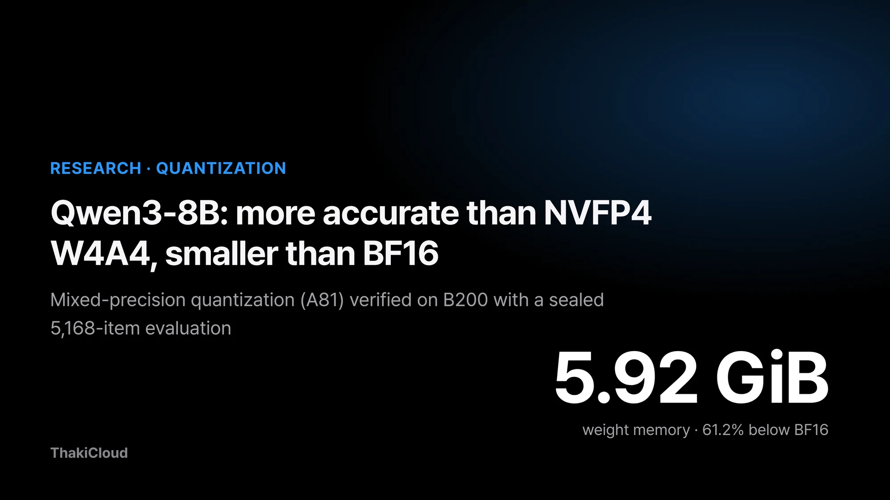
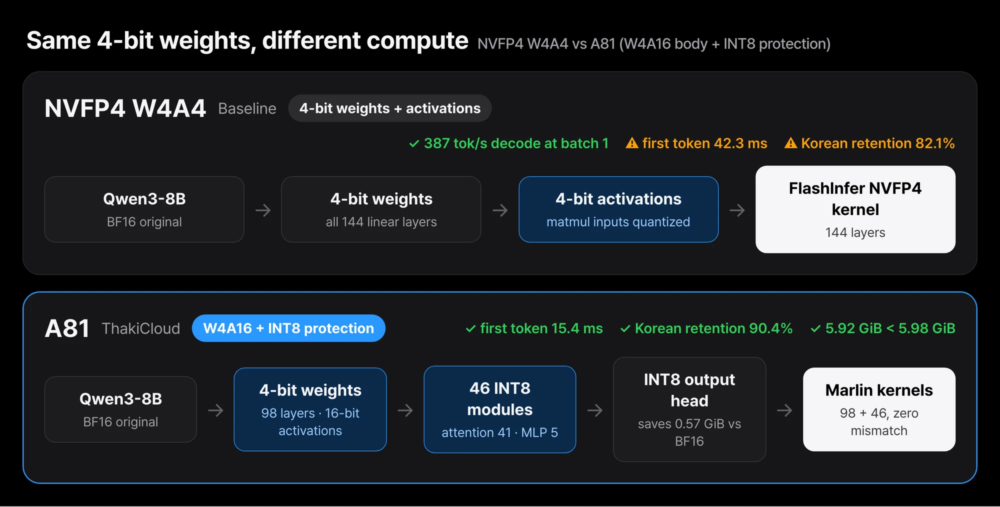
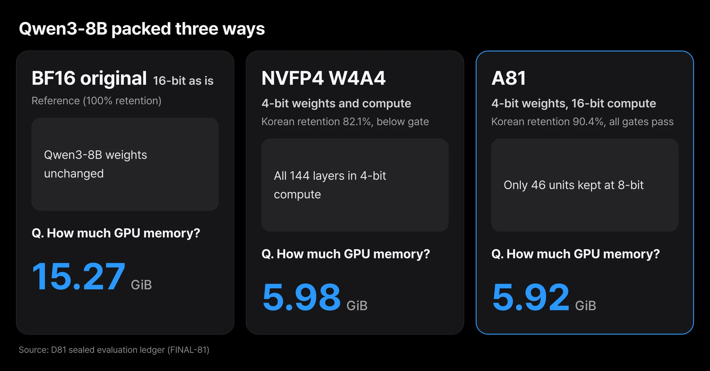
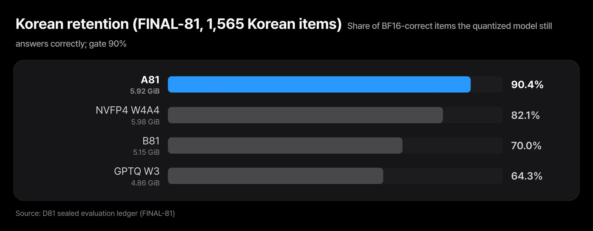
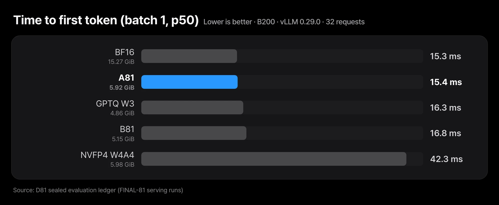

*A81 was the only configuration that passed every memory, kernel, quality and latency gate.*

This is a follow-up measurement for anyone who wants to fit an 8B model into a little over six gigabytes of GPU memory while keeping its Korean answers close to the original. In our previous post we reported that we had cut memory sharply, but no model passed the Korean quality gate.

This time one did. It keeps weights at 4 bits, runs computation in 16 bits, and leaves only 46 sensitive parts and the output layer at 8 bits. On a 5,168-item evaluation it had never seen, it used 5.92 GiB of memory, retained 90.4% of Korean answers and cleared every gate.

The Korean margin, however, is only 0.36 percentage points. This post covers what passed and how far the result can be trusted.

## In plain terms

Last time we compared quantization to squeezing a suitcase with compression bags. The method we found this time presses hard when packing but unfolds the clothes before you wear them. Things stay small only in storage and return to their normal shape when used.

On top of that, a few easily wrinkled garments went into a gentler pouch instead of the compression bag. The suitcase grew a little but still fit within the size limit, and the clothes that came out were wearable.

The alternative, wearing the clothes while still folded, used a suitcase of almost the same size but left them more wrinkled. That difference is the core of this post.

## The open problem from last time was Korean quality

The experiments in [our previous post](/tech-blog/en/research/b200-low-bit-quantization-limits/) solved memory and kernels. The 2-bit model cut memory by 73% but produced no answers, and the 3-bit, 4-bit and mixed-precision configurations stopped at the 0.90 Korean retention gate.

The gates this time are the same. Weight-load memory must stay below 5.98 GiB. Retention, the share of items the original answered correctly that the quantized model also answers correctly, must be at least 90% overall and in Korean.

The drop in numeric and reasoning accuracy must stay within 3 points, and the rise in format errors within 2 points. Time per output token may not exceed 1.1 times the original. Finally, all 144 linear layers must run on their intended low-bit kernels.

The gates were sealed before evaluation. The selection set used to choose the configuration (SEL-81) and the final confirmatory set (FINAL-81) do not overlap. The final evaluation ran exactly once.

## Weights in 4 bits, computation in 16 bits

*W4A4 cuts both weights and compute inputs to 4 bits. A81 keeps only the weights at 4 bits, leaves compute inputs at 16 bits, and keeps 46 sensitive modules and the output layer in INT8.*

The comparison point is NVFP4 W4A4. NVFP4 is the 4-bit floating-point format that B200 supports natively. W4A4 means both the weights and the activations fed into computation are cut to 4 bits.

A81 uses the same NVFP4 weights but keeps activations at 16 bits. This is called W4A16, or NVFP4A16. On top of that, 46 quality-sensitive modules stay in 8-bit integers (INT8), and the output layer is also reduced to INT8.

The memory budget was tight. With 16-bit activations and the output layer left at original precision, the model takes 6.01 GiB and misses the gate. Moving the output layer to INT8 saves 0.57 GiB. Within that headroom we spent 0.50 GiB returning 46 modules to INT8.

The 46 modules were chosen by a sensitivity ranking that looked at Korean and reasoning accuracy together on the selection set. Forty-one were attention projections and only five were MLP projections. In the final measurement, 98 of the 144 layers ran on the NVFP4 kernel and 46 on the INT8 kernel, with no mismatches.

## All gates passed on a sealed 5,168-item evaluation

*Memory is weight-load bytes divided by 2^30. Only A81 cleared the Korean gate.*

*Only A81 cleared the 90% Korean gate, by a narrow 0.36-point margin.*

The final set contains 1,565 Korean, 1,043 English, 1,320 numeric and 870 reasoning items. The table below shows four configurations measured on the same items.

| Configuration | Memory (GiB) | Overall retention | Korean retention | Verdict |
|---|---|---|---|---|
| BF16 original | 15.27 | reference | reference | reference |
| A81 | 5.917 | 0.931 | 0.904 | pass |
| NVFP4 W4A4 | 5.977 | 0.887 | 0.821 | quality fail |
| B81 (3/4-bit mixed) | 5.153 | 0.810 | 0.700 | quality fail |
| GPTQ W3 | 4.864 | 0.748 | 0.643 | quality fail |

*Table: FINAL-81 sealed evaluation. Retention is the share of items BF16 answered correctly that the quantized model also answered correctly. Memory is weight-load bytes divided by 2^30.*

A81 used 61.2% less memory than the original, and its overall accuracy was only 0.3 points lower. In a paired comparison on the same items it was 1.4 points above NVFP4 W4A4. The multiplicity-corrected interval ran from +0.2 to +2.6 points.

This advantage comes from a single preregistered comparison. Split by domain, A81 was 3.8 points higher on reasoning. On Korean alone it was 1.1 points higher, but the interval included zero.

## Why we did not pick the faster 4-bit compute path

*W4A4 decodes tokens fastest but its first token arrived about 2.8x later than BF16. A81 is close to BF16.*

On speed alone, W4A4 leads. At batch size 1, where requests are handled one at a time, W4A4 generated 387 tokens per second. A81 generated 272 and the original 255.4.

Time to first token, however, was slowest for W4A4 at 42.3 ms. A81 took 15.4 ms, almost the same as the original's 15.3 ms. For a chat service that exchanges short answers often, first-token latency is what users notice first.

Quality decided it. W4A4 retained 82.1% of Korean answers, well below the gate. A81 also passed the speed gate, so there was no case for choosing a configuration that failed quality just because it was faster.

In short, A81 is smaller than the original, runs at a similar speed and keeps Korean quality above the line. W4A4 generates tokens fastest but fell short on Korean quality under these gates.

## Most of the accuracy gain comes from 16-bit compute

A81 and W4A4 differ in two ways at once. Activations went from 4 to 16 bits, and 46 modules received INT8 protection. We separated the two only exploratorily, on a separate development set.

Switching only the activations to 16 bits raised accuracy by 2.8 points (interval +1.6 to +4.0). Adding INT8 modules on top changed it by -0.3 points, with an interval including zero. That test, though, used an earlier 17-module allocation.

So we can only say the accuracy gain appears to come mostly from 16-bit activations. We did not measure what A81's own 46-module allocation adds independently. What the INT8 modules clearly did was create room, within the memory gate, to reassign the output layer and sensitive layers.

During the selection stage we also tested adding more Korean calibration data. When half the calibration sentences for the 3-bit family configuration B81 were switched to Korean, Korean accuracy rose 2.2 points, but the interval included zero. Reasoning fell 12.3 points. A81 used the default calibration data.

## Four things to know before trusting this

First, the Korean margin is narrow. Korean retention cleared the 90% gate by 0.36 points on 1,565 Korean items. A rebuild from the same recipe could land below the gate.

Second, two builds from the same recipe were not byte-identical. The selection and final checkpoints had different hashes, and neither checkpoint was kept. How much quality varies across rebuilds has not been measured yet.

Third, speed was measured only at batch size 1. When many requests are batched together, W4A4's throughput lead may grow. That condition is outside this measurement.

Fourth, this is one model (Qwen3-8B), one GPU (B200) and one serving engine version (vLLM 0.29.0). There is no guarantee the same allocation works for other models or versions.

## How ThakiCloud uses this result

ThakiCloud often serves models directly on GPUs that customers own. Fitting more models or longer contexts on the same GPU means shrinking weight memory, without giving up Korean quality. A81 is the first recipe in our experiments to pass both conditions together.

The A81 checkpoint we are releasing was saved separately, then reloaded and verified in a fresh runtime. It then passed every preregistered quality and serving gate on REL-81, an independent 4,694-item evaluation set with no overlap with earlier sets. Korean answer retention was 0.926, and retention across the four axes combined (Korean, English, numeric, reasoning) was 0.930. GPU weight memory was 5.917 GiB, and time per output token (TPOT) was 0.927x that of BF16. These numbers come from a different build than the paper's FINAL-81 results, so we report them separately rather than combining them.

Numeric accuracy was 2.20 points below BF16, with a 95% confidence interval of −4.13 to −0.27 points. We could not statistically rule out a loss larger than the −3 point limit, so numeric accuracy needs its own validation before any commercial use.

This is a research-release verification of one saved checkpoint. Passing the preregistered gates is not commercial service approval, and it does not guarantee performance on other hardware or operating environments.

## Closing

Even with 4-bit weights, whether to cut computation to 4 bits is a separate decision. In this experiment that choice decided Korean quality. If you try this yourself, start by comparing the same 4-bit weights with only the activations switched to 16 bits.

If your memory budget is tight, moving the output layer to INT8 creates the first headroom. How you spend that headroom on sensitive layers is only shown here as one allocation, so measure it again on your own evaluation set.

Paper details, the released checkpoint and aggregate results are below.

- Paper: Beyond Bitwidth: Deployment-Constrained Mixed-Precision Quantization for Multilingual LLM Inference on NVIDIA Blackwell (arXiv preprint in preparation; we will add the link once it is public)
- Released checkpoint (research use, not approved for commercial service): [ThakiCloud/Qwen3-8B-NVFP4A16-INT8-Mixed-B200](https://huggingface.co/ThakiCloud/Qwen3-8B-NVFP4A16-INT8-Mixed-B200)
- Aggregate results, recipe and reproduction guide: [ThakiCloud/B200-LowBit-Quantization-Benchmarks](https://huggingface.co/datasets/ThakiCloud/B200-LowBit-Quantization-Benchmarks)
- Previous post: [Memory Dropped 73%, but the Model Could Not Answer](/tech-blog/en/research/b200-low-bit-quantization-limits/)
