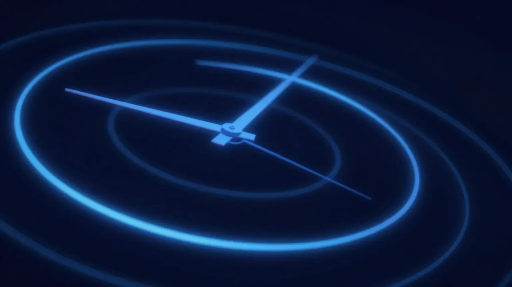
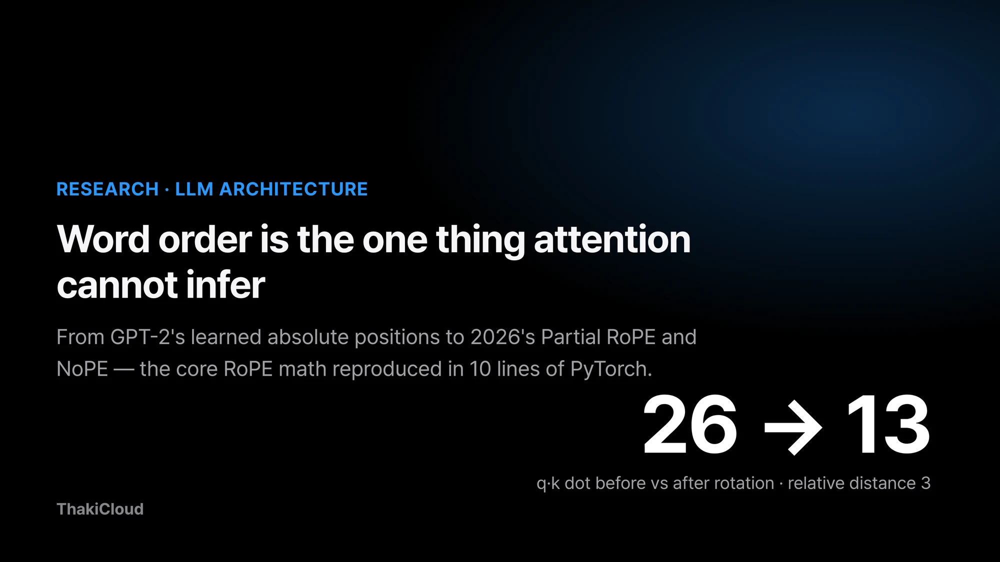
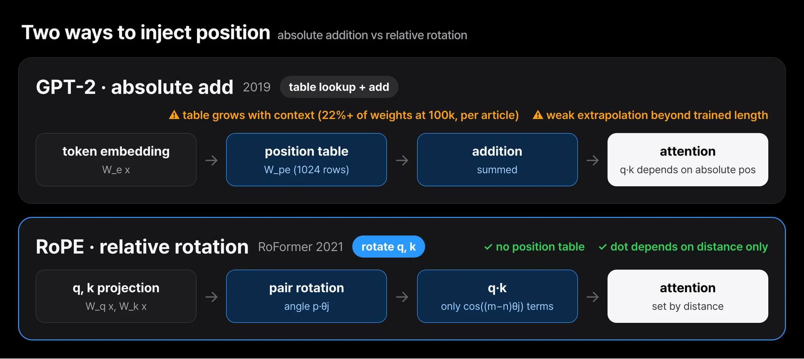
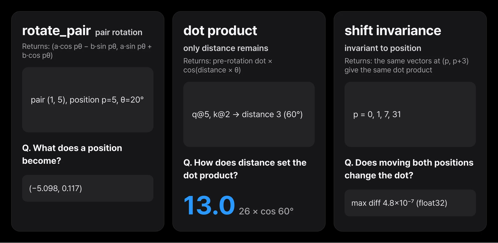
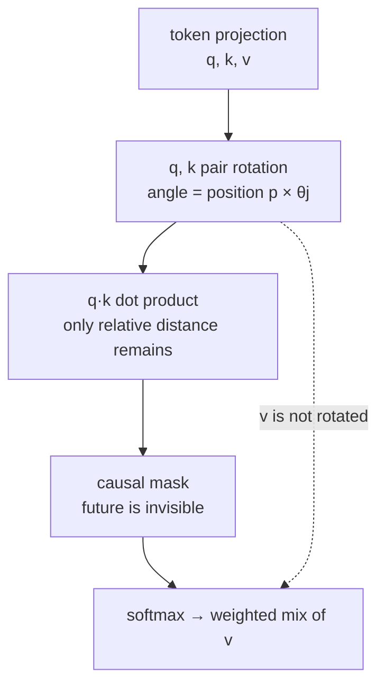
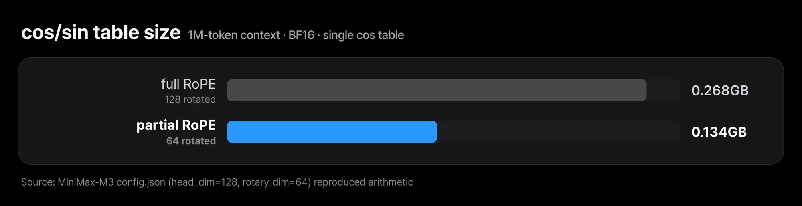

Open the config of a 2026 open model and the positional embedding fields sit there quietly. MiniMax-M3 has `partial_rotary_factor: 0.5`, and SmolLM3 drops RoPE every fourth layer. These are design decisions, not typos. Without knowing what positional embeddings do, you cannot explain why these fields exist.

If you serve long-context models on your own GPUs or own fine-tuning, this post is for you. The one-line conclusion up front: in 2026, positional embedding is no longer a single technique. It is a design axis that sets context economics.

The core math of RoPE is one sentence. The dot product of rotated queries and keys depends only on the relative distance between them. This post reproduces that core in PyTorch, with no model weights. In the tutorial's toy example, a pre-rotation dot product of 26 becomes exactly 13.000 at relative distance 3 and 19.917 at distance 2. At a 1M-token context, the partial RoPE cos/sin table is 0.134 GB smaller than the full RoPE table (single table, BF16, measured arithmetic).


*The clock face of RoPE's feature-pair rotation: the dot product only sees the angle difference between the hands.*


*A from-scratch reproduction of Sebastian Raschka's positional embeddings tutorial.*

## In plain terms

Think of each feature pair in your query and key as a clock hand. Every hand spins at a different speed. The fast hand completes a full turn over a short distance, and the slow hand barely moves. RoPE rotates these hands by the token's position. When attention takes the dot product of two clocks, all it sees is the angle between the hands, that is, the relative distance. What matters is not which clock shows what time, but how many hours apart the two clocks are.

Partial RoPE is a clock with some hands removed. The mechanism (the cos/sin table) gets smaller. NoPE (no positional embedding) is a clock with all hands removed, and word order comes only from the causal mask's "you cannot see the future." The story of 2026 models is about how many hands to remove.

## Why attention must be told word order

Attention computes relevance between tokens. But the same set of tokens in a different order produces nearly the same relevance. "The fox jumped" and "jumped fox the", computed without positions, give identical token-pair dot products. The causal mask only says "future tokens are invisible" (per the tutorial). Word order itself has to be injected from outside.

How to inject it has split into six families since the Transformer.

| Scheme | How order is injected | Depends on | Example |
|---|---|---|---|
| Learned absolute | Add a position vector from a table | Absolute position | GPT-2 |
| Fixed sinusoidal | Add sine/cosine vectors | Absolute position | Original Transformer |
| RoPE | Rotate queries/keys per position | Relative distance | LLaMA, Qwen3 |
| Partial RoPE | Rotate a subset of dimensions | Relative distance (fewer pairs) | MiniMax-M3 |
| NoPE | No explicit signal | Causal mask only | SmolLM3 (every 4th layer) |
| Learned relative bias | Add a learned bias to scores | Relative offset | T5, Inkling |

Per the tutorial's architecture gallery, "RoPE in every softmax attention layer" is still the most common choice in 2026. Its share fell from 2025 to 2026, and fell again in the latter half of 2026. Partial RoPE went from a minority in 2025 to a majority in both 2026 cohorts (per the tutorial's tally).

## GPT-2 adds; RoPE rotates


*GPT-2 adds a position vector to each token. RoPE rotates q and k by position angles so the dot product depends only on relative distance.*

GPT-2 uses a learned position table. The table has 1024 rows, and context cannot exceed the table's length. That table is 0.30% of total weights at 1024 positions, and over 22% when extended to a 100k context (per the tutorial). Position information becomes a weight that grows with context length.

The original Transformer (2017) added fixed sine/cosine vectors. No learned parameters, and token embeddings are scaled by the square root of model width. But it is still an absolute-position add.

RoPE (RoFormer, 2021) takes a different route. It adds nothing to the token. Instead, it rotates queries and keys inside attention. Values are not rotated. The rotation angle is the position times a frequency unique to each feature pair. In the clock analogy, RoPE does not write "it is now this hour" on the token (GPT-2's approach); it turns the hands by the position.

## From 26 to 13: the moment order becomes an angle


*What RoPE rotates. Input: a vector pair and a position; output: the rotated vector and a dot product that only knows relative distance (measured in run-3.log).*

This is the heart of the tutorial. Rotate one feature pair, (1, 5), of the query and key. The angle is 20 degrees per position. The query sits at position 5, the key at position 2. The pre-rotation dot product is 1×1 + 5×5 = 26.

```python
import torch

theta = torch.deg2rad(torch.tensor(20.0))  # 20° per position
m, n = 5, 2                                # query, key positions

def rotate_pair(pair, angle):
    a, b = pair
    c, s = torch.cos(angle), torch.sin(angle)
    return torch.stack((a * c - b * s, a * s + b * c))

q = torch.tensor([1., 5.])
k = torch.tensor([1., 5.])
q_rot = rotate_pair(q, m * theta)
k_rot = rotate_pair(k, n * theta)

print(q @ k)          # 26
print(q_rot @ k_rot)  # 13.000  ==  26 × cos((m−n) × 20°)
```

Running this code gives a post-rotation dot product of exactly 13.000. It is the pre-rotation value 26 times the cosine of the angle difference (60 degrees). Move the key to position 3 and it becomes 19.917 (angle difference 40 degrees). The dot product is set by the distance between the two tokens, not by absolute position.

In a real model, the fixed 20-degree angle is replaced by a per-pair frequency. With head dimension 8 and base 10,000, the four angles per position are 1, 0.1, 0.01, and 0.001 radians (measured output). The fast hand (1.0) loses its cycle over a short distance, and the slow hand (0.001) still distinguishes long distances. Same principle as a clock's second, minute, and hour hands.



There are two notations for the rotation: split-half and interleaved. The former pairs (j, j+4), the latter pairs (2j, 2j+1). We ran random vectors through both and checked. After reordering the features, the maximum difference between the two notations is 0.000e+00. The same rotation with different pairing. The Qwen3 from-scratch notebook uses the split-half notation.

## The rotation depends on distance, not on position

If the dot product really depends only on relative distance, moving the same two vectors further into the sequence should not change it. We rotated the same query/key vectors at positions (0,3), (1,4), (7,10), and (31,34) and measured the dot product. All four results were 1.2444, with a maximum difference of 4.8×10⁻⁷ (float32 measurement error, measured).

This invariance is why RoPE keeps working beyond the trained length. What the model learns is "the dot product of two tokens at distance 3," and that rule holds at position 30 and at position 30,000. The base (10,000) and theta values set how far the slow hand can still distinguish. MiniMax-M3 uses rope_theta 5,000,000. That is 500 times the base, a deliberate choice to slow the slow hand down for a 1M context.

## The 2026 answers: rotate half, or do not rotate at all


*Halving the rotated dimensions (128 to 64) halves the table exactly. Measured arithmetic from run-3.log.*

The cos/sin table is a lookup table of size (max length × rotated dimensions). At a 1M-token context, that table is hundreds of MB in BF16 by itself. MiniMax-M3 rotates only rotary_dim 64 of a 128-dimension head. Thirty-two rotated pairs per head. The table is exactly half. Single-cos-table arithmetic gives 0.268 GB for full RoPE, 0.134 GB for partial, 0.134 GB saved (measured arithmetic). The tutorial computes the same configuration as a 128 MiB BF16 saving.

The partial RoPE paper (arXiv 2305.19466) trained 1B to 8B models and reports that rotating about 10% of the head features often yields comparable final loss. But full RoPE did better on some evaluations (per the paper). "How many hands to remove" has no settled answer.

NoPE takes the stronger position. The length-generalization paper (arXiv 2603.11611) trained a 107M small model and reports that, evaluated beyond the training length across ten tasks, NoPE ranked first overall. A separate 1.3B code-model experiment showed predictions worsening at the longest lengths tested (per the paper). SmolLM3 (3B) puts that direction into practice. Across its 36 blocks, it applies RoPE in three blocks and skips the fourth, repeating that pattern (Hugging Face blog, verified).

Inkling (975B) goes a different way. It uses learned relative position bias, adding a learned bias to the attention scores, in both windowed and global attention layers (per the tutorial).

| Model | Positional scheme | Notes |
|---|---|---|
| LLaMA | Full RoPE | Standard since the original model |
| Qwen3 | Full RoPE | Split-half notation |
| MiniMax-M3 | Partial RoPE | 64 of 128 dims rotated, 1M context |
| SmolLM3 | Mixed | RoPE in 3 layers, NoPE in 1 (36 blocks) |
| Inkling | Learned relative bias | 975B, windowed + global attention |

## At ThakiCloud, positional embedding is context economics

What the serving team watches is the KV cache. The cos/sin table is small next to the KV cache, but the positional scheme sets how much context you can serve with confidence. Run a model trained to 32k at 200k, and extrapolation quality splits by how the position is encoded.

ThakiCloud's training and serving platform Metis serves models over a K8s GPU queue. In long-context serving, the positional fields in a config are a contract that determines cache sizes. `partial_rotary_factor` is a field you can compute memory from before deployment. In on-prem or sovereign environments, that computation feeds directly into GPU counts.

On the Paxis side, the story is about agents. An agent session grows in tokens with every turn. When the session is long, long-context extrapolation quality is the economics of the work. When a NoPE-layer-pattern model like SmolLM3 or a partial RoPE model enters the agent stack, the cost curve of "how long a conversation can one GPU hold" changes. Those fields are part of that calculation.

## Four things to know before you use it

First, NoPE is not a silver bullet. The length-generalization paper reports that the 1.3B code model's predictions worsened at the longest lengths tested. Second, partial RoPE does not win every evaluation. The partial RoPE paper reports full RoPE doing better on some. Third, base and theta are a near-distance versus far-distance resolution tradeoff. There is no universal optimum, and MiniMax-M3's 5,000,000 is a choice made for its 1M context. Fourth, the 2026 trend (partial RoPE going majority, NoPE layers appearing) is a direction, not yet an answer for any specific workload.

## To close

Attention cannot infer word order on its own. GPT-2 added a table, RoPE turned it into a rotation angle, and 2026 models decide how many hands to remove from that clock. The core math is one sentence. The dot product of rotated queries and keys depends only on relative distance.

If you want a first experiment, the ten-line rotate_pair above is all you need. Put the same pair at distances 0, 2, and 3 and print the dot products. If you see 26, 19.92, and 13, you have the mechanism in your hands.

- Tutorial: [Understanding Positional Embeddings in Modern LLMs](https://magazine.sebastianraschka.com/p/understanding-positional-embeddings) (Sebastian Raschka, 2026-11-15)
- Qwen3 from-scratch notebook: [LLMs-from-scratch ch05](https://github.com/rasbt/LLMs-from-scratch/blob/main/ch05/11_qwen3/standalone-qwen3.ipynb)
- RoFormer (RoPE): [arXiv 2104.09864](https://arxiv.org/abs/2104.09864)
- Partial RoPE: [arXiv 2305.19466](https://arxiv.org/abs/2305.19466)
- NoPE length generalization: [arXiv 2603.11611](https://arxiv.org/abs/2603.11611)
- Architecture gallery: [LLM architecture gallery](https://sebastianraschka.com/llm-architecture-gallery/)
