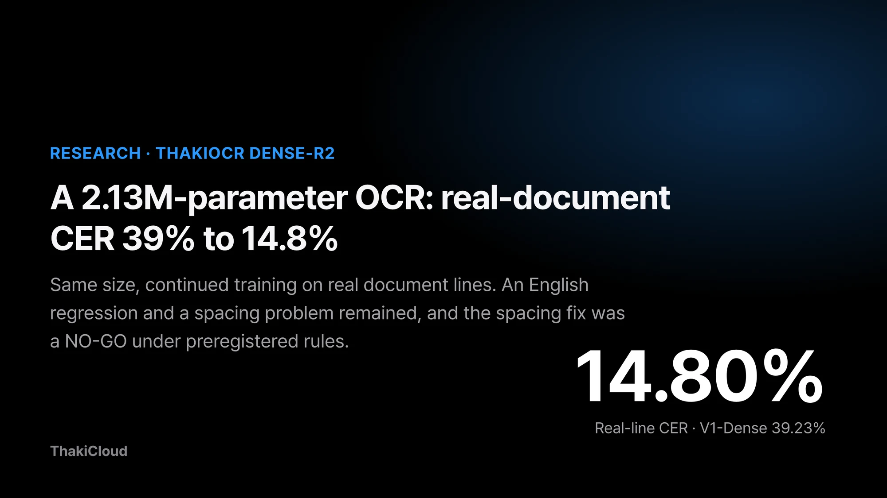
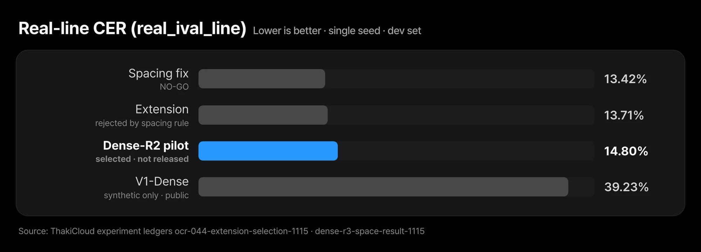
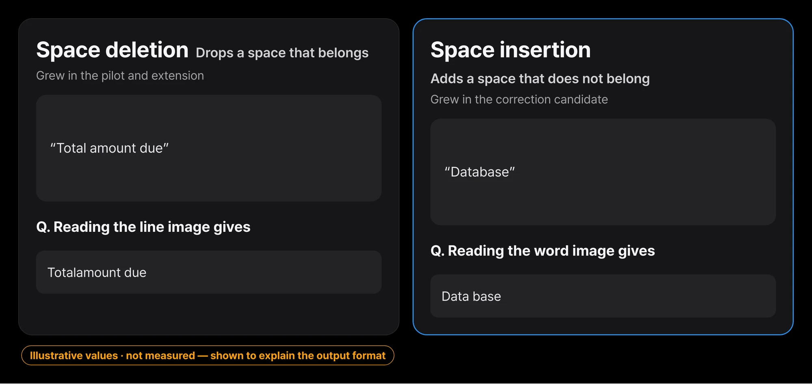
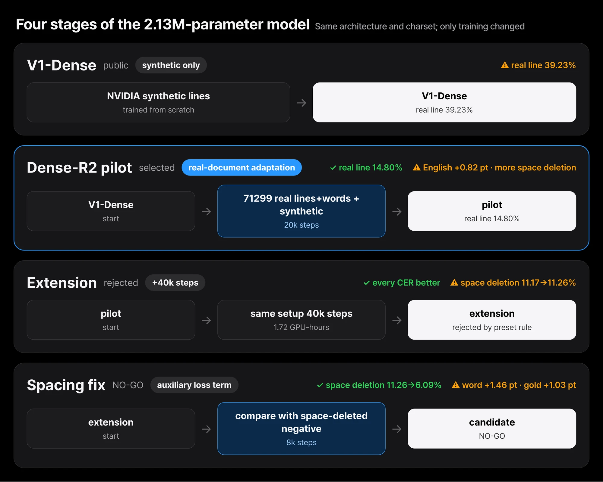
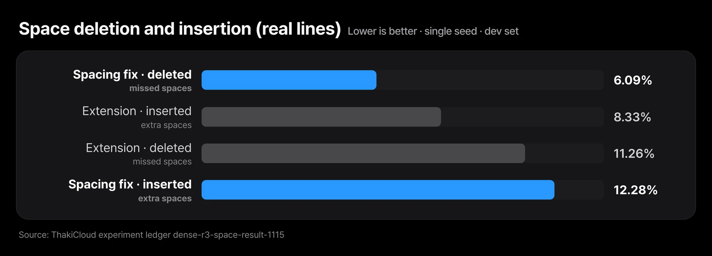

Developers who need to read documents on servers without a graphics card, or on small devices, often cannot use large models. They look for small text recognition models with a few million weights instead. Most of those small models, however, are trained only on synthetic text, and they make many mistakes on real scanned paperwork.

ThakiCloud's public 2.13M-parameter line recognizer, [ThakiOCR A](/tech-blog/en/research/thakiocr-a-small-korean-english-line-ocr/), had the same problem. It was trained from scratch on synthetic data only, and its character error rate on real document lines was 39.23%. Character error rate is the share of reference characters the model reads wrong; lower is better. We write it as CER below.

This time we kept the model size fixed and continued training on real document lines. Real-line CER fell from 39.23% to 14.80%. In exchange, CER on synthetic English lines got 0.82 points worse, and the model began dropping spaces that should be there more often.

This post covers that gain, its cost, and two attempts to fix the cost. A longer-trained extension dropped slightly more spaces, so we rejected it. A spacing correction run cut dropped spaces sharply but started inserting spaces where none belong, so we rejected it too. Every number is from single-seed dev sets, not an independent test. We are not releasing any new checkpoint from this work.

*Summary of the ThakiOCR Dense-R2 research log. Numbers are single-seed dev-set values.*

## In Plain Terms

Picture a student learning dictation. The student practiced only with textbook sentences, and when asked to take down a real newspaper, got four characters out of ten wrong.

So the student practiced with real newspaper sentences, and errors dropped to one or two out of ten. But a new habit appeared: joining words that should be written apart.

The teacher then drilled one rule, "do not leave out spaces," and joined words dropped by almost half. In exchange, the student started splitting words that should stay together. Scores on long sentences went up a little, but scores on short single-word dictation went down.

## Training on Real Document Lines Took Real-Line CER from 39% to 14.8%

The starting point is the public [ThakiOCR-KOEN-V1-Dense](https://huggingface.co/ThakiCloud/ThakiOCR-KOEN-V1-Dense), with 2,130,249 parameters. It is a CTC line recognizer that takes one line image and returns one string. CTC is a training method that maps a whole line to a character sequence at once, without aligning each character position separately.

We did not change the architecture or the list of characters the model can output. We only switched the training data to the same mix as G2M-R2. The real documents are lines and words from the Training split of AI-Hub's public-sector OCR dataset (71299), mixed with NVIDIA synthetic lines and ThakiCloud synthetic symbol lines.

Training rows containing characters outside the character list were removed. We trained for 20,000 steps on one B200, which took 0.88 GPU-hours. We call this checkpoint the Dense-R2 pilot.

| Eval set | Contents | V1-Dense | Dense-R2 pilot | Change (pt) |
|---|---|---|---|---|
| real_ival_line | AI-Hub 71299 internal validation lines | 39.23% | **14.80%** | −24.43 |
| real_ival_word | AI-Hub 71299 internal validation words | 54.68% | **19.15%** | −35.53 |
| gold_dev | AI-Hub 71299 Validation words and lines | 37.33% | **10.64%** | −26.69 |
| hold_line | Real lines from volumes held out of training | 24.12% | **8.02%** | −16.10 |
| ko_val | NVIDIA synthetic Korean lines | 16.77% | **15.13%** | −1.64 |
| en_val | NVIDIA synthetic English lines | **11.11%** | 11.92% | +0.82 |
| a1_dev | ThakiCloud synthetic symbol lines | 10.58% | **1.26%** | −9.32 |

All four real eval sets dropped sharply. Real lines went from 39.23% to 14.80%, and real words from 54.68% to 19.15%. A model of the same size changed this much just from different training data. Keep in mind, though, that the starting model had never seen a real document, so a large gain was expected.

*Real-line CER for V1-Dense, the Dense-R2 pilot, the extension, and the spacing correction candidate. Single-seed dev-set values.*

## The Cost Was an English Regression and Dropped Spaces

Two things got worse. First, CER on synthetic English lines rose from 11.11% to 11.92%, up 0.82 points. Before training, we had agreed to flag any synthetic eval set that got more than 0.5 points worse, and this regression crossed that line.

Second, the model dropped more spaces. We call the share of reference spaces that the model leaves out the space deletion rate. On real lines it rose from 9.0% to 11.2%, and on held-out lines from 3.3% to 8.6%. When words run together in a line-level document, downstream field extraction and search suffer too.

V1-Dense originally had the opposite problem. On real word images it inserted spaces between syllables where none belong. Training on real documents reduced that habit, but inside lines the model tilted toward leaving spaces out.

*Space deletion versus space insertion. The sentences on the cards are format examples we wrote, not real inference results.*

## We Rejected the Longer-Trained Extension by a Pre-Set Rule

The pilot cleared the improvement conditions we had set in advance, so we continued the same setup for another 40,000 steps. On CER alone, the extension beat the pilot on every eval set. Real lines reached 13.71% and real words 17.87%, and synthetic English lines dropped to 10.68%, 0.43 points below V1-Dense.

The rule for choosing the extension, however, included a spacing condition: if the space deletion rate got worse than the pilot, the extension is discarded regardless of CER. The extension's space deletion rate on real lines rose from 11.17% to 11.26%, up 0.09 points. On held-out lines it fell from 8.64% to 8.40%, but the condition looks at both eval sets.

This rule was not in the original plan. We added it after seeing the pilot results and fixed it in the ledger before reading the extension results. The margin was small and the verdict felt harsh, but we did not reinterpret the rule after seeing the outcome. So the selected Dense-R2 checkpoint remained the pilot.

In plain words, we discarded the candidate with better-looking numbers because of a rule we had written down first.

*The path from V1-Dense to the Dense-R2 pilot, the extension, and the spacing correction candidate, with each verdict.*

## Spacing Correction Cut Dropped Spaces but Added Extra Ones

We discarded the extension, but it was still the starting point with the best CER. So we tried one more short run from the extension that only targets spacing. We wrote the decision rule in the ledger before training.

The method reused an auxiliary training term we had tested in October on a model with the same architecture. For every real training line that contains a space, we build a wrong sentence with one space removed, and penalize the model unless it clearly scores the correct sentence above the wrong one.

We lowered the learning rate to a quarter of the extension's and ran only 8,000 steps. It was a single run with no hyperparameter search.

There were six pass conditions. The space deletion rate had to be lower than the extension and no higher than the pilot on both eval sets. CER on the four real eval sets could not get more than 0.10 points worse than the extension. Synthetic English lines had to stay at or below V1-Dense, and synthetic Korean lines within 0.50 points of the extension.

| Item | Extension | Correction candidate | Change (pt) | Verdict |
|---|---|---|---|---|
| Space deletion, real lines | 11.26% | **6.09%** | −5.17 | Pass |
| Space deletion, held-out lines | 8.40% | **4.92%** | −3.48 | Pass |
| Space insertion, real lines | **8.33%** | 12.28% | +3.95 | (not in rule) |
| Space insertion, held-out lines | **6.54%** | 9.19% | +2.65 | (not in rule) |
| CER, real_ival_line | 13.71% | **13.42%** | −0.29 | Pass |
| CER, hold_line | 7.41% | **7.22%** | −0.19 | Pass |
| CER, real_ival_word | **17.87%** | 19.33% | +1.46 | Fail |
| CER, gold_dev | **9.82%** | 10.85% | +1.03 | Fail |
| CER, en_val | 10.68% | **10.60%** | −0.08 | Pass |
| CER, ko_val | 12.81% | **12.73%** | −0.08 | Pass |

The target, the space deletion rate, fell sharply: from 11.26% to 6.09% on real lines and from 8.40% to 4.92% on held-out lines. Line-level CER improved slightly, and there was no English regression.

But real-word CER rose 1.46 points and gold_dev CER rose 1.03 points. Both are far above the 0.10-point limit, so the verdict is NO-GO. We do not promote this checkpoint; it stays only as a research record.

*Space deletion and insertion rates on real lines for the extension and the spacing correction candidate. Insertions grew as deletions shrank.*

## We Suspect a Global Habit Shift Toward Emitting Spaces

Put the numbers side by side and the picture is clear. Space insertions grew as space deletions shrank.

On real lines, deletions fell 5.17 points while insertions rose 3.95 points. CER measured with all spaces removed barely moved: 11.64% to 11.81% on real lines and 5.53% to 5.57% on held-out lines. The ability to read the characters themselves did not change; only the habit of emitting spaces did.

We suspect that habit is what hurt the word evaluations. The auxiliary term only fired on real lines that contain spaces.

The model may have learned a global habit of "emit spaces more often" rather than "do not drop spaces." On word crops, which have almost no spaces, that habit turns straight into errors. We did not measure space insertion separately on the word set or gold_dev, though, so this explanation is still a hypothesis.

Also, at the start of training about 95% of the rows targeted by the auxiliary term already scored the correct sentence well above the wrong one. At the end it was about 96%. A small minority of rows appears to have moved the model's overall spacing habit.

If we continue, the first candidate is to make the term symmetric. Alongside wrong sentences with one space removed, we would build wrong sentences with one space inserted where none belongs, and use word crops as examples that must stay free of spaces. We have not run this experiment, and whether to continue will be decided separately.

## Training Was Short; Data Preparation Was Long

The Dense-R2 pilot took 0.88 GPU-hours and the extension 1.72 GPU-hours. The spacing correction training itself took 0.48 GPU-hours. But it ran on an H200 node with few CPUs, and data preparation alone took about 2.5 hours. One attempt hit its time limit during data preparation and ended without training. As a result, the correction experiment held the GPU for 7.03 hours including smoke tests.

## Limitations to Know Before Using This

- **No new checkpoint is released.** None of the Dense-R2 pilot, the extension, or the spacing correction candidate is on Hugging Face. Only the starting point, V1-Dense, is public.
- **This is not an independent test.** Every number comes from a single seed on dev sets that were also used to choose candidates.
- **The selected pilot has weak spots too.** Synthetic English-line CER is 0.82 points worse than V1-Dense, and the space deletion rate is 11.2% on real lines and 8.6% on held-out lines.
- **The cause of the spacing failure is a hypothesis.** We did not measure space insertion separately on the word set.
- **Accuracy for its size is not yet high.** On a nearly identical real-line eval set, the 8.93M-parameter [G2M-R3](/tech-blog/en/research/thakiocr-g2m-r3-real-document-adaptation/) scores 8.16%. The 2.13M-parameter model scores 14.80%.

## A Small Model Fits the First-Pass Reader Role in Paxis

When you automate document work with Paxis, you do not need a large model for every line. A 2.13M-parameter model runs lightly even on a CPU, so it can serve as a first-pass reader or pre-classifier.

Because spacing and the English regression remain, value checks and human review should follow it. We cover this setup in the [Paxis verification post](/tech-blog/en/agentops/thakiocr-paxis-verify-before-commit/) and the [tiered document inference post](/tech-blog/en/llmops/thakiocr-metis-tiered-document-inference/).

## Closing

Keeping the model size fixed and training on real document lines took the 2.13M-parameter model's real-line CER from 39.23% to 14.80%. The cost was an English regression and dropped spaces. The extension and the spacing correction run that tried to fix this were both rejected by rules written in advance. The correction run in particular turned a dropped-space problem into an extra-space problem.

If you work with small OCR models, we recommend measuring space deletion and insertion separately instead of relying on CER alone. As here, CER can improve while the spacing habit tilts to one side.

The quickest first experiment is to run the public [V1-Dense](https://huggingface.co/ThakiCloud/ThakiOCR-KOEN-V1-Dense) on a few lines from your own documents and compare results with and without spaces removed.

## Sources and Data

- Public model: [ThakiCloud/ThakiOCR-KOEN-V1-Dense](https://huggingface.co/ThakiCloud/ThakiOCR-KOEN-V1-Dense) (Apache-2.0). The Dense-R2 pilot, extension, and spacing correction candidate in this post are not released.
- Training data: NVIDIA OCR-Synthetic-Multilingual-v1 (CC BY 4.0), AI-Hub — OCR Data (Public Sector) (71299), Training split; and synthetic symbol lines rendered with SIL OFL 1.1 fonts.
- We do not redistribute AI-Hub data or anything derived from it. This post contains no AI-Hub images, crops, or labels; all numbers are aggregates.
- Earlier posts: [ThakiOCR A, 2.13M parameters](/tech-blog/en/research/thakiocr-a-small-korean-english-line-ocr/) · [G2M-R3: real-image adaptation](/tech-blog/en/research/thakiocr-g2m-r3-real-document-adaptation/) · [G2M-R2: three times the training](/tech-blog/en/research/thakiocr-g2m-r2-three-times-training/) · [G2M Preview: numbers and symbols](/tech-blog/en/research/thakiocr-g2m-numbers-and-symbols/) · [KO-v1: OvisOCR3 Korean LoRA](/tech-blog/en/research/thakiocr-ko-v1-ovisocr3-korean-finetune/) · [KO-v2 diagnostic study](/tech-blog/en/research/thakiocr-ko-v2-vision-lora-merge-research/) · [Large-27B-R2B](/tech-blog/en/research/thakiocr-large-27b-r2b-qwen-korean-ocr/) · [Comparing open Korean OCR models](/tech-blog/en/research/korean-ocr-open-models-2m-to-27b/)
