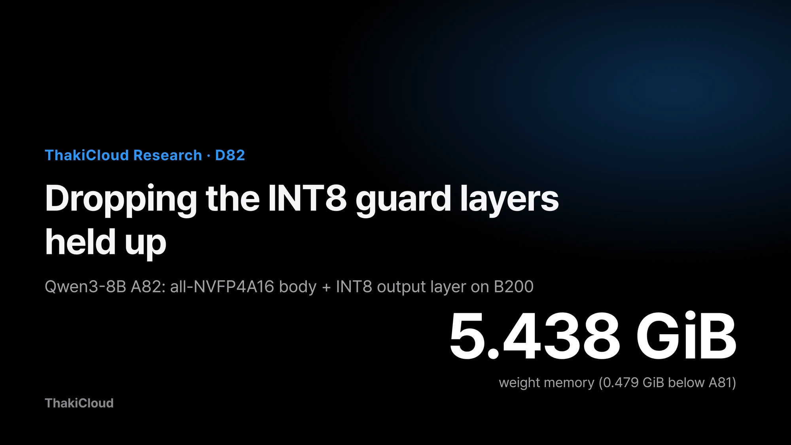
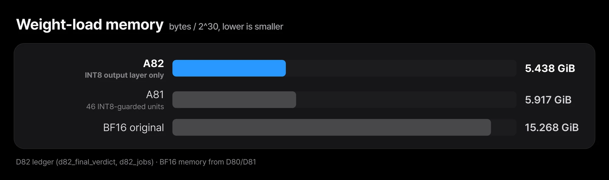
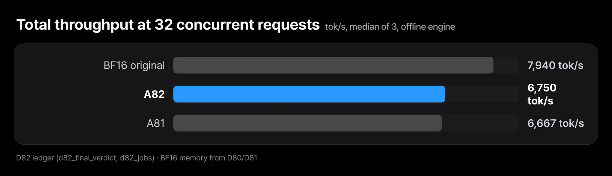

*A82 returns all 46 INT8-guarded body units to NVFP4A16 and keeps only the output layer in INT8.*

In the [previous post](/tech-blog/en/research/b200-nvfp4a16-int8-mixed-qwen3-8b/), ThakiCloud released A81, which shrinks Qwen3-8B to 5.917 GiB. That configuration kept 46 units we judged quality-sensitive in 8-bit integer (INT8). At the end of that post we said we had not measured how much those 46 units contributed on their own.

This time we tested A82, which removes all of that protection. The whole body uses 4-bit weights and only the output layer stays in INT8. Memory drops to 5.438 GiB, another 0.479 GiB. It also passed a preregistered test that it is not meaningfully worse than A81.

That does not mean "A82 is better than A81". This post separates what was confirmed from what is still open.

## In plain terms

Last time we compared quantization to a vacuum-packed suitcase. A81 was a suitcase where 46 easily wrinkled shirts went into a gentler pouch instead of the vacuum bag. This time we removed the pouch and put everything in the vacuum bag.

The suitcase got smaller. Checked against the same standard, the clothes as a whole were still wearable. A few shirts, though, looked more wrinkled on one inspection and about the same on another. We had not looked at enough shirts to judge them on their own.

## We asked one question

The D82 question was fixed before looking at any data: is A82's overall accuracy no more than 1.5 points worse than A81's? A test that checks "not meaningfully worse" is called a non-inferiority test.

That was the only test. We did not preregister a superiority test asking whether A82 is more accurate. So even with a favorable result, we make no superiority claim.

We built two new evaluation sets: SEL-82 for deciding whether to advance, and FINAL-82 for the final verdict. The two share no items or source text, and every item used in earlier experiments was excluded. Each decision rule was sealed before its run.

## It passed the non-inferiority bar

A82 and A81 answered the same items, and we compared per-item correctness in pairs. The final set had 10,210 paired gated items.

| Set | A82 − A81 | 95% CI | Verdict |
|---|---|---|---|
| SEL-82 (10,198 items) | +1.49 pts | +0.88 to +2.10 pts | selected for next stage |
| FINAL-82 (10,210 items) | +0.71 pts | +0.10 to +1.31 pts | non-inferior |

*Table: paired per-item accuracy difference with 95% confidence interval. Non-inferiority margin −1.5 points.*

On the final set the lower end of the interval was +0.10 points, well above the −1.5 margin. The preregistered verdict is a pass.

Because the interval sits above zero, it is tempting to read A82 as better. Superiority was never tested, though. What this result supports is that removing the guard layers did not cost meaningful overall accuracy.

## Memory dropped another 0.479 GiB

*A82 is 64.4% smaller than BF16 and 0.479 GiB smaller than A81. The BF16 value was measured in D80/D81 on the same engine and GPU.*

A82 loads 5.438 GiB of weights. That is less than A81's 5.917 GiB and 64.4% less than the BF16 original's 15.268 GiB. We did not re-measure BF16 this time; the value comes from earlier experiments on the same engine and GPU.

We checked the kernels as well. All 144 quantized linear layers ran on the B200 NVFP4 kernel, and the output layer ran on an INT8 kernel. No layer fell back to full precision.

A82 also cleared every BF16-relative gate used for the A81 release. Korean retention was 0.914, above the 0.90 bar. Time per output token at batch 1, one request at a time, was 0.919x BF16.

## By axis, reasoning is still unresolved

Overall accuracy is made of four axes: Korean, English, numbers and reasoning. Per-axis differences were report-only, not confirmatory tests. Before seeing any results we declared the number and reasoning axes underpowered because they have fewer items.

| Axis (A82 − A81) | SEL-82 | FINAL-82 |
|---|---|---|
| Korean | +0.38 pts (−0.53 to +1.29) | −0.81 pts (−1.71 to +0.08) |
| English | −0.10 pts (−0.89 to +0.68) | −0.31 pts (−1.17 to +0.55) |
| Numbers (underpowered) | +5.50 pts (+4.26 to +6.74) | +3.40 pts (+2.19 to +4.62) |
| Reasoning (underpowered) | −3.47 pts (−5.66 to −1.28) | −0.40 pts (−2.62 to +1.82) |

*Table: paired per-axis accuracy difference with 95% interval. Report-only, not confirmatory.*

Reasoning stands out. On the selection set A82 was 3.47 points below A81, with the whole interval below zero. On the final set the gap shrank to −0.40 points and the interval includes zero.

Taken together, these two results are not evidence that reasoning is equal. A difference that moves this much between sets means this axis does not have enough items to decide. If reasoning matters for your service, compare A81 and A82 again on your own items.

On the number axis A82 was higher on both sets. That is still a report from an underpowered axis, so we do not claim better arithmetic. Korean retention was 0.914 for A82 and 0.937 for A81, so A81 was higher.

## Under concurrent load, BF16 was faster

*At 32 concurrent requests BF16 delivered about 18% more total throughput than A82. A82 is for saving memory.*

This time we also measured the concurrency condition missing from the previous post. The three models ran one after another on the same GPU, and we took the median of three runs each.

With one request, A82 produced 274.9 tokens per second, ahead of BF16 at 252.3. At 8 requests A82 was still slightly ahead. At 32 requests, though, BF16 processed 7,940 tokens per second, about 18% more than A82's 6,750.

So A82 is not a throughput tool. It is for fitting the model into less memory on the same GPU. These concurrency numbers come from the offline engine and exclude HTTP server and network queueing time.

## Four things to know before trusting this

First, this result confirms non-inferiority and nothing more. We do not claim A82 is more accurate than A81.

Second, the number and reasoning axes were underpowered by design. The reasoning difference swung from −3.47 to −0.40 points between sets.

Third, Korean retention is lower than A81's. Both clear the 0.90 bar, but A82 has less headroom.

Fourth, this is one model (Qwen3-8B), one GPU (B200) and one engine version (vLLM 0.29.0). We did not evaluate thinking mode, long-form generation or safety.

## How ThakiCloud uses this result

ThakiCloud often serves models directly on customer GPUs, and Paxis work automation ultimately runs on top of them. Smaller weights leave room for longer contexts or more models on the same GPU. This result shows we can free another 0.479 GiB of that room.

It does not replace A81. For reasoning-heavy work, or where Korean headroom matters, A81 remains the reference configuration. We plan to keep A82 as a candidate for the most memory-constrained deployments and choose after re-measuring on real task items.

A82 is a research release, not a model approved for commercial service. We do not guarantee the same performance on other hardware or operating environments.

## Closing

The open question from the last post was what the 46 guard layers were doing. This result says they were not necessary for overall accuracy. What they did for reasoning, we still do not know.

Our next experiment, D83, is being prepared to target that question directly. The plan is to measure the effect of returning the 46 units individually or at random, the trade-off between numbers and reasoning, and whether the result holds for other model sizes, using new evaluation sets with enough items.

The public checkpoint and aggregate results are below.

- A82 public checkpoint (research use, not approved for commercial use): [ThakiCloud/Qwen3-8B-NVFP4A16-INT8Head-B200](https://huggingface.co/ThakiCloud/Qwen3-8B-NVFP4A16-INT8Head-B200)
- D82 aggregate results, recipe and reproduction guide: [ThakiCloud/B200-LowBit-Quantization-Benchmarks-D82](https://huggingface.co/datasets/ThakiCloud/B200-LowBit-Quantization-Benchmarks-D82)
- Comparison baseline A81: [ThakiCloud/Qwen3-8B-NVFP4A16-INT8-Mixed-B200](https://huggingface.co/ThakiCloud/Qwen3-8B-NVFP4A16-INT8-Mixed-B200)
- Previous post: [More Accurate Than NVFP4 W4A4, Smaller Than BF16](/tech-blog/en/research/b200-nvfp4a16-int8-mixed-qwen3-8b/)
