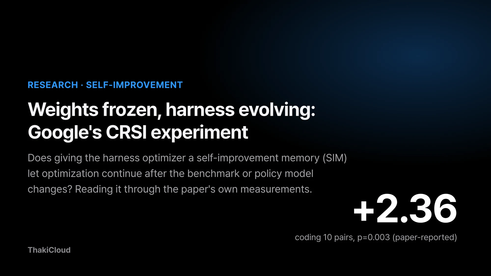
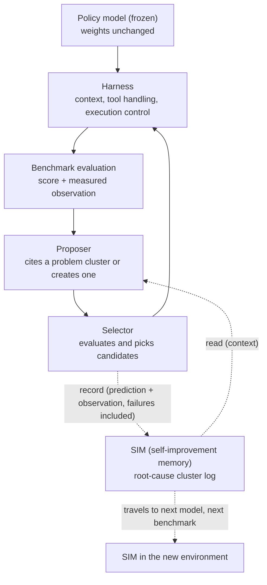
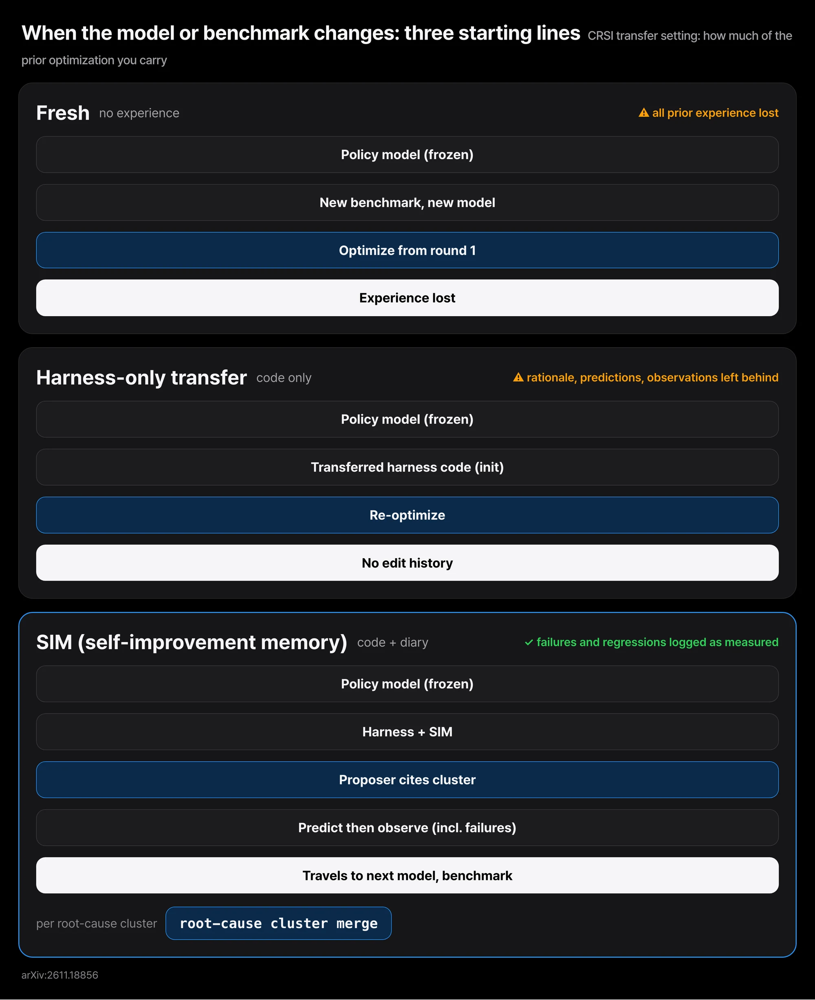
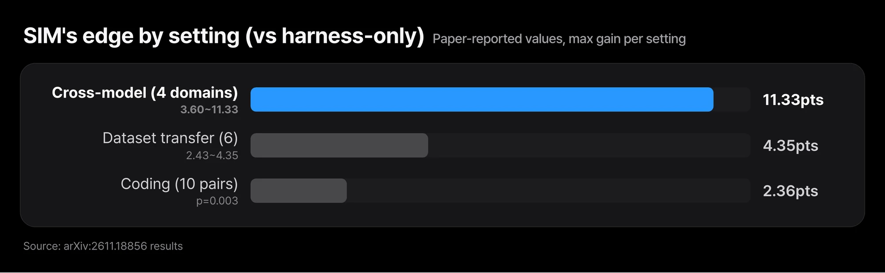

*Weights frozen, harness evolving: Google's CRSI experiment. Re-reading arXiv:2611.18856's self-improvement memory (SIM) results.*

Anyone who runs an agent harness has hit this scene. A retry policy that was trimmed last week is needed again this week. You switch benchmarks, and a prompt you were confident about yesterday drops for reasons you cannot name. The cost of re-discovering from scratch never accumulates, and the context you built does not carry into the next session.

The paper "Self-Improvement Memory Enables Continual Recursive Self-Improvement" (arXiv: 2611.18856, submitted 2026-11-13) from Google Cloud AI, Google DeepMind, and Penn State addresses exactly this. In the setting where the policy LLM's weights are frozen and only the runnable harness around it (context construction, tool handling, execution control) is evolved by proposer and selector agents, it defines CRSI (Continual Recursive Self-Improvement), the practice of resuming that optimization loop after the benchmark or the policy model changes, and proposes SIM (Self-Improvement Memory), the device that carries the memory across that change.

The headline results first. On coding, with 10 independent paired runs, SIM beat harness-only transfer by an average of +2.36 points (p=0.003). Across six dataset transitions, SIM was best in all of them (+2.43 to +4.35). And in cross-model transfer, switching the policy model from Opus to Gemini, improvement carried over by +3.60 to +11.33 points. But when only labels were transferred, the effect was mixed (−1.82 to +2.40), and on the next-generation Gemini 4 Argon, transfer itself inverted to −0.8. This experiment separates the conditions under which improvement continues from the conditions under which it breaks.

## In plain terms

Imagine a watchmaker's repair diary. If the watchmaker re-learns from scratch every time a new watch model comes in, a hundred years of work never compounds. A diary changes that. Symptom-by-symptom notes like "on this model, once the crown loosens, the 3-o'clock hand binds," the prediction made before each attempt, the measured outcome after, and which generation of watch it was made on, all stay in the book. When a new watch model arrives, the watchmaker brings the diary. Symptoms already in the book do not need to be re-discovered. The paper's SIM is exactly that diary, and CRSI is the rule that says repairs continue regardless of which generation of watch you are holding.

One caveat belongs in the diary too. The diary does not apply to every new watch. When the model changes a lot, the previous generation's repair habits can become friction instead of help. The watchmaker brings the diary, then re-checks on the new watch. That is the paper's Argon inversion result.

## Why the harness, not the weights, is the optimization target

When people hear RSI (Recursive Self-Improvement), they usually picture a model making itself better. This paper's setting is different. The LLM that makes policy decisions is frozen from start to finish. What changes is the harness that wraps it in execution: prompt structure, tool-call handling, execution control, verification logic, a mix of runnable code and text.

Why not touch the weights? Weight updates require new training data and cost, and have to restart whenever the model changes. Harness optimization runs on a loop that tries an edit against one evaluation score, and its output is text and code that can be moved to another environment as-is. That is the premise the paper defines for CRSI. Even when you switch to a different benchmark or a different policy model, as long as the harness interface (the input/output contract) is shared, the optimization loop can resume without stopping.

"Shared interface" is a concrete condition. It means that a harness optimized on the previous benchmark, placed in the new one, still accepts the new environment's inputs (problems, tools, evaluation function) and returns output in the same shape. When the contract holds, the transferred harness is the new environment's starting point. When the contract breaks, transfer is no different from a fresh run. So every transfer result in the paper is valid only under the compatible-interface condition, and that assumption has to be read into every result.



The harness does not flow one way. It is a loop that reads the evaluation score, tries an edit, and records what happened around the attempt. That loop is what makes CRSI "continual," and SIM is the part that slots into the loop as the paper's contribution.

The actual loop size, per the paper: five candidate edits per round, ten rounds. Every candidate writes a prediction, "this edit will change the score like this," before evaluation, and gets its measured outcome attached after. So when a round ends, the harness has changed once, and the memory has five new diary lines, successes and failures alike.

## A diary that records failures

SIM's design principle is about what it keeps. Unlike RSI work that passes only successful edits forward, SIM records three things per attempt.

First, the change and its rationale. What was edited and why. Second, prediction and observation. The prediction written before the edit, "the score will change like this," and the measurement taken after, kept as a pair. Third, provenance. Domain, benchmark, policy model, and round, so every record is traceable to where it came from.

The unit that groups these is the root-cause cluster. Instead of treating recurring symptoms as repeated edits, SIM groups them as "these edits all came from this root cause." When a new attempt attaches to a known cluster, history accumulates rather than spawning a new entry. Regressed edits (score drops) stay in the log with their measured observation. The structure even preserves open predictions from reverted edits.

A line in SIM, drawn in its actual shape, looks like this.

```
cluster:   C-017 (retry storm: identical call repeated after failure)
round:     6
edit:      change backoff interval to exponential on retry
rationale: C-017 history shows linear backoff reverted 3 times
predicted: score +1.5 (fewer tool calls)
observed:  +0.8 (calls down, but verification latency up)
context:   coding / mbpp / opus-policy / round-6
```

The prediction/observation pair is the core. A record saying "predicted +1.5, observed +0.8" becomes evidence for the next round: when the proposer considers the same kind of edit again, it knows this kind of edit acts weaker than expected. If only successes were kept, that calibration would be impossible.

This is where the design pays off in transfer. When the benchmark changes, the harness could restart from zero, but SIM carries the record "in this kind of problem, this kind of edit ended this way." Same when the policy model changes. And when the model changes enough that symptoms shift, the same root-cause cluster merges history instead of dropping it. Here is why the watchmaker's diary travels to the new watch.

## When the benchmark and the model changed, what actually carried over


*The three CRSI transfer settings. How much of the prior optimization you carry is the experiment's core variable.*

The paper's setup, in one line. The proposer and selector are both LLM agents, the edit target is the harness, and the evaluation is the benchmark score. The conditions branch into three: Fresh (from scratch), Harness-only transfer (harness code carried, labels and records dropped), and SIM (harness + memory carried).

On coding, 10 independent paired runs of SIM versus harness-only transfer put SIM +2.36 points ahead. 95% confidence interval [1.05, 3.68], paired t-test t(9)=4.06, p=0.003, effect size d_z=1.28, and SIM won 9 of 10 pairs. This is the paper's most statistically solid number.

Across six dataset transitions (the benchmark changes), SIM was best in all six, +2.43 to +4.35 over harness-only. In cross-model transfer (the policy model switches from Opus to Gemini, four domains), the carry-over ranged +3.60 to +11.33.

The starting point of the transfer matters too. In a new-benchmark environment, the transferred harness starts below the fresh seed. Edits tuned to the previous benchmark are an initial handicap in the new one, and SIM's gain is the whole path of recovering that handicap and climbing past it. Measured against the fresh final score, the cross-model gain shrinks to +1.08 to +1.77 (except engineering, +9.56). "+11.33 over harness-only" and "+1.77 over fresh" are different numbers, and both come from the same experiment.

| Setting | SIM vs harness-only | Note |
|---|---|---|
| Coding 10 pairs | +2.36 (p=0.003) | most solid statistics |
| Six dataset transitions | +2.43 to +4.35 | SIM best in all |
| Cross-model 4 domains | +3.60 to +11.33 | Opus to Gemini |
| Labels-only transfer | −1.82 to +2.40 | mixed, no edits carried |
| Gemini 4 Argon | −0.8 | inverted, one generation ahead |


*Paper-reported values (max gain per setting). On next-generation Gemini 4 Argon, transfer inverts to −0.8.*

Reading the labels-only mixed effect makes SIM's value sharper. A problem-cluster label is a map of symptoms. It is not knowledge of which gestures on that terrain worked and which failed. In a new benchmark, a proposer with the map but without the record of actual repairs keeps doing the same trial and error. It is a diary with symptoms written down but no prescriptions and no outcomes.

The paper leaves another comparison. In the text-classification domain, a setup that optimized the harness independently per model (B1) trailed a setup that optimized one shared harness and ran it all (S2) by 76.30 to 77.08. Improvement accumulating across the model boundary, shown inside the same environment.

Two caveats remain. First, labels-only transfer mixed (−1.82 to +2.40). What is not enough is the label of "what was wrong." The edit, the prediction, and the observation have to travel together. Second, on the next-generation Gemini 4 Argon, the transferred harness inverted to −0.8 (CRSI 94.8 against fresh RSI 95.6). When the next generation is good enough, the previous generation's optimization record can become a habit that does not fit the new model.

## What it leaves in a system where agents keep evolving

This paper reads directly in ThakiCloud's Paxis (our agent platform), because Paxis evolves the harness itself as a standing structure. Skills are generated, executed, reviewed, revised, and reflected in the next run. That loop is Paxis's normal operation. The only gap: the format of what the loop records was pre-paper. Edits and rationale existed, but the prediction/observation pair, the root-cause cluster, and the provenance (domain, model, round) were not structured.

Read in SIM terms, Paxis's skill-evolution log gains a cluster-level record: what root cause this edit addressed, what score change was predicted before it, and what the measurement showed after. Concretely, each skill edit leaves a diary line with the same fields as the SIM record shown above. The root cause (what kind of failure this was), the edit, the pre-edit prediction, the post-edit measurement, and provenance: domain, model, round.

That format pays off at model-change time. When the model moves from Opus to the next generation, the record "in this kind of failure, this kind of edit ended this way" becomes context for the new generation's first optimization round, instead of being re-learned. The paper's cross-model results (+3.60 to +11.33) are evidence that the context becomes score. The Argon inversion (−0.8) is the warning against the opposite temptation: records travel, but do not skip re-validation on the new model.

The ai-platform side has a different angle. When a customer runs their agent harness across several models, "do I re-tune the harness from scratch when I switch models?" is a practical question. The paper's answer: as long as the interface is shared, you can resume with the memory in hand. If harness optimization is a service, SIM is the device that preserves the customer's asset at model-change time.

## Four things to know before building on it

**1. Independent repeats exist only in coding.** The other domains are single runs per condition (n=1). The +2.36 (p=0.003) is a statistic that holds only in coding. The transfer gains in other domains are single-run values.

**2. Transfer starts below the fresh seed.** The transferred harness begins from a lower score than the fresh seed in the new environment. So a large part of the cross-model gain is recovering the transfer deficit. Against the fresh final score, the gain is +1.08 to +1.77 (except engineering, +9.56). "Transferred and gained 11.33" is not measured against fresh. Keep that distinction.

**3. There is no cost accounting.** The proposer and selector call an LLM every round, and that cost is not accounted for in the paper. Five candidates per round for ten rounds means that before the first edit is settled, dozens of candidate evaluations plus proposer and selector LLM calls have already happened. Whether the gain of harness optimization exceeds that cost is not answerable from this paper. To reproduce it, price your own environment's evaluation cost first.

**4. The optimizer and the target share a lineage.** If the proposer and selector are LLMs of the same lineage as the target policy model, the bias of "making itself better" is not excluded. The experiment does not generalize to optimizers of a different lineage.

## In closing

The most practical sentence this paper leaves: freeze the weights, evolve the harness, and record each attempt as a prediction/observation pair inside a root-cause cluster, and improvement carries over across benchmark and model changes. And the limit of that carry-over comes with it: one generation ahead, the record becomes a habit, and the cost is unaccounted.

The first experiment you can run today: take the harness edit you most recently reverted, and record it, starting now, in SIM format. The pre-edit prediction, the post-edit measurement, the root cause. The experience of that diary becoming context at the next model switch arrives before the paper does. And write Argon's lesson into the diary too, in one line: bring the record, re-validate on the new model.

> 📄 **Full deep review (DOCX)**: [Download the detailed peer review on Google Drive](https://drive.google.com/file/d/1JGwjSAN8xri3ZfGLkqAyr-ZJtFO2Ic_F/view).

- Paper: [arXiv:2611.18856](https://arxiv.org/abs/2611.18856)
- Authors: Xin Yu, Fei Xia, Jiaqi Pan, Youbao Tang, Chengzhi Liu (Google Cloud AI), Adams Yu, Sicong Jiang (Google DeepMind), Yanfei Chen (Google Cloud AI Research), Lingzhou Xue (Penn State), Ting Yu (Google Cloud AI)
- Submitted: 2026-11-13

Sources: arXiv:2611.18856 (accessed 2026-11-18), author affiliations per the HTML full text.
