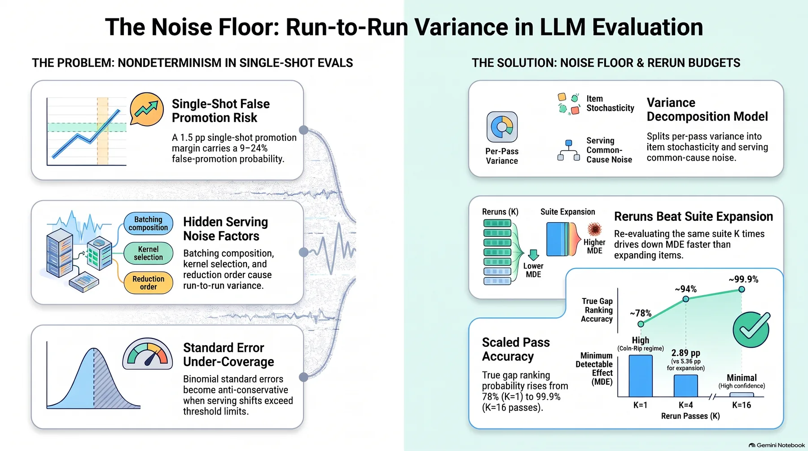
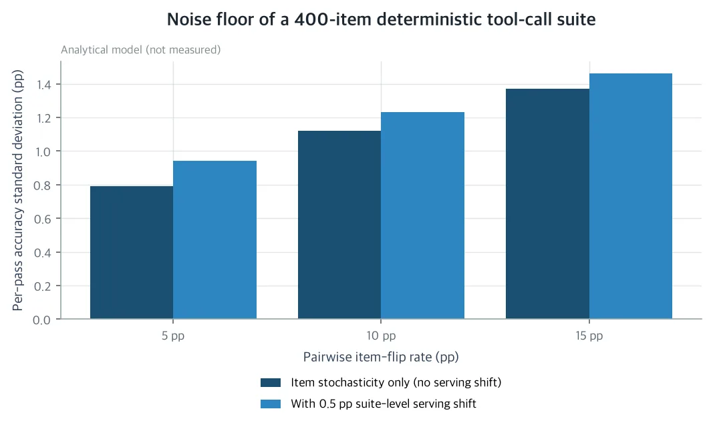
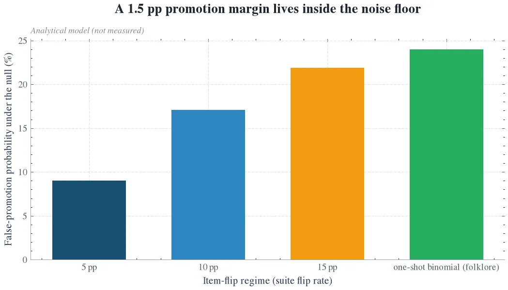
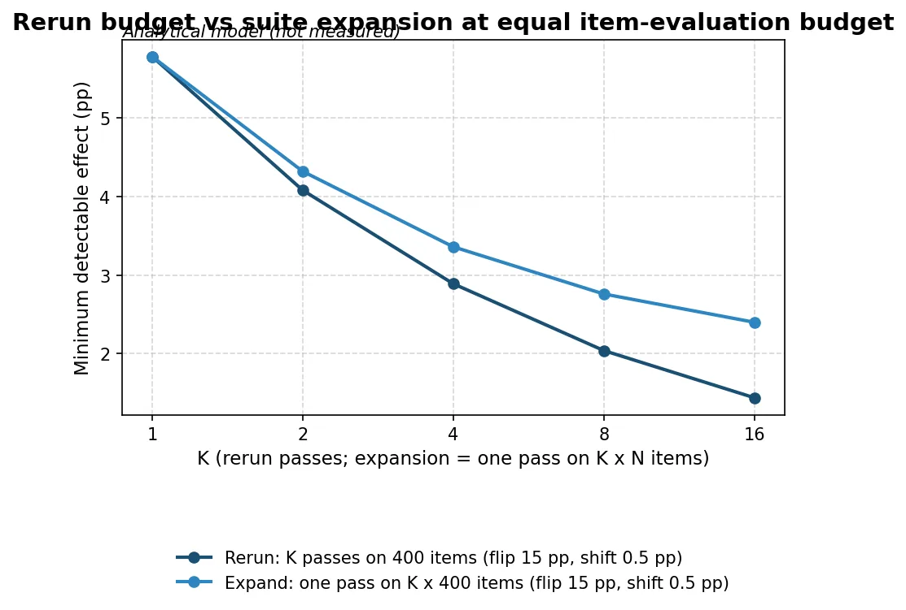
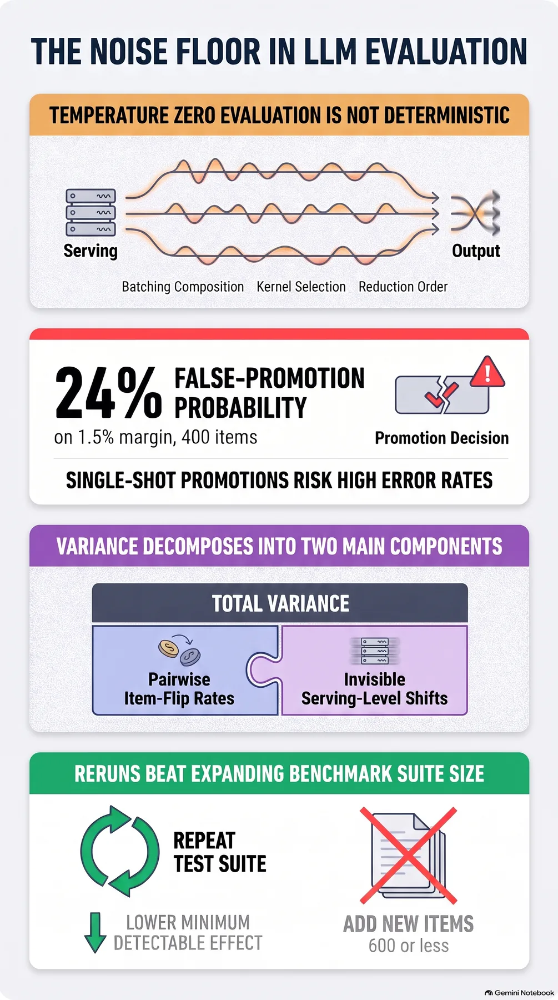

If you run a self-hosted inference fleet and make calls on a benchmark row, whether to promote a model, change the quantization precision, or keep or drop a routing tier, read this post to the end. The intended reader is the cloud or AI engineer who operates vLLM style continuous batching serving on H200 class hardware and compares models with hundreds of code-graded tool-call probes. The reason for the post is simple: a single-pass benchmark row is not a stable quantity. Even at temperature 0, with the same items and the same weights, the score moves by several points from one pass to the next. The margin on which you make promotion decisions is exactly that size.

The paper this post introduces, "The Noise Floor," is an analytical paper that gives that random variable its probability laws. It derives, in closed form, the noise floor theory for deterministic AST-graded BFCL tool-call evaluation under continuous batching serving. It yields what a promotion gate can actually resolve: the minimum detectable effect (MDE), the rerun budget, the misjudgment promotion probability, and the drift boundary. It also fixes and preregisters the measurement protocol that is to be checked against. It does not report new endpoint measurements. The values in the example table and the figures are model-derived values at the operating point. The framing is a step up from vLLM style serving. PagedAttention and continuous batching made self-hosted serving fast. This paper makes it measurable.

## Deterministic measurement, not deterministic evaluation

A self-hosted inference fleet lives on comparisons. Which model tier goes into the single-call category, whether to promote a 27B class production checkpoint from BF16 to NVFP4 or demote it to a smaller full-precision model, whether to keep or drop a DPO arm or a routing tier, these choices follow one another. In every decision, the evidence is one row of a benchmark table. Hundreds of code-graded tool-call probes, one pass, one accuracy number. The Precision Ladder, Concurrency Tax, and Grader Confound posts in the ThakiCloud cost-quality series all share one unverified assumption: that a row measured once is a stable quantity.

It is not. Even at temperature 0, top-p 1, a fixed grader, and identical weights, a pass over the same 400 items through a continuous batching engine can differ by several points from run to run. Requests land in a different batch on every pass. The batch composition decides the tiling of the kernels and the order of the floating-point reduction. Floating-point addition is not associative, so the output bits change. The effective randomness this produces is formalized in the literature as the background temperature. A one-off reproducibility check of our 27B NVFP4 endpoint in the production lab observed a ±2.0pp band on the 400-item single-call category. A band the same size as the margin on which promotion decisions are made. When the floor beneath a row is this wide, a close-tie comparison is a coin flip. A gate with a small margin promotes noise.

You can remove the noise. The price is the serving stack itself. Batch-invariant kernels pay more than 2x latency and up to 74% of throughput. Fixed batch geometry holds bits only under a per-deployment contract. The economic implication is clear. Removing noise costs in the serving stack. Measuring it costs only reruns. This paper chooses the latter.

<!-- nlm-visual -->

*Infographic generated by NotebookLM from the sources.*

## Two noise sources: item flips and serving common cause

What the paper establishes is a single closed-form decomposition. Under the assumptions of stationarity (A1), conditional independence (A2), and common-cause nonnegativity (A3), the per-pass accuracy variance σ²_A splits into two terms. The item stochasticity term σ²_item/N (each item flipping around its own reliability), and the serving common cause term σ²_cc/N² (the batch state shifting the whole suite). The former shrinks as 1/N. The latter is O(1) for a suite-level shift. Expanding the suite does not remove it. The flip-variance bridge (Proposition 1) makes this a measurable object. σ²_A is tightly bound below by the suite item flip rate φ̄ divided by 2N. A 400-item suite at 90% accuracy can flip by up to 18pp on an item-pair basis. An observation beyond that bound refutes the stationarity or independence assumption itself.

*The per-pass standard deviation of suite accuracy grows with the item flip mass (φ̄), and the suite-level serving shift (τ) adds a component that suite expansion cannot remove. Analytical model values at N=400, p̄=0.90, not measurements.*

The second consequence is a correction to practice. The single-pass binomial standard error p̄(1−p̄)/N is treated as conservative, but it is a valid upper bound only while the serving shift τ stays below the threshold s_r/√N. Above it, the binomial interval under-covers. Reporting the conventional standard error then becomes anti-conservative. The common cause, which a single pass cannot see at all, is exactly what the rerun budget has to buy.

## MDE, rerun budget, and gate resolution limits

Once the variance is in hand, the quantities a promotion decision needs take closed form. For two arms each running K passes with per-pass variance σ²_A, the MDE at significance level 0.05 (two-sided) and power 0.80 is MDE_K = 2.8016×sqrt(2σ²_A/K). The rerun budget needed to resolve a target effect ε is K*(ε). The budget does not depend on the accuracy level p̄. It is connected only through the flip rate. A suite with many boundary-near items needs more reruns at the same accuracy.

The example calculation (Table 1) fixes the production operating point N=400, p̄=0.90. The flip rate covers the model-plausible 5pp to 15pp, and the serving shift takes 0 and 0.5pp. The single-pass MDE is 3.1pp to 5.9pp. The null misjudgment promotion probability of a fixed 1.5pp margin gate is 9% to 24%. Read another way, one promotion decision in five is a coin flip. The alpha-safe budget K_safe for that margin is 2 to 6 passes. The ranking results are more concrete. Two arms with a true 1.5pp difference are ranked correctly 78.1% of the time under a single pass, 93.9% at 4 passes, and 99.9% at 16 passes. The 1.5pp margin of the series gate is resolvable. Only under a multi-pass budget.

*In a 400-item suite at 90% accuracy, the null misjudgment promotion probability of a fixed 1.5pp single-pass margin rises with the item flip mass. Under the conventional single-pass binomial standard error, it reaches roughly one misjudged promotion in four. Analytical model values, not measurements.*

## Reruns versus suite expansion: the equal-budget answer

To buy resolution you must choose: rerun the same suite, or widen it. The equal-budget theorem answers under the same item-evaluation budget. The comparison is 400 items at 4 passes (1,600 evaluations) against 1,600 items at 1 pass. In the suite-shift model, the batch shift τ acts identically on every item of the expanded pass. It does not disappear under expansion. Reruns divide it by K. At φ̄=15pp, N=400, K=4, the MDE advantage of reruns is 0% at τ=0 (a tie), 14% at 0.5pp, and 30% at 1.0pp. Even in the τ=0 tie, only reruns deliver measured σ̂_A, φ̂, and the order contrast. The single true advantage of suite expansion, coverage of new items, is a different statistical goal. It does not lower the noise floor of any already published row.

*At the paper's operating point (N=400, φ̄=15pp, τ=0.5pp), rerunning the same suite K times brings the MDE down as 1/sqrt(K), while expanding the item count K-fold in a single pass shrinks only the item stochasticity part and leaves the serving shift component in place. Analytical model values, not measurements.*

Two diagnostic tools come with it. The order sensitivity contrast alternates passes between fixed order and shuffled order. A significant contrast identifies batch composition as the first-order noise source (a scheduler or geometry level fix); a non-significant contrast locates the noise in kernel-level numerics (an invariant or fixed-composition kernel-level fix). Two branches of fixes, with entirely different backfill budgets. The quiet-item sandwich bounds the between-arm difference on the items (quiet set) that stay stable across K passes in both arms. By construction, the quiet difference contains no serving noise. The price is instead paid in the width of the bound over the items outside the quiet set, namely the flip-induced mass 1−w_K.

## Preregistered measurement protocol: five predictions and five falsifiers

The protocol fixes endpoints, suite, passes, and every threshold before execution. E1 (the main experiment) is BF16 vs NVFP4 on a 27B class dense checkpoint, self-hosted H200. On Hopper silicon, NVFP4 class weights are served through the dequantized GEMM path, so the quantization drift is identical (weights FP4 fixed) and only the serving numerics differ from a native deployment. E2 is 4B class BF16 vs dynamically quantized FP8 on the Hopper native path, a measurable low-bit surrogate arm. The suite is 400 single-call BFCL style items, stratified by difficulty (easy/medium/hard), frozen and version-pinned before execution. Grading is exact AST/JSON match. No judge model. K=8 passes per arm, alternating 4 in fixed order and 4 in shuffled order. Temperature 0, top-p 1, max tokens fixed, engine and kernel versions pinned, light load.

The five predictions (P1 to P5) each carry a designated falsifier (R1 to R5). P1 (decomposition): the measured variance sits between the flip-rate lower bound and the single-pass binomial upper bound. P2 (layer structure): the flip mass concentrates in the medium layer, where item reliability is near 1/2. P3 (order): under light load the order contrast is non-significant. Kernel-level numerics carry the residual. P4 (quantization amplification): the NVFP4 flip rate widens relative to BF16. Low-bit weights do more than lower accuracy. They push boundary items onto the reliability boundary and widen the floor itself. P5 (gate audit): at K=1, the BF16 vs NVFP4 single-call difference cannot be separated in one pass. At K=K*(1.5pp), the sign of the difference stabilizes over the last 3 passes. The falsifiers are symmetric. R1 is a super-binomial common cause (order-correlated state or co-tenant traffic), R2 is a flip peak in the easy or hard layer, R3 is the first-order role of batch composition, R4 is the floor not widening under low-bit, and R5 is that 1.5pp lies below the achievable floor. The total budget is 2 endpoints × 2 arms × 8 passes × 400 items = 12,800 item evaluations. Worst-case spend is capped per arm at K_max×N×t_item.

<!-- nlm-visual -->

*Infographic generated by NotebookLM from the sources.*

## Contributions and limits

The contributions come in three branches. For the ThakiCloud token factory, it gives the minimum trustworthy BFCL delta and the rerun budget when promoting quantized models, DPO arms, and routing tiers on H200. Promotion decisions on close-tie models stop being noise-induced misjudgments. For the community of self-hosted deployments, it honestly bounds evaluation claims. Effect sizes are reported leaning on the measured floor instead of treating a single-pass row as fact. The rerun budget the floor requires is spent instead of a cheaper-looking suite expansion. The overclaiming of quantization gains that sit inside the floor also stops. For the science of LLM evaluation, it gives the first closed-form quantification of the run-to-run variance, the item-level flip rate, and the MDE of deterministic code-graded tool-call evaluation under low-bit quantization and continuous batching at temperature 0. It is the measurement-statistics layer that was missing under every cost-quality frontier already drawn.

The limits are stated up front. Stationarity holds only under a pinned stack and light load, so the protocol's floor is a lower bound on the production floor. Concurrent sequences interact through shared memory and scheduling state. The order contrast is the designated diagnostic. The grader is assumed deterministic and complete. The grader choice axis is separate. The per-turn floor is a lower bound on the trajectory floor of multi-turn agentic workloads. The item stochasticity term is architecture invariant, but the common cause term is kernel specific (Hopper vs Blackwell). That is why E2 exists. Every bound depends on the (p̄, φ̄) regime. Gates must be recalibrated per category, not per fleet. The MDE and budget formulas use a Gaussian approximation at N=400. For smaller suites, keep the structure and swap in exact tests or permutation tests. This paper is an analytical paper. The measurement is the preregistered protocol. Its predictions are fixed before any outcome is seen.

The full paper and the figure assets are available at the Hugging Face dataset page below.

- Paper page: [thaki-AI/daily-paper-2026-11-19-noise-floor-quantized-tool-call-eval](https://huggingface.co/datasets/thaki-AI/daily-paper-2026-11-19-noise-floor-quantized-tool-call-eval)
