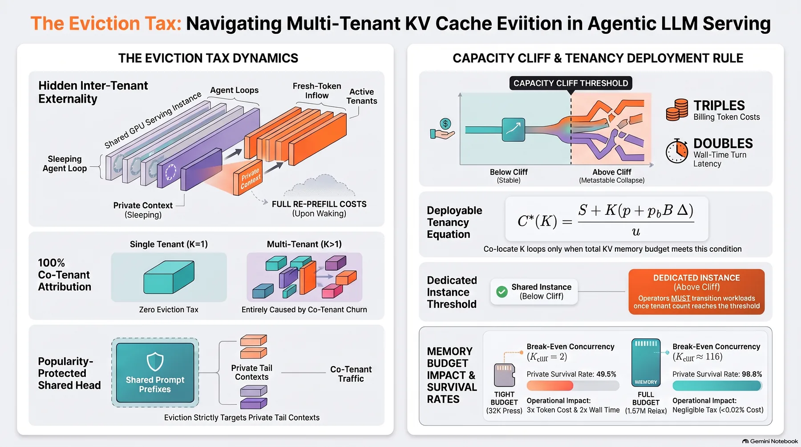
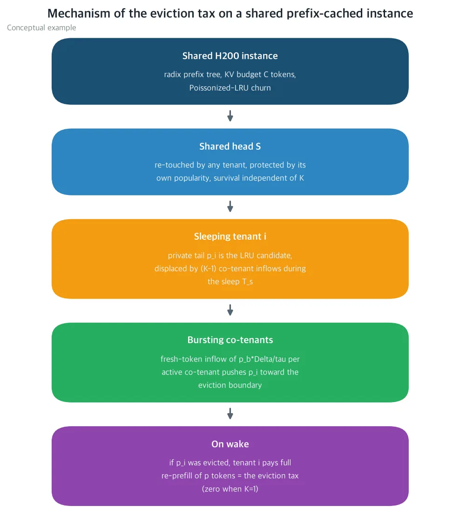
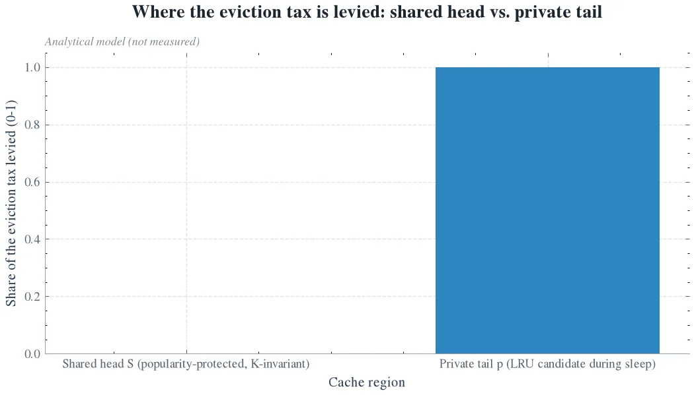
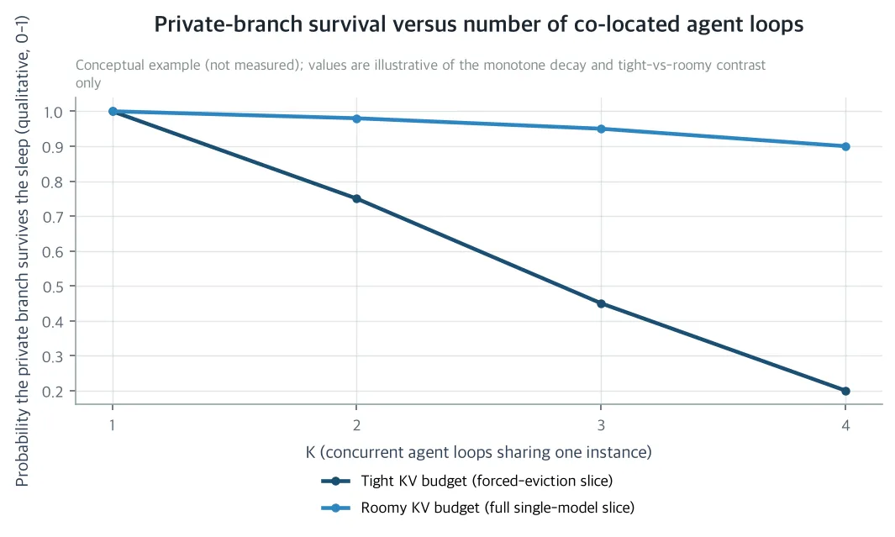
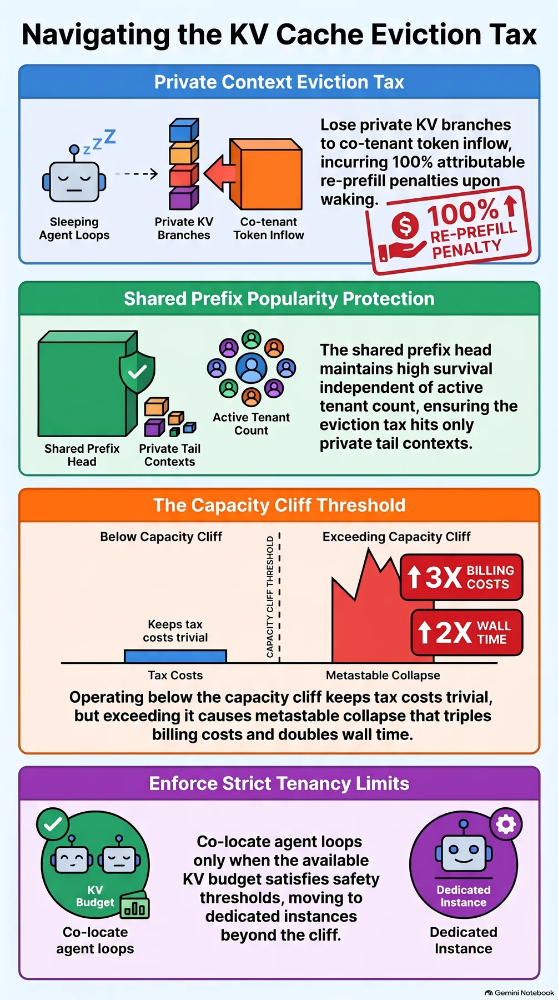

If you run several unattended agent loops on the same H200, there is one number you need to know first. The upper bound on how many loops can share a single serving instance. This paper's answer compresses to one line. What sets that bound is capacity, not price.

This post is the ThakiCloud introduction to the Eviction Tax paper. When K unattended loops share one prefix-cache-enabled instance, a sleeping loop wakes to find its context pushed out by co-tenant traffic. It pays for re-processing the whole thing, that is, a re-prefill.

The paper names this cost, which shows up nowhere on the per-token bill, the eviction tax. It prices the tax in closed form and answers when to switch to a dedicated instance.

A note before you read on. This is an analytic paper, and the body reports no new measurements. Every number is derived in closed form on the declared constant card (rate card) and the cited measurement studies. A 4-arm pre-registered falsification protocol for verifying those predictions is fixed at the end of the paper.

## In plain terms

Think of a shared chalkboard.

Several people write on the same board. When the board fills up, someone starts erasing from the oldest writing. What I wrote and stepped away from gets pushed out by someone else's new writing whenever the board is tight. When I come back, I have to rewrite it from the start. The cost of rewriting is the tax.

In this paper the chalkboard is the KV (key-value, the intermediate state the model leaves while processing its input) memory of the serving instance. The writing is the cache of each agent loop's context, and the erasing rule is LRU, which evicts what has gone unused the longest first. A sleeping loop's context is the "what I wrote and stepped away from", and a co-tenant's new tokens are the "new writing". If the loop wakes to find its context erased, it pays for re-processing everything, that is, a re-prefill. The paper prices this cost in closed form.

Remember one more thing. The title at the top of the board is never erased, because everyone reads it every turn. It is always fresh because someone always reads it, no matter how many co-tenants there are. The tax lands only on each person's private area. That is the core point of the paper: sharing the head and sharing the capacity become separate decisions.

<!-- nlm-visual -->

*Infographic generated by NotebookLM from the sources.*

## What the paper sets up

Prefix caching has become the fundamental economics of agentic inference. An unattended loop resends its growing context every turn, and the prefix cache discounts that resend. A hit is a small incremental prefill of just the new tokens; a miss recomputes the 10K~40K token context in full. In published coding-agent trajectories, 98.6% of input tokens are served by the prefix cache. Flat input pricing overstates loop cost by about 7x under near-ideal caching.

But the reuse pricing in that literature is all anchored to one program at a time. The radix tree is shared state. When K independent loops, each with a different schedule and context, run on one instance, the fresh-token inflow of every tenant pushes every other tenant's cached branches toward the eviction boundary. A loop that slept between bursts wakes to find its private context stolen by co-tenant bursts and re-processes the whole thing. An inter-tenant negative externality, invisible to single-tenant accounting and to any bill that counts only resent tokens.

The structure in which a sleeping loop's private branch is pushed out by co-tenant fresh-token inflow during sleep. The shared head is protected because any tenant touches it again, and the tax is levied only on the private tail. A conceptual example, not a measurement.*

This is the serving-side mirror of the two effects ThakiCloud priced earlier. Compact Debt is the cost a loop's own in-context edits incur, and Manifest Order is the churn cost of the fixed prefix shared by always-active co-located loops. Both are self-inflicted: the loop invalidates its own cache. The eviction tax is externally enforced invalidation, in which co-tenant bursts steal the cache while the loop sleeps.

The setup is one self-hosted H200, a paged KV engine with the prefix cache on, and K concurrent unattended agent loops. Each loop resends the shared head (system prompt and tool schemas) plus its private working context every turn. Each is also a burst-sleep duty: append a fixed amount of new tokens, burst for a few turns, then sleep for a long time. The erasing rule is the Poissonized LRU model this series has used. When the cumulative fresh-token inflow since an item's last use exceeds the KV budget, the item is evicted. All numbers are evaluated on the declared constant card. For example, the H200 spot instance is $2.25 per hour, the private working context is 12,000 tokens, and sleep is 30 minutes. The full constant card is in the footnote at the end.

## What it finds

First, the per-wake eviction tax is a pure function of co-tenant inflow during sleep. The expected re-prefill recovery X(K) is the product of the private context size p, the probability of eviction during sleep, and the prefill rate gap (1−ρ); it is exactly zero at K=1. The eviction probability is 1 − e^−(K−1)Λ, and Λ is the dimensionless number formed by dividing the product of the co-tenant burst duty cycle, new tokens per turn, and sleep time by the product of the turn interval and the KV budget. A loop running alone has an immortal private branch. Every cent of the tax is attributed to co-tenants.

Second, the shared head protects itself with its own popularity. The probability that the head withstands co-tenant churn is C/(C+Δ), independent of K. As tenants increase, the head's usage interval shortens and the inflow pushing it out grows at the same rate, so the two effects cancel. Under the declared constants, head survival on the press budget is about 96%. Wake survival of the private context when four loops run together is only about 50%. The consolidation gain of one cached head serving K loops stays intact, while the tax is levied on the private tail only.

*Attribution contrast. The per-wake re-prefill recovery is 100% attributable to co-tenants, and it all lands on the private working context. The shared head's survival probability is independent of K, and the head keeps its cache discount in every regime. An analytic model, not a measurement.*

One more, more important consequence. Even in the limit where the private context is evicted in full, a wake turn is still cheaper than using no cache at all. Because the shared head's discount survives. So the eviction tax is not the variable that decides whether to turn the cache switch off. It is the variable that decides how many loops to put together. The switch stays on in every regime.

Third, the regimes split at the capacity cliff. The burst-peak working set is the shared head S plus, per loop, the private context p and the in-flight burst share. When it exceeds the KV budget, the instance enters the metastable collapse regime. The fully subcritical maximum tenancy is K_cliff = ⌊(uC − S)/(p + p_b BΔ)⌋. Under the declared constants, the press multi-model pool slice gives 2 and the full H200 budget about 116. On a narrow board the third person's writing does not fit; on a wide board, realistic headcounts are no problem.

*Qualitative shape. The probability that a sleeping tenant's private branch survives the sleep falls with the number of co-located loops K. A tighter KV budget makes it fall faster, and the capacity cliff bites first. Values are illustrative and not to scale. An analytic model, not a measurement.*

Below the cliff the tax is small. Under the declared constants it is under 2×10⁻⁴ of the per-task dollar cost, and on dollars alone the break-even comes only at about 100M tokens of private context. A value one to two orders of magnitude larger than any shipped context window. In plain terms: by the bill alone, the consolidation decision never changes. The eviction tax is a phenomenon of capacity and time, not of price.

Above the cliff the story changes. In metastable collapse the cache hit rate drops to about 10%, real time per turn doubles, and the token cost in the billing view balloons to 3x. On a narrow board, the board keeps getting erased until nobody's writing is left. At that point sharing is no longer a small tax problem. The regime itself has changed.

What steers the tax is the dimensionless product Λ. Double the sleep time or the new tokens per turn and the tax doubles; double the KV budget and it halves. Loops that run more often, i.e. loops with a larger duty cycle, lower the cliff. Because the burst-peak working set grows with the duty cycle.

Fourth, the break-even concurrency is the capacity cliff itself. In the self-hosted real-time SLO view, per-turn real time doubles above the cliff and the SLO binds. In the token billing view, consolidation saves nothing. Because billing is per token, there is no difference below the cliff, and above it the collapse inflates the token cost. In the capacity admission view, the cliff is the admission boundary itself. In every operating view, the break-even tenancy K* equals K_cliff.

The deployable rule is two lines. Co-locate K loops when the KV budget C is at least C*(K) = (S + K(p + p_b BΔ))/u. Below that, reserve a dedicated instance. The declared press slice (32,000 tokens) holds exactly 2 loops, and the third needs 41,000 tokens. In plain terms: exactly two people sit at a narrow board, and the third needs their own board.

The paper puts these predictions to falsification. The 4-arm protocol is A0 (dedicated, K=1), A1 (shared, K=2, press budget), A2 (shared, K=4, press budget), and A3 (shared, K=4, full budget). Each arm has a pre-set falsification criterion. For example, if A2's measured wake re-prefill differs from the prediction by 2x or more, the tax identity is rejected. If the sustained hit rate of the same arm is 50% or above, the capacity cliff falls. No new instrumentation is needed. It uses only the telemetry of a dedicated H200 under the existing overnight agent harness.

## What to change

For ThakiCloud's H200 token factory, this becomes the number in the tenancy policy. How many unattended agent loops to co-locate per serving instance, and whether to keep the prefix cache on for a multi-tenant agent workload, is now decided in two lines. Budget the per-co-located-loop KV slice at C*(K), keep the cache switch on, and grow the shared head. The head can be grown for free. It only raises the consolidation gain and never touches the tax channel.

For every organization running large-scale unattended automation, it shows where the regime is in which cramming agent loops onto shared GPUs feeds more re-prefill cost than idle-capacity savings. Consolidation savings show up on the GPU-hour bill and the eviction tax does not, so if the sharing decision is made on price alone, the direction in which it goes wrong is fixed. Catching that regime before the loss, as a question of capacity and time, cuts both inference spend and energy.

In the science, it is the first result to price a negative externality in closed form for agentic multi-tenancy over a radix-tree-style shared prefix structure. Multi-tenant LLM serving has been studied through the latency channel (fairness isolation, per-request attribution) until now. The KV memory channel was treated only as a security problem, a side channel. This paper prices that memory channel as a cost problem. With per-tenant re-prefill expansion and break-even concurrency, it lifts single-tenant reuse economics to the shared-instance regime. The accounting of this series closes here. After self-inflicted invalidation (Compact Debt), resident-activity churn (Manifest Order), and compute-queue interference (Rerank Carpool), it now reaches externally inflicted eviction.

<!-- nlm-visual -->

*Infographic generated by NotebookLM from the sources.*

## What not to trust

First, this is an analytic paper, and the body has no new measurements. Every number is a closed-form output of the declared constant card and the cited measurement studies. The collapse anchor (hit rate 0.1, turn time 2τ) is a regime parameter taken from one recent measurement study that spanned both engines.

Second, the cache-churn model is a declared assumption, not a fit to measurements. The Poissonized LRU approximates block-level radix-tree eviction. The nested structure holds, but the residence distribution is assumed. The sleep phases are i.i.d., and synchronized tenancy is the worst case for the shared head and the best for the private branch, so the peak working-set rule is conservative.

Third, the model class is 4B~32B dense GQA. MoE and 1M-token windows are open. The closed-loop metastable collapse and the death spiral, in which arriving traffic turns the cliff into a traffic-state admission boundary, are the next targets.

*The cost figures in the body are closed-form outputs on the declared H200 rate card, not measurements. The shared head S is 512 tokens, the private context p is 12,000 tokens, new tokens per turn Δ is 1,500, burst B is 6 turns (turn interval τ 60 seconds), sleep T_s is 1,800 seconds (30 minutes), and duty cycle p_b is 1/6. KV is about 72 KiB per token, the H200 spot rate is $2.25 per hour, and the fresh prefill rate c_p is about 2.1×10⁻⁸ dollars per token. The tax-to-savings ratio κ is 6.2×10⁻⁵ at K=2, 8.3×10⁻⁵ at K=3, and 1.0×10⁻⁴ at K=4 on the press budget, and 1.4×10⁻⁶ at K=2 and 2.8×10⁻⁶ at K=4 on the relax budget. The dollar break-even private context p* is 1.9×10⁸ tokens at K=2 (press) and 1.2×10⁸ tokens at K=4 (press). C*(K) on the press budget is 27.5K at K=2, 41.0K at K=3, and 54.5K tokens at K=4 (a KV budget of about 1.9~3.9 GB on the 72 KiB/token model). The press budget is the forced-eviction slice of the multi-model pool, 32,000 tokens (2.3 GB); the relax budget is 0.85×(141−4.5)GB, a full single-model budget of about 1.57M tokens. Head survival probability is 0.956 on press and 0.999 on relax; the K=4 private survival probability is 0.495 on press and 0.986 on relax. The billing-view token cost in the supercritical regime is about 3.16x, and the per-cycle tax is 1.58×10⁻³ dollars. The pre-registered 4-arm predictions are A1 tax(2)≈4.2×10⁻⁵ dollars/wake·s_priv(2)≈0.79, A2 collapse h*≈0.1·τ*≈2τ·billing ≈3.2x, and A3 tax(4)≈2.87×10⁻⁶ dollars/wake.*

The full paper and the figure materials are available on the Hugging Face dataset page below.

- Paper page: [thaki-AI/daily-paper-2026-11-20-eviction-tax-kv-prefix-cache](https://huggingface.co/datasets/thaki-AI/daily-paper-2026-11-20-eviction-tax-kv-prefix-cache)
