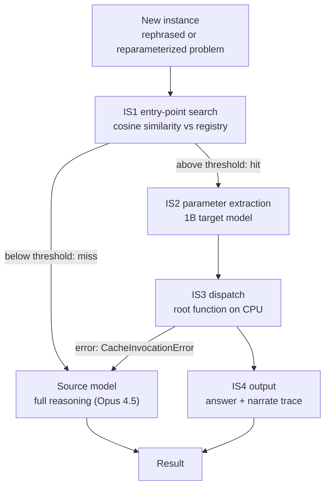

This article is for the people running agents that repeat the same family of work every day. Agents that classify the same shape of inquiry, pull the same fields from reports, solve the same computation with different numbers each time. NVIDIA's 28-page tech report, CPU-ARC, answers the question that arises from that situation: when a new instance of a problem family arrives, can re-reasoning from scratch be replaced by code execution? The answer is yes, and the price gap is large. Once a reasoning trace is compiled into a CPU-executable semantic function network, a new instance costs 1/16 to 1/291 of the source model re-reasoning. Accuracy matched or beat the source model on 7 of 8 benchmarks, and led by 10 points on AIME 2025.

This article covers what CPU-ARC (arXiv 2611.09891) builds, what price assumptions its numbers rest on, and the limits to know before applying it. The semantic function network, the build/invocation role split, robustness tests on rephrased inputs, and the break-even math. There are no new measurements in this article; every number is reported in the paper's Table 2 and appendices.

One premise before you read on. The source model S and the builder B are both Claude Opus 4.5, and the small target model T that runs at invocation is a fine-tuned Llama 3.2 1B. Cost figures are at March 2026 retail API prices, so the break-even moves when prices do.

*NVIDIA tech report CPU-ARC: a reasoning trace compiled into CPU-executable code, re-solved at 1/16 to 1/291 the invocation cost.*

## In plain terms

Think of a restaurant's recipe shelf.

Developing the first dish is the head chef's, that is, the frontier model's, job. Choosing ingredients, working out the method, tasting along the way: expensive labor. The core of CPU-ARC is what happens after that development is done. Once the recipe book, the ARC (agentic reasoning cache), is on the shelf, an order for the same dish with a different sauce or a different portion is no longer the head chef's work. A line cook, a 1B small model, makes the dish from the recipe using the kitchen's basic equipment.

The recipe book is Python code, not plain text. That is why, when the portion changes to "large", the function that takes that value and computes it just runs. A rephrased order must be made from the same recipe book, so the paper changes the phrasing of orders, changes the values, and changes both together, verifying that the recipe book still produces the same taste: fidelity.

What if an order comes in for a dish that is not on the shelf? The gate calls it a miss, and the order goes back to the head chef. The paper's gated serving structure, exactly. A cache miss is not a failure; it is just a signal to return to the original path.

## The recipe is a network of Python functions, not sentences

An ARC is a network of "semantic functions." Each function is a Python callable that takes a Context object and returns a dictionary of natural-language description to value. Inputs, outputs, and callees are referenced by natural-language descriptions and examples, not by fixed identifiers. When function B calls function A, it finds A by description.

There are seven runtime primitives. `load` retrieves values from layered context memory by vector similarity. `do` discovers and invokes another semantic function by description. `narrate` leaves a human-readable reasoning trace. `lm` asks the small target model T for classification, summarization, or short-form generation. `extract` does verbatim value extraction, and `convert`/`smart_convert` do multi-tier type coercion: `smart_convert` has T rewrite the value as a Python literal and validates it with `ast.literal_eval()`. `invoke_tool` wires in external tools such as the terminal or web search.

The small model is used in exactly three places: `lm`, `extract`, `smart_convert`. Its job is bounded to elementary natural language processing, namely value extraction, format conversion, and classification. The heavy thinking was already done by the builder at build time; it is not in the code. Once the function registry is stable, the `do` and `load` lookups can be resolved statically into a self-contained Python module that runs with no embedding engine and no vector store. The `lm` and `extract` calls are the exception and remain.

Entries are small. The paper's worked example, the ideal-gas SciBench entry, is three semantic functions and about 57 lines after compilation. The body code is abbreviated "for brevity", so real entries are larger, but the order of magnitude, tens of lines per problem, holds.

## The build is expensive, the run is nearly free

Building the recipe book costs. The builder B is also Opus 4.5, and it compiles the source transcript in five phases. Phase 1 separates the user input from the expected output. Phase 2 decomposes the reasoning into a hierarchical list of function-sized logical operations, marking reusable sub-computations. Phase 3 recognizes the parameters and produces a generic input template plus a dictionary of parameter descriptions to concrete values. Phase 4 plans which functions to create, the dependency structure, and a bottom-up implementation order; the structure must not depend on the original parameter values. Phase 5 implements in an agentic loop: search the registry for reusable equivalents, write a candidate, run static analysis, test against the transcript fragment with a judge, rewrite on failure.

That build costs 12 to 84 times a source invocation per sample, $0.85 to $1.78. A one-time number. Invocation, by contrast, runs on the target T and the CPU only. IS1 embeds the input and searches the entry-point registry by cosine similarity; below the threshold it is a miss, and the request goes to the source model. IS2 extracts the parameter values with the 1B extractor. IS3 dispatches, running the root function on the CPU in a fresh Context. IS4 outputs the result dictionary and the narrate trace. The paper states it plainly: invocation uses only the target (small) model and CPU execution, and the expensive source and builder are required only at construction time.

The break-even is B/(S−C) invocations. Roughly 13 for the AIME family, roughly 90 for GSM8K. A problem family invoked a dozen or more times has already paid back the build. Every invocation after that is $0.0004 to $0.0019.

## 16 to 291: the savings are a function of the source's price

Savings× is the per-invocation ratio of source cost to cache cost. The measurement basis is March 2026 retail API prices. Opus 4.5 is $5.00/M input, $25.00/M output, $6.25/M cache write, $0.50/M cache read. Llama 3.2 1B is $0.023/M input, $0.194/M output. The builder's multi-turn loop is prompt-cached, which lowers its cost.

That is why the savings vary by benchmark. AIME's source call is $0.11 to $0.12 per sample, so the cache's $0.0004 becomes 262 to 291 times. GSM8K's source is $0.01, so 16 times. The number is a price ratio, not a performance of the method. If Opus prices fall, the 291× falls with them.

The accuracy side is the more interesting part. The cache matches or beats the source model on 7 of 8 benchmarks. AIME 2025 is 93.3% for the cache against 83.3% for the source: a 10-point lead. The paper's explanation is that deterministic code execution avoids the source model's final-step slips. GSM8K is the only benchmark where the cache trails, by 0.5 points (98.0 vs 98.5). What you gain by replacing reasoning with code is not just cost savings but determinism, and on AIME, where the final step matters, determinism is quality.

## Rephrased, reparameterized, both

The robustness test runs three modes. Phrasal keeps the parameters and rewords the problem. Parametric keeps the wording and changes the values. Combined changes both, under the constraint that the problems stay equi-substantive. The perturbation generator G is the same Opus 4.5 as the source, and judging is a committee of two Opus 4.5 instances requiring unanimity.

| Benchmark | Fidelity | Phrasal | Parametric | Combined |
|---|---|---|---|---|
| MATH-500 | 99.6 | 96.7 | 94.5 | 91.6 |
| AIME '24 | 100.0 | 96.0 | 99.3 | 95.1 |
| AIME '25 | 90.0 | 98.4 | 91.2 | 93.4 |
| AIME '26 | 90.0 | 97.9 | 90.9 | 90.8 |
| GPQA Diamond | 98.5 | 93.8 | 93.9 | 94.0 |
| GSM8K | 99.5 | 96.2 | 94.2 | 92.5 |
| MMLU-Pro | 100.0 | 95.7 | 96.7 | 91.9 |
| SciBench | 99.4 | 97.5 | 98.8 | 96.4 |

All values are pass rates, in percent. Combined is lowest at 90.8 to 96.4; phrasal is highest at 96.0 to 98.4. Fidelity, the agreement between cache and source answers, runs 90.0 to 100.0. Note that the robustness tests apply only to problems the cache already answered golden-correctly; the table does not answer how much accuracy drops on a miss.

The deployment form is gated serving. The cache is tried first, and on a miss or an error the request falls through to the full LLM.

## For ThakiCloud products

Paxis's skill axis already stores "working code + SKILL.md". CPU-ARC prices that structure. A recurring skill, from its second occurrence, is a build plus code execution, not a model call. The break-even line is a dozen to ninety invocations, depending on the problem family. A skill called twelve times a day has already paid back the build, and its marginal execution cost approaches CPU code plus a 1B model. A P3-tier task, the expensive frontier model, drops into P0-tier economics, CPU plus small model, from its second occurrence. This is not a measurement; it is the implication of applying the paper's break-even structure to the Paxis skill ledger.

From the ai-platform lens, CPU-ARC is a CPU execution layer between serving tiers. The build is a GPU- or API-using batch job that fits the platform queue job discipline as is. The invocation is CPU: no GPU occupancy, no queue wait. Gated serving, miss-then-full-model, slots into the serving stack unchanged, and it also fits the on-prem story of replacing frontier API dependency with a local 1B target plus CPU execution.

To be honest, we have not measured hit rates or break-even on our own workloads. The first experiment is to pick one task family that recurs in production and count its invocations.

## Before you apply it

Scope. The paper's claim is aimed at domains "that do not require a great deal of creativity and are instead focused on the execution of particular instructions." The math and science benchmarks are an exploratory framing as "the hardest case deliberately chosen." Open-ended generation and creative work are outside the structure.

Hit rate. The paper reports no hit-rate numbers at all. What fraction of a real workload hits the cache is the number that decides actual savings, and it must be measured in your own environment. Every number in this article is a conditional savings given "already solved once."

Safety. The body has no dedicated discussion of the safety of executing generated code; the words sandbox or security do not appear. The safety devices are three: judge-validated tests before registration, type validation via `ast.literal_eval`, and gated fallback on error. Running CPU code in production needs a separate isolation story.

Compilation freezes the function network; any update requires recompilation. Generalizing multiple similar functions into one is an open problem.

Finally, price. All cost numbers are at March 2026 retail API prices. If Opus prices move, the Build× and Savings× ratios move with them.

## To close

The recipe analogy closes the paper. The first development is expensive, because the build is 12 to 84 times the source. Execution is cheap, because it is 1/16 to 1/291. The break-even is a dozen to ninety invocations. And determinism is not just a cost story; it is a quality story, and the 10-point lead on AIME 2025 is the evidence.

If you run an agent that repeats the same family of work, the first thing to count is not model tokens but invocations per week per task family. The families that clear the break-even line are where CPU-ARC-style caching pays. Pick one family and count its calls; if the frequency clears the line, the next experiment is a pilot that turns one trace into a parameterized function.

> 📄 **Full deep review (DOCX)**: [Download the detailed peer review on Google Drive](https://drive.google.com/file/d/1LybLlQENoUHjxuhxry2qo85k8ww5mzuO/view).

- Paper: [CPU-ARC: Agentic Reasoning Caching for on-CPU Reasoning Reuse (arXiv 2611.09891)](https://arxiv.org/abs/2611.09891)
- [DAIR Academy paper summary](https://academy.dair.ai/papers/cpu-arc-agentic-reasoning-caching-for-on-cpu-reasoning-reuse-2611.09891)
- Source tweet: [hjguyhan](https://x.com/hjguyhan/status/2124287085981131185)
