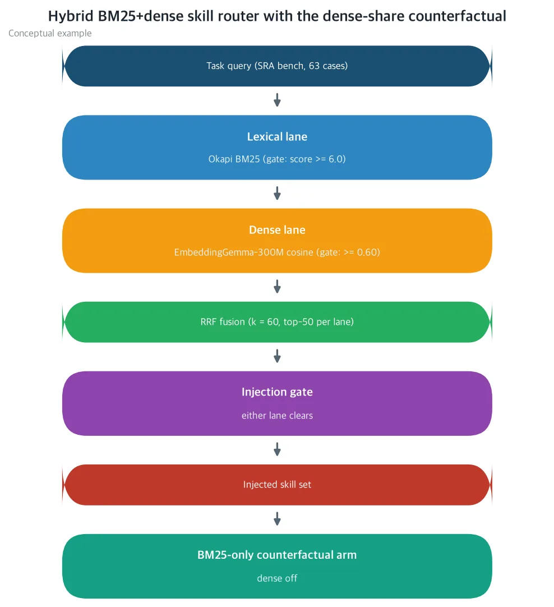
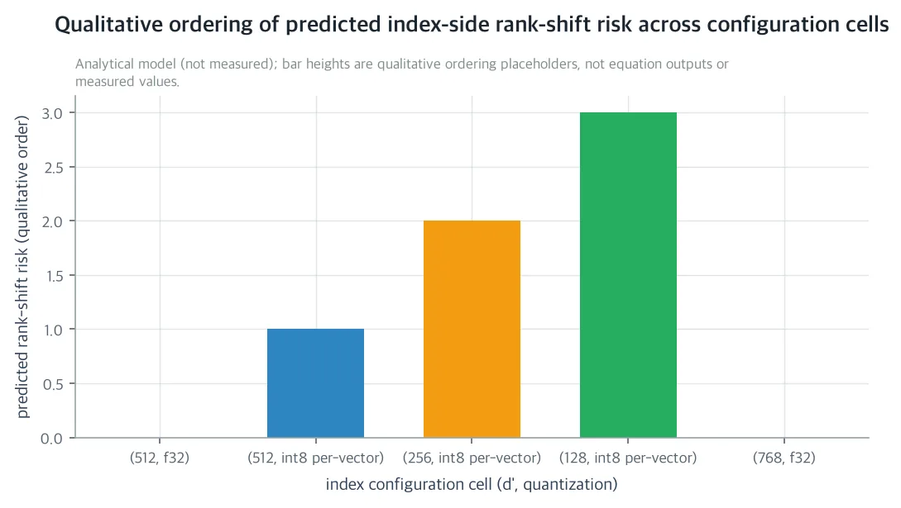
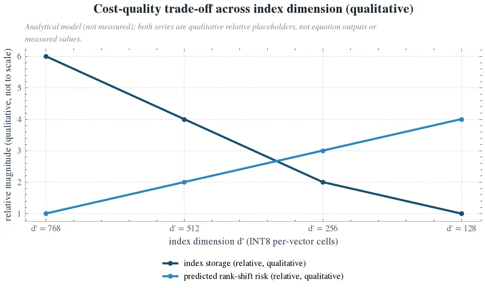

If you are a cloud/AI engineer in Korea running a harness on a self-hosted H200 that keeps thousands of skills in a registry and decides, for each task that arrives overnight, which skills go into context via a hybrid retrieval router, this article is for you. In the series where ThakiCloud has priced each stage of the router, the one stage left unpriced is the single dense embedding backbone. The paper this article introduces closes that last gap: it separates, in closed form, the share of accuracy the dense lane actually delivers (the dense share), and finds the cost-quality knee across backbone size, INT8 index quantization, and index dimension on a self-hosted H200. One thing before you read on. Every number in this paper is a closed form or exact arithmetic under the declared nominal parameters, and the 14-arm factorial measurements are pre-registered by protocol. The measurements have not been run yet: the paper hands you the map and the timetable along with the model.

## The problem: the router's last unpriced stage, the embedding backbone

The production router runs on two lanes. A lexical BM25 lane and a dense cosine similarity lane retrieve independently, and Reciprocal Rank Fusion (RRF, a fusion that merges the top 50 of each lane with k=60) weaves the two lists into one. Merged candidates must pass the injection gate to actually enter the model context, and only skills with a BM25 score of 6.0 or above or a cosine of 0.60 or above survive. One routing mistake means the wrong skill executes in context, so this decision is billed straight to task misses. The registry holds the declared nominal 2,029 skills, and routing quality is scored on a frozen SRA bench of 63 cases (45 positive, 10 out-of-domain hallucination probes, 8 negative forbidden skills).

The dense lane is not decoration. Earlier measurements in the series showed the hybrid router producing an 8.9pp lift over BM25-only in Recall@5 and top-1 while paying a toll of 1,440.3 tokens per decision. That is evidence the dense lane carries real accuracy. But the 8.9pp is only an aggregate figure. Nowhere in the series has the dense lane's own contribution been measured apart from a BM25-only counterfactual, and no price was set on the backbone that produces that contribution. The earlier quantization study also analyzed a single axis: backbone fixed, dimension fixed, only model-side INT8. What it measured was how robust the dense lane is to compression.

So this paper answers two questions. How much of the hybrid routing accuracy is the dense stage's share, and where is the knee of accuracy versus serving cost across backbone size, INT8 index quantization, and Matryoshka index dimension? The production dense backbone is EmbeddingGemma-300M: a 3×10^8-parameter encoder with native dimension 768, truncated to 512 in production. The variables are three axes. A is the encoder size P, B is the quantization of the stored corpus vectors (f32, per-vector INT8, global-scale INT8), and C is the truncation dimension d' ({128, 256, 512, 768}). B is a purely index-side channel, since it touches only the stored corpus vectors while query vectors are freshly produced in f32 at every serving. A and C act on both query and corpus through the shared encoder.

The measurement design was deliberately borrowed from an unrelated domain. An earlier individual-level cross-protocol decentralization measure from blockchain research wrapped a new metric into a two-level framework: one that attributes part of the protocol-level consensus quality to the share of an individual validator. This paper moves that design itself into skill routing. The retrieval lane becomes the individual-level unit, the fusion protocol (BM25-only versus RRF hybrid) corresponds to consensus, and the dense share becomes the individual-level contribution metric. What crossed over is structure, not numbers. Before judging a large protocol, first measure the contribution of the small unit.

*A task query fans out into the lexical BM25 lane and the dense embedding lane. RRF fusion (k=60) and the production injection gate form the set of skills that gets injected, and the dense-off BM25-only arm is the counterfactual that defines the dense share. A conceptual schematic, not drawn from measured data.*

## dense share: separating recovery from loss

The dense share is defined per query as Δ_K. If the hybrid arm reinserts a gold skill the BM25-only arm missed, that is recovery; if the hybrid removes what BM25-only had matched, that is loss. Δ_K is recovery minus loss, and the overall dense share is the mean across all positive queries. The paper shows this quantity in closed form under RRF.

The top-1 level result is a gate. Suppose the gold sits at lexical rank i (i ≥ 1); let G be the dense rank of the gold and A the dense rank of the lexical top-1. Under the binding challenger assumption (the lexical top-1 is the strongest fused competitor), the necessary and sufficient condition for the hybrid top-1 to be the gold is (1/(k+G)) − (1/(k+A)) > i/(k(k+i)). The right-hand side is the fused-score gap the lexical lane creates on its own at rank i, and the dense lane must overcome that gap with its rank contrast. The special case G=0 is the cleanest: when the gold is top-ranked in the dense lane, the top-1 is recovered only if the dense lane ranks the wrong lexical top-1 one slot below the gold's lexical offset (at least i+1). The loss gate is the mirror image. The dense lane can knock out the correct lexical top-1 gold only if it places that gold at its own rank 2 or lower (0-indexed). The geometry that bounds recovery is the geometry that bounds damage.

Is the Recall@5 level a different machine? If the gold sits at lexical rank 5 through 49 (outside the BM25 top-5, inside the fusion list), it lands in the hybrid top-5 whenever the dense rank G is 49 or below. Even the worst corner at k=60, (i,G)=(49,49), gives a fused score of 2/109 that beats the lexical fifth candidate's 1/64, because the arithmetic is strict. At first order, the top-5 dense share is the mid-list mass, i.e., the frequency with which the gold sits at lexical rank 5 through 49, minus the loss term. The two levels carry different query classes: top-1 carries near-tie discord queries, Recall@5 carries the mid-list mass. The single scalar of "dense contribution" mixes these two mechanisms, and the 8.9pp aggregate lift unpacks as a sum across the two discord sets. So does the fusion tax, which is a gain in aggregate but a loss on individual queries. The tax is charged on exactly the near-tie discord queries where the dense lane overturns the correct lexical top-1 without compensating recovery.

One more number to remember: RRF damping. Moving a candidate one slot in the dense list changes the fused score by at most 1/(k(k+1)), which at k=60 is 2.73×10^-4 fused-score units. Every channel through which an index-side perturbation reaches the fused score passes through this damping, and it is the lever that makes the quantization and truncation logic in the next section possible.

## How perturbation reaches the fused score: INT8 quantization and Matryoshka truncate

The two index-side axes touch only the stored corpus vectors; query vectors are freshly produced in f32 at every routing decision. Perturbation comes only from the stored codes and the dimension. The paper propagates this perturbation to the fused score at first order.

Per-vector INT8 attaches a 4-byte scale per vector to 1 byte per coordinate, then renormalizes after dequantization. The per-dimension rounding error is uniform over a half-step of s_v/254, and under the nominal spectral constant 2.5 for near-isotropic unit vectors, the standard deviation of the cosine shift is about 2.5×10^-4 at d'=512 and about 5.0×10^-4 at d'=128. Scheme choice is the variable. In global-scale INT8 the whole corpus shares a single 4-byte scale, so a vector whose own max is smaller than the corpus max is quantized with a coarser effective step. Its variance inflates by the square of that ratio, and in the nominal registry with a single outlier (ratio 8) the variance of that vector is 64× the per-vector value. On variance, per-vector wins.

Dimension truncation is a different channel. Matryoshka truncation replaces a vector with its d' prefix, and the first-order cosine shift is ½(τ_u+τ_v)·cos_full. τ is the truncated tail energy, the energy of the tail that gets cut off. This shift is not a uniform shrinkage but a per-candidate positive bias. Because τ differs for each stored vector, the dense list reorders candidate by candidate, and the size of the reordering is captured by the spread of the shift across the dense top-50. The paper declares a model-safe band of d' ≥ 0.3·d. On the 768 grid, 256, 512, and 768 are inside the band, and 128 (83.3% reduction) is in the heavy-truncation regime. The anchor for this band is a result from outside the series: the boundary from the first direct comparison of random truncation with MRL training, which found that random truncation is nearly harmless up to a 70% reduction.

The two channels act on different vector factors, so they combine in quadrature: σ_tot = √(σ_int8² + σ_trunc²). On top of that sits the rank-safety margin diagnostic. When the flip-ball radius δ* that a query is certified with from its fused score is divided by the worst-case cost δ_RRF of one dense rank move, it absorbs δ*/δ_RRF rank positions. The combined shift moves J·σ_tot rank positions at first order, where J is the dense-list density (nominal 50 ranks per 0.1 cosine, median gap 0.002). A configuration (P, d', quant) is rank-safe for a query if and only if M = δ*_rank − J·σ_tot ≥ 0, and the whole registry is rank-safe when M ≥ 0 for every query on the frozen bench. Read in numbers: at d'=512 per-vector INT8, J·σ_tot is about 0.125 rank positions, so the configuration is rank-safe for every query whose certified margin exceeds 3.4×10^-5. At d'=128 the requirement doubles to 6.8×10^-5, with the heavy-truncation spread added on top.

The operational value of this diagnostic lies in its inputs. Everything, including δ* (the fused list), σ_trunc (the stored-side tail energy), and σ_int8 (the declared quantizer form), comes out of the float scores the router already produces. Because it is computed from float scores alone, the configuration is priced without putting INT8 serving in the loop.

*The f32 cells have no quantization or truncation shift, and among the INT8 per-vector cells the predicted rank-shift risk grows as the index dimension gets smaller. The 128-dim cells additionally enter the heavy-truncation regime. An analytical model over declared nominal parameters, not measured values.*

## cost-quality knee: encoding dominates, so the index side is nearly free in GPU time

The cost model runs on the declared H200 card: $2.00 per GPU-hour, dense throughput at 30% utilization of 989 TFLOPS, task queries of 32 tokens, skill descriptions of 128 tokens, 10,000 routing decisions per overnight cycle, and a 2,029-skill registry. Encoding a query with a P-parameter backbone costs 2·P·T_q FLOP, which at P=3×10^8 is 19.2 GFLOP, roughly 65µs, around $0.0004 per cycle. One routing decision's dense matvec uses 2·N·d' FLOP, which at d'=512 is 2,077,696 FLOP, less than 1/9,240 of query encoding. Rebuilding the index after a registry mutation is 1.56 PFLOP, about 5.5 seconds, on the order of $0.003, and that happens once per mutation, not once per decision. The resident index is N·d'·b bytes, with b = 4 for f32, 1+4/N for per-vector INT8, and 1 for global-scale INT8.

The structural result is encoding dominance. For every production width d' with P ≥ 3×10^8, the matvec-to-encoding FLOP ratio is below 10^-3, and exactly 1/9,240 at the production point. The index-side axes (dimension, quantization) enter accuracy only through σ_trunc and σ_int8, and contribute less than 0.1% of cycle GPU time. The size axis P enters accuracy as the declared backbone quality level A_0(P), and cost as encoding and build. The two axis families decouple in cost and couple only in A_0(P). So the cost-quality knee splits into two. The index-side knee, trading index storage for accuracy, is cheap in GPU time; the size knee, trading GPU encoding and build for backbone quality level, is the opposite. The fusion protocol is fixed at RRF k=60, and query-adaptive fusion weights are a separate axis that the model does not take on.

The index-side accuracy model is first-order in cosine shift: A(P, d', quant) = A_0(P) − κ·σ_trunc − κ·σ_int8, with the declared conversion factor κ at 25pp per unit-1 cosine shift. The pre-registered knee rule is simple: among the configurations whose gated-Recall@5 stays within the declared 2.0pp of the best cell, it is the minimum-storage cell. The model's point prediction puts the knee at (512, per-vector INT8). The cheaper (256, per-vector INT8) cell remains inside the allowed band, and (128, *) is outside it. By exact byte arithmetic against the f32-512 reference, that is 3.98× savings at 512 and 7.9× at 256.

One corollary gives the rule its reuse value. Index storage is linear in N, the per-pair cosine shift is independent of N, and the one-time build cost is linear in N as well. The index-side knee is therefore invariant to registry scale. Even if a self-evolving registry doubles from 2,029 to 4,058, the configuration rule stays put; only storage, build time, and absolute dollars move linearly. In plain terms: no matter how the skill count grows, you do not need to re-ask "which configuration to pick".

The paper packages this as a 5-step decision rule. d* is set to the smallest production step at or above 0.3·d_P (in the declared nominal d_P=512, so the floor is 153.6). quant* is INT8 per-vector. The byte count stays within 4N bytes of the global-scale variant while keeping per-vector precision. At every registry mutation, the rank-safety diagnostic is rerun on float scores to recertify. If the diagnostic fails, the rule falls back to (d_P, f32) and holds the anchor until a new configuration is certified. Storage and build budgets are rederived at the new N. On the declared nominal registry, the rule outputs (512, int8_per-vector): 1.05 MB against 4.17 MB, 3.98×. The value of the rule is not in steady-state GPU dollars. Compared to the declared $2,040/night step-execution budget, the routing stage is a drop, and what the rule is for is the storage and build frontier, the certified rank-safety margin, and the fact that it recertifies its own configuration after the registry changes, without a new factorial measurement.

*Shrinking the index dimension from 768 to 128 trades roughly linearly falling storage for rising predicted rank-shift risk. 128 enters the heavy-truncation regime, and the knee rule picks the smallest dimension that is rank-safe within the declared accuracy allowance. An analytical model over declared nominal parameters, not measured values.*

## What the company, society, and science gain

What this paper gives ThakiCloud's self-evolving harness is the cheapest embedding backbone configuration that holds SRA routing accuracy. It binds the three axes of size, INT8 index quantization, and index dimension into a single cost-quality knee, and the 5-step rule recertifies the choice even after registry mutations. The registry changes every night, so the configuration the rule recertifies is precisely the H200 serving cost saving of the nightly router.

Teams outside the company keep a reproducible ablation recipe. Instead of opaque vendor defaults or leaderboard-first model selection, they can rerun the dense-share decomposition and the per-bit, per-dimension knee rule on their own registry and their own bench. That the top leaderboard model is rarely deployment-optimal is an established result from earlier research, because general-domain benchmarks (the MTEB family) measure retrieval quality only, not routing contribution. The recipe is structurally domain-specific, and it lowers the cost and energy bar for self-hosting accurate skill routing.

Scientifically, it fills the missing dense-stage ablation of the hybrid skill router. Under RRF fusion it separates the dense share from the lexical share, recovery from loss, and prices routing accuracy per bit and per index dimension. The top-1 recovery gate and the rank-safety margin diagnostic turn lane ablation into closed-form certificates, and the lane-level contribution measurement carried over from the blockchain cross-protocol design is a domain-specific upgrade of general embedding benchmarks. The earlier single-axis quantization study is superseded by an explicit upgrade spanning the full size × quantization × dimension space, including the BM25-only counterfactual.

## What not to trust: the scope of the declared values and the pre-registered protocol

The paper enumerates its own limits in five.

First, the binding challenger assumption is a first-order model. Every closed form holds under the declared nominal fusion constants (k=60, FUSE_N=50, equal lane weights). Even if query-adaptive fusion weights or a rerank stage move those constants, what moves is the constants inside the closed forms, not the geometry. The discord set still splits into a near-tie top-1 component and a mid-list Recall@5 component, and step 3 of the rule recertifies after every registry mutation.

Second, the size axis is a single point, EG-300M. The dense-only accuracy anchor A_0(P) is a declared nominal only at this P; it has not been instantiated across the family. Follow-on backbones (unified multimodal representations) or sparse mixture-of-experts encoders (active parameters versus serving throughput trade-off) are the directions the axis points toward, and steps 1 and 5 of the rule rederive (d*, quant*) and the budgets for each declared P.

Third, bench resolution. On the fixed 63-case SRA bench, one positive case is 1/45 of Recall@5, about 2.2pp. That is larger than the declared 2.0pp knee tolerance: a single flipped case can push a cell across the knee boundary. The protocol is a floor, not a ceiling. The arms and metrics scale to a larger bench without touching the model.

Fourth, the declared nominal card. All dollars scale linearly with the card, and the $2.00 per GPU-hour H200 rate is a declared value, not a market measurement. The storage and FLOP ordering between configuration cells is invariant to the card, but absolute dollars are not. The registry size of 2,029 is also nominal rather than a recorded snapshot count; the pre-registered run pins the snapshot at its start and calibrates the nominal.

Fifth, cross-lingual interaction is unmodeled. For bilingual queries, the perturbation budget combines additively with the language-wall offset from earlier research, and a joint analysis is out of scope. The rule's fallback covers that degradation through step-3 recertification.

The pre-registered protocol is where the model's predictions meet measurement. There are 14 arms: bm25_only on the byte-identical lexical path (the dense-off counterfactual); dense_only at each of the four dimensions (contribution isolation); hybrid over the 8 cells of dimension {128, 256, 512, 768} × {f32, int8_per-vector} under the production gate and RRF fusion (k=60, FUSE_N=50, 0-indexed rank); and hybrid over the single cell (512, int8_global-scale). All arms share the same pinned snapshot, analyzer, and gate, so any difference between cells is attributable only to the dense index configuration (d', q). The metrics are Recall@5, Top-1, gated Recall@5, hallucination rate, negative-avoidance at k=5 and k=8, and the available-only variant, and each query records its recovery set and loss set against the hybrid(512, f32) reference. The knee is the minimum-storage hybrid cell within 2.0pp (declared) of the best gated-Recall@5 cell. No arm, threshold, or tolerance is set post hoc.

The paper itself and its accompanying materials are available on the paper's detail page. https://huggingface.co/datasets/thaki-AI/daily-paper-2026-11-22-dense-share-embedding-backbone-frontier

*Every number in the body is a closed form or exact arithmetic over the declared nominal parameters of this paper: registry of 2,029 skills, H200 at $2.00/GPU-hour, 989 TFLOPS at 30% utilization, query 32 tokens, description 128 tokens, 10,000 routing decisions per overnight cycle, nominal spectral constant 2.5, dense-list density of 50 ranks per 0.1 cosine (median gap 0.002), conversion factor of 25pp per unit-1 cosine shift, knee tolerance 2.0pp, RRF k=60, FUSE_N=50, injection gate BM25 6.0 or cosine 0.60. The 8.9pp hybrid-over-BM25 lift and 1,440.3 tokens per decision are measured citations from an earlier paper in the series. The three figures are a conceptual schematic (the first) and analytical models over declared nominal parameters (the other two); none is drawn from measured values. The 14-arm factorial protocol is pre-registered, and its measured results are not included in this paper.*
