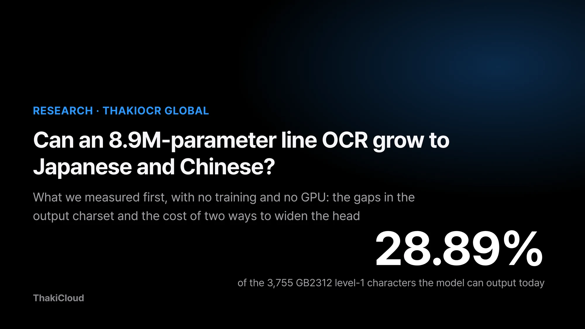
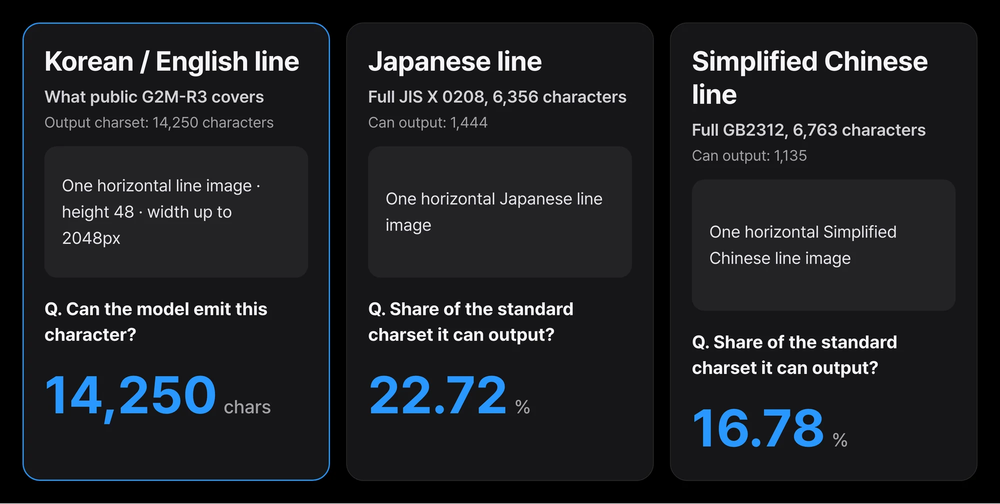
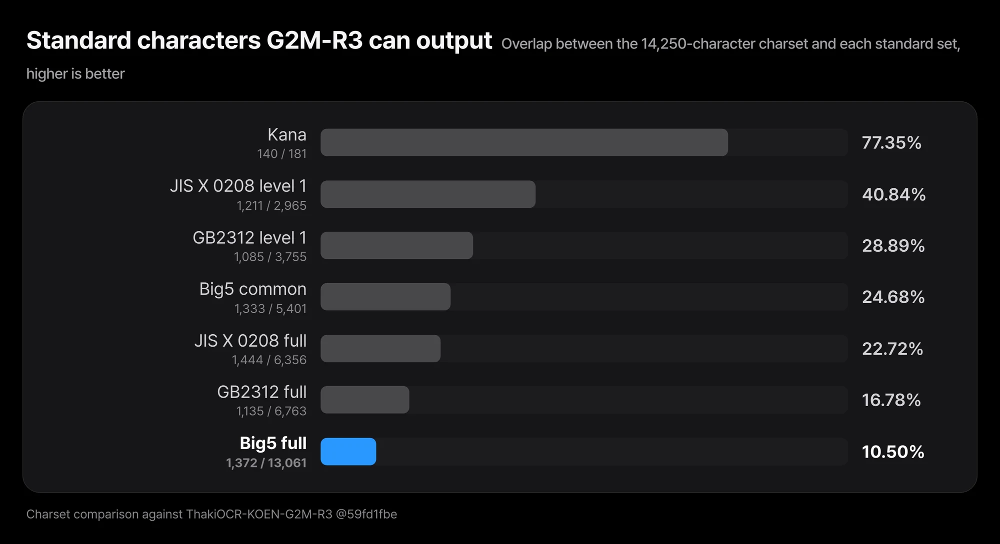
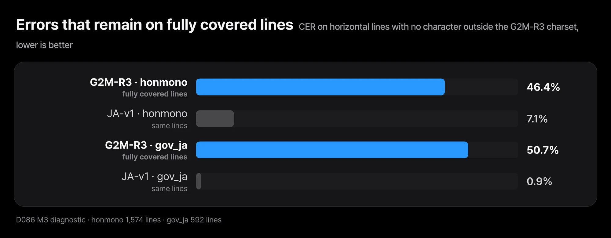
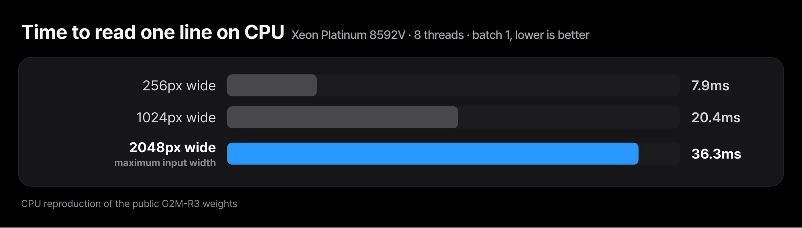
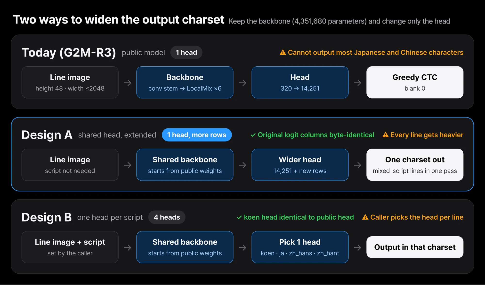
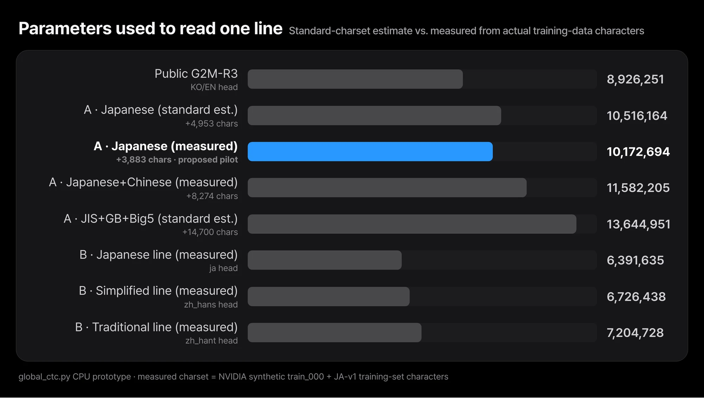

Once a small Korean-English text recognizer becomes useful, the next request arrives quickly. Someone wants it to read documents from a Japanese supplier. Someone else wants Chinese receipts handled by the same model. This post is for the OCR and model engineers who get those requests.

Here is the short answer. The 8.93M-parameter line recognizer we released cannot even output most Japanese and Chinese characters. Of the 3,755 common Simplified Chinese characters in GB2312 level 1, only 1,085 (28.89%) are in its charset. So is it enough to add output characters? When we scored only the Japanese lines made entirely of characters the model can output, the error rate was still 46.4% and 50.7%. The model is [ThakiOCR-KOEN-G2M-R3](https://huggingface.co/ThakiCloud/ThakiOCR-KOEN-G2M-R3).

So this post reaches two conclusions. The output head has to grow. And that alone is not enough: the backbone has to learn Japanese character shapes too. This time we used no training and no GPU at all, and measured the numbers behind both conclusions.

*A pre-check for multilingual expansion, measured against ThakiOCR-KOEN-G2M-R3 (revision 59fd1fbe). No training and no GPU were used.*

## In plain terms

Think of the type case in an old print shop. However well the typesetter reads the manuscript, a character that is not in the type case cannot be printed. That spot stays blank or gets filled with a similar-looking piece of type.

In an OCR model, the type case is the output charset, and the head is the part that holds it. The eyes and hands that read the manuscript are the backbone. G2M-R3's type case holds 14,250 pieces of Korean and English type. Hand it a Japanese or Chinese manuscript and most of the time there is no type to pick up.

But this typesetter also made many mistakes on manuscripts whose type was in the case. Having only read Korean and English, its eyes were not trained on Japanese shapes. Enlarging the type case and teaching the typesetter to read Japanese have to happen together.

## Today the model answers only from 14,250 characters

G2M-R3 is a CTC line recognizer: it takes one cropped line of text and returns one string. CTC is a training and decoding method that maps a whole line to a character sequence without aligning each character's position. Input is a grayscale image 48 pixels high and up to 2048px wide. Longer lines are rejected, so you have to split them.

The structure is simple. A convolutional stem with stride 4 turns the image into a sequence of frames. The frame count is (width+3)//4, which is 512 frames at 2048px. The frames pass through Linear 160→320, six LocalMixBlocks and a LayerNorm. A final head, Linear(320, 14251), picks blank or one of 14,250 characters for each frame. Decoding is greedy CTC with blank at index 0. Output is NFC-normalized and NBSP becomes a regular space.

Of the 8,926,251 parameters, the head holds 4,574,571, or 51.25%. The backbone holds 4,351,680. Every character added to the charset adds 321 parameters to the head: 320 weights and one bias. In other words, the part that holds the output charset is half the model.

*Whatever line you feed the model, a character that is not in its output charset can never be an answer. Percentages are the share of each standard charset that is in the G2M-R3 charset.*

Direction is the other constraint. The model supports only horizontal lines written left to right. Vertically typeset Japanese is out of scope for this expansion as well. Every plan and number in this post is for horizontal lines.

## Most of the Japanese and Chinese standard charsets are outside the type case

We compared the model's charset with each region's standard character set.

| Standard charset | Characters in the standard | In the G2M-R3 charset | Share |
|---|---|---|---|
| GB2312 level 1 (common Simplified) | 3,755 | 1,085 | 28.89% |
| GB2312 full | 6,763 | 1,135 | 16.78% |
| Big5 common (Traditional) | 5,401 | 1,333 | 24.68% |
| Big5 full | 13,061 | 1,372 | 10.5% |
| JIS X 0208 level 1 | 2,965 | 1,211 | 40.84% |
| JIS X 0208 full | 6,356 | 1,444 | 22.72% |
| Kana | 181 | 140 | 77.35% |

Kana is highest at 77.35%, and everything else is below half. Even JIS X 0208 level 1, the common Japanese kanji, is at 40.84%. Full Big5 for Traditional Chinese is only 10.5%.

*Apart from kana, more than half of every Japanese and Chinese standard charset is outside the output charset.*

This table is about a ceiling, not accuracy. Even if the backbone saw Japanese character shapes perfectly, more than 77% of full JIS X 0208 would have no type to pick up.

## Even lines with all their type in the case kept about half their errors

To see how large the gaps are on real lines, we scored four Japanese evaluation sets. The comparison, JA-v1, is a frozen set of predictions made earlier by an existing Japanese VLM LoRA model. Both models were scored on the same horizontal lines.

| Set | Lines | G2M-R3 CER | JA-v1 CER |
|---|---|---|---|
| gov_ja | 2,000 | 59.4% | 1.1% |
| tc_matched | 300 | 70.7% | 9.2% |
| honmono | 1,927 | 56.6% | 7.0% |
| ndl_p2 | 111 | 92.1% | 5.1% |

CER is the share of ground-truth characters read wrong; lower is better. In all four sets more than 1% of ground-truth characters fall outside the G2M-R3 charset, so every set is labeled UNSUPPORTED_VOCAB. This table alone cannot compare the two models.

So we went one step further. We kept only the lines whose ground-truth characters are all inside the G2M-R3 charset and scored them again. That left 1,574 lines in honmono and 592 in gov_ja. These lines have no type-case problem, yet G2M-R3 still had 46.4% CER on honmono and 50.7% on gov_ja. On the same lines JA-v1 had 7.1% and 0.9%.

*Even on lines made only of characters it can output, G2M-R3 had 46.4% and 50.7% CER. Widening the head is not enough; the backbone has to learn Japanese character shapes.*

This is the central finding of the post. A large part of the error comes not from missing type but from a backbone that does not know Japanese character shapes. Appending new rows to the head while freezing the backbone will not reduce it. Expansion training has to move the backbone too.

We also scored idoc_ko (283 lines), built as a Korean regression check. G2M-R3 scored 56.6% and JA-v1 72.8%. On diagnosis, the set turned out to be unsuitable for line-recognition evaluation. 46 rows that look like several lines in one crop had 120% CER, with predictions 2.1 times longer than the ground truth, and they account for 57% of all edits. 18 rows whose ground truth covers only part of the crop reached 990% CER. Both models had the same exact-match rate, 42.8%. So we do not read G2M-R3's 56.6% versus JA-v1's 72.8% as a difference in ability.

## Before widening anything, we pinned down the Korean-English baseline on CPU

Moving the backbone makes it even more likely that existing Korean and English output will shift. To know whether it did, we first need today's values nailed down. So we reran the public weights on CPU, with no retraining, and compared them with earlier records.

| Set | Lines matching earlier predictions | CER | CER change vs record | Digit F1 |
|---|---|---|---|---|
| ko_val (5,000 lines) | 99.92% | 5.43% | +0.002 pt | 0.917 |
| en_val (5,000 lines) | 99.94% | 4.64% | +0.001 pt | 0.870 |

Predictions reproduced almost exactly on both sets, and the CER change was under 0.01 points. Digit F1 separately measures whether numeric tokens were read correctly. For real-document sets we rescored earlier predictions: gold_dev 4.1%, hold_line 4.4%, real_ival_line 8.2% and real_ival_word 8.3%. These agree with the values in the [G2M-R3 release post](/tech-blog/en/research/thakiocr-g2m-r3-real-document-adaptation/).

We measured speed as well. On a Xeon Platinum 8592V with 8 threads and batch 1, the model took 13.35 ms per line, or 74.9 lines per second. Peak memory (RSS) was 710 MiB. With a single thread it took 40.9 ms per line, or 24.4 lines per second.

Larger batches made it slower. At batch 128 with 8 threads, throughput dropped to 14.6 lines per second and memory rose to 6.1 GiB. On CPU, batch 1 is the better choice.

*Longer lines take longer, but even the maximum 2048px width took 36.3 ms. Per-width values are medians; across the full run at the same setting, the average was 13.35 ms per line.*

## We counted which characters the training data contains

How far to enlarge the type case cannot be decided from standard charsets alone. So we counted the train_000 shards of the candidate multilingual training data, NVIDIA OCR-Synthetic-Multilingual-v1 (CC BY 4.0), on CPU.

| Shard | Lines | Distinct chars | Not in G2M-R3 | Token OOV | Chars covering 99% / 99.9% | Vertical |
|---|---|---|---|---|---|---|
| ja | 472,197 | 5,070 | 2,714 | 4.57% | 1,607 / 2,882 | 3.23% |
| zh_hans | 471,007 | 7,397 | 5,079 | 17.59% | 2,537 / 4,669 | 3.50% |
| zh_hant | 473,847 | 8,887 | 6,230 | 14.61% | 2,993 / 5,642 | 3.25% |

OOV is the share of character occurrences outside the G2M-R3 charset. The ja shard covers 99% of occurrences with 1,607 characters and 99.9% with 2,882. Far fewer characters than a full standard charset cover most of the real data.

We also checked the CTC length condition: the ground-truth sequence has to fit in the 512 frames of a 2048px line. Lines that fail it were 0 in ja, 5 in zh_hans and 3 in zh_hant. But 3,957 ja, 3,560 zh_hans and 4,139 zh_hant lines are wider than 2048px and must be split or dropped. Across the 455,288 horizontal ja lines, median width is 294px and the 99th percentile is 1,999px. Characters per line have a median of 10 and a 99th percentile of 71.

We counted the JA-v1 training set of real Japanese lines too. It has 41,828 lines plus 4,274 pages, and 86% of the lines (35,912) are vertical. That leaves 5,916 horizontal lines, of which 381 fail the CTC length condition. It has 4,557 distinct characters, 2,901 of them missing from G2M-R3, for an OOV of 12.85%. Since vertical text is out of scope, only the horizontal lines are usable.

We also checked overlap between evaluation and training data. Strings identical to honmono ground truth appear in 820 lines of NVIDIA ja and 1,383 lines of the JA-v1 training set. This is a text-only match, and short boilerplate can inflate it. Even so, the pilot training data will drop all such lines.

## We measured the size of two ways to enlarge the type case

Design A extends the shared head. It keeps the single head and appends new character rows after the existing ones. New rows start with zero weights and a bias set below the existing minimum. So right after extension, the logit columns for existing characters are byte-identical to the public model.

Design B shares the backbone and keeps one head per script: koen, ja, zh_hans and zh_hant. The koen head is identical to the public head. The caller decides which head to use for each line; there is no automatic detection.

*Design A appends new character rows to a single head. Design B shares the backbone and keeps a separate head per script. Both are untrained CPU prototypes.*

We counted parameters two ways. First we estimated them from standard charsets. Then we measured them again from the characters actually found in the training data above, that is, in the NVIDIA train_000 shards and the JA-v1 training set.

| Configuration | Estimate from standard charsets | Measured from training-data characters |
|---|---|---|
| Public G2M-R3 | 8,926,251 | 8,926,251 |
| A, add Japanese | +4,953 chars → 10,516,164 | +3,883 chars (18,133 total) → 10,172,694 |
| A, add Japanese + Chinese | +14,700 chars (28,950 total) → 13,644,951 | +8,274 chars → 11,582,205 |
| B, all heads loaded | 17,389,095 | 16,194,012 |
| B, one Japanese line | 6,450,378 | 6,391,635 |
| B, one Simplified line | 6,522,924 | 6,726,438 |
| B, one Traditional line | 8,544,582 | 7,204,728 |

Measured B head sizes are ja 2,039,955, zh_hans 2,374,758 and zh_hant 2,853,048, with the koen head unchanged at 4,574,571. Design A with Japanese only comes to 10,172,694 measured, about 14% larger than the public model.

*Counted from actual training-data characters, design A with Japanese drops to 10,172,694 parameters, smaller than the standard-charset estimate. Design B uses only one head per line.*

On size alone, design B is lighter per line. We still recommend design A first. As shown above the backbone has to be trained, so either design needs replay, mixing Korean and English data back in. What remains for B is the language-selection contract. The caller must pick a script for every line, and on lines mixing Japanese with Latin letters or digits it risks picking the wrong head. Design A has no such contract and reads mixed lines with one head.

Both designs are implemented as CPU prototype code and pass 8 tests. They load the public `model.safetensors` as-is and check the preservation conditions. Neither has been trained, so this post contains no Japanese or Chinese accuracy.

## We proposed design A for Japanese as the first GPU pilot

Earlier runs give a good estimate of training cost. The reference is one B200 at batch 128.

> Cost basis: roughly 0.05 to 0.057 GPU-hours per 1,000 steps. R3A, the run that produced G2M-R3, used 0.569 GPU-hours for 10k steps and 1.112 for 20k.

So we proposed the first pilot as design A extended to Japanese: 20k steps, batch 128, about 1.1 to 1.4 B200 GPU-hours, capped at 1.5. Training data is NVIDIA ja horizontal lines, JA-v1 horizontal real lines and Korean-English replay, with strings identical to evaluation ground truth removed.

The pass conditions are set in advance. Korean and English CER must move by no more than 0.5 points. Japanese character OOV must be 1% or less. Claims stop at horizontal line recognition. This pilot is still awaiting approval and has not been run.

## Limits to know before you use this

- **There is no Japanese or Chinese accuracy yet.** No training and no GPU were used. The numbers above are ceilings, diagnostics and costs, not the accuracy of an extended model.
- **Vertical Japanese is out of scope.** Only horizontal lines are covered, and lines wider than 2048px must be split.
- **The Japanese table is not an accuracy comparison.** All four sets are labeled UNSUPPORTED_VOCAB. The fully covered results are a diagnosis that the backbone needs training.
- **idoc_ko is not used for line-recognition evaluation.** Multi-line crops and partial ground truth make it unfit for comparing ability.
- **Train-eval overlap was counted on text only.** Short boilerplate may inflate it, and the pilot drops the overlapping lines.
- **CPU numbers come from one server type.** They were measured on one Xeon Platinum 8592V and may differ on other CPUs.

## In Paxis document work, charset and backbone go together

When Paxis automates document work, OCR is the first step that fills in values. A small line OCR like G2M-R3 runs at around 13 ms per line even on CPU, so it is easy to keep on an internal network. But before routing documents from overseas partners through the same flow, you have to check two things: whether the model can output those characters, and whether it has learned their shapes. If either is missing, a later verification step cannot fix it. The verification setup is covered in the [Paxis verification post](/tech-blog/en/agentops/thakiocr-paxis-verify-before-commit/).

## Wrapping up

Today G2M-R3 cannot output most of the Japanese and Chinese standard charsets. Only 28.89% of GB2312 level 1 and 40.84% of JIS X 0208 level 1 are in its type case. Yet even on Japanese lines whose type is all in the case, CER was 46.4% and 50.7%. So multilingual expansion means widening the head and training the backbone with it. Counted from actual training-data characters, design A for Japanese is 10,172,694 parameters, and we proposed it with Korean-English replay as the first pilot.

You can run the same check on your own model. First count the overlap between its output charset and the character set of your target language. Then score only the lines whose characters are fully covered; that separates the head problem from the backbone problem.

## Sources and data

- Base model: [ThakiCloud/ThakiOCR-KOEN-G2M-R3](https://huggingface.co/ThakiCloud/ThakiOCR-KOEN-G2M-R3) (Apache-2.0, research preview, revision 59fd1fbe).
- Candidate multilingual training data: NVIDIA OCR-Synthetic-Multilingual-v1 (CC BY 4.0). We aggregated the character distribution of the ja, zh_hans and zh_hant train_000 shards.
- This post contains no originals, crops or ground-truth text from the AI-Hub data used to train G2M-R3 or from the evaluation sets. All numbers here are aggregates.
- Earlier posts: [G2M-R3: real-document adaptation](/tech-blog/en/research/thakiocr-g2m-r3-real-document-adaptation/) · [Dense-R2 research log](/tech-blog/en/research/thakiocr-dense-r2-real-document-adaptation/) · [G2M-R2: three times the training](/tech-blog/en/research/thakiocr-g2m-r2-three-times-training/)
