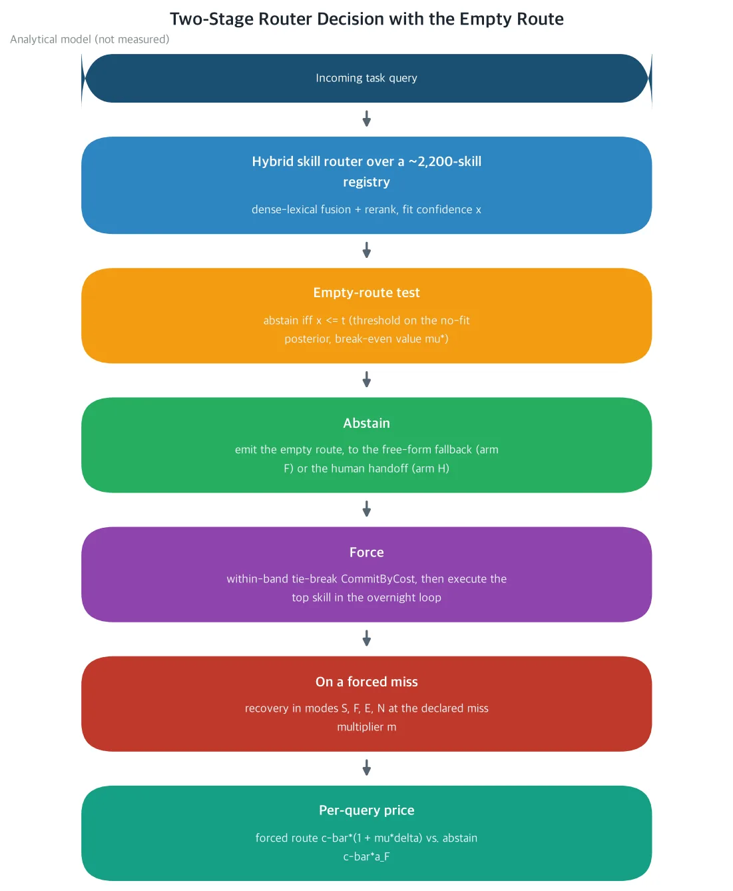
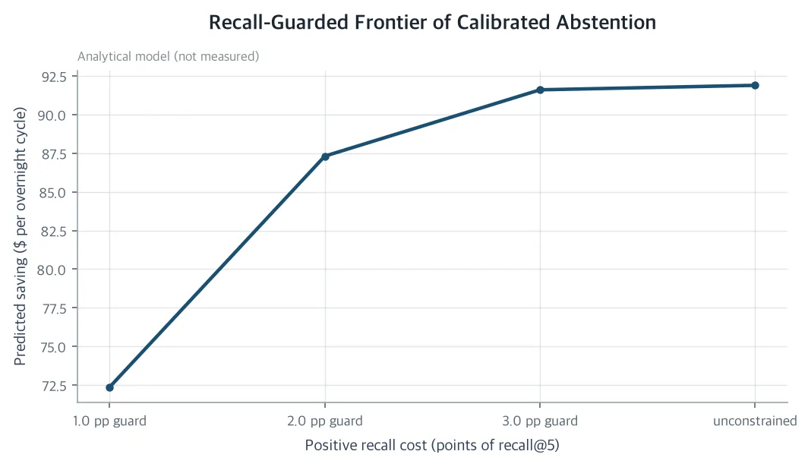
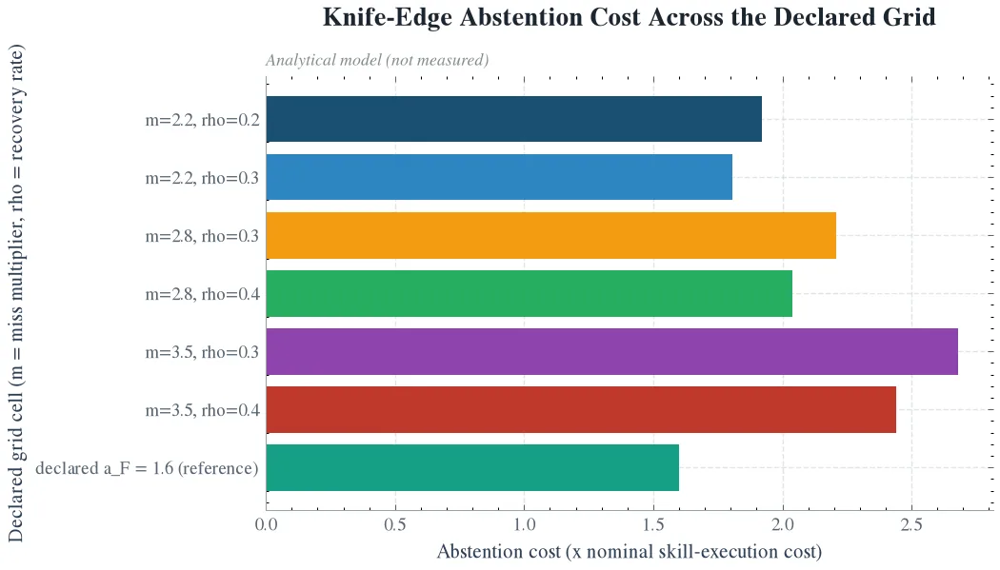

An article for people running unattended agents over a large skill registry on self-hosted GPUs and having to set the price of a router failure. This paper prices the moment the router can say 'I will not route' on tasks where no registered skill fits, as a cost-optimal abstention threshold. On the declared price card, is the current frozen 50.0% negative avoidance gate under-abstaining. That is, abstaining too little. If you swap in a calibrated threshold, negative avoidance rises to 86.6%, positive recall@5 drops 3.40 points in exchange, and an overnight saving of $91.89 (3.65% of the declared total) is expected. A deployment rule for when the router should stand down in the unattended overnight loop running a 2,200-skill registry on a self-hosted H200.

One thing before you read on. This is an analytic paper, and it takes its position on declared premises. It reports no new measurements. Every number is either a closed-form prediction on declared nominal premises or a result attributed to a cited source. The three figures in the body are schematics drawn by the analytic model, not measured data. Confirmation and falsification are the job of the arm-and-falsification protocol preregistered at the end of the paper, made up of four arms (A0-A3), four measurements (M1-M4), and five falsification criteria (F1-F5). F3 preregisters the null that the frozen gate is already knife-edge, i.e., already cost-optimal, so the analysis is designed not to read as an anecdote.

## In plain terms: the dispatch center's 'do not dispatch' decision

Think of taxi dispatch. When the app takes a call, the dispatch center decides two things: which driver gets it, and whether it goes out at all. If you decide not to dispatch, the call waits or rolls over to another means of transport. But if you decided to dispatch and in fact no driver fits, you force the nearest one onto it. That driver makes a wasted trip out, arrives, and gets cancelled. Fuel and time are gone, and the caller's trust goes with them. Forcing it on is the downstream cost of a failed route; not dispatching is the price of an empty dispatch. Both sides have a price. Yet the dispatch center's boundary rule is a single line: 'dispatch if the score exceeds the constant.' A score constant is dividing two choices that both have value.

The skill router is the same. The router's decision has two parts: which, which of the registered skills to pick, and whether, if no skill fits at all, emit the empty set and call the fallback. Evaluation practice prices which obsessively: recall@k, top-1, set recall. whether is left to a score constant. This paper prices whether. The downstream miss cost of a forced route is already priced in this series (Miss Price), and the abstention fallback has a declared cost (latency and human handoff). Once both sides have prices, the boundary is a computation. Not a constant.

## The problem: the 50.0% that looks like a calibration result is a constant

In our harness the symptom is concrete and repeatable. Across two recent SRA-Bench checkpoints, negative split avoidance sat at 50.0% while positive recall@5 improved over the same period. A plateau that looks like the result of calibration, but is actually a constant. The production injection gate executes a skill whenever the fused score clears the declared threshold constant. Look at the score distribution of skill-less tasks and, by accident, 50.0% falls below that constant. This plateau is not the output of optimization; it is a calibration accident whose sign you can even measure.

The objects around this gap are already priced. Miss Price priced the single router miss: the miss multiplier m, the post-miss recovery classes R={S,F,E,N} and the recovery rate rho, the break-even routing accuracy alpha*. But the policy was left open. The price of a miss was set, but the price was never used as a policy. Indifference Band priced the decisions inside a close tie: with the indifference band B_delta and the expected-cost tiebreak CommitByCost(delta), it saves $60.5 overnight at declared nominal rates, the predicted quality cost being 1.18 SRA top-1 points. Composite measured the skill-less split on the same corpus (10 of 75 tasks) and showed that the gate's multi-candidate signal separates skill-less tasks from gold (0/10 gate firings on skill-less tasks, 91.23% gate observation on gold). But it was not calibrated.

This paper closes that loop. It prices the decision for the empty set and turns the measured miss cost into an abstention policy. An explicit upgrade of Indifference Band. That paper asked which of the band members to commit to; this paper first asks whether the right answer is the empty set when no skill fits at all.

## Design: the two arms of the empty route and the declared price card

The harness runs an unattended overnight agent loop on a self-hosted H200 serving path. A hybrid skill router routes each task query over the production registry of about 2,200 self-evolving skills (2,283 entries at the time of the Composite measurement). Dense-string fusion retrieves candidates, the reranker scores the top candidates, and the normalized fit confidence x (the rerank score on the declared scale) is the signal relevant to the router's abstention. The production gate executes a skill only when the fused score clears the declared constant; below it, the task rolls to the free-form fallback. SRA-Bench is the internal skill-routing evaluation corpus, and this protocol uses it with a synthetic out-of-scope query holdout added to the negative split (tasks that no registered skill fits).

On fit confidence x, the policy chooses between force (route to the top candidate and execute in the loop) and abstain (emit the empty route). Abstention has two declared arms: the free-form fallback (arm F) and human handoff (arm H). Costs are declared in units of the nominal per-run price c̄ of a skill execution. c̄ is $0.42 per run, and 4,860 overnight runs match a step-execution budget of about $2,040. In the task mix, the declared share of negative to positive is 0.25 to 0.75. The miss multiplier m is declared at 2.8 and the effective recovery rate rho at 0.30. The pure excess cost after forced-miss recovery, Delta=(m-1)(1-rho), comes out to 1.26. The free-form fallback arm costs a_F at 1.6 c̄, and the human handoff arm a_H at 8.0 c̄. The declared score model uses the positive fit confidence distribution F_p=Beta(9,4) and its mirror F_n=Beta(4,9). The frozen gate boundary tau=0.2976 is the operating point that realizes F_n(tau)=0.5, i.e., 50.0% avoidance. Every entry is a declared nominal input, not a measurement.

On top of that, this paper formalizes the empty route as a reject-option decision over the no-fit posterior mu(x)=P(neg|x). mu(x) is induced by rerank confidence and strictly decreases in x under the declared score model. The threshold policy pi_t abstains when x is at most t, and the avoidance A(t)=F_n(t) and the positive routing rate R(t)=1-F_p(t) give the shape of the cost curve.

*The structure of the policy. The empty-route test (abstain iff fit confidence x <= t, where t is the threshold derived from the no-fit posterior mu*) comes before the within-band tiebreak, and the two sides of indifference are priced by the miss cost of the forced route and the cost of the abstention arm. A schematic of the analytic model, not a measurement.*

## Result 1: indifference and knife-edge, the sign of the 50.0% plateau

For a query with no-fit posterior mu, the expected cost of force is c̄(1+mu*Delta) and the expected cost of abstain (arm F) is c̄*a_F. If 1 < a_F < 1+Delta, there is a single break-even posterior, mu*=(a_F-1)/Delta=(a_F-1)/((m-1)(1-rho)). force is the cheaper side only when mu < mu*. This is the Chow-style threshold of the reject option, with the cost of rejection set to the empty-route arm cost a_F*c̄ and the cost of misclassification set to the downstream miss cost Delta*c̄ of the unattended loop.

The pointwise-Bayes policy is globally optimal. Over the observable score x, the policy that abstains when mu(x)>=mu* coincides with the threshold rule at theta_mu=mu^(-1)(mu*). That threshold rule minimizes the expected cost C(t) over all measurable policies on x, the entire single-threshold policy family. Under the declared mirror Beta pair, f_n/f_p is strictly decreasing, so C'(t) changes sign exactly once and the minimum is unique.

The lemma that faces the frozen gate is the sharpest sentence in the paper. The frozen gate pi_tau (F_n(tau)=0.5, 50.0% avoidance) is cost-optimal if and only if a_F equals the knife-edge cost a_F^dagger=1+mu(tau)(m-1)(1-rho). In other words, the 50.0% plateau is a cost-optimal boundary at exactly one declared abstention cost. The sign, which side of that cost you are on, is model-independent. If mu(tau) > mu*, the gate is under-abstaining (the boundary must move up, avoidance above 50.0%); if mu(tau) < mu*, over-abstaining; if equal, knife-edge.

The regime is three-branched. If a_F >= 1+Delta, mu* falls outside (0,1), the empty route is never cost-optimal, and the policy becomes always-force. The abstention version of Miss Price's router-decommissioning lemma. If a_F <= 1, it becomes always-abstain. The interior regime is 1 < a_F < 1+Delta. The human handoff arm has a_H=8.0 >= 1+Delta=2.26, so it can never be the default interior arm, and the economically relevant empty route is the free-form arm (a_F=1.6). The role of recovery is worth keeping in mind. The better the loop recovers from a forced miss (the larger rho), the smaller Delta and the higher mu*, but a_F^dagger comes down. Read either way, the optimal abstention set shrinks. The better the recovery, the lower the value of the empty route.

## Result 2: the frontier on the declared price card, from 50.0% to 86.6%

Substitute the declared values and the picture compresses to a single frame. Under the declared score model, mu(tau)=0.961 and mu*=(1.6-1)/1.26=0.476. The frozen boundary sits deep in the no-fit region, so the sign test decides: the gate is under-abstaining. The optimal threshold is theta_mu=0.450, giving the knife-edge cost a_F^dagger=1+0.961*1.26=2.210. That is, for the 50.0% plateau to be cost-optimal, the free-form fallback would have to cost nearly twice (2.21 times) a nominal skill run.

Avoidance rises from 50.0% to 86.6%. That is +36.55 points. The price is 3.40 points of positive recall@5. Under the frozen gate, the default abstention rate on positives is 0.16%; at threshold 0.450 it rises to 3.56%. The cost ledger reads as follows. The overnight total cost of the frozen gate, C(tau), is $2,517.24, and at the optimal threshold C(theta_mu) is $2,425.35. The net saving is $91.89 overnight, 3.65% of the declared frozen gate total. Cross-footed, the negative piece saves $123.11/night by avoiding forced misses in the (tau, theta_mu] interval, and the positive piece spends $31.22/night on abandoned matching tasks. The two values sum to -$91.89. In quality-cost terms, that is $27.03 per recall point.

A recall guard shows how far the frontier survives. Since deployment does not accept the unconstrained optimum, the constrained boundaries are computed with the allowed recall cost epsilon at 1.0, 2.0, and 3.0 points. The constraint binds in all three bands, and the saving is concave in the guard. The last recall point is the cheapest one. At the 1.0-point guard, the boundary is 0.385, avoidance 74.2%, saving $72.37. At 2.0 points, boundary 0.420, avoidance 81.4%, saving $87.31. At 3.0 points, boundary 0.443, avoidance 85.4%, saving $91.60. The 3.0-point guard keeps 99.7% of the unconstrained saving, and the avoidance lift exceeds 24 points under every guard.

*The frontier between the overnight net saving (predicted) and the allowed positive recall cost. Because it is concave, the 3.0-point guard keeps 99.7% of the unconstrained optimal saving of $91.89, and the avoidance lift exceeds 24 points under every guard. A schematic of the analytic model, not a measurement.*

The knife-edge sensitivity is checked as well. The directional conclusion rests on the (mu(tau), mu*) pair, so the whole declared (m, rho) grid is swept. a_F^dagger=1+mu(tau)(m-1)(1-rho) ranges from 1.807 to 2.681 across the grid, because every cell sits strictly above the declared a_F=1.6. The frozen gate is under-abstaining not only at the central point but in every cell of the declared grid. The knife-edge that would make the 50.0% plateau cost-optimal only appears if the free-form fallback costs nearly twice a nominal skill run.

*What is the knife-edge cost 1+mu(tau)(m-1)(1-rho) of each cell in the declared (m, rho) grid? Every cell sits strictly above the declared free-form arm cost a_F=1.6, which means the frozen 50.0% avoidance gate is under-abstaining at the central point and at every declared cell. A schematic of the analytic model, not a measurement.*

This frontier composes with the indifference band tiebreak in two stages. The full routing decision is (i) the empty-route test, abstain if x <= t, and (ii) otherwise the within-band expected-cost tiebreak CommitByCost(delta). Under the within-band invariance premise (D4), the stages separate, and the combined prediction is $91.89 + $60.50 = $152.39 overnight, 6.05% of the declared frozen gate total. The quality cost is 3.40 recall@5 points (empty route) plus the 1.18 top-1 points already attributed to Band Two; they are different metrics, so they go to the deployment ledger separately.

## The calibration gap and the attack surface: what the frontier assumes

The entire frontier turns on mu(·). The threshold theta_mu=mu^(-1)(mu*) is a calibration target, and the declared D3 score model (AUROC 0.980) is a premise, not a fact. Four cited results bound the range of the risk. First, in LLM-based IT ticket routing, the correctness AUROC of prompted-LLM confidence was 0.500, and in that setup no threshold beat fixed-rate defer. Our F1 null (declared AUC < 0.65) is the regime where the empty-route frontier degenerates to exactly that device. Second, the gains of confidence-based routing are task-dependent (AUC 0.510 to 0.705), and gains do not transfer across domains, so the judgment does not stand without M1. Third, task-agnostic self-reported confidence (the P(IK) type) showed miscalibration on new tasks. The no-fit posterior must be estimated on the skill-less split and cannot be borrowed from the general answer-confidence channel. Fourth, answer confidence barely separates the answerability of a question: where a hidden-state probe put out 0.69 to 0.77 AUROC, answer confidence sat at near-random levels. The none option is an answerability decision about the registry. The signal has to be a calibrated registry-fit signal, namely the rerank confidence. The current production gate is using that signal uncalibrated (0/10 gate observation on skill-less tasks against 91.23% on gold).

The attack surface is part of the design. The abstention decision is a target for availability attacks, and induced over-abstention under caution-first prompting rose from 9.8% to 86.3% in one model family. The boundary becomes a target: as it moves down, the abstention set grows (declared: 50.0% to 86.6% on negatives). The mitigations are structural. The gate consumes only the fit channel inside the router (no low-confidence content path), the recall guard floors the boundary (the guard values above), and the skill-description channel, i.e., the decoy channel, is subject to provenance checks.

## The preregistered protocol: confirmation and falsification, nulls included

The protocol is preregistered on SRA-Bench, targeting the replacement of the declared D2 to D3 with measured values. The negative split adds a synthetic out-of-scope query holdout to the existing skill-less cases. The declared size is 2,400 positive and 960 negative (mix p_n=0.25). On power (two-sided, alpha=0.05, power 0.8), about 247 positives are enough for the recall effect (3.40 points off the 0.16% base) and about 25 negatives for the avoidance effect (36.55 points off 50.0%). The declared size is about 10 times and 38 times those minimums, leaving headroom for the heterogeneity of the out-of-scope holdout.

Four arms. A0 is the frozen gate (t=tau). A1 is the threshold rule: abstain iff mu_hat(x)>=mu*, using mu_hat(x) fit on the calibration split (temperature scaling). A2 is the grid boundary: without assuming monotonicity, it minimizes the declared expected cost C(t) over t on the calibration split (the robustness arm for the global optimality proposition). A3 is the guard: it clips the A1/A2 boundaries at epsilon = 1.0, 2.0, and 3.0 recall points.

Four measurements. M1, no-fit calibration: attach the sign test sign(mu_hat(tau)-mu*) to the mu_hat reliability diagram on the skill-less split (calibration slope, ECE, neg-discrimination AUROC) and report discrimination and calibration utility separately. M2, the empty-route miss multiplier m_0: force-execute negative queries under A0 and price them on the standard harness token and wall-time ledgers. Declared prior: the sign of m_0-m is unknown. The empty-route decoy is the best of a bad set, so it can lean cheaper, and if the best is 'good-looking on the surface' it can be more expensive. M3 records the per-arm cost ledger: tokens, wall time, handoffs, and the recovery mode mix R={S,F,E,N}. M4 measures recall@5 on positives at each boundary.

Five falsification criteria, each with a null decision rule. F1: if the neg-discrimination AUROC is below 0.65, the threshold policy family is indistinguishable from random within the declared cost band, so report the null and recommend fixed-rate defer. F2: if the measured m_0 is below 1.30, recompute Delta_0=(m_0-1)(1-rho_meas); if a_F is at or above the knife-edge value, the empty route is never interior and the frontier collapses to always-force. F3: if |mu_hat(tau)-mu*| is below 0.05, the frozen 50.0% gate is knife-edge within tolerance, so report the plateau as cost-optimal. This null is the null that is the reason this analysis exists. F4: if the 3.0-point guard keeps less than 90% of the unconstrained measured saving, the knee is inside the guard band; then deploy the guarded boundary and report the knee. F5: if D4 breaks (if the neg-route top-1 decoy composition of A1/A2 leaves the declared tolerance), the two stages bind and the (t, delta) combined frontier is recomputed.

The decision rule is a win for the arm that minimizes the M3 ledger under the M4 constraint. No post-hoc arm selection. The full sweep (4 overnight cycles) costs at most 4 x $2,517.24 = $10,069 on the declared card.

## Where it touches the company, society, and science

What the company gets is a deployable abstention gate for the ThakiCloud skill-routing pipeline and the overnight unattended agent loop. negative_avoidance, the failure mode of force-routing tasks that no skill fits, has plateaued at 50.0% on SRA-Bench while recall improved; it becomes a cost-optimal abstention policy. The already-measured miss cost (m, rho) feeds the policy threshold mu*, and wasted tokens and failed loops shrink quantitatively. On the declared card, $91.89 (3.65%) overnight and $152.39 (6.05%) combined with the indifference band. Because the registry self-evolves, mu_hat and the knife-edge are refit every overnight cycle, and since the cost is a single scalar threshold, the routing-stage overhead is negligible.

What society gets is a router that knows when not to act. Making the none option a cost-optimal calibration decision reduces wrong executions on out-of-scope tasks. The risk and cost of automation misuse go down for small teams running agent stacks on their own H200 harnesses. Step one in the reliability of unattended automation.

What science gets is a step past the practice of measuring hybrid-routing precision on a large (about 2,200-entry) skill registry with positive cases only. No paper, in this series or in the external literature surveyed, prices the none option as a cost-optimal threshold over the no-fit posterior. It establishes a decision-theoretic cost-quality frontier and a calibration framework for the route-to-nothing (none option) action. The break-even mu* over the no-fit posterior, the globally optimal threshold rule, the knife-edge lemma for the frozen constant gate (the sign test is model-independent), and the regime separation all hold model-independently under D1 to D3. This paper is the explicit upgrade that lifts Indifference Band's 'which of the tied candidates to commit to' up to 'the decision about null, when not to route'.

## Limits: what is still declared, what is still unmeasured

First, every frontier number is an evaluation on declared nominal inputs, i.e., a prediction. It does not pose as a result. The pivot value mu(tau) is the most important declared input and the least certain one. M1 measures it, and F3 preregisters the null that the headline may be wrong (the frozen gate is already knife-edge).

Second, the miss of the empty route is a separate object from m. m_0 is not m, because the empty-route decoy is (by definition) the best of a set that contains no fitting skill. If m_0 is low, the value of the empty route drops (F2); if the best is 'good-looking on the surface', it rises. The declared D2 uses m_0=m, and the protocol replaces it with measurement.

Third, scale and drift. The registry self-evolves, and p_n, F_n, and decoy quality move with registry growth. mu* and a_F^dagger are per-cycle targets, and the declared adaptation rule is to refit mu_hat and re-evaluate the knife-edge every overnight cycle.

Fourth, the must-not-use split is a safety regime, not a cost regime. In the 8 tasks where a skill exists but must not be used, the right answer is to abstain via the handoff arm regardless of a_H. In the limit of infinite risk, the empty route is the only defensible action. The cost frontier of this paper applies only to the skill-less/out-of-scope split.

Fifth, position. It does not claim that the frontier has been measured. What it claims is the policy family (thresholds over the no-fit posterior), the indifference algebra (model-independent under D1 to D3), the knife-edge (the frozen 50.0% plateau is cost-optimal at exactly one declared abstention cost, and the declared card sits on one side of it), and the preregistered protocol with its nulls.

The paper and its companion materials are on the Hugging Face paper detail page. https://huggingface.co/datasets/thaki-AI/daily-paper-2026-11-23-empty-route-abstention-frontier

*Every number in the body is a closed-form prediction on the declared nominal inputs (D1 to D3), or a result attributed to earlier series work (Miss Price, Indifference Band, Composite) and the cited literature. mu(tau)=0.961, mu*=0.476, theta_mu=0.450, a_F^dagger=2.210, avoidance 50.0%->86.6%, recall@5 -3.40 points, overnight net saving $91.89 (3.65%), 99.7% retained under the 3.0-point guard, combined saving $152.39 (6.05%): all are evaluations of the declared score model and price card. The three figures are schematics of the analytic model, not measurements. The preregistered protocol (arms A0-A3, M1-M4, F1-F5) was not executed in this paper, and the reporting of mu(tau), m_0, and the measured saving happens at the point execution completes.*
