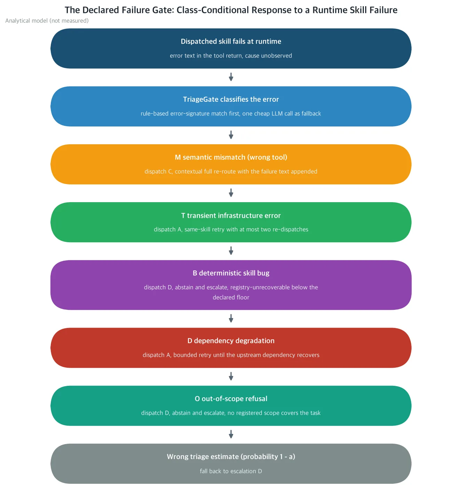
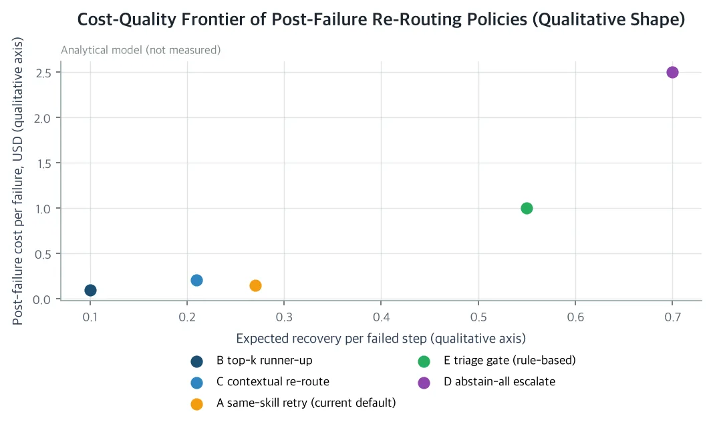
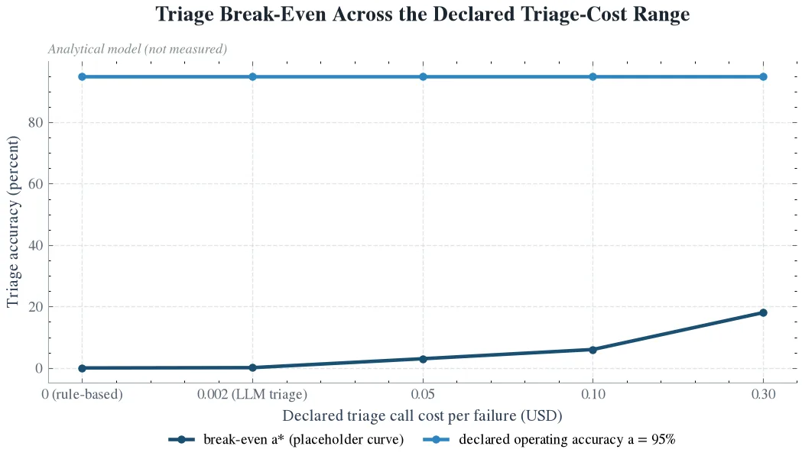

This is an article for people who run unattended agents at scale overnight on self-hosted GPUs and have to set the price of what happens when a run breaks. Every night the agent picks one of thousands of registered skills and hands the task over to execution. When the chosen skill fails mid-run, the current response is only one thing, the blind retry: a structure that re-dispatches the skill that just failed two more times, regardless of cause. Timeout, program bug, out-of-scope refusal, they all receive the same response and the same cost, but the probability of success is structurally different.

The core result of this paper is that reading the cause of failure changes the economics of the response. A single cheap triage, which classifies the cause from the error text the tool returns and then dispatches the optimal response for that cause, recovers 272 more failure tasks per night than the current default. The price is less than half the cost of handing everything to a human. The breakeven at which triage pays off is 0.12% triage accuracy, and 0 for rule-based triage.

One thing to make clear before you read on. This paper is an analytic paper that takes its position on declared premises, and it reports no new measurements. Every number is either a closed-form prediction on declared nominal premises or a result attributed to the cited references. The three figures in the body are schematics drawn by the analytic model, not measured data. This paper is also an explicit one-step upgrade of the preceding paper, Miss Price. That paper priced the cost of a routing miss and lumped all recovery after the miss into a single recovery rate. It did not ask which response is optimal for which cause. This paper prices exactly that open question.

## In plain terms: the repair shop that only knows 'turn it off and on again'

Think of a repair shop. A customer call comes in. The device has stopped working. The shop does not ask the cause and sends the same technician out with the same equipment, two more times. If the device simply powered off, that is the right answer. Restarting it fixes it. If a part is broken, the same technician with the same equipment only repeats the same failure. If the equipment is out of warranty, the visit was a waste from the start. Only the cause changes, and the response should change with it.

The agent harness is the same. The symptom is always one line: the tool returned an error. But the cause branches into five. Semantic mismatch, where the chosen skill was the wrong skill from the start; transient infrastructure error, like a timeout; a deterministic bug inside the skill; dependency degradation, where an upstream dependency slows down or goes stale; and out-of-scope refusal, where the task is out of scope and the skill declines it. The current overnight default treats these five causes as one problem and blind-retries.

This paper asks what the optimal response is when you know the cause, and what it is worth. The answer comes out as a single table. Semantic mismatch gets rerouting with the failure context attached, transient error gets same-skill retry, deterministic bug gets human escalation, dependency degradation gets retry, out-of-scope refusal gets escalation. That single table is the core result of the paper.

## The problem: everything before dispatch is priced, and only the response after failure has no price

The series has priced every stage before the routed skill is dispatched. The priced objects run from the scores of hybrid search and fusion, through the paid listwise reranker call, the menu frozen at width 5, the expected-cost tiebreak inside the indifference band, to the post-hoc price of a routing miss. Miss Price priced the miss itself, down to the miss multiplier, the recovery rate, and the breakeven routing accuracy. But it lumped all recovery after the miss into a single aggregate recovery rate, rho. Which of the five causes is recovered by which response, it left that answer open.

The problem comes from here. A single aggregate recovery rate cannot choose a policy. A policy that recovers 26% of failed steps and a policy that recovers 73% have different cause-by-cause composition and different overnight economics. Yet the current overnight default, the blind retry, sits at a 0.26 recovery rate, well below the declared overnight quality floor of 0.50. It misses the floor every day, and no one knows what it would cost to fix. This paper prices the response space after failure, the rerouting policy per failure class, and answers that question.

## Design: five causes, four responses, and the triage gate

The premises live in the declared rate card. The cost per step is $0.11, the overnight routing steps are 18,000, and the total budget is set at $2,040. The failure rate is declared at 5%, so 900 steps fail every night. The harness is an unattended loop running over vLLM serving on a self-hosted H200 cluster, and the 2,200-skill registry is a structure that keeps evolving.

The four responses are the current default and three alternatives. A is same-skill retry, the current default that re-dispatches the failed skill up to two more times. B is the runner-up, the second candidate on the frozen top-5 menu; the menu selection itself is free, and only dispatch carries a cost. C is context rerouting, the arm that attaches the failure text to the task query and re-queries the router. The requery is priced at $0.08. D is give-up and escalate, the arm that stops dispatch and hands the task to a human verifier. The cost is declared at a cause-independent $2.50.

The fifth arm, E, is the triage gate. It reads the error text of the tool return and first classifies the cause by rule-based error signatures. When uncertain, it falls back to a single LLM call. That call costs less than $0.01, under 2% of the cost per step. If the classification is right, it dispatches the optimal response for that cause; if wrong, it falls to escalation D. The structure of the failure gate is in the figure below.

*The declared failure gate. From a runtime failure, the cheap triage step reads the tool return, estimates the failure class, dispatches the class-optimal policy, and falls to escalation on misclassification. This is a schematic drawn by the analytic model, not a measurement.*

On the declared premises, the cause-by-cause optimal response table comes out as a single proposition. Impose a per-class recovery floor of 0.30 and take the cheapest policy that clears it. For semantic mismatch M, rerouting C clears the floor at 0.45, and its cost of $0.18 is far cheaper than the $2.50 of escalation. For transient error T, retry A recovers 0.84 at $0.13. For deterministic bug B and out-of-scope refusal O, no policy in the registry clears the floor, so escalation is the only recovery possible. For dependency degradation D, retry A recovers exactly 0.30 at $0.15. This dominance map reads: M to C, T to A, B to D, D to A, O to D.

## Result 1: the tangency of the cost-quality frontier is the triage gate

The cost-quality frontier is the lower envelope of six arms. The x-axis is the expected recovery rate per failed step, the y-axis is the cost per failure, and we read the lower edge. It is made of six arms: the four fixed policies A through D, the triage gate that knows the oracle cause, and the rule-based triage gate.

At the declared overnight quality floor of 0.50, the picture sums up in one sentence. Every fixed policy is infeasible, and the only exception is abstain-all D. The current default A sits about 24 points below the floor at a 0.26 recovery rate. B is 0.09, C is 0.21. D clears it at a 0.73 recovery rate, at $2.50 per failure, though. With 900 failures a night, that is $2,250, reaching 110.3% of the entire $2,040 overnight step budget. One response, D, spends more than the whole overnight step budget.

The triage gate is the only alternative feasible inside the budget. Rule-based triage, at the declared accuracy of 0.95, recovers about 0.56 of failed steps at $0.94 per failure. The overnight cost is $847.5, 41.5% of the budget. The failure tasks left unrecovered every night are 393, 272 fewer than the 665 of the current default. At the relaxed floor of 0.25, the recovery purchase efficiency is 1.9 times that of abstain-all. The calculation comes to 272 tasks for $725.2.

*The cost-quality frontier of post-failure rerouting policies. The fixed policies cluster at low cost below the declared overnight quality floor, and the triage gate clears the floor at a fraction of the abstain-all cost. The point positions are order-preserving placeholders, not the closed-form coordinates of the paper; this is a schematic drawn by the analytic model.*

## Result 2: the triage breakeven is 0.12%, and 0 if rule-based

The question the gate must answer is: how wrong can it be and still pay off? It comes out as a breakeven theorem. Triage pays off when the cost of the triage call is less than the per-failure gain gap times the triage accuracy, and the breakeven accuracy a* is the triage call cost divided by $1.64. For the LLM fallback call it is 0.12%, and for rule-based triage it drops to 0. A 0.12% accuracy is far below any error-signature classifier, so this breakeven is structurally trivial. Quality never becomes the binding constraint. Where abstain-all clears, the gate always holds the floor, and the expected recovery rate is 0.55 or above across the entire declared accuracy range.

Sensitivity is declared the same way. The declared perturbations are five: a changed cause mix (transient error at 0.40), doubling the escalation cost ($5.00), raising the per-class floor (0.45), doubling the failure rate (0.10, 1,800 per night), and lowering the triage accuracy (0.75). Across the entire declared grid, the breakeven stays below 0.2%, and the gate stays feasible at the floor and structurally cheaper than abstain-all. At a 0.10 failure rate, the gate runs $1,695 a night and abstain-all runs $4,500, 220% of the budget. At a 0.75 triage accuracy, the cost per failure is $1.27, still 49% cheaper than abstain-all.

*The triage breakeven over the declared triage-cost range. The breakeven accuracy rises linearly in the triage call cost and stays far below the declared operating accuracy of 95%. The placeholder values show the order and shape of the linear relationship; this is a schematic drawn by the analytic model, not the closed-form result of the paper.*

## Preregistered protocol: 1,575 episodes, declared cost $454.2

Since every number is a declaration, the paper preregisters a protocol to confirm or refute them. It is a fault-injection factorial design. The scale is 63 SRA cases × 5 causes × 5 arms, 1,575 episodes. The seeded failure stream is identical across all arms, so each arm faces the same failures on the same cases. The only thing isolated is the effect of the response. Per-episode accounting covers router, search, requery, triage, and dispatch tokens, plus wall time and deterministic scores. Arm D is flat and cause-independent, so it runs as a 63-episode partial sample with one escalation per case, and the full protocol cost is $454.2, inside the $500 budget.

There are six refutation criteria, R1 through R6. Each is a closed-form prediction on the declared nominal value, and a harness run outside the band refutes the corresponding declaration. The criteria: retry must produce a 0.84 recovery rate on transient error; retry recovery must be near 0 on the bug and refusal classes; rerouting must recover 0.45 on semantic mismatch; rule-based triage accuracy must be 0.90 or above; escalation must stay at 0.30 partial recovery on out-of-scope refusal; and per-episode cost must stay within ±25% of the declared value. There is no post-hoc arm selection. Arm E, at the declared value of $0.94, wins: it minimizes the declared expected cost while surviving all the criteria. If one criterion is refuted, a procedure is set for re-declaring the corresponding cell of the success and cost matrices.

## Where it touches company, society, and science

What the company gets is a deployable failure-gate decision rule, one lookup table that maps the triaged cause and the quality floor to a response. It is a drop-in for the ThakiCloud skill router, with no new model and no added step on the routing ledger. The regex signatures on the tool return are all of it. On the declared premises, the overnight default changes from a policy that misses the floor, 0.26 recovery rate and 665 unrecovered per night, to a policy that holds the floor, 0.56 recovery rate and 393. The overnight cost is $847.5, 41.5% of the budget.

What society gets is not a specific table but reading the shape of the problem. Timeout, bug, refusal are three different problems that the blind retry treats as one. The same failure demands a structurally different response depending on the cause. The sentence that remains as a general design principle for teams running an unattended agent stack on self-hosted infrastructure is this: whether the overnight quality floor is held or missed is decided not in the retry loop but at the failure gate.

What remains for science is the first closed-form price of the failure-class × response space, the triage breakeven, and the aggregate-metric gap. With a single aggregate recovery rate, the cause-by-cause allocation is not identifiable, and two arms with the same aggregate success rate and cost can have completely different cause-by-cause recovery. An offline metric that looks only at the miss rate and the lumped recovery rate cannot price the response. This paper steps up from the cost of a miss to the optimal response to a failure.

## Limitations: numbers declared on premises, not measurements

First, every magnitude is a closed-form prediction on the declared nominal premises. The success and cost matrices are declarations, and the failure stream is seeded per task and per cause and shared by all arms. The triage accuracy of 0.95 is a declaration, not a measurement. R4 is exactly the criterion that tests that value. The sensitivity grid shows that the breakeven and feasibility conclusions do not move under any single-parameter perturbation, but it does not claim joint robustness.

Second, the class prior probabilities are a design choice of the seeded stream. The dominance map that sets the cause-by-cause optimal response is independent of the priors, but the aggregate coordinates of the frontier are not. If the real overnight cause mix differs from the declared one, the tangency of the frontier moves along with it.

Third, the scope is set. What the frontier prices is a single-step failure: one dispatched skill, one tool return, one response. Multi-step cascades, in which one failure contaminates the state that later steps consume, are out of scope, and the paper marks that boundary itself explicitly.

The full text of the paper and the accompanying materials are on the Hugging Face paper page. https://huggingface.co/datasets/thaki-AI/daily-paper-2026-11-24-second-route-failure-rerouting-policy

*Every number in the body is either a closed-form prediction on the declared nominal premises or a result attributed to the cited references. The precise closed-form values run through the arm set A(0.261, $0.1359), B(0.0905, $0.0927), C(0.2073, $0.1773), D(0.725, $2.50), triage gate oracle (0.555, $0.8597), rule-based a=0.95 (0.5635, $0.9417), overnight cost $847.5 vs $122.3 vs $2,250, triage call cost $0.002, breakeven a* = c_tri / $1.6403 = 0.12% (0 for rule-based), and protocol cost $454.2. The three figures are analytic-model schematics, and the point positions in fig2 and fig3 are order-preserving placeholders, not the closed-form coordinates of the paper. The preregistered fault-injection protocol (1,575 episodes, R1~R6) was not run in this paper, and the report of measured values happens at run completion.*
