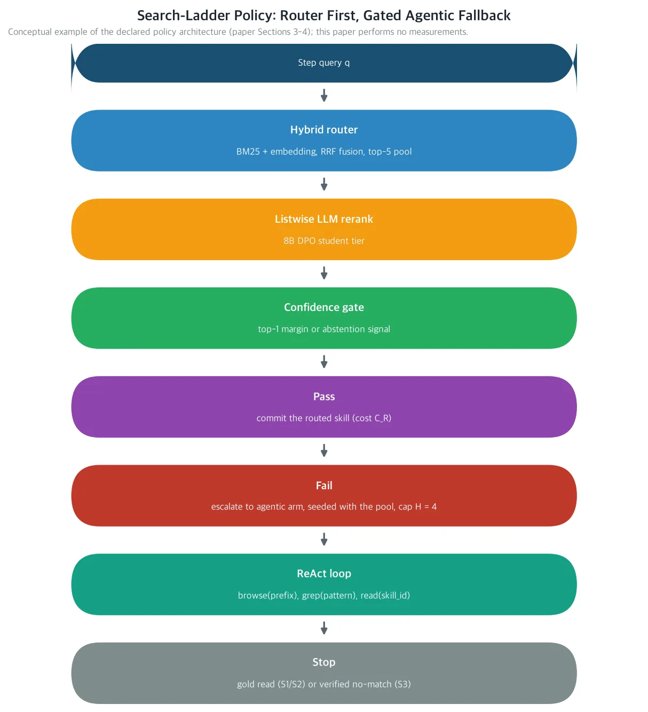
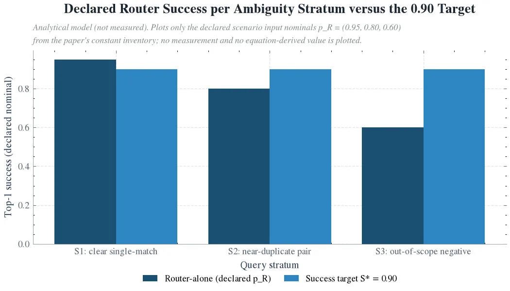
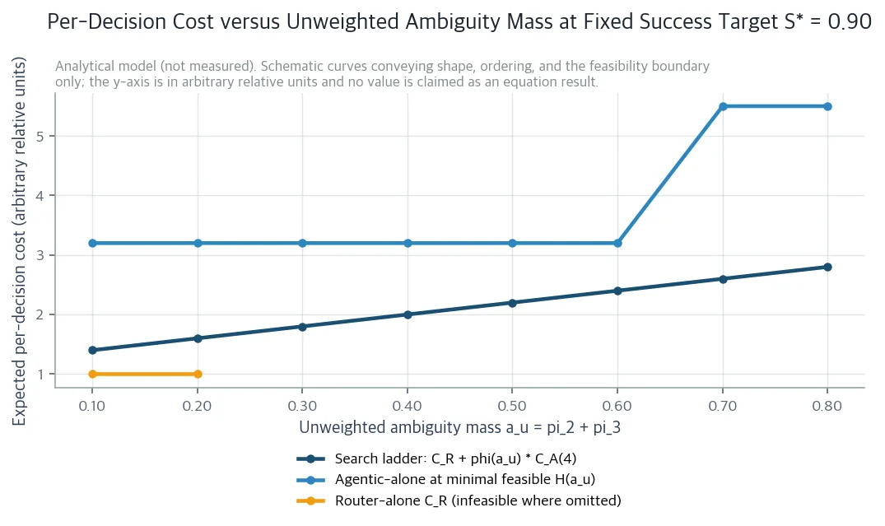

This post is for anyone who runs an unattended agent harness on a self-hosted GPU and routes a 2,200-skill registry every night, and for anyone who wants to change that routing structure but does not know how much more expensive each alternative would be. The agent picks exactly one of the registered skills per step query and hands it off to execution. Today that choice runs through a fixed pipeline. A hybrid retriever produces a top-k pool, and a listwise LLM re-rank pins down a single skill. ThakiCloud's router series has priced the steps inside that pipeline one by one: the re-rank model tier, the pool width, the break in near ties, and the number of decisions batched per re-rank call. This paper asks the question outside the pipeline. Is the router itself the right abstraction, and what does it cost to let the execution LLM explore the registry on its own with the browse, grep, and read tools, at the same task success rate?

The core result comes out in closed form on the declared rate card. Router-alone is already infeasible at the 90% success target: the ambiguity mass at the nominal operating point, a = 0.525, exceeds a_max = 0.333, the feasible ceiling for router-alone. The search ladder, in which the router goes first and only the decisions that pass a confidence gate are escalated to agentic exploration seeded by the top-5 pool, holds that target at $3.18×10^-4 per decision. That is 2.1× cheaper than agentic-alone at its minimum feasible budget ($6.76×10^-4), and the break-even misroute price of $0.0022 sits about 50 to 640× below the series' public anchor ($0.113 per-step budget, $1.40 per-miss price).

One clarification before you read. This is an analysis paper that computes values from declared premises, and it reports no new measurements. Every number is a declared design constant, a published constant from prior work, or closed-form arithmetic over the two. The three figures in the body are schematics drawn by the analysis model, not measured data. The four preceding papers in the router series priced the steps inside the router; this one prices the router itself. One step up, at the abstraction boundary.

## Problem: the internal costs of the router are all out, and only whether the router is right remains

The four earlier papers in the series held routing quality fixed and priced one internal component of the fixed hybrid router at a time. The distilled re-rank tier paper priced the model tier and published the 71.6% share of LLM re-rank in the routing ledger. The pool width paper priced the top-k versus commit trade and published knee k = 5, the tiebreak paper priced the indifference band, and the batching paper priced the number of decisions shared per re-rank call. In every one of them, the router itself was held fixed.

At a registry scale of N = 2,200 skills, the execution LLM can bypass the pipeline entirely. It can explore the registry directly in a ReAct-style loop with the browse(prefix), grep(pattern), and read(skill_id) tools. Whether that is a viable alternative is no small question. Tool choice at scale is still open, and very large toolsets degrade selection in measurable ways. The question this paper sets up is not whether agentic exploration works, but how much it costs, relative to the static hybrid router it replaces, at the same task success rate.

There is a cost reason the comparison is timely. The stage the fallback offloads is exactly the expensive stage. Listwise LLM re-rank demands call scheduling, and hundreds of candidates per call are infeasible. In the published router accounting, a single LLM re-rank holds 71.6% of the ledger. The confidence-gate fallback, in which the router sends only a small fraction φ of its decisions, and only the uncertain ones, to agentic exploration, is the exit through which the most expensive stage settles its cost.

## Design: three arms, and a gate that reads the router's output

The stage is a frozen registry and a declared card. The registry holds 2,200 skills (public, current value), and routing quality is SRA, top-1 accuracy on the published 0 to 100 scale, evaluated on a frozen 2,295-entry snapshot and a 63-case gold holdout. Step queries split into three strata by ambiguity. S1 is unambiguous single matches, S2 is near-duplicate pairs, S3 is out-of-scope negatives, and the declared nominal mixture is (0.55, 0.30, 0.15). The ambiguity mass is a = π2 + 1.5·π3, where the declared card bills an out-of-scope misroute at 1.5× a near-duplicate misroute.

The rate card is declared once. Self-hosted H200, 8B NVFP4 tier, input $0.20 per million tokens, output $0.80 per million tokens. Sensitivity sweeps are at 3× and 1/3×. Both arms use the same 8B self-hosted tier, so the comparison is tier-neutral and no frontier-model bill enters.

Arm R is the static hybrid router. A BM25 and a dense embedding index over the registry are fused by RRF, and a listwise LLM re-rank in the published 8B DPO distilled-student tier pins down a single skill over the top-5 pool (the published knee). The token design constants are 60 for the query, 120 for the skill card, and a 64 cap on re-rank output. Plugging in the declared card, the cost per decision computes to C_R = $1.83×10^-4 and wall time W_R = 0.726 s.

Arm A is agentic registry exploration. An execution LLM of the same tier explores the registry directly in a ReAct-style loop under a search-as-code discipline. At this corpus scale, boolean substring search is competitive with dense search, so grep alone suffices. An episode stops on a gold lead (S1, S2) or a verified no-match (S3), and that stop is an evidence-coverage criterion. The declared constants are 300 for system + tool schema, 150 for mean cumulative tool output per step, 80 for agent output per step, and 2.0 s of wall time per step. The per-stratum discovery hazard per step is (0.50, 0.35, 0.50), giving C_A(3) = $4.62×10^-4, C_A(4) = $6.76×10^-4, and C_A(6) = $1.19×10^-3.

Arm L is the search ladder. It runs R first, and the gate reads the re-rank output: the top-1 score margin or the abstention signal, both first-class routing objects. When the gate fails, it escalates to A, seeded by the k-pool and its negative evidence. The pool is the first observation of the escalation, so it is paid once, inside C_R. The seeded episode is cut off at H_max = 4 steps, the declared agentic cap of 6 with a 0.6× reduction applied. Gate quality is also declared per stratum: α = (0.02, 0.10, 0.30) escalate decisions R already succeeded on, and η = (0.01, 0.10, 0.05) drop rescues. The ladder's cost per decision is C_L = C_R + φ·C_A(4).

The model assumes six things. A1 deterministic token accounting, A2 linear per-step transfer growth for arm A, A3 the step hazard invariant within an episode, A4 gate decisions independent of the episode outcome conditional on the stratum, A5 tier-neutrality of the two arms, A6 escalation episodes are in-task sequential loops with no decision batching. Carpooling applies only to arm R's re-rank calls. A single routing decision through this structure is shown in the figure below.

*One routing decision through the static hybrid router. The confidence gate either commits the routed skill or escalates to an agentic exploration episode seeded by the top-5 pool, with steps capped at 4. A schematic of the analysis model, not a measurement.*

## Result 1: router-alone cannot clear 90%, and the ambiguity mass is a structural barrier

The declared quality nominal is p_R = (0.95, 0.80, 0.60) for (S1, S2, S3), swept at ±25%. The ordering is structural, not fitted. p_{R,2} sits below p_{R,1} because of routing interference, in which near-duplicate skills crowd out earlier ones, and p_{R,3} sits below p_{R,2} because abstention is the hardest routing mode. At the nominal mixture, blended success is 0.55×0.95 + 0.30×0.80 + 0.15×0.60 = 0.8525. It falls short of the declared operating target of 0.90.

*Router-alone success by ambiguity stratum at the declared quality nominal, against the 0.90 target. Router-alone clears the target only on unambiguous single-match queries; the near-duplicate and out-of-scope strata must be carried by the escalation gate. A schematic of the analysis model, not a measurement.*

Feasibility closes as an inequality in the ambiguity mass. At target S* = 0.90, the feasibility of router-alone reduces to 0.15·π2 + 0.35·π3 ≤ 0.95 − S*, and its two corners give a_max = 0.333 (all S2) and 0.214 (all S3). The nominal operating point is a = 0.30 + 1.5×0.15 = 0.525, above 0.333, and the headline result of the paper is right here: the nominal operating point sits outside the feasible region of router-alone. The barrier is not a component of the pipeline but the stratum composition itself. No change inside a fixed pipeline can fix the stratum composition; only an escalation in the policy tier can.

The ladder picks up exactly that part. Per-stratum ladder success is p_L = (0.9774, 0.8679, 0.7762), and the per-stratum net change is (0.0274, 0.0679, 0.1762). The largest gain is in S3. The blended gain is +6.2 SRA points, and ladder success S_L = 0.9144 clears 0.90.

## Result 2: the ladder holds the target at $3.18×10^-4, and break-even is $0.0022

At the nominal mixture, the expected escalation fraction is φ = 0.1997. The escalation premium φ·C_A(4) is $1.35×10^-4 per decision, and the ladder comes out at C_L = $3.18×10^-4 per decision and W_L = 2.32 s of wall time. At the same success, agentic-alone holds 0.90 at H = 4 (success 0.9027, $6.76×10^-4); at the declared cap H = 6 it reaches 0.9664 ($1.19×10^-3). The ladder is strictly cheaper than agentic-alone at equal or better success, a 2.1× gap on the minimum-feasible-budget basis.

Two break-even conditions define the frontier. Against agentic-alone: the ladder is cheaper at equal success whenever the escalation fraction stays below φ* = 1 − C_R / C_A(H_a). At the declared cap of 6, φ* = 0.847; at the minimum-feasible H = 4 it tightens to 0.729. The nominal φ = 0.1997 sits far below both thresholds. Against router-alone: the premium is recovered only when the misroute price M_d satisfies M_d ≥ M_d* = φ·C_A(4) / dp. At nominal values that is $1.35×10^-4 / 0.0619 = $0.0022 per decision. The misroute price is anchored to the series nominal. The published $2,040 nightly budget divided by the series-declared 18,000-step nightly volume gives M_d ≈ $0.113, and the published per-miss price is $1.40. The break-even price sits about 50× below the per-step budget and about 640× below the per-miss price. The one-line run rule is this: as long as the declared gate nominal holds and M_d ≥ $0.0022, the ladder is on by default.

Proposition 1 (rate card homogeneity) underwrites the economics. Every closed-form cost is a linear combination of declared token counts, so scaling all costs by a common factor s leaves φ* invariant, and leaves M_d invariant as well, since M_d is anchored to the published nightly budget and volume. The comparison M_d ≥ M_d* does not depend on the card. That is why the 3× and 1/3× sweeps move the bills but the conclusion stays where it is.

The nightly accounting is small in absolute terms. The nightly routing ledger is 18,000×C_R = $3.29, or 1.6×10^-3 of the $2,040 step budget. Per D = 6 decision session, the routing ledger is just $1.10×10^-3. Routing is a small sliver of step execution, and the $1.35×10^-4 the ladder adds on top is about 0.74× the router-alone cost, less than what the LLM-dominant stage that the fallback offloads spends, the stage holding 71.6% of the published ledger.

The figure below sweeps the unweighted ambiguity mass a_u = π2 + π3 from 0.10 to 0.80 as a one-parameter mixture family.

*Expected cost per decision against the unweighted ambiguity mass a_u = π2 + π3, at a fixed success target S* = 0.90. The search ladder stays below agentic-alone across the whole sweep, and router-alone is feasible only in the low-ambiguity region. The nominal operating point (dashed, a_u = 0.45) sits inside the ladder region. A closed-form evaluation of the declared model, not a measurement.*

Reading the three curves is enough. The ladder starts at 2.56×10^-4 at a_u = 0.10 and rises monotonically to 4.14×10^-4 at a_u = 0.80, below the agentic-alone step at every sweep point. Agentic-alone steps up to H = 6 ($11.90×10^-4) whenever the minimum-feasible budget H = 4 can no longer clear the target (a_u ≥ 0.75 in this sweep family). The router-alone arm is the cheapest over the plotted range, but in this sweep it is feasible only up to a_u ≤ 0.1765. The weighted boundary a_max = 0.333 applies to any mixture. The nominal point is a_u = 0.45 (weighted a = 0.525), deep inside the ladder region. The headline result, as a figure.

## Pre-registration protocol: 63 cases, three arms, three seeds, under one dollar

The closed form is a prediction on the declared card. The protocol fixes in advance everything a measurement would require. The arms are R, A with the declared cap H = 6, and L with the gate and the seed cap H_max = 4. The corpus is the published 63-case SRA gold holdout on the frozen 2,295-entry snapshot, and strata are assigned by a margin threshold on the fused RRF score. Counts are read at runtime, so no stratum mixture is assumed. Metering uses the family convention's deterministic token accounting, logs per-step tool output, and measures per-arm wall time. At temperature 0, with three independent seeds per arm-case, it probes kernel-level nondeterminism.

Acceptance thresholds are pre-registered at S* = 0.90, pairing a declared tolerance band with a derived reference value in each case. (i) Ladder success within +1 SRA point of 91.4 and not below the router-alone baseline of 85.2, (ii) ladder cost per decision within 1.5× of $3.18×10^-4, (iii) per-stratum escalation fractions within 2× of (0.0685, 0.26, 0.56), and (iv) agentic-alone success at H = 6 within ±3 SRA points of 96.6. Each threshold names the declaration it would revise. (i) and (iv) revise p_R and ρ, (iii) revises α and η, and (ii) revises σ. The declared stratum mixture π is replaced by runtime counts before any threshold applies, and the rate card is out of scope for revision by Proposition 1.

The budget is derived to the end. 63 cases (public) × 3 arms (declared) × 3 seeds (declared); the worst case per case-seed is the router stacked on the agentic arm at the declared H = 6, at $1.19×10^-3 + $1.83×10^-4 = $1.37×10^-3. The total budget stays at most 63×3×3×$1.37×10^-3 ≈ $0.78. Under one dollar.

## Where it touches company, society, and science

A company gets a measurable architecture-decision rule for skill routing. It marks the boundary where a search index is cheaper than direct agent exploration and delivers a router-first/search-fallback operating policy that cuts routing cost in an overnight unattended loop without losing success rate. The boundary is a = 0.525 > a_max = 0.333, and outside it, router-alone cannot reach the 90% target. The escalation premium is $1.35×10^-4 per decision, about 0.74× of the token-accounted router cost, less than what the LLM-dominant stage that the fallback offloads spends, the stage holding 71.6% of the ledger. The run rule is one line: when M_d ≥ $0.0022 and the declared gate nominal holds, the ladder should be on by default.

Society gets a quantification of the compute cost of agent autonomy in a large skill ecosystem. Search infrastructure can be replaced or complemented by interactive LLM exploration, and the cost of doing so can be computed. For a small team running a self-evolving agent harness on self-hosted hardware, the router-first/gated-exploration combination is a cheaper autonomy policy than agentic exploration in its entirety. The design principle that stays general is this: gate the expensive stage, and pay for exploration only where the cheap stage is uncertain.

What science gets is the first head-to-head pricing of agentic (multi-step, tool-using) skill search against static hybrid search on the same gold set. A new axis, task ambiguity, and a break-even curve are added to the skill-routing cost-quality frontier literature. Where the series' earlier work priced every stage inside the router, this paper prices the router itself, the abstraction boundary one step above them all.

## Limit: what binds is gate calibration, not economics

Four limits cage the claim. First, the declared rate card stands in for live prices. By Proposition 1, the break-even conclusion is invariant to the card; neither φ* = 0.847 nor the M_d ≥ M_d* comparison moves. Second, the quality and gate nominals p_R, ρ, α, η are declared scenario inputs, not measurements; the stratum mixture is read at runtime only, on the frozen gold. Third, gate calibration is the binding constraint. The abstention signal exists mechanically, but the per-stratum α_i and η_i have to be estimated by the protocol above, and both enter dp directly. What holds the ladder back is not the price but the accuracy of the gate. Fourth, tier-neutrality (A5) means both arms are 8B self-hosted; an agentic arm at frontier tier remains a separate question.

Agentic-alone wins in three regions as well. First, M_d → 0. If misrouting is free, the M_d ≥ $0.0022 condition fails and the escalation premium buys nothing. Second, when p_R is systematically low. Registry metadata broken at scale, routing interference, or governance drift degrade the first step in every stratum, and the ladder inherits that weakness in each decision. Third, a → 1. When everything is ambiguous, the router commits nothing, and the ladder pays C_R in full before escalating. The ladder is the default for the middle region, and the nominal mixture sits right inside it. Router-alone reaches 85.2, and the gated escalation fills in the remaining points, at a cost that is part of the agentic-alone ledger.

The paper itself and the accompanying materials are available on the Hugging Face paper page. https://huggingface.co/datasets/thaki-AI/daily-paper-2026-11-25-agentic-skill-search-ladder

*Every number in the body is either a closed-form prediction on the declared nominal premises or a result attributed to a cited reference. The exact closed-form values run from C_R = $1.83×10^-4, C_A(3/4/6) = $4.62×10^-4 / $6.76×10^-4 / $1.19×10^-3, W_R = 0.726 s, W_A(4) = 8.0 s, φ = 0.1997, φ_i = (0.0685, 0.26, 0.56), p_R = (0.95, 0.80, 0.60), p_L = (0.9774, 0.8679, 0.7762), dp = 0.0619, S_L = 0.9144, C_L = $3.18×10^-4, W_L = 2.32 s, escalation premium $1.35×10^-4, M_d ≈ $0.113, M_d* = $0.0022, φ* = 0.847 (0.729 at H = 4), a = 0.525, a_max = 0.333, nightly routing ledger $3.29, and protocol cost ≈ $0.78, to the pre-registration thresholds (91.4 +1, 1.5×, 2×, 96.6 ±3). The three figures are schematics of the analysis model, closed-form evaluations of the declared model, not measurements. The 3-arm pre-registration protocol on the 63-case gold set was not executed in this paper; measured values will be reported when it runs.*
