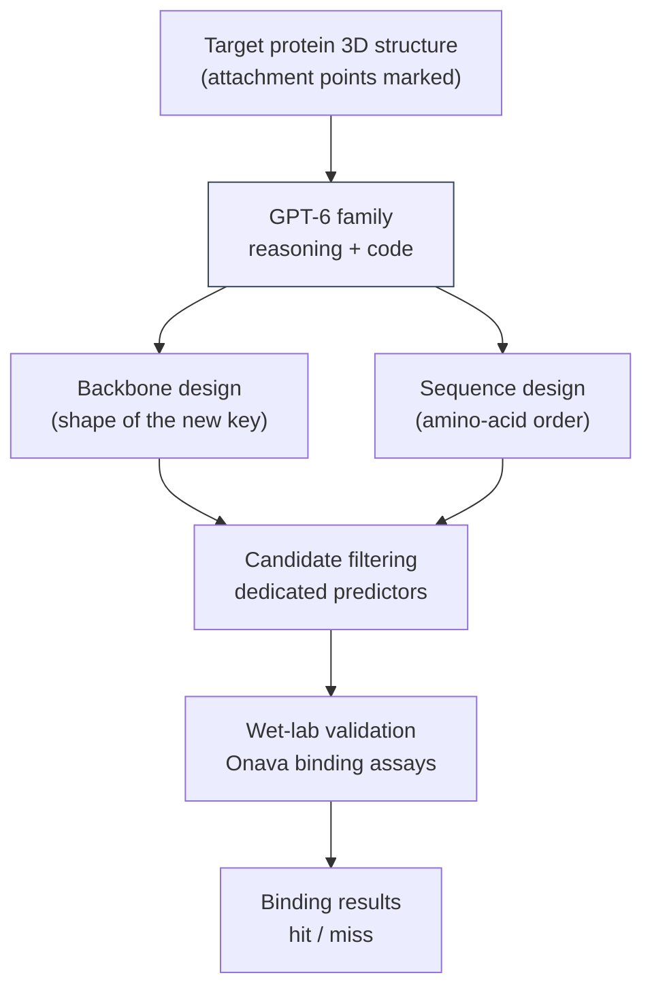
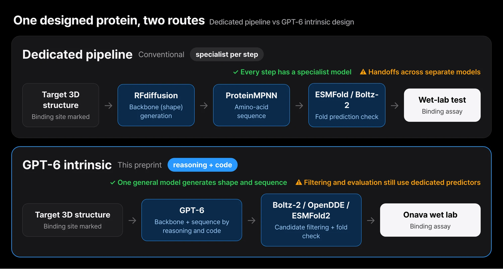
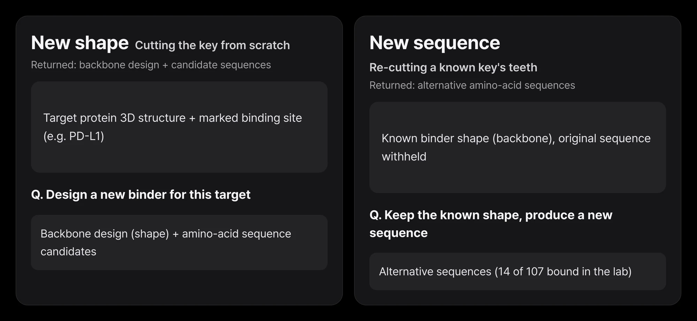
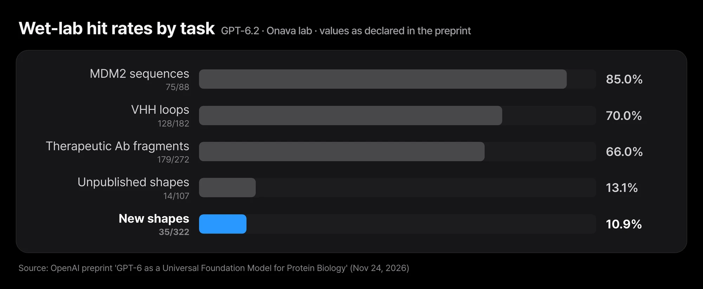
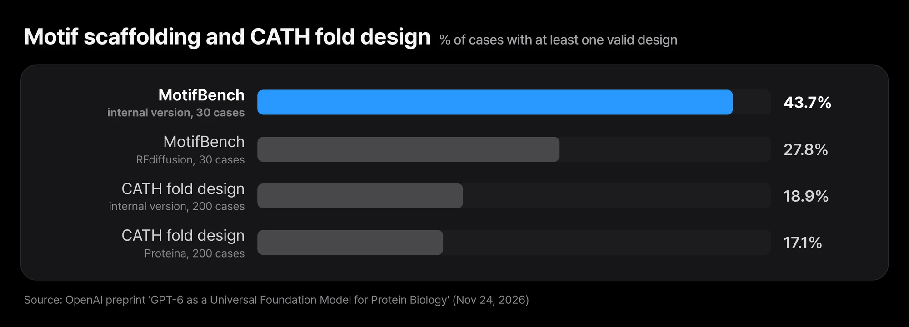
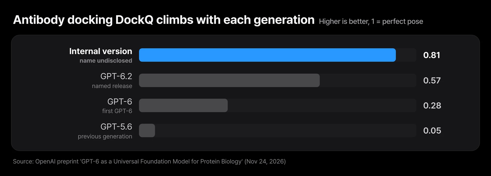

This post is for anyone building or evaluating scientific agents that pair general-purpose models with tools. It is also for anyone trying to gauge where the line is at which "reasoning + code" can replace specialized models. OpenAI published a preprint on November 24, 2026. It reports wet-lab validation of protein design by the GPT-6 family.

The core conclusion comes first. The lab-validated results are real, but this is not a blanket victory for "general-purpose is enough." GPT-6 produced the designs on its own. Dedicated predictors such as Boltz-2 and ESMFold2 were still used for candidate filtering and fold prediction. OpenAI itself calls this profile a "jagged capability frontier."

*The analogy this preprint lives in: a general model cuts the key, and a wet lab checks whether it turns.*

## In plain terms

Designing a protein that binds to a specific target is like cutting a key for a lock. The lock is the target protein. The key is the binder protein that fits into a specific site on it.

This field already had dedicated "key-cutting machines" built only for cutting keys, such as RFdiffusion and ProteinMPNN. What is new in this preprint is different. GPT-6, a general-purpose model, looked at the structure of the lock, reasoned, wrote code, and cut new keys without using a dedicated machine. Then it checked in a real lab whether the cut keys actually turn in the lock. The rest of this post calls the designed proteins "keys."

## A general model versus the key-cutting machine

Until now, de novo protein design had been the territory of specialized models. Generative models such as RFdiffusion built the backbone, the shape of the key. ProteinMPNN filled in the amino-acid sequence, the teeth. ESMFold or Boltz-2 judged whether the design would fold as intended. A dedicated tool stood at each step.

The GPT-6 family is a general-purpose foundation model that handles text, code, and reasoning alike. The claim of this preprint is that GPT-6 can produce designs using only reasoning and code, without calling a specialized biology model.

The preprint is titled "GPT-6 as a Universal Foundation Model for Protein Biology: Beyond Specialized Models." Wet-lab validation was performed by the partner lab Onava. The model versions named in the body are GPT-5.6, GPT-6, GPT-6.2, and an internal version whose name is not disclosed. The internal version consistently posted the best results on the computational benchmarks.

GPT-6's design targets go wider than "making a binder." New minibinder shapes, new sequences for existing shapes, antibody loop redesign, motif scaffolding, CATH fold design, small-molecule docking, antibody docking, mutation-effect ranking. OpenAI states that it evaluated 14 protein tasks in total. Performance improved on many of them in newer generations.

## Reasoning cuts the key, dedicated tools check it

Minibinders are small proteins designed to bind specific target sites. The "key" in our analogy is exactly this minibinder. The wet-lab experiments split the design work in two.

The first split is making a new shape, the backbone. GPT-6.2 receives the target's 3D structure and marked attachment points. It generates backbone designs through reasoning and code. Prompt control is the standout feature. Binding location can be specified down to a single bond between two atoms. Shape, structural class (coil-only, strand-only, mixed), and the count of each structure can also be specified. In the paper's words, this fidelity is "near-perfect."

The second split keeps the shape and asks for new sequences. The shape of the key is already confirmed to bind. The question is "can you cut a different key of the same shape?"

*How GPT-6 cuts keys through reasoning and code. No specialized biology model is used in the generation steps (B, C, D); dedicated predictors (E) intervene in candidate filtering and fold judgment.*

*The dedicated route hands every step to a specialist model. GPT-6 generates both shape and sequence by reasoning and code, and the dedicated predictors move to filtering and evaluation.*

*The two task shapes of the preprint: what goes in, and what comes out.*

The division of labor with dedicated predictors is explicit. Boltz-2, OpenDDE, and ESMFold2 do not make keys. They pick which of the cut keys is worth putting in a test tube and predict whether it will fold as intended. This division of labor is the core of the "jagged frontier" discussed below.

## Wet-lab validation 1: 35 of 322 new shapes bound

The first experiment used five targets: PD-L1, IL-7Rα, TrkA, VEGF-A, and IL-17A. These are proteins of interest in immunology and oncology. GPT-6.2 created a new binder shape for each target, and 322 proteins were tested in the Onava lab. 35 bound. The hit rate is 10.9%.

The results were not even across targets. VEGF-A had 8 hits and PD-L1 had 5. IL-7Rα had 3, while TrkA and IL-17A had 1 each. OpenAI notes that earlier RFdiffusion work reportedly had higher success rates. The preprint does not give that number, and it also states that hit rates shift with the definition of binding and the filtering criteria.

In the computational comparison on the same task, GPT-6.2 was lower than RFdiffusion and the internal version was higher. Since the numbers are not disclosed, only the direction is recorded.

The 10.9% is a per-protein hit rate. Read per target, it says that every one of the five targets got at least one working key. The two readings answer different questions. The per-protein rate matters when planning how many to make. The per-target reading matters when deciding whether the direction is worth pursuing.

## Wet-lab validation 2: 14 of 107 on unpublished shapes

The second experiment asked for new sequences with the shape known. Starting with three shapes already confirmed to bind (MDM2, VEGF-A, PD-1), the original sequences were withheld. MDM2: 75 of 88 bound (85%). VEGF-A: 26 of 42 (62%). PD-1: 8 of 59 (14%).

The median divergence from the original sequence was 50% for VEGF-A, 43% for MDM2, and 15% for PD-1. That is a different key cut, not a copy.

Three unpublished shapes (two PD-L1, one IL-7Rα) are more interesting. For each shape, one sequence previously supplied by ProteinMPNN had bound. GPT-6.2's own sequences: 14 of 107 bound (13.1%). For one PD-L1 shape, two sequences differed from the original at 52 and 58 of 90 residues and from each other at 44 residues. Two different keys of the same shape both turned in the lock.

## Antibody loop redesign: the first step of affinity maturation

The third experiment was done on antibodies. OpenAI frames the result as the first step of "affinity maturation," the process of improving the binding of an existing antibody.

From six VHHs (single-domain antibodies) against IL-4Rα, the three binding loops were removed, and GPT-6.2 designed replacements. 128 of 182 bound, 70%.

For five therapeutic antibodies against PD-1 or PD-L1, roughly half the residues of three loops were changed and tested as fragments. 179 of 272 fragments bound, 66%.

This is where the "70% binding rate" in some coverage comes from. It is the VHH loop-redesign result, a different number from the 10.9% of the new-shape experiment. The task difficulty differs. One is cutting a new key from scratch against a lock. The other is re-cutting the teeth of a key that already fits.

*Shapes cut from scratch hit 10.9%, while re-sequencing known shapes and antibody loop redesign run 66% to 85%. The wet-lab hit rate is jagged by task.*

## Computational benchmarks: the jagged profile shows in the numbers

The computational task results are gathered in the table below. "Internal version" is the top of the GPT-6 family whose name is not disclosed. Some tasks do not disclose every version's number; undisclosed values are marked "n/a."

| Task (scale) | GPT-6.2 | Internal version | Dedicated baseline |
|---|---|---|---|
| MotifBench motif scaffolding (30 cases) | n/a | 43.7% | RFdiffusion 27.8% |
| CATH fold design (200 cases) | n/a | 18.9% | Proteina 17.1% |
| PoseBusters small-molecule docking | 93% | 96% | DiffDock-L 50% |
| Scarpino tethered docking (179 structures) | 92% | 97% | DiffDock 60% |
| Antibody docking DockQ (1 = perfect) | 0.57 | 0.81 | GPT-5.6 0.05 · GPT-6 0.28 |
| Mutation-effect ranking (stability, 265 sets) | 0.57 | 0.66 | ESM2-650M (outperformed on avg. of 4 sets) |
| Fold prediction TM-score (1 = perfect) | 0.26 | 0.38 | ESMFold2 0.93 |

The profile is jagged. On docking and motif scaffolding, the GPT-6 family beat dedicated tools by wide margins. On fold prediction, the internal version's TM-score of 0.38 trails ESMFold2's 0.93. TM-score 0.5 is the line for overall fold match, and the internal version does not even cross it.

*On motif scaffolding the internal version reaches 43.7% against RFdiffusion's 27.8%. On CATH fold design it leads Proteina 18.9% to 17.1%.*

The generational climb is clearest on antibody docking. DockQ, where 1 is a perfect pose, rises from 0.05 for GPT-5.6 to 0.81 for the internal version. Each generation closes the gap to the dedicated docking tools.

*DockQ rises from 0.05 (GPT-5.6) to 0.81 (internal version) across the GPT-6 family on antibody docking.*

The mutation-effect ranking deserves a separate look. Given the original sequence and 50 variants, the model ranks their effect on stability without using code. GPT-5.6 0.41, GPT-6 0.52, GPT-6.2 0.57, internal version 0.66. It climbs smoothly with each generation. It is a task of reading the "key-cutting manual" with internal representation alone. Across all four public datasets, GPT-6.2 and the internal version beat ESM2-650M on average.

## ThakiCloud Product Implications

Paxis's execution model is exactly the configuration this preprint validated. A general-purpose model reasons and writes code, and specialized models and tools attach not as protagonists but as tools for filtering and evaluation. In the paper, Boltz-2 and ESMFold2 check "which key is worth putting in a test tube," and ProteinMPNN supplies "one comparison sequence."

Paxis, ThakiCloud's Agent-Native Cloud, treats skills, tools, policies, and audit logs as first-class resources. A scientific agent doing protein design is assembled from the same structure. The core of the engineering is not "which foundation model to use" but "which dedicated tool to attach at which step."

The jagged frontier has a direct implication for evaluation design. At steps where dedicated predictors win (fold prediction), do not trust the general model's output. At steps where the general model wins (docking), do not waste the dedicated-tool budget. If Paxis's policy gates and audit logs record "at which step the general model's result was sufficient," that is the operational form of this preprint.

The ai-platform lens is the cost structure. Wet-lab validation is the most expensive evaluation, and a per-protein hit rate of 10.9% means sending every candidate to the lab would blow the budget. In this preprint, dedicated predictors filtered the candidates and only 322 went into test tubes.

In an environment where customer data cannot leave the building, running the foundation model, dedicated predictors, and the evaluation pipeline on a single platform, a self-hosted configuration, is the precondition for this workflow to hold at all. ThakiCloud's Metis serving and on-prem/sovereign deployment options aim at exactly that configuration.

## Limitations and Counterarguments

The strongest counterargument: "GPT-6 alone did not cut the keys." A fair point. Both wet-lab experiments used dedicated predictors (Boltz-2, OpenDDE, ESMFold2) for candidate filtering and fold prediction. In the new-shape experiment, SolubleMPNN proposed the sequences.

The paper itself states that the result supports native capability for backbone generation and sequence redesign. It is not evidence of fully autonomous design of new minibinders end to end. The claim should be read at that strength.

Second, binding is only the first milestone. Specificity, stability, activity, safety, and efficacy are all unvalidated. A key that turns in a lock is not a key you can trust with the house. The 70% of antibody loop redesign also has not yet answered whether binding affinity improved over the original.

Third, some computational scores may reflect memorization or generation artifacts. A risk the paper raises itself. The closer a task is to public datasets, the harder it is to draw the line between "learned the pattern" and "memorized the answer" from this preprint alone.

Fourth, the baseline comparison is incomplete. The hit rate of the earlier RFdiffusion work is not stated, and denominators for some docking percentages are not given. Individual author names are also absent. Numbers should be cited at the strength this preprint declares.

Fifth, biosecurity. With protein-design capability entering general-purpose models, security-risk assessment appears explicitly in the paper. One should not read only the capability numbers. The risk territory opened by protein design in general-purpose models should be read alongside them.

## In conclusion

The conclusion stated at the start is recovered. GPT-6 cut keys with general reasoning and code alone, and in the Onava lab's test tubes 35 of 322 turned in the lock. In antibody loop redesign, 70% of the re-cut teeth bound. On the docking and motif-scaffolding computational benchmarks the dedicated tools were badly beaten. On fold prediction the gap is still large.

For anyone building scientific agents, the takeaway is one sentence. The general model is no longer an outsider to protein design, but it is still not the sole key-cutter. The engineering question is "at which step to trust the general model, and at which step to attach a dedicated tool." This preprint showed the first answer to that question in wet-lab numbers.

## Sources

- OpenAI announcement: https://openai.com/index/gpt-6-models-demonstrate-intrinsic-protein-design-capabilities/ (November 24, 2026)
- Preprint PDF: "GPT-6 as a Universal Foundation Model for Protein Biology: Beyond Specialized Models" https://cdn.openai.com/pdf/gpt-6-a-universal-foundation-model-for-protein-biology.pdf

*All numbers in this post are cited as declared in the preprint and the announcement page. Values the preprint does not disclose (the earlier RFdiffusion hit rate, denominators of some docking percentages, individual author names) are marked "n/a."*
