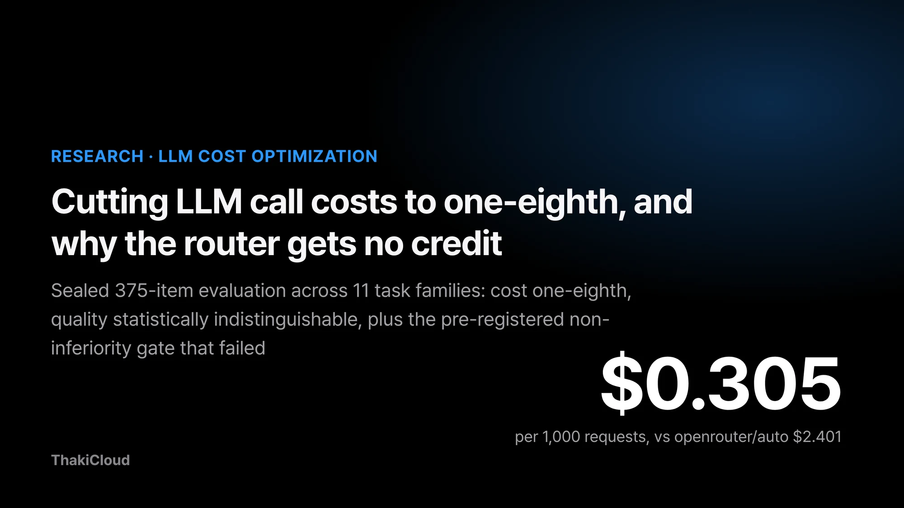
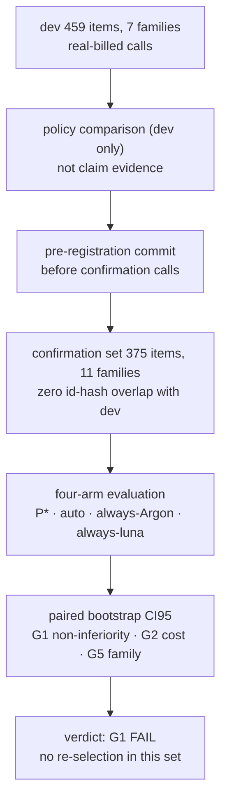
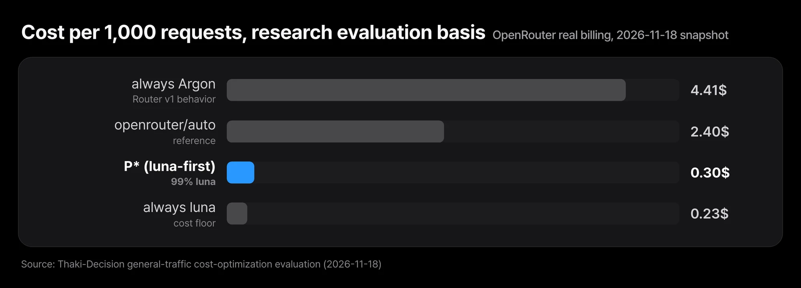
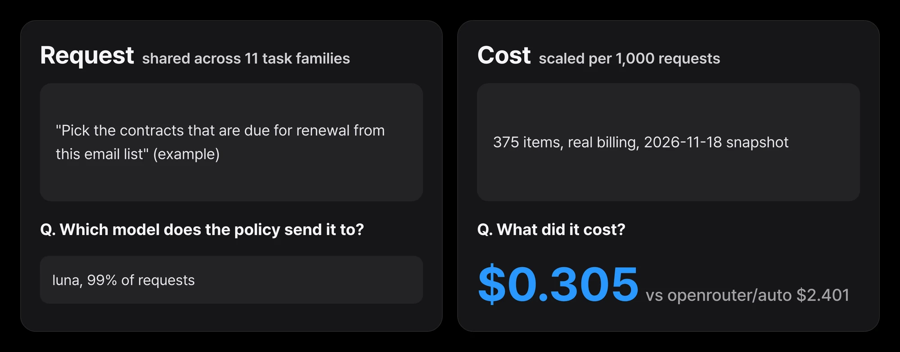

If LLM calls happen on every request in your service, the first place you reach for to cut cost is usually the router, which decides which model each request goes to, complete with training. We spent two months on that path.

The result came out the opposite of our prior. In a sealed 375-item evaluation, what cut cost per 1,000 requests to one-eighth was not runtime learning. It was a plain policy: pick one cheap, strong default model. This post reports the numbers as they are, including the gate we failed.

## The one-line conclusion first

A low-cost-first policy, evaluated on 375 items across 11 task families, cut evaluation-basis cost to roughly one-eighth of OpenRouter's automatic selection (openrouter/auto, 2026-11-18 snapshot). Quality was 0.926 versus 0.928, a 0.24 percentage point gap with zero inside the 95% confidence interval: not statistically distinguishable.

But the pre-registered non-inferiority test failed. So this study can say "indistinguishable at this precision," not "equivalent to auto." And the default model handled 99% of the requests. That is where the credit sits.

## How it was evaluated

The experiment ran in three stages. A dev set of 459 items (7 families) was called against six fixed models plus openrouter/auto with real OpenRouter billing. Policy comparison stopped at dev; numbers chosen there were not claim evidence.

A confirmation set followed: 375 of 380 items, 11 families, zero id or prompt-hash overlap with dev, plus families absent from dev (ARC-Challenge, HRM8K, BBH, KoBEST, Arena-Hard).

The decision rule was committed before the confirmation calls: one low-cost-first policy (P*) against openrouter/auto, "always Argon" (our Router v1's behavior), and "always luna," judged by three gates. G1 non-inferiority (P*-vs-auto lower bound at or above −0.02), G2 cost (per 1,000 requests at or below 25% of auto), G5 per-family floor (no family more than 10 points worse).

Grading was exact where it could be: numeric answers, option letters, normalized math equivalence, hidden tests for code, and open-ended questions scored 1 to 10 by a single internal judge with no reference answer.

## The four-arm result

The same 375 items ran in four arms. Quality is the per-family mean; cost is OpenRouter real billing per 1,000 requests.

| Arm | Quality (macro) | Cost $/1,000 req | p95 latency |
|---|---|---|---|
| P* (luna-first) | 0.926 | $0.305 | 21.2s |
| openrouter/auto | 0.928 | $2.401 | 27.4s |
| always Argon (Router v1 behavior) | 0.959 | $4.409 | 31.5s |
| always luna | 0.920 | $0.225 | not measured |

Start with P* versus auto. Quality is −0.0024 (95% interval −0.0221 to +0.0172, containing zero). The cost ratio is 0.126: where auto spent $2.401, P* spent $0.305, an 87.4% reduction on the research-evaluation basis.

That number must always carry two contexts: "vs openrouter/auto, research evaluation basis." The reference is auto as of 2026-11-18; its model mix changes with the snapshot.

Against the other lines the picture shifts. P* is −0.0335 quality versus always-Argon at a cost ratio of 0.068, a 93.2% reduction. "Better than our existing Router v1" does not hold: quality dropped significantly. P* is +0.0052 versus always-luna at a cost ratio of 1.33, and that last arm is the key.

Verdicts: G1 FAIL, G2 PASS, G5 PASS. The confidence lower bound (−0.0221) came up 0.0021 short of the non-inferiority margin (−0.02). We did not re-select the policy in this set.

## Family by family: not a uniform loss

In macro terms it is −0.24 percentage points, but family by family it is not a uniform loss. P* leads on hard reasoning: ARC-Challenge 1.0 versus auto 0.975, BBH 1.0 versus 0.975, Arena-Hard 0.866 versus 0.820. It trails on Korean domain knowledge and part of coding: KMMLU 0.933 versus 0.967, HumanEval and KoBEST both under 1.0.

This shape is not a routing defect. It is the consequence of the default being luna: on hard reasoning, luna beats auto cheaper; on Korean domain knowledge, auto pulls a more specialized model. The gain and the cost show up in the same paragraph.

Latency came with it. P* averages 6.3s with a p95 of 21.2s, faster than auto (6.99s, 27.4s p95). Most requests concentrate on one model, so cost is one-eighth and latency is shorter; auto scatters across models including expensive ones.

This policy did not just take cheap. It took cheap and fast. But that is under the single-query, no-tools condition, and it does not carry over unchanged to multi-turn agent loops.

## Where the credit sits

Of 375 items, 99% were handled by luna; only 1.1% escalated to Argon. The routing did almost none of the "send the hard ones to the expensive model" work. Most of the policy is the single line "the default is luna."

To price that line, compare against always-luna. P* adds +0.0052 quality, with an interval starting at zero. A runtime-signal cascade and RouteLLM MF re-applied to our data both matched always-luna (0.920). A learned router adds, at this precision, close to nothing on top of the default choice.

So the source of competitiveness is not learned routing. It is the economics of picking a cheap, strong default first. If its market price changes, the conclusion changes with it: the gain came from the model choice, and that choice is bound to the price list.

## What can and cannot be claimed

The wording for external citation is fixed to the three paragraphs below. Claims outside these do not hold in this study.

> In an evaluation of 375 items across 11 task families, the low-cost-first model selection policy reduced evaluation-basis cost per 1,000 requests from $2.401 to $0.305 compared with OpenRouter's automatic selection (an approximately 87.4% reduction).
>
> Quality scored 0.926 versus 0.928, about 0.24 percentage points lower, with zero inside the 95% confidence interval, so no statistically significant difference was observed. However, the pre-registered non-inferiority test was not passed.
>
> These results show the potential of low-cost default model selection. They do not establish the superiority of learned model routing, or cost reduction in production environments.

Six limits must be stated alongside.

- The pre-registered non-inferiority gate (G1) failed. "Equivalent to auto" cannot be claimed.
- With n=375 the paired confidence interval half-width is about ±0.02, so a 0.02-margin non-inferiority gate hit a power limit.
- The reference is openrouter/auto as of 2026-11-18. The models auto picks change with the snapshot.
- All measurements were single-query, no tools. Quality under agent loops (tools, multi-turn) is not covered by this evaluation.
- Open-ended grading was a single judge (in-house Qwen3.8-27B) with no reference answer. Judge bias was not measured.
- The conclusion can change with model market prices. The source of the gain is the default model choice, and that choice is bound to the price list.

## A reflection on the gate's power

At n=375 the paired bootstrap half-width was about ±0.02. With a 0.02 margin, the design only passed if the point estimate were at or above zero. Close to "must be clearly better," not "pass if no difference."

We committed that condition without a power calculation. The reflection does not change the verdict: G1 stands as FAIL. Next time, margin, sample size and half-width go in the same document, approved before it starts.

## How this is used in Paxis

In ThakiCloud Paxis an open PR ([ThakiCloud/paxis#10234](https://github.com/ThakiCloud/paxis/pull/10234)) targets the general-traffic path. It is unmerged, not deployed. Request types with a basis are left as they are; only requests without a basis go to the `general` path, default model openai/gpt-6-luna. A quality-first mode keeps Argon.

We did not add "escalate to Argon on format failure" to chat. Its measured contribution was +0.005. The lesson: complex routing is not always better. Picking a low-cost default model and a deterministic executor can be more effective; in the sealed evaluation of the same lineage, the main contribution was the deterministic executor.

## If you are going to use this

For your own service, in this order:

1. Pick a "cheap but strong" default model per task family first. That is choosing one model, not router design, and most of the savings come from there.
2. Measure "always the default model" and the routing gain separately. Without the always-default arm, you overvalue the routing.
3. To claim non-inferiority you need a pre-registered sealed evaluation. Put margin, sample size and half-width in the same document before starting.
4. Attach a reference line to any cost number. There is no standalone "87.4%." It must carry "vs openrouter/auto (2026-11-18 snapshot), research evaluation basis."

No weights are published: the policy is routing code, and the default model is a commercial model served by OpenRouter.
