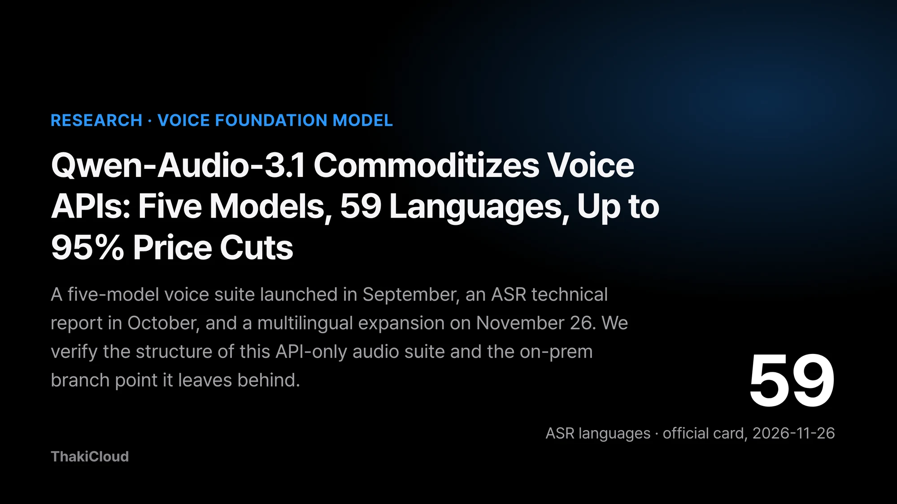
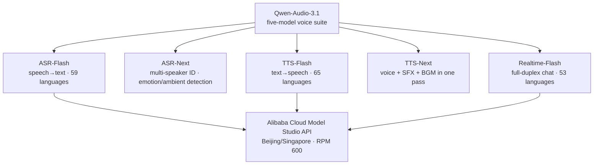
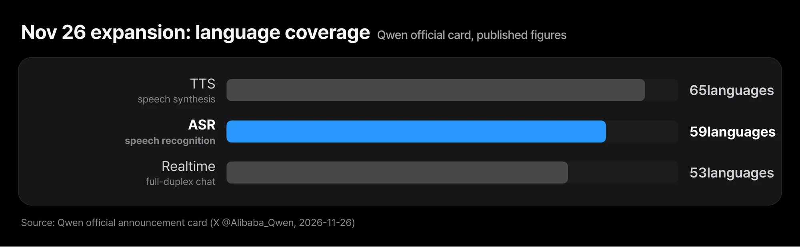
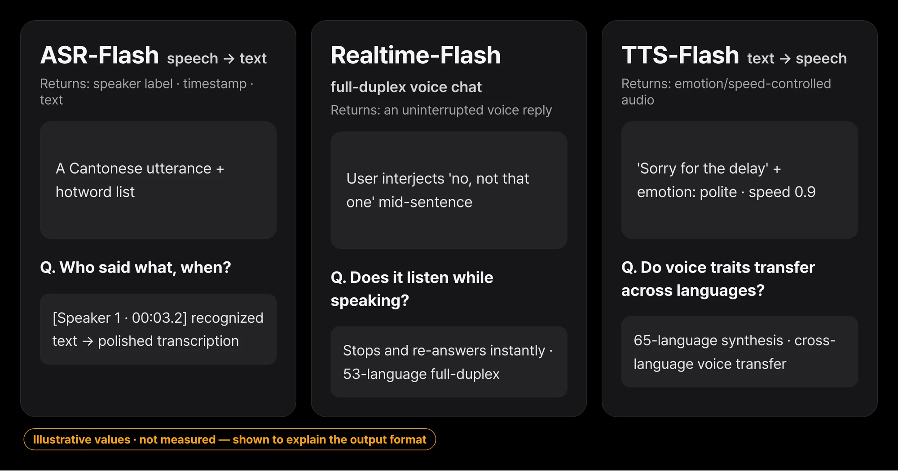
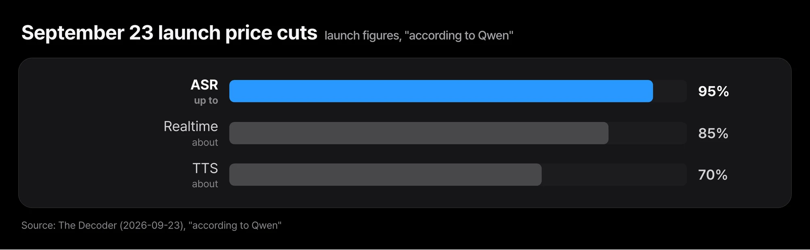
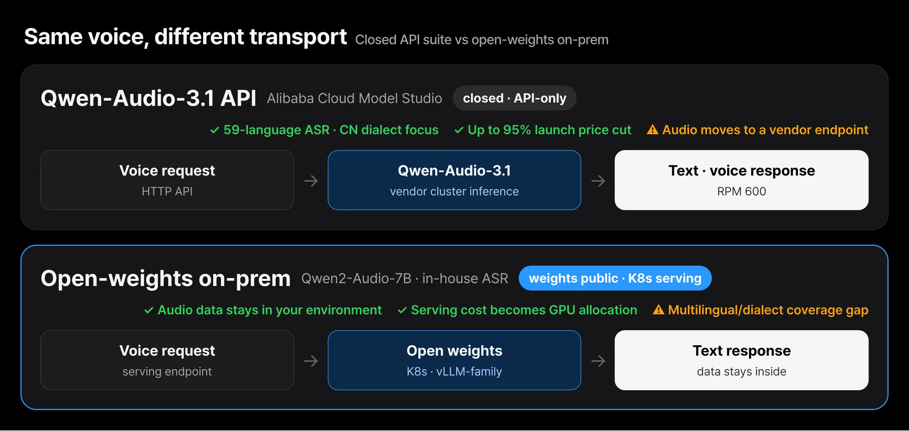

This post is for ML engineers who need to attach multilingual voice features (ASR, TTS, real-time conversation) to a product or an agent, and for platform teams deciding where that voice data will travel. On November 26, 2026, Qwen announced a multilingual capability expansion for Qwen-Audio-3.1: ASR 59 languages, TTS 65, Realtime 53, with Chinese dialects emphasized.

The core conclusion comes first. Qwen is commoditizing "voice" as a layer, not as a feature. The five-model suite, the up-to-95% price cuts, and today's coverage expansion are the evidence. But there are no open weights for Qwen-Audio-3.1. So the voice decision splits into two markets along one line: where the audio data travels. Cloud API on one side, on-prem open weights on the other.

What this post verifies: the structure of the five models launched on September 23, what the October 20 technical report (arXiv 2610.28711) shows inside the ASR side, the numbers published in today's expansion and the ones that were not, and the branch point this structure leaves for on-prem and sovereign voice design. All figures were cross-checked against official releases, documentation, and search results as of November 26.

*Qwen-Audio-3.1: five models, 59 ASR languages, and up to 95% launch price cuts. Reading the structure of an API-only audio suite with no open weights.*

## In plain terms

Qwen-Audio-3.1 is like building a "multilingual call center" inside a single API. The center has five employees, each with a distinct role. ASR-Flash is the agent who takes the call and writes it down. It understands 59 languages and cleans the transcript into clean sentences. ASR-Next is the team lead. It records who said what and when with timestamps, and catches emotion, ambient sounds, and machine noise. TTS-Flash is the answering voice in 65 languages, with emotion, speed, and style control. TTS-Next is the dubbing studio: voice, sound effects, and background music in one pass.

Realtime-Flash is the agent who listens while speaking and stops instantly when the customer interjects: 53-language full-duplex conversation.

This call center opened on September 23, published its operations manual (the technical report) on October 20, and today, on November 26, expanded its agents' language repertoire to 53 to 65 languages, with Chinese dialects as the focus. One structural note: the call center is a vendor-run closed API. The phone lines run through someone else's building. The "call center" analogy carries through the rest of this post.

## September 23: five roles, released at once

Qwen announced the Qwen-Audio-3.1 lineup at the Yunqi (Apsara) Conference on September 23. It was not a single model. ASR, ASR-Next, TTS, TTS-Next, and Realtime: five models in one release. The Decoder covered the launch as "five new models and AI audio prices slashed by up to 95 percent," and summarized each role as follows.

| Model | Role | Verified capabilities |
|---|---|---|
| ASR-Flash | speech → text | Multilingual and dialect recognition; automatic cleanup of fillers and repetitions |
| ASR-Next | audio understanding | Multi-speaker identification with timestamps; emotion, ambient sound, and machine noise detection |
| TTS-Flash | text → speech | Multilingual synthesis; cross-language voice transfer; emotion, speed, and style control |
| TTS-Next | audio generation | Language model + diffusion: voice, sound effects, and background audio in a single pass |
| Realtime-Flash | full-duplex chat | Speaking and listening simultaneously; instant interruption |

In the call-center framing, this is not hiring one employee. It is hiring the entire department at once: from call handling to dubbing. That difference matters. The pattern of stitching together different vendor APIs for each piece of the voice pipeline becomes a single suite where the pipeline is complete.

*The five roles of the Qwen-Audio-3.1 suite and the access path. All models are served through the Alibaba Cloud Model Studio API (official docs, 2026-11-26).*

## What the technical report shows inside the ASR

The "Qwen-Audio-3.1-ASR Technical Report" (arXiv 2610.28711), registered on October 20, lays out the ASR side. It lists 48 authors. Coverage at the time of the report: 30 languages plus 16 Chinese dialects. That is the baseline before today's expansion.

The report identifies five feature threads. First, historical-context conditioning: the previous turns feed into the current recognition. In call-center terms, the agent is not picking up a cold call. It remembers the last one. Second, hierarchical hotword customization: brand names and proper nouns can be registered in tiers to lift recognition. Third, transcription polishing: fillers and repetitions are cleaned into tidy sentences.

Fourth, diarization output: speaker labels, timestamps, and text together, with consistent speaker labels across turns and overlapping speech represented. Fifth, expansion beyond ASR: audio, speech, and music captioning; temporal grounding and sound event detection; audio question answering and multiple-choice reasoning, all handled by the same model family.

This is the point that exceeds what the name "ASR" implies. What sits inside the ASR API is not transcription but audio understanding. Practically, three jobs that used to be three separate pipelines converge into one API call: transcribing support calls, splitting meeting notes by speaker, and nailing down proper nouns in voice commands.

The report also names four service modes: asynchronous file transcription, low-latency streaming, interactive voice input, and non-streaming recognition. Batch transcription, real-time streaming, and interactive input run on the same model family. In the call-center framing, one agent handles phone, text transcript, and record lookup.

## Today's (Nov 26) expansion: from 30 to 59 languages

Today's release is a coverage expansion, not a new model. Per the official announcement card: Realtime 53 languages, ASR 59, TTS 65. ASR doubled from the 30 languages reported in October. The tweet body says "Especially for Chinese dialects": dialects are the center of this expansion.

*TTS 65, ASR 59, Realtime 53 languages. ASR doubled from the 30 languages in the October technical report, with Chinese dialects emphasized.*

What was not published is equally clear. There are no benchmarks for today's expansion: no WER figures, no accuracy comparisons. The dialect list was not disclosed, and Qwen did not specify which dialects are covered. Secondary reporting (aicoder) puts the dialect counts at 8 for ASR, 6 for TTS, and 6 for Realtime [reported figure], but no official list exists for those numbers either.

*What the three cores of the audio suite return. A dialect utterance plus a hotword list goes in; text with speaker labels and timestamps comes out (values are format examples).*

In the call-center framing, what was added today is not new staff. It is a wider language repertoire for the same five roles.

## Up to 95%: the price structure the cuts created

Price is half of this suite. At the September 23 launch, Qwen cut TTS by about 70%, Realtime by roughly 85%, and ASR by up to 95% (The Decoder, "according to Qwen"). The "up to" matters: 95% is the ceiling of the cut, not a sustained price level.

*TTS down about 70%, Realtime about 85%, ASR up to 95%. The 95% is the ceiling of the cut, not a sustained price level.*

Current official list prices (Alibaba Cloud Model Studio docs, verified 2026-11-26) for qwen-audio-3.1-asr-flash: input 0.8 CNY / output 2.7 CNY per million tokens in the Beijing region; 1.094 / 3.427 CNY in Singapore; RPM (requests per minute) 600. The docs add that this model is tuned for transcribing classical Chinese poetry.

Per secondary reporting, the USD pricing is ASR-Flash $0.15 input / $0.47 output, TTS-Flash $0.23 / $1.87, and Realtime $0.93 audio input / $1.87 text-plus-audio output per million tokens [reported figure].

Regions split the pricing too. Beijing and Singapore carry separate token rates, with Singapore running higher. Choosing a region is choosing the data path. In either region, the voice request enters a vendor cluster and is processed there.

The structural shift: once voice features are priced per token, the cost variable moves from "which model do we use" to "how much do we use, times the token rate." It is the same shape as a call center whose per-minute rate keeps falling: the side that runs more calls wins.

## A suite without weights: where the two markets split

A direct Hugging Face API query on 2026-11-26 found no Qwen-Audio-3.1 weight repository under the official Qwen organization. Official open audio weights stop at Qwen2-Audio-7B(-Instruct). Qwen-Audio-3.1 is a closed suite served only through the Alibaba Cloud Model Studio API.

That single fact sets the design branch point.

*Qwen-Audio-3.1 is API-only; official open weights stop at Qwen2-Audio-7B. Where audio data travels is the design branch point.*

First, data residency: audio moves to a vendor endpoint in Beijing or Singapore. Second, offline and latency: the pipeline depends on the network and vendor operations. Third, sovereign requirements: a closed API is not an on-prem option at all. Open weights (the Qwen2-Audio-7B line) or in-house models are the only assets on that path.

Read the shape of the facts: Qwen's position is closer to "cloud revenue" than to "opening the ecosystem." The five-model suite and the price cuts are a share strategy for a vendor-run call center.

## From a Metis perspective: coordinates in each market

ThakiCloud's Metis (Kubernetes-based AI serving platform) reads this structure in two coordinates.

On the cloud API path, the coordinate is "use coverage as the given; measure accuracy on your own data." The coverage of qwen-audio-3.1-asr-flash (59 languages plus dialects) and its token rates are already public. What remains is the WER on your domain audio: support calls, meetings, voice commands. With hotword and context conditioning available, domain proper-noun accuracy can be tuned as an API option, without a separate pipeline.

On the on-prem path, the coordinate is "use the API's coverage as the ruler; re-cut your own assets against it." Open-weight voice models served on Metis (the Qwen2-Audio-7B line, ThakiCloud's public Thaki-ASR-KO-1.7B, and others) guarantee data residency and offline operation.

Qwen-Audio-3.1's 59 languages become the baseline for that gap. If the languages you actually need are three to five rather than 59, your on-prem assets already cover the requirement.

On the on-prem path, the shape of cost changes too. GPU allocation, not token rates, becomes the cost, and voice models share the same accelerator pool as text inference. The added load is not "buying one more server." It is "how much of the existing pool you carve out."

From Paxis (the agent-native cloud) the cost line differs again. In a workflow that calls a voice API N times a day per agent run, token rates and GPU allocation grow along different curves. Voice cost must be measured per workflow, not per call.

Finally, the multilingual axis. ThakiCloud is running a ko/en/zh/ja/ar multilingual TTS comparison. Qwen's 65-language TTS entering that landscape is a reference data point, not a verdict. Naturalness and emotion are values you measure on your own data. A vendor's language count does not decide them.

## Four things to know before you use it

First, every figure here is vendor-published. Today's multilingual expansion carries no public benchmarks (no WER, no accuracy comparisons), and no dialect list. The 53/59/65 numbers are coverage claims, not measurements.

Second, the dialect focus is China-centric. The dialect counts (8/6/6) are from secondary reporting [reported figure], and whether Korean is inside the 59 or the 65 needs separate verification.

Third, the closed API has a price tag beyond money. Audio leaves your environment to vendor regions, and "up to 95%" is a launch-time ceiling, not a price guarantee. Throttles like RPM 600 belong in your operations plan.

Fourth, Realtime full-duplex quality is a vendor claim. Instant stop-and-reanswer is documented behavior, not independently verified numbers. Before production, measure latency and interruption behavior under your own workload.

## In closing

Qwen-Audio-3.1 is a five-model voice suite that entered the market on an "API-first plus price cut" strategy. Today's multilingual expansion (ASR 59, TTS 65, Realtime 53 languages) sharpened the coverage line, but the weights stayed closed. Read it as "a new model launch" and you understate it. Read it as "open-source progress" and you overstate it. The accurate reading is "a pricing-structure change in the cloud voice market."

Which of the two markets fits you is not a question about voice features. It is a question about voice data. Organizations whose data can leave get the API path's pricing and coverage as-is. Organizations whose data cannot leave must re-measure their open-weight assets' coverage.

Your first experiment today, one of two. If you are on the cloud path: point qwen-audio-3.1-asr-flash at ten minutes of your own domain audio (calls or meetings) and measure WER. Coverage and rates are already known; accuracy is the only remaining unknown. If you are on the on-prem path: inventory the language coverage of your Qwen2-Audio-7B-line or in-house ASR and compare it against the list of languages you actually need. The 59-language baseline is what makes that gap visible.

## Sources

- Qwen official announcement tweet (2026-11-26): https://x.com/Alibaba_Qwen/status/2125798914490249411
- Qwen-Audio-3.1-ASR Technical Report (arXiv 2610.28711, 2026-10-20): https://arxiv.org/abs/2610.28711
- Alibaba Cloud Model Studio docs (qwen-audio-3.1-asr-flash): https://help.aliyun.com/en/model-studio/qwen-audio-3-1-asr-flash
- The Decoder (2026-09-23, five-model launch and price cuts): https://the-decoder.com/alibaba-launches-qwen-audio-3-1-with-five-new-models-and-slashes-ai-audio-prices-by-up-to-95-percent/
- aicoder (2026-11-26, multilingual expansion coverage): https://aicoder.com/news/news-20261126-qwen-audio-3-1-multilingual-upgrade-asr-59-languages-tts-65-realtime-53-chinese-dialects-qwen-cloud
- Hugging Face Qwen organization model search (direct query 2026-11-26, confirming the absence of Qwen-Audio-3.1 weights): https://huggingface.co/Qwen
