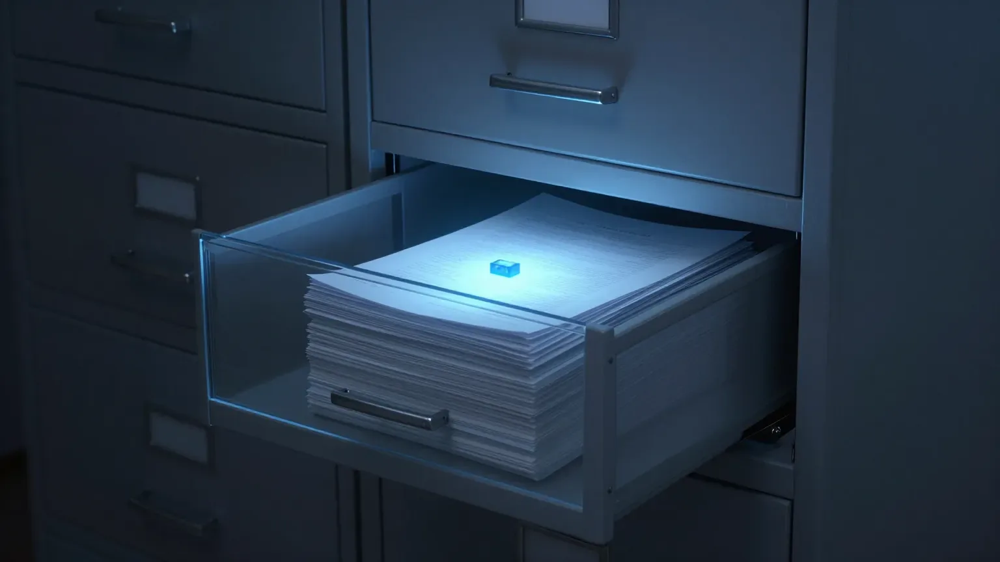
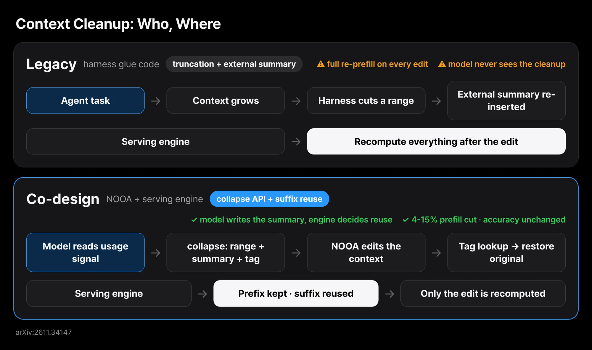
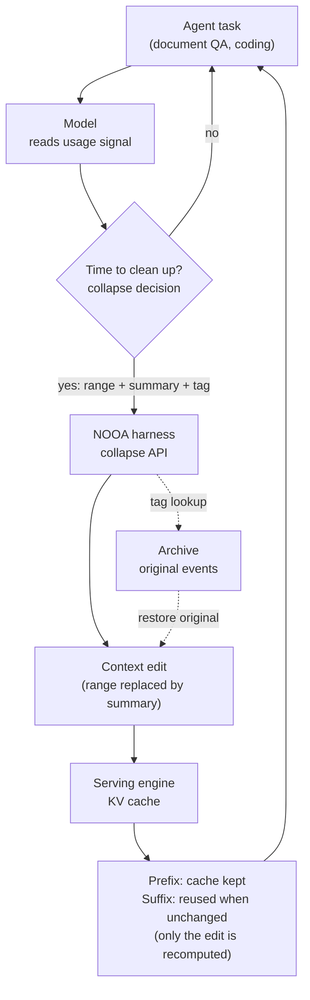
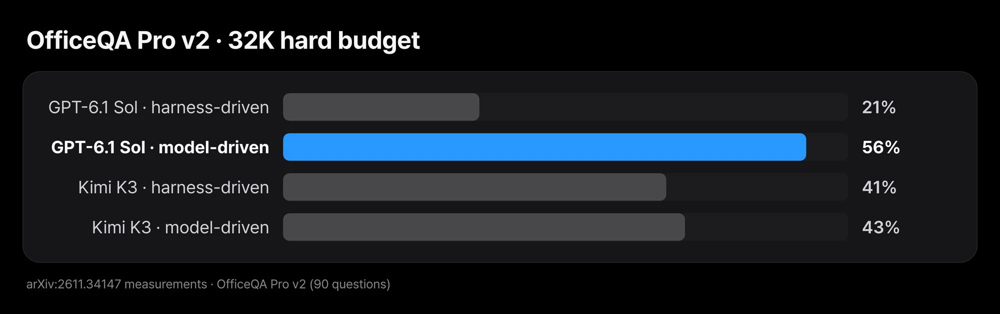
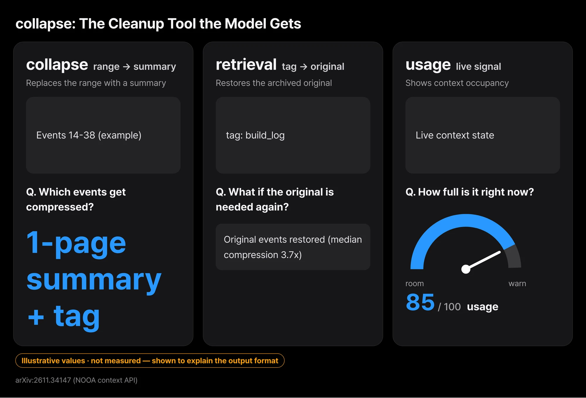

This post is for engineers who run long-horizon, multi-task agents on a GPU cluster and operate the serving platform, and for harness maintainers who have to decide who cleans up the context. An agent's context is a file that keeps growing. Left alone, it hits the budget and gets truncated. Cleaned up, it costs the serving side to re-read. This post is about where the ownership of that cost sits.

Here is the headline up front. NVIDIA's position report, Letting Models Manage Their Own Context: Where We Stand (arXiv 2611.34147, submitted 2026-11-25), is a controlled experiment in which the model itself makes the context-cleanup decision. Two numbers carry it. GPT-6.1 Sol's OfficeQA Pro v2 score at a 32K budget goes from 21% harness-driven to 56% model-driven, and suffix KV-cache reuse on the serving side cuts prefill compute by 4-15% per request with no measurable accuracy change.

One disclosure. The paper has not yet measured the central co-design claim, which is training the model. The measured numbers are what happens when you hand the tool over first and watch how the model behaves. The body covers what the co-design is, how the four models' cleanup habits differ, what the timing guidance does, under which conditions the serving-side number holds, and the two places ThakiCloud can pick it up.

> 📄 **Full deep review (DOCX)**: [Download the detailed peer review on Google Drive](https://drive.google.com/file/d/1NpUQ851uvpm6OWAAJPfUv2P8PZQCnGcx/view).

## In plain terms

An agent's context is like a filing cabinet in an office. The old harness cleaned it up on the model's behalf. The boss threw whole drawers away (truncation) or moved the files to a side room and re-sorted them (external summarization). And the reading room (the serving side) had to re-read everything from the top every time the cabinet changed.

The paper's approach gives the clerk (the model) a tool to shred and label (collapse). The model decides which stack of documents becomes a one-page summary, which tag it gets, and can pull the original back by tag when it needs it. The server re-reads only the pages that actually changed (suffix KV reuse).

In other words, this is the controlled experiment of what happens when you hand the clerk the shredder, and of what happens when you also teach the clerk when to shred.

## "Context Cleanup" Has Been the Harness's Glue Code

Agent context-management research has mostly come from outside the model's loop. MemGPT pages context into external memory, Context-Folding folds at fixed points, and SelfCompact summarizes under an external policy. SideQuest and Cache Engineering for Agents handle the cache on the serving side. The common point: the model never knows when and what got cleaned up. It just sees the changed context.

That structure carries a serving-side cost. When the context is edited, the existing prefix cache survives, but the changed point and everything after it must be re-read. The edit itself is the cost. When the cleanup policy lives in the harness, the serving side does not know what was edited, and the cache does not either.

The paper splits context management into three layers. The model decides when and what to clean up, the harness NOOA (NVIDIA's open-source agent harness) provides the collapse API and the usage signal, and the engine keeps as much of the KV cache as it can. That three-layer split is the co-design.

*Left is the structure where the harness cleans up on the model's behalf: every edit re-prefills the whole context. Right is the co-design, where the model decides the collapse and the engine reuses the suffix KV.*

## Co-design: the model decides when and what, the engine preserves the cache

NOOA's context API centers on one operation, collapse. The model names a range of events; the range is replaced by a summary and the original is archived. Tag-based retrieval pulls the archived original back. Alongside these, a live usage indicator shows how full the cabinet is, and timing guidance plus warnings tell the model when it is time to clean up.

The engine-side technique is suffix KV-cache reuse. After an edit, the prefix before the edit point is unchanged, so it stays cached as before. The key is that the text after the edit point (the suffix) is also not recomputed when it is unchanged. Because collapse replaces a middle event range with a summary, the long suffix after it is usually untouched. The summary is produced by the model, not inside the cache. The engine only decides which KV can be reused.

## Without extra training, GPT-6.1 Sol goes from 21 to 56

The benchmark is OfficeQA Pro v2, 90 document-based questions. The context budget is fixed as a hard limit from 8K to 512K tokens, and when it is exceeded a fallback drops the oldest events. Three failures count as wrong.

The headline number is GPT-6.1 Sol at a 32K budget. With the harness driving context management it scores 21%; with the model driving it, 56%. A nearly 3x score at the same budget. Kimi K3 is also positive. At 32K the score goes from 41% to 43% and cumulative input tokens fall from 62M to 36M, a 41% cut. At 64K the score goes from 52% to 57% with about 11% fewer tokens.

A number that reads as a behavioral fact. GPT, Kimi, and DeepSeek used the context API in 42-53% of tasks. Claude Opus 5.5 used it in 4%. The model uses the cleanup tool only when it wants to.

*At the same 32K budget, model-driven cleanup lifts GPT-6.1 Sol from 21% to 56%. Kimi K3 goes from 41% to 43% while cumulative input tokens drop 41%. Measured in the paper.*

## The four models clean up completely differently

The median compression per compaction is 3.7x for GPT, 2.1x for Kimi, 1.8x for DeepSeek, and 1.5x for Opus. How tightly the summary is written is a model-personality variable.

The rate of pulling the archived original back after compaction is 19% for GPT, 7% for Kimi, 3% for DeepSeek, and 14% for Opus. GPT shreds and then looks back; DeepSeek almost never does.

The first-warning behavior at a 64K budget is more interesting. GPT read the documents first and then compacted in 69% of cases. DeepSeek inspected the history and then compacted in 46%. Kimi compacted immediately in 49%. Opus frequently just returned an answer. Give four models the same tool and their cleanup timing and depth differ. A harness designer should not assume one cleanup policy; it should measure per model.

*The model passes an event range to collapse and gets back a summary, a tag, and a path to retrieve the original. Example values, not measurements.*

## Without teaching "when," cleanup happens at the wrong time

The paper compares a timing instruction (compact at 85% usage) with no instruction. With it, Kimi's first-compaction median moves from about 84% to 29% of the budget at 128K, and DeepSeek from 83% to 40% at 256K. Opus compacts far earlier than the instruction on its own, at a median of 16% at 128K.

Without the instruction, at 128K and above Kimi and DeepSeek score about 8 points below the harness baseline. GPT and Opus show no comparable change. For mid-tier models, the guidance is not a convenience feature. It is part of the accuracy.

## The serving side gets cheaper: 4-15% less prefill compute per request

The suffix KV-reuse prototype was measured with the Qwen3.6-27B model, the SGLang engine, a 32K context, and three benchmarks (MLE-bench Lite, OfficeQA Pro, DeepSWE). The result is 4-15% less prefill compute per request versus standard prefix caching, with no measurable accuracy change.

The largest cut is on OfficeQA Pro. The surviving suffix after an edit averages about 10K tokens, roughly 60% of the prompt. The longer the suffix, the bigger the cut.

Read the two boundaries with it. This is a prefill-compute number, not an end-to-end latency or cost number. And it is one model, one engine, three benchmarks, so the generalization range is the next step.

## Where ThakiCloud picks it up

ThakiCloud's ai-platform serving layer (Metis, running vLLM and SGLang on K8s and Kueue) has a direct hook in the suffix-reuse number. The condition that makes a suffix survive after an edit is exactly the agent workload. The more the context is edited, the bigger the serving-side benefit. On a shared GPU cluster, prefill compute is a term that moves the GPU-hour bill, and whether the 4-15% cut reproduces on the Metis serving stack is worth measuring.

On the Paxis side, the context budget becomes a first-class policy resource. Paxis already treats Skills, Tools, Policies, and Audit Logs as first-class resources, and the collapse timing guidance plus usage signal in this paper is the control surface of context policy. In Paxis orchestration, giving each agent a context-pressure signal and logging the cleanup decision (what, when, why) extends the existing policy gate. The per-model usage rates of 4-53% are the reference values for deciding which model to trust with the cleanup tool.

## Four things to watch before applying

First, the sample is small. OfficeQA Pro v2 is 90 questions and MLE-bench Lite is 22 competitions. A gap as large as 21 to 56 still carries a wide margin of error.

Second, the pressure is simulated. Shrinking the context budget is a proxy for real long-horizon work, and the fallback (dropping the oldest event) itself affects scores.

Third, the training boundary. Every measured number in the paper comes from off-the-shelf models. The co-design's original claim, training the model to know when and what to compact, is an open direction.

Fourth, the engine boundary. The KV-reuse prototype is Qwen3.6-27B on SGLang, measured in prefill compute only. Porting to other engines is unmeasured.

## In closing

The context-cleanup decision moves from the harness's glue code to the model's tool, and the KV cache that used to be invalidated by every edit becomes partially reusable. The two halves of the co-design measured 21 to 56, and 4-15%.

If you maintain a harness, the first experiment is measurement, not implementation. You need to know whether the model you are running actually uses the collapse tool. Usage rate is the number to know before you build. If you run a serving platform, measure how much of the suffix survives after an edit in your workload. That is the term that shows up directly in prefill cost.

The filing cabinet was always the clerk's. The paper showed that handing the clerk the shredder pays, and teaching when to shred pays more. The next step is training the model that holds the key, and the paper leaves that open.

## Sources

- Devoto, Vem, Safavi, Kariyappa, Tseng, Furgale, Cabral (NVIDIA), "Letting Models Manage Their Own Context: Where We Stand", arXiv:2611.34147 (2026-11-25). https://arxiv.org/abs/2611.34147
- Full text: https://arxiv.org/html/2611.34147v1
- Discovery path (tweet): https://x.com/hjguyhan/status/2126467297196077378

> 📄 **Full deep review (DOCX)**: [Download the detailed peer review on Google Drive](https://drive.google.com/file/d/1NpUQ851uvpm6OWAAJPfUv2P8PZQCnGcx/view).
