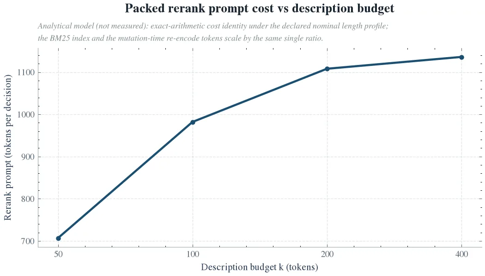
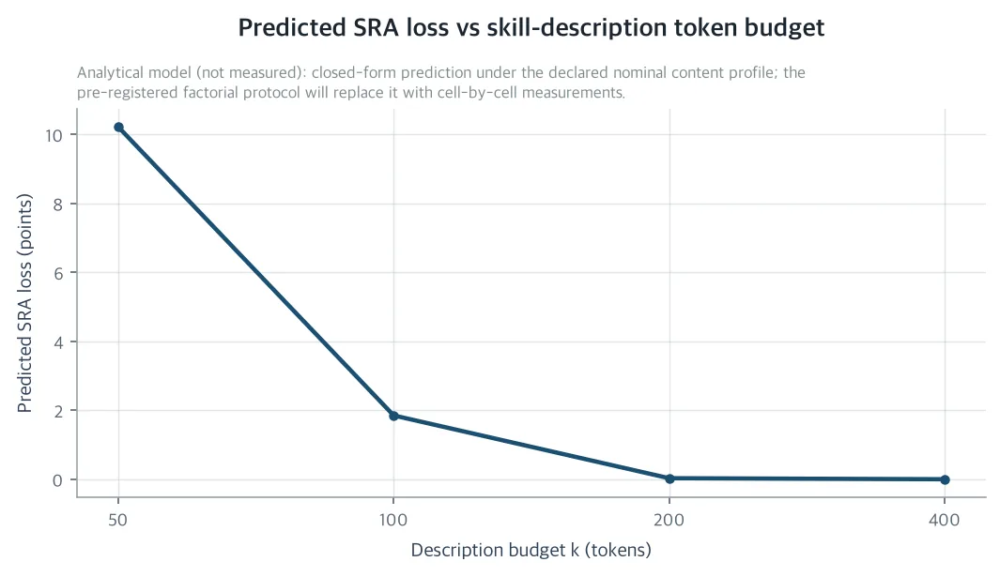
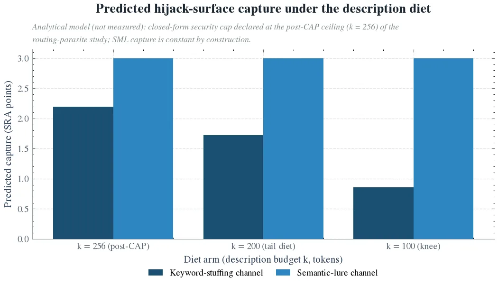

This post is for Korean cloud and AI engineers who run a hybrid BM25+embedding router in a self-evolving agent harness where thousands of skills evolve on their own overnight, or who want to change that router's structure. The router reads each skill as a one-line string of name and description, and that description is the only text the router consumes from the registry side. This paper writes a closed-form value on that description side: how much a skill must describe itself for the router to find it, and where that knee sits.

The core result comes out on the declared nominal premises. Among the budget arms k=50/100/200/400/full that truncate the description to its first k tokens, the cheapest arm on which routing quality stays inside the 2.0-point tolerance band is k*=100. The predicted SRA loss is 1.85 points, and the rerank prompt per decision falls from 1,136.0 to 982.0 tokens, a cut of 154.0 tokens. All three cost objects, the BM25 index, mutation-time re-encoding, and the rerank prompt, move at exactly the 25/32 ratio. k=50 sits outside the tolerance band at 10.22 points, and k=400 is an exact no-op on the declared profile. There is one side effect as well. The diet caps the attack surface that grows with length at exactly k/256.

One thing to state before you read on. This paper is an analytical paper that counts values on declared premises, and it reports no new measurements. The quality numbers are closed-form predictions on the declared nominal content profile, and the cost identities are exact arithmetic independent of the premises. The preregistered protocol with its five arms is the design that turns predictions into measurements. The three figures in the body are drawn by the analytical model and are not measured data. If the ThakiCloud router series has priced the model side, the output side, the pipeline toll, and the query side in turn, this paper prices the one side of the input that was left: the skill's self-description.

## Problem: Every Stage of the Router Is Priced, and Only the Description Side Remains

Every turn of the unattended agent harness begins with a routing decision: which of the registered skills to inject for this task query. The production router is hybrid. The lexical Okapi BM25 lane and the dense cosine lane each fetch a top-50, and the two lists are fused by Reciprocal Rank Fusion (RRF, constant k_r=60). A candidate is injected when it clears either gate, BM25 above 6.0 or cosine above 0.60.

The registry is the declared nominal N=2,029 skills. It self-evolves in overnight cycles, and routing quality is scored on a frozen 63-case SRA bench (45 positive, 10 native, 8 negative). The text the router reads from a skill is its name and description, and the name is short. The declared nominal name length is 16. So the registry side of routing quality is, for all practical purposes, the quality of one line of description.

The series has priced this router stage one by one: the model side of the dense lane (INT8 quantization, the three-axis space of backbone size x quantization x dimension), the output side (menu width M=5, near-tie break), the pipeline toll (1,440.3 tokens per decision), and up through the query side of the input (the query ceiling a sentence sets). What has no price yet is the description side of the input. How much a skill must describe itself for the router to find it is where the question remained.

This paper is an explicit upgrade of the gatekeeper study across the encoder. That study compressed the model the router uses. This paper compresses the text the router reads. The perturbation algebra on both sides is the same, because quantization error and truncation error both reach the fused score only through the dense term, and RRF attenuates both by the same constant per ranking position. The router's compression tolerance is therefore a shared budget. And this paper is the mirror axis of the query-ceiling study. If the query side stood up a ceiling on intent, the description side stands up a floor on minimal self-description, and the way the value is made is the same: a closed-form content model, a first-order perturbation, a ranking-safety diagnostic, a declared nominal cost card, a preregistered factorial protocol.

## Design: Three Cost Objects Move Under Truncation, and One Ratio Summarizes Them

The diet operator is simple. The budget k is the prefix truncation trunc_k, which cuts every indexed string to its first k tokens at index time. BM25 indexes trunc_k(s), the encoder embeds trunc_k(s), and the rerank reader packs trunc_k(s). The arms are k=50, 100, 200, 400, and full. Since the name length 16 is below 50 and survives on every arm, the diet acts purely on the description side. Truncation is string arithmetic and spends no LLM tokens at all, so its cost lives only in the index-side objects and the content loss.

The declared length profile walks in step with two cards from the earlier series. Curator-normalized organic strings are 128 tokens, the post-CAP description ceiling is 256 tokens, and the mass distribution is declared 90% at 128 and 10% at 256. The expected indexing length E_k comes out exactly as 140.8 at full, 135.2 at k=200, 110.0 at k=100, 55.0 at k=50, and 140.8 at k=400. k=400 is the same value as full.

The cost-identity theorem picks exactly three cost objects for the diet to move. The overnight rerank input tokens C_prompt = Q×(S_r + T_q + M×E_k), the BM25 indexing tokens C_idx = N×E_k, and the mutation-time re-encoding tokens C_enc = m×E_k. All three objects are linear in E_k, so they are summarized by the single ratio E_k/E_full. At k=100 it is 110.0/140.8, exactly 25/32, and at k=50 it is 55.0/140.8, exactly 25/64. The marginal cost per budget token is 50,000 tokens per night on the k<128 interval and 5,000 tokens per night on 128≤k<256. The length-tail interval is exactly 10× cheaper, or, cutting that interval removes only the tail, which is 10% of the total mass.

The cost card is a self-hosted H200 ($2.00 per GPU hour), the rerank stage ($0.50 per million input tokens), overnight routing decisions Q=10,000, registry mutations m=50, query length T_q=32, rerank scaffolding S_r=400 (per decision, k-independent), full menu width M=5, and the declared overnight budget $2,040. On this card the rerank prompt per decision falls from 1,136.0 tokens at full to 1,108.0 at k=200, 982.0 at k=100, and 707.0 at k=50. The BM25 index falls from 285,683 tokens to 223,190 at k=100 and 111,595 at k=50, and overnight re-encoding falls from 7,040 to 5,500 and 2,750.

*The rerank prompt tokens per decision rise as the budget k grows, bend near the organic length of 128, and saturate at k=400. The k=400 arm is an exact no-op on the declared profile. A closed-form computation of the analytical model, not a measurement.*

Two exact facts are also caught here. The length-normalization invariance lemma says that on uniform-length organic mass, prefix truncation affects the BM25 lane in no way other than content loss. The Okapi normalization term ell(|s|) = 1 - b + b×|s|/avgdl is exactly invariant at 1, because setting the length of every mass skill to k at the same time also sets the mean document length to k, or it is 1 both before and after truncation. The diet cannot buy a compensation boost on the mass, so its BM25 effect is anchor-mass loss alone. The saturation-witness proposition says that any arm with k above the 256 ceiling does exactly nothing. Since min(400, 128)=128 and min(400, 256)=256, E_400 = E_full and trunc_400 = identity. The k=400 arm is the query-ceiling design reversed: it certifies the ceiling from above at no extra cost, and the diet is decided by the below-nominal arms 50/100/200.

## Result: The Knee Is at k=100, and k=50 Is a Value Outside the Tolerance

The quality side is entangled in the same first-order shape as the earlier study that handled quantization error. The declared content profile sets an anchor-first convention. Since capability anchors and idf-weighted anchor terms stand at the front, the query-relevant mass fraction kappa that the prefix supports on the organic mass is 1.00 at k≥128, 0.90 at k=100, and 0.70 at k=50, and the truncated tail mass is declared with low query alignment at fraction phi=0.3. The gold dense score averages 0.66 (margin 0.06 over the 0.60 gate), and the gold BM25 score averages 9.0 (margin 3.0 over the 6.0 gate). The certified-margin CDF of the risk ranking position is declared F(1.02)=0.01, F(5.10)=0.05, F(15.30)=0.25.

On the dense lane, the truncated embedding is taken as the full embedding minus the truncated query-aligned tail mass: e(trunc_k s) ≒ e(s) - (1-kappa)×phi×v_rel(s). The first-order cosine perturbation bound uses the same algebra as the quantization bound with content loss in place of the error, namely sigma_D(k) ≤ (1-kappa_D(k))×phi×(1-c̄). On the declared nominal, sigma_D(200) ≤ 0.00204, sigma_D(100) ≤ 0.0102, and sigma_D(50) ≤ 0.0306 come out exactly. Every arm clears the dense gate at the declared mean, so gate loss occurs only in the joint tail of low-margin golds. On the BM25 lane, the condition for the anchor mass kappa to hold the gate is written, and it first breaks at kappa < 2/3 from the mean 9.0: k=50 survives at 0.3 BM25 units from the mean, and the risk set is the declared tail of golds with s_L < 8.57 (fraction 0.12).

RRF composition attenuates the ranking shift. The maximum position a lane-score perturbation sigma can move a ranking is J×sigma (J=500, since the top-50 list spans the declared 0.1 score band), and RRF attenuates it by delta_RRF = 1/(60×61) = 2.73×10^-4 per position. The ranking-safety margin diagnostic says that trunc_k is ranking-safe on every SRA case whose certified fusion margin is at least m_k = delta_RRF×r(k). The risk set is the fraction F(r(k)) of the cases below that, and the predicted ranking loss is F×45×p_flip (p_flip=0.5 declared).

The knee rule is the series convention. The knee is the cheapest arm whose predicted SRA loss lies inside tol=2.0 points, and no arm, threshold, or tolerance band is changed after the fact. One bench case is 100/63 ≒ 1.5873 points. The per-arm predicted loss splits into two channels: ranking loss (applying a flip rate of 0.5 to the risk mass) and gate loss (the joint tail of golds that lose both lane gates).

*The closed-form predicted SRA loss drops steeply as the description budget grows. The knee k=100 sits at 1.85 points, inside the 2.0-point tolerance band, and k=50 is predicted outside the band at 10.22 points. The analytical model, not a measurement.*

The numbers are as follows. k=200 is 0.03 points (it acts on only 4 cases of tail golds), k=100 is ranking 1.79 + gate 0.06 = 1.85 points, and k=50 is ranking 8.93 + gate 1.29 = 10.22 points. Set against the per-decision cost (full/400: 1,136.0, 200: 1,108.0, 100: 982.0, 50: 707.0), the inside-band arms are full, 400, 200, and 100, and the cheapest of them is k*=100. The diet is therefore two steps. The tail diet 256→200 is a free security step at 0.03 predicted points, and the head diet 200→100 is the knee where the price is paid. The one step 100→50 spends a further 8.37 predicted points, or 4.2× the full tolerance band. Rejected on the declared profile.

The shared-compression-budget theorem gives this series' upgrade in one line. Model-side perturbations (size, index quantization, index dimension) and input-side perturbations (description budget) reach the fused score through the same dense term and are attenuated by the same delta_RRF. The router's total compression tolerance is the shared budget m_cert ≥ delta_RRF×J×(sigma_model + sigma_input), and filling one side shrinks the other's budget. On the margin, the two are substitutes. If gatekeeper entangled one model-side axis and dense-share entangled three, this theorem gathers the input axis too under a single diagnostic.

The scale-invariance corollary says that the knee rule is invariant in N. Since every cost object is linear in N or Q and the profile is per skill, the self-evolving registry re-certifies the knee at no measurement cost by recomputing C(k) and re-checking the certified margin of the flip ball. The knee is a rule, not an experiment run per mutation.

## Security: The Budget Caps the Attack Surface That Grows With Length

The description is also the attack surface of the routing parasite. The payload-free description-level hijack formalized by the earlier study splits into two channels: the keywording (KWS) channel with a term budget, and the semantic (SML) channel that needs no term budget at all.

The security-cap theorem gives exactly how the diet acts on that surface. Against the declared linear coverage c(L) = (0.55/512)×L and the KWS capture of 2.2 SRA points at the L'=256 ceiling, a diet with k ≤ 256 caps the tail's term budget at k, and the KWS capture shrinks exactly to c(k)/c(256) = k/256. What remains is 1.72 points at k=200 and 0.86 points at k*=100 (multiplier 25/64), while the SML capture of 3.0 points stays the same at every k. A lure needs no term budget.

*The diet cuts the predicted capture of the keywording channel in proportion to the budget, while the semantic channel stays at 3.0 points on every arm. The analytical model, not a measurement.*

There are three results. First, on the KWS channel the diet is the only structural lever with zero promotion-time LLM cost. If CAP bought the 256 ceiling at zero price, the diet buys the 100 ceiling at CAP's zero price, removing a further 1.34 predicted points of surface. The point of comparison is TLOCK buying the last 0.4 points at 3.84k tokens per night. Second, the gates and the diet act multiplicatively on different interfaces, promotion time versus index time. Applying the diet (k=100) to the residual 0.5 points at the CAP+AGREE knee leaves 0.5×25/64 ≒ 0.20 points, a predicted 97% removal of the 5.8-point surface. Third, the curator's rewrite lengthens by construction, so without a boundary the committed attack surface grows every night. Against the earlier result that the evolution interface itself is an attack surface, the diet is a standing guard on the ceiling the loop can commit.

The honest scope is the channel asymmetry. The diet caps only the budgeted KWS channel, and the SML channel is the gate's target as it is. The two controls have to run together.

## Order: Secure the Description Floor First, and Look at the Query Ceiling Later

The mirror-axis corollary contrasts the value-payment cycles of the two levers. The description-side lever is paid m=50 times per night at index time, and the query-side lever (the per-decision LLM lever of the query-ceiling study) is paid every decision, Q=10,000 times per night. The amortization wedge is exactly Q/m = 200×. The head-content improvement delta_kappa obtained by anchor-first rewrite and truncation is priced at up to 1/200 of the nightly cost of obtaining the same improvement by per-decision query augmentation.

So the order is decided. The diet precedes the stretch: secure the description floor first, and spend on the query side only where the sentence-poor diagnosis binds. The two levers are complements, not substitutes. The ceiling binds what the sentence can carry, the floor binds what the router can read, and routing quality is jointly bound by min(ceiling, floor).

The anchor-first payoff corollary hands over the key to a deeper diet. If the curator lifts the k=50 retention kappa(50) from 0.70 to 0.90 by head-first rewrite, the predicted loss at k=50 falls from 10.22 to 1.85 points and enters the tolerance band, and the knee moves to k=50 at 707.0 tokens per decision (60.9% of the description component, exactly 39/64). The rewrite convention becomes a measured curation KPI, kappa_L(50), kappa_D(50) ≥ 0.90.

## Preregistered Protocol: Where the Predicted Curve Becomes a Measurement

The protocol swaps the declared nominal for recorded values and runs the five arms on the frozen bench. (i) At run start, pin the frozen snapshot and record N, the length profile, and the content profile (kappa_L, kappa_D, phi, c̄, s̄_L, F) to replace the declared nominal. (ii) Run the five arms on the frozen bench (45/10/8) and score Recall@5, Top-1, gated Recall@5, hallucination rate, negative avoidance at k=5 and k=8, and the available-only variant with an SRA composite. (iii) Run the parasite attack suite (A0 to A3 arms) on each diet arm and measure the KWS/SML surface separation directly, verifying the security-cap theorem cell by cell. (iv) Apply the knee rule among the measured arms inside tol=2.0 points, where the two-sided test is that the k=100 measured loss is inside the tolerance and the k=50 measured loss exceeds it. k=400 certifies the no-op. (v) No arm, threshold, or tolerance band is changed after the fact. The predicted column of the tables and the theorems are preregistered hypotheses.

## Where It Touches: Company, Society, and Science

What the company gets is a principle-based description-length budget for a 2,000-plus skill registry. Cutting at the predicted knee k*=100 keeps SRA quality inside the 2.0-point tolerance, shrinks the packed rerank prompt by 154.0 tokens per decision, and reduces all three cost objects at exactly 25/32. The overnight token bill becomes a closed form in (k*, N, m) rather than the length of a whim, and the bill stops sliding as descriptions grow.

What society gets is a lower unit price per autonomous turn. When the unit price of unattended agent operation falls, fully autonomous work automation docks with more teams and price ranges, and token and power consumption per level of automation drop, shrinking the energy footprint. The recipe reruns anywhere there is a registry that describes itself.

What remains for science is the first value on the description side of the router input, the axis that had not been measured. It is the mirror axis of the query-side budget, and the unification of the router's compression algebra remains: model-side quantization and input-side truncation are one perturbation class under the RRF-attenuated shared budget. From length-normalization invariance, the saturation witness, and the 200× amortization wedge, to the k/256 security cap with zero promotion cost, a reproducible cost-quality knee curve remains over the self-evolving large-scale skill registry.

## Limits: Closed-Form Predictions Over the Declared Profile

There are three limits. First, the declared nominal profile. Every quality number is a closed-form prediction over the declared content profile, not a measurement. The protocol calibrates the profile and re-derives the knee on recorded values. The cost identities are exact arithmetic and hold regardless of the profile.

Second, the first-order model under strong truncation. k=50 truncates 80.5% of the tail and 60.9% of the mass, entering the strong-truncation regime, the zone where the earlier literature found truncation not nearly harmless (at least 70% reduction). The predicted 10.22 points at k=50 is a lower bound, so the conclusion that it is outside the tolerance is firmer. The k=100 arm is in the mild regime (21.9%), where the bound is the reliable side.

Third, the model and coupling scope. The length-normalization invariance is exact only on the curator-normalized mass, and the tail's normalization-term shift is declared second-order and measured directly in the protocol. Since one bench case is 1.5873 points, the 2.0-point tolerance is about 1.26 cases, and the knee decision is sensitive to one boundary case (the protocol reports per-arm confidence). The cost is declared on the series' menu knee M=5 (re-certification is free), and the security cap inherits the earlier study's linear coverage c(L) as a declared nominal (the protocol re-measures the separation). The mirror axis is joint optimization, not sequential: where a sentence-poor query and a truncated description overlap in the same case, they combine, and it shows in the protocol's composite scoring.

The paper and its companion materials are viewable on the Hugging Face paper detail page. https://huggingface.co/datasets/thaki-AI/daily-paper-2026-11-28-skill-description-budget-routing

*Every number in the body is a closed-form prediction on the declared nominal premises, or a result attributed to the cited references. The precise values are E_k: full 140.8 / 400 140.8 / 200 135.2 / 100 110.0 / 50 55.0, rerank prompt per decision 1,136.0 → 982.0 (k=100, -154.0), BM25 index 285,683 → 223,190, overnight re-encoding 7,040 → 5,500, ratios 25/32 (k=100) and 25/64 (k=50), marginal cost 50,000 (k<128) vs 5,000 (128≤k<256) tokens per night, sigma_D ≤ 0.00204 / 0.0102 / 0.0306, predicted SRA loss 0.03 (k=200) / 1.85 (k=100) / 10.22 (k=50), KWS capture 1.72 (k=200) / 0.86 (k=100), gate residual × 25/64 vs 0.20 points, the 200× amortization wedge, and 707.0 tokens per decision (39/64) at kappa(50) 0.70 → 0.90. The three figures are closed-form computations of the analytical model, not measurements. The five-arm preregistered protocol was not executed in this paper, and the report of measured values happens at execution time.*
