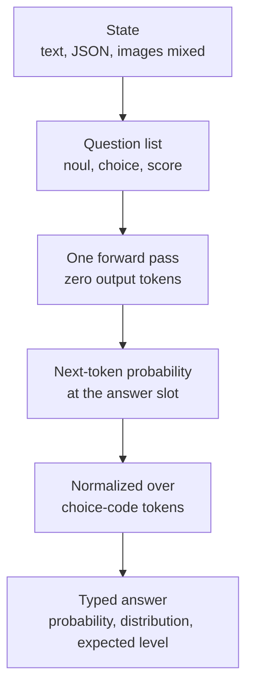

## Why read this

For engineers who put a "decision" step in agent or service pipelines. Routing, triage, guardrails, LLM-as-judge scoring: the goal is "picking," not "writing an answer," and the standard tool so far has been calling a small chat model, generating text, and parsing it. Conclusion first: **a decision model is a different species that moves the parsing step inside the model, and fine-tuning d1-3B is just "SFT where the completion is a single token," so it finishes in about 30 minutes on free GPU.** This post includes the model architecture we verified by downloading the weights, the question schema, the two fine-tuning notebooks (TRL, Unsloth), and our internal S3 onboarding.

## Overview

A tweet by Leonie, a DevRel engineer at Liquid AI, went viral: two notebooks that show "how to fine-tune a decision model on your own data," covering (1) how to prepare the training data and (2) how to fine-tune d1-3B with your own labels, via TRL and Unsloth.

d1-3B itself is an open model from Liquid AI's "system one" decision-model line. Its Hugging Face model card records it as the best decision model under 10B on Decision Index 0.2.1 (48.57), below 12B Winnow (50.02) but above 36B Decider 35B-A3B (47.11). One decision takes 8ms on an RTX 4090, and packing 64 states into one pass gives 475 decisions per second.

| Metric | d1-3B |
|---|---|
| Parameters | 3.12B (base LFM2.5-VL-3B) |
| Context | 32,768 tokens |
| Output tokens | 0 (single forward pass) |
| Decision Index 0.2.1 | 48.57 (best under 10B) |
| 4090 latency | 8ms/decision (compiled) |
| License | lfm1.0 (custom) |

## What a decision model is

The difference between a chat model and a decision model is the output. A chat model generates a token sequence. d1-3B takes a state (text, JSON, images, or a mix) plus a list of questions, answers all of them in **one forward pass**, and emits zero output tokens. Answers are typed values: a yes/no probability, a probability distribution over choices, an expected ordered level.

The real usage example on the model card throws three questions at a single customer-support ticket.

```python
import torch
from transformers import AutoModel

model = AutoModel.from_pretrained(
    "LiquidAI/d1-3B", trust_remote_code=True, dtype=torch.bfloat16
).to("cuda")

questions = {
    "refund": {
        "type": "noul",
        "instructions": "Is the customer asking for a refund?",
    },
    "team": {
        "type": "choice",
        "instructions": "Which team should handle this?",
        "criteria": {
            "billing": "Charges, refunds, invoices",
            "technical": "App or site faults",
            "fraud": "Suspected unauthorised use",
        },
    },
    "urgency": {
        "type": "score",
        "instructions": "How urgent is this?",
        "criteria": ["Can wait", "Today", "Blocking the customer now"],
    },
}

print(model.system_one(
    "I was charged twice this month, please refund one of them.", questions
))
```

Questions come in three types. `noul` returns the yes/no probability (P(yes)), `choice` returns one of the named options with its probability distribution, and `score` returns an expected level over 2 to 10 ordered levels. Putting your domain options and descriptions in `criteria` is the core of fine-tuning, and that schema is the shape of the training data.

How the "decision" is produced matters. The model does not write text; it reads the next-token probability at the answer slot, normalized across the choice-code tokens, and that reading is the answer. No generation loop, zero output tokens, 8ms.

### The question-and-state flow



*The path where a state and questions converge into a typed answer in one forward pass*

## What is inside d1-3B

Before installing anything, we downloaded the weights and read config.json directly. The reason `trust_remote_code=True` is required is that the model ships its own code (`modeling_d1.py`, `D1Model`). What that code and the config show:

- **Base**: LFM2.5-VL-3B (3.1B vision-language). The text backbone is a 30-layer LFM2, hidden 2048, GQA (32 heads / 8 KV heads), vocab 128,000
- **Hybrid layers**: 22 of the 30 layers are conv recurrent layers, only 8 are full attention (roughly every 5th layer). LFM2's signature conv+attention mix, so long states do not push attention cost linearly
- **Vision encoder**: SigLIP2 NaFlex 400M. One image compresses to 64 to 256 tokens, and text, JSON, and images enter the same state
- **Multilingual**: 16 languages (ar, zh, en, fr, de, hi, id, it, ja, ko, pl, pt, ru, es, th, vi)
- **Context**: 32,768 tokens
- **dtype**: bfloat16, recorded against transformers 5.14.1

The performance tables on the model card are also worth reading as decisions. SQuAD 2.0 at 85.3, MASSIVE intent at 87.3, BoolQ at 86.7, XNLI at 85.0: public benchmarks reframed as decision problems, at a class apart from Decider 4B. The 11 image benchmarks average 74.1, on par with the base model (73.9), and with images removed the score drops to 45.1, a verification that the answers actually come from the images.

## Fine-tuning on your own data

Leonie's two notebooks live in `finetuning/notebooks/` of the `Liquid4All/cookbook` repository.

- **TRL path**: `sft_for_decision_models_with_trl.ipynb`
- **Unsloth path**: the companion notebook in the same folder

Both follow the same procedure. The difference is the install stack and speed.

### Step 1. Prepare the data

One row of training data is (state, question schema, label). In the customer-support example, the ticket body is the state, the question is the `team` choice schema seen above, and the label is "billing." Writing your domain options and descriptions in `criteria` is all there is to it, and on the TRL path the completion is one choice-code token, so it fits standard SFTTrainer data handling.

The core is not volume but **option-description quality**. If `criteria` descriptions are ambiguous, the model answers ambiguously, and calibration gets tangled too.

### Step 2. Fine-tune (TRL path)

```bash
pip install "transformers>=5.14" torch torchvision pillow
```

The one install line the model card requires. Inside the notebook, LoRA is attached to d1-3B as base and SFT runs, finishing in about 30 minutes on free GPU (24GB-class), per Leonie. A 3.1B model in bf16 is just over 6GB, so training LoRA alone fits 24GB with room to spare.

### Step 3. Fine-tune (Unsloth path)

The Unsloth path repeats the same process with 4bit plus LoRA in less VRAM. One caveat: the Unsloth docs entry "Train your own Decision Model" covers a **separate feature that attaches a decision head to your own LLM (Qwen family, etc.)**, not the d1 line. For fine-tuning d1-3B, the cookbook notebooks are the right path; confusing the two tangles the stack.

### Step 4. Verify

The fine-tuned model keeps the same `system_one` API. Run your domain test set through (state, question) pairs and check that the choice probability distribution lands on the expected label and that confidence separates. Because d1-3B claims to be "calibrated," probability reliability is easier to audit than in a normal chat model.

### Reproduction status (honestly)

We have not run the fine-tune itself yet. The recipe targets Colab/free GPU, so running it on our cluster needs a separate GPU job pinning transformers 5.14.1 and wiring the d1 custom modeling-code load path. Onboarding is done, though: all 15 weight files (6.27GB) were uploaded and verified to ThakiCloud's dev S3 store (`objects3-dev.thakicloud.net`, `ai-platform/global/models/liquidai/d1-3B/`), and the config inspection above was performed against those files. The fine-tune reproduction is split off as a follow-up job.

## ThakiCloud product implications

### Paxis lens (agents)

The most expensive cost in an agent loop is "every decision is written as text by a big model." Routing, triage, guardrails, judge scoring are all "picking" tasks, exactly where a decision model fits. d1-3B at 8ms on a 4090, 475/s packed, means Paxis workflows can reduce a "pre-stage gate" to a single model call while keeping latency in milliseconds. Deciding one ticket before an agent makes ten tool calls is cheaper with one d1 pass than one chat-model generation, and the typed, parse-free answer keeps downstream safe.

### ai-platform lens (serving)

3.1B bf16 uses about a third of a single GPU's VRAM, so it works both as a customer-dedicated gateway on Telox GPUaaS and as on-prem edge (the model card records Jetson AGX Thor at 262/s, Orin Nano at 38/s). One thing to check before deployment: the license is lfm1.0 (custom). Since it is not an Apache family license, verify commercial redistribution terms against the license text; our platform recommends confirming this first in customer on-prem cases.

## Limits and counterarguments

Four points.

1. **License.** lfm1.0 is a custom license. "Open-weight" with a different contract than Apache 2.0; confirm whether fine-tuned model redistribution inherits the original terms.
2. **Zero output is a strength and a boundary.** It cannot produce free text (summaries, generation, dialogue). It is for decision slots only.
3. **32K context.** If the state is a whole long document, chunking or external RAG must sit in front.
4. **Calibration is scorer-dependent.** Decision Index scores come from the official scorer; re-check probability calibration on your own test set.

## Takeaway

A decision model is a design that replaces "small chat model plus parsing" with "one pass of typed output." d1-3B is the open-weight model that ships that design at its current top spec (best under 10B on Decision Index, 8ms, 32K, 16 languages), and fine-tuning it is SFT with a one-token completion, so data preparation is everything. If you have a gate slot in an agent loop, the cheapest experiment this week is running the cookbook notebook on Colab. Our cluster onboarding is complete through dev S3, and the fine-tune reproduction plus lfm1.0 license review continue as the next job.

### Sources

- [LiquidAI/d1-3B model card (Hugging Face)](https://huggingface.co/LiquidAI/d1-3B)
- [Open d1 blog (Liquid AI)](https://www.liquid.ai/blog/open-d1)
- [sft_for_decision_models_with_trl.ipynb (Liquid4All cookbook)](https://github.com/Liquid4All/cookbook/blob/main/finetuning/notebooks/sft_for_decision_models_with_trl.ipynb)
- [Train your own Decision Model with Unsloth (Unsloth docs)](https://unsloth.ai/docs/new/train-your-own-decision-model-with-unsloth)
- [AGI Hunt tutorial write-up](https://agihunt.info/en/p/1a1439b1e278d5f049ff1a6d4d6)
